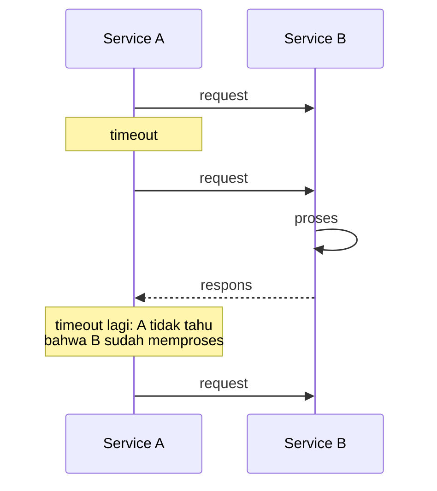
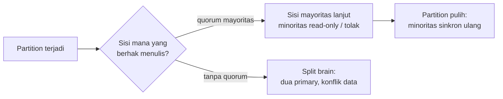

## Tujuan belajar

Setelah pelajaran ini kamu bisa:

- Menjelaskan kenapa **network tidak bisa dipercaya** dan apa konsekuensinya untuk retry, timeout, dan idempotency.
- Menempatkan model konsistensi (linearizable, sequential, causal, eventual) pada skala "kuat ↔ lemah" dan tahu harga masing-masing.
- Membedakan model kegagalan (crash-stop, crash-recovery, byzantine, gray failure) dan menyebut cara mendeteksi serta memulihkannya.

## Kenapa abstraksi ini penting

Setiap komponen di Bagian 2 (cache, queue, database terdistribusi) adalah jawaban atas tiga kenyataan yang sama: pesan bisa hilang, dua node bisa melihat urutan kejadian yang berbeda, dan node bisa mati kapan saja. Kalau tiga kenyataan ini sudah jelas, kamu bisa menurunkan sendiri kenapa Kafka butuh offset, kenapa Redis punya replica, dan kenapa semua API tulis butuh idempotency key.

## 1. Network: pesan bisa hilang, telat, atau ganda

Di satu proses, memanggil fungsi berarti fungsi itu dijalankan tepat sekali. Di antara dua mesin, mengirim request memberi **empat kemungkinan hasil** yang dari sisi pengirim terlihat sama:

Konsekuensi desain:

- **Timeout adalah tebakan**, bukan kepastian. Terlalu pendek → retry berlebihan dan failover palsu; terlalu panjang → user menunggu.
- **Retry hanya aman untuk operasi idempotent.** Untuk operasi non-idempotent (transfer uang, buat order), lampirkan _idempotency key_ agar penerima bisa mengenali duplikat.
- **Retry memperbesar beban** pada sistem yang sudah sakit. Pakai _exponential backoff + jitter_, batasi jumlah retry, dan _circuit breaker_ agar kegagalan tidak menjalar.
- **Clock tiap mesin berbeda.** Jangan mengurutkan kejadian lintas mesin berdasarkan timestamp wall-clock; gunakan nomor urut dari satu penulis (log offset, version number) atau logical clock.

Delapan asumsi keliru yang terkenal ("fallacies of distributed computing") bisa diringkas: network tidak reliabel, latency tidak nol, bandwidth terbatas, topologi berubah, dan ada lebih dari satu administrator.

## 2. Konsistensi: siapa melihat apa, kapan

Begitu data disalin ke lebih dari satu node (replikasi, cache), muncul pertanyaan: pembaca melihat versi yang mana? Model konsistensi adalah **kontrak** tentang itu.

| Model                 | Jaminan (bahasa manusia)                                                                            | Harga                                                                           | Contoh pemakaian                              |
| --------------------- | --------------------------------------------------------------------------------------------------- | ------------------------------------------------------------------------------- | --------------------------------------------- |
| Linearizable (strong) | Seolah hanya ada satu salinan; setelah tulis sukses, semua baca melihatnya                          | Latency tinggi, availability turun saat partition; butuh konsensus (Raft/Paxos) | Lock, leader election, saldo, stok terakhir   |
| Sequential            | Semua node melihat urutan operasi yang sama, tapi tidak harus "real-time"                           | Lebih murah dari linearizable                                                   | Log replikasi                                 |
| Causal                | Kejadian yang berhubungan sebab-akibat terlihat berurutan; yang tidak berhubungan boleh beda urutan | Butuh melacak dependensi (vector clock)                                         | Komentar balasan tampil setelah komentar asal |
| Read-your-writes      | Kamu selalu melihat tulisanmu sendiri                                                               | Routing ke primary / sticky session                                             | Edit profil lalu refresh                      |
| Monotonic reads       | Setelah melihat versi N, tidak akan melihat versi lebih lama                                        | Sticky replica per user                                                         | Timeline tidak "mundur"                       |
| Eventual              | Kalau tulisan berhenti, semua replica akhirnya sama                                                 | Paling murah, paling tersedia                                                   | Counter like, DNS, cache                      |

Pola praktis di interview: **pilih model terlemah yang masih benar untuk fitur itu**, lalu sebut cara memenuhinya. Saldo rekening butuh linearizable di satu partisi; jumlah like cukup eventual.

### CAP dan PACELC dalam satu paragraf

Saat network partition (P) terjadi, kamu harus memilih: tetap melayani di kedua sisi dengan risiko data berbeda (A), atau menolak sebagian request demi satu kebenaran (C). Partition tidak bisa dihindari, jadi pilihannya hanya A atau C **saat partition**. PACELC menambahkan: bahkan tanpa partition (E), ada trade-off latency (L) vs consistency (C), karena menunggu replika mengonfirmasi tulisan memakan waktu.

## 3. Kegagalan: apa yang bisa salah, dan bagaimana tahu

| Model kegagalan     | Perilaku                                                    | Deteksi                             | Pemulihan                                                    |
| ------------------- | ----------------------------------------------------------- | ----------------------------------- | ------------------------------------------------------------ |
| Crash-stop          | Node berhenti dan tidak kembali                             | Heartbeat / health check gagal      | Failover ke replica, ganti node                              |
| Crash-recovery      | Node mati lalu hidup lagi, memori hilang, disk mungkin utuh | Sama, plus cek state saat start     | Replay log (WAL), rejoin cluster                             |
| Omission / network  | Pesan hilang atau telat                                     | Timeout                             | Retry + idempotency                                          |
| Gray failure / slow | Node hidup tapi lambat atau separuh berfungsi               | Sulit: health check lulus, p99 naik | Outlier detection, lease, "fail fast"                        |
| Byzantine           | Node berbohong / rusak                                      | Sangat mahal (quorum 3f+1)          | Jarang diasumsikan di sistem internal; relevan di blockchain |

Dua jebakan klasik:

- **Split brain**: dua node sama-sama mengira dirinya primary setelah partition. Solusi: _lease_ berwaktu, _fencing token_ yang naik monoton, atau quorum mayoritas (n/2 + 1).
- **Failover berantai**: node sehat menerima beban dari node mati, ikut kewalahan, mati, dan seterusnya. Solusi: kapasitas cadangan (N+1), load shedding, circuit breaker.

## Trade-off yang akan selalu muncul

| Keputusan                   | Pilih "kuat" bila                                          | Pilih "lemah/tersedia" bila                                    |
| --------------------------- | ---------------------------------------------------------- | -------------------------------------------------------------- |
| Konsistensi tulis           | Kesalahan sementara tidak bisa diterima (uang, stok, lock) | Pengguna mentoleransi data basi beberapa detik (feed, counter) |
| Replikasi sinkron vs async  | Kehilangan tulisan terakhir tidak boleh terjadi            | Latency tulis lebih penting; replica boleh tertinggal          |
| Timeout pendek vs panjang   | Ingin gagal cepat dan ada fallback                         | Operasi memang lama dan retry mahal                            |
| Failover otomatis vs manual | Downtime detik-menit mahal, ada fencing                    | Risiko split brain lebih mahal daripada downtime               |

## Pertanyaan yang sering ditanya interviewer

- "Apa yang terjadi kalau request ini timeout?" → Jelaskan empat kemungkinan, lalu idempotency dan backoff.
- "Replica tertinggal 5 detik, apa dampaknya ke user?" → Sebutkan fitur mana yang butuh read-your-writes dan cara memenuhinya.
- "Kenapa butuh tiga node, bukan dua?" → Quorum mayoritas: dua node tidak bisa membedakan "rekan mati" dari "partition".
- "Bagaimana mendeteksi node yang lambat tapi belum mati?" → Health check berbasis latency/error rate, bukan hanya ping; lease yang kedaluwarsa.
- "Pilih CP atau AP untuk sistem ini?" → Jawab per fitur, bukan per sistem; sebagian besar sistem punya keduanya.

## Ringkasan

1. Network tidak bisa dipercaya: timeout bukan kepastian, retry butuh idempotency dan backoff, jangan andalkan wall-clock lintas mesin.
2. Konsistensi adalah kontrak berjenjang; pilih model terlemah yang masih benar untuk fitur itu, dan sebutkan cara memenuhinya.
3. Kegagalan datang dalam beberapa model; yang paling berbahaya adalah node lambat dan split brain, keduanya diatasi dengan lease, fencing, dan quorum.
