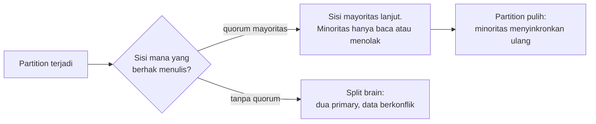

## Tujuan belajar

Setelah pelajaran ini kamu bisa:

- Menjelaskan kenapa jaringan tidak bisa dipercaya dan apa akibatnya untuk timeout, pengulangan request, dan idempotency.
- Menempatkan model konsistensi pada skala dari kuat sampai lemah, dan tahu harga masing-masing.
- Membedakan cara mesin gagal dan menyebut cara mendeteksi serta memulihkannya.

## Kenapa tiga abstraksi ini penting

Setiap komponen di Bagian 2 adalah jawaban atas tiga kenyataan yang sama. Pesan bisa hilang. Dua node bisa melihat urutan kejadian yang berbeda. Node bisa mati kapan saja. Kalau tiga kenyataan ini sudah jelas, kamu bisa menurunkan sendiri kenapa Kafka butuh offset, kenapa Redis punya replica, dan kenapa setiap API tulis butuh idempotency key.

Idempotent artinya operasi yang hasilnya sama walau dijalankan berkali-kali. Idempotency key adalah penanda unik yang dikirim client supaya server mengenali request yang diulang.

## 1. Jaringan: pesan bisa hilang, telat, atau ganda

Di dalam satu proses, memanggil fungsi berarti fungsi itu dijalankan tepat sekali. Di antara dua mesin, satu request punya empat kemungkinan hasil, dan dari sisi pengirim semuanya terlihat sama.

Akibatnya untuk desain:

- Timeout adalah tebakan, bukan kepastian. Terlalu pendek membuat sistem mengulang request yang masih diproses dan menganggap server mati padahal hanya lambat. Terlalu panjang membuat pengguna menunggu.
- Mengulang request hanya aman untuk operasi idempotent. Untuk operasi yang tidak idempotent, seperti transfer uang, lampirkan idempotency key agar penerima mengenali duplikat.
- Pengulangan memperbesar beban pada sistem yang sudah sakit. Beri jeda yang membesar dengan unsur acak, batasi jumlah pengulangan, dan pakai circuit breaker. Circuit breaker adalah saklar yang berhenti memanggil dependency yang terus gagal.
- Jam setiap mesin berbeda. Jangan mengurutkan kejadian lintas mesin berdasarkan jam dinding. Pakai nomor urut dari satu penulis, misalnya offset log atau nomor versi.

Delapan asumsi keliru yang terkenal, disebut "fallacies of distributed computing", bisa diringkas begini. Jaringan tidak andal, latency tidak nol, bandwidth terbatas, topologi berubah, dan ada lebih dari satu administrator.

## 2. Konsistensi: siapa melihat apa, dan kapan

Begitu data disalin ke lebih dari satu node, muncul pertanyaan: pembaca melihat versi yang mana? Model konsistensi adalah kontrak tentang itu.

| Model            | Jaminannya dalam bahasa sehari-hari                                                                 | Harganya                                                           | Contoh pemakaian                                 |
| ---------------- | --------------------------------------------------------------------------------------------------- | ------------------------------------------------------------------ | ------------------------------------------------ |
| Linearizable     | Seolah hanya ada satu salinan. Setelah tulis sukses, semua baca melihatnya                          | Latency tinggi, ketersediaan turun saat partition, butuh konsensus | Lock, pemilihan leader, saldo, stok terakhir     |
| Sequential       | Semua node melihat urutan operasi yang sama, tetapi tidak harus seketika                            | Lebih murah dari linearizable                                      | Log replikasi                                    |
| Causal           | Kejadian yang berhubungan sebab akibat terlihat berurutan. Yang tidak berhubungan boleh beda urutan | Butuh melacak hubungan antar kejadian                              | Balasan komentar tampil setelah komentar asalnya |
| Read-your-writes | Kamu selalu melihat tulisanmu sendiri                                                               | Baca dari primary atau sesi yang menempel ke satu replica          | Edit profil lalu refresh                         |
| Monotonic reads  | Setelah melihat versi baru, kamu tidak akan melihat versi lama                                      | Satu replica tetap per pengguna                                    | Timeline tidak "mundur"                          |
| Eventual         | Kalau tulisan berhenti, semua replica akhirnya sama                                                 | Paling murah, paling tersedia                                      | Jumlah like, DNS, cache                          |

Pola praktis di interview: pilih model paling lemah yang masih benar untuk fitur itu, lalu sebut cara memenuhinya. Saldo rekening butuh linearizable di satu partisi. Jumlah like cukup eventual.

### CAP dan PACELC dalam dua paragraf

Saat network partition terjadi, kamu harus memilih. Tetap melayani di kedua sisi dengan risiko data berbeda, itu pilihan A. Atau menolak sebagian request demi satu kebenaran, itu pilihan C. Partition tidak bisa dihindari, jadi pilihannya hanya A atau C saat partition.

PACELC menambahkan satu hal. Bahkan tanpa partition, ada trade-off antara latency dan konsistensi, karena menunggu replica mengonfirmasi tulisan memakan waktu.

## 3. Kegagalan: apa yang bisa salah, dan bagaimana kamu tahu

| Cara gagal     | Perilakunya                                                 | Cara mendeteksi                     | Cara memulihkan                                              |
| -------------- | ----------------------------------------------------------- | ----------------------------------- | ------------------------------------------------------------ |
| Crash-stop     | Node berhenti dan tidak kembali                             | Heartbeat atau health check gagal   | Failover ke replica, ganti node                              |
| Crash-recovery | Node mati lalu hidup lagi, memori hilang, disk mungkin utuh | Sama, ditambah cek state saat start | Putar ulang log, gabung kembali ke cluster                   |
| Pesan hilang   | Pesan hilang atau telat                                     | Timeout                             | Ulangi dengan idempotency                                    |
| Gray failure   | Node hidup tetapi lambat atau separuh berfungsi             | Sulit. Health check lolos, p99 naik | Deteksi pencilan, lease, gagal cepat                         |
| Byzantine      | Node berbohong atau rusak                                   | Sangat mahal                        | Jarang diasumsikan di sistem internal, relevan di blockchain |

Lease adalah izin berbatas waktu yang harus diperpanjang. Kalau pemegangnya mati, izin kedaluwarsa sendiri.

Dua jebakan klasik:

- Split brain: dua node sama-sama mengira dirinya primary setelah partition. Solusinya lease berwaktu, fencing token yang selalu naik, atau quorum mayoritas.
- Failover berantai: node sehat menerima beban dari node mati, ikut kewalahan, lalu mati juga. Solusinya kapasitas cadangan, menolak sebagian beban, dan circuit breaker.

## Trade-off yang akan selalu muncul

| Keputusan                     | Pilih yang kuat bila                                              | Pilih yang lemah atau lebih tersedia bila                                |
| ----------------------------- | ----------------------------------------------------------------- | ------------------------------------------------------------------------ |
| Konsistensi tulis             | Kesalahan sementara tidak bisa diterima, seperti uang, stok, lock | Pengguna mentoleransi data basi beberapa detik, seperti feed dan counter |
| Replikasi sinkron atau async  | Kehilangan tulisan terakhir tidak boleh terjadi                   | Latency tulis lebih penting dan replica boleh tertinggal                 |
| Timeout pendek atau panjang   | Ingin gagal cepat dan ada cadangan                                | Operasi memang lama dan pengulangan mahal                                |
| Failover otomatis atau manual | Downtime beberapa menit mahal dan ada fencing                     | Risiko split brain lebih mahal daripada downtime                         |

## Pertanyaan yang sering ditanya interviewer

- "Apa yang terjadi kalau request ini timeout?" Jelaskan empat kemungkinan, lalu idempotency dan jeda pengulangan.
- "Replica tertinggal 5 detik, apa dampaknya ke pengguna?" Sebutkan fitur mana yang butuh read-your-writes dan cara memenuhinya.
- "Kenapa butuh tiga node, bukan dua?" Dengan dua node, tidak ada yang bisa membedakan rekan mati dari partition. Mayoritas butuh tiga.
- "Bagaimana mendeteksi node yang lambat tetapi belum mati?" Health check berbasis latency dan tingkat error, bukan hanya ping, ditambah lease yang kedaluwarsa.
- "Pilih CP atau AP untuk sistem ini?" Jawab per fitur, bukan per sistem. Sebagian besar sistem punya keduanya.

## Ringkasan

1. Jaringan tidak bisa dipercaya. Timeout bukan kepastian, pengulangan butuh idempotency dan jeda, dan jam lintas mesin tidak bisa dipakai untuk mengurutkan.
2. Konsistensi adalah kontrak berjenjang. Pilih model paling lemah yang masih benar untuk fitur itu, lalu sebutkan cara memenuhinya.
3. Mesin gagal dengan beberapa cara. Yang paling berbahaya adalah node lambat dan split brain, dan keduanya diatasi dengan lease, fencing, dan quorum.
