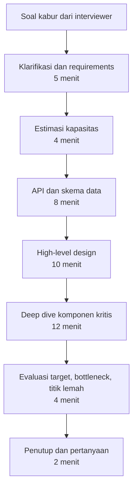

## Tujuan belajar

Setelah pelajaran ini kamu bisa:

- Menjelaskan apa yang dinilai dalam system design interview dan kenapa tidak ada satu jawaban benar.
- Membagi 45 menit ke dalam tahap dengan jatah waktu yang masuk akal.
- Mengenali sinyal yang membuat interviewer yakin, dan sinyal yang membuat mereka ragu.

## Interview ini bukan ujian arsitektur

Soalnya hampir selalu kabur: "rancang Twitter", "rancang sistem notifikasi". Kekaburan itu disengaja. Interviewer ingin melihat bagaimana kamu mengubah masalah terbuka menjadi sistem yang bisa dibangun. Mereka tidak menguji apakah kamu hafal arsitektur Twitter.

Ada lima hal yang dinilai, dengan bobot kurang lebih sama.

| Yang dinilai        | Yang dicari interviewer                                    | Bukti yang bisa kamu tunjukkan                                            |
| ------------------- | ---------------------------------------------------------- | ------------------------------------------------------------------------- |
| Pemahaman masalah   | Kamu bertanya sebelum merancang dan tahu mana yang penting | Daftar requirement, plus daftar hal yang sengaja kamu lewati              |
| Keputusan beralasan | Setiap komponen punya alasan dan alternatif                | Angka estimasi yang dipakai untuk memilih, dan tabel trade-off kecil      |
| Kedalaman teknis    | Kamu bisa turun ke detail komponen penting                 | Deep dive 2 sampai 3 komponen: cara kerja dalam, cara gagal, cara scaling |
| Komunikasi          | Interviewer selalu tahu kamu sedang di mana                | Cerita yang runtut, diagram yang diberi nama, rangkuman tiap tahap        |
| Manajemen waktu     | Kamu selesai dengan gambaran utuh                          | Tidak tenggelam di satu komponen, dan berani menyatakan asumsi untuk maju |

Akibatnya, dua kandidat dengan desain berbeda bisa sama-sama lulus. Sebaliknya, kandidat dengan desain "benar" bisa gagal kalau tidak bisa menjelaskan alasannya.

## Bentuk sesi yang umum

Pembagian waktu ini bukan aturan baku, tetapi dua kegagalan paling sering berkaitan dengan waktu. Pertama, menggambar sebelum bertanya. Kedua, tenggelam di deep dive pertama sehingga hampir separuh sistem tidak pernah dibahas. Rubrik di mode Mock Interview platform ini memakai pembagian yang sama.

Interviewer punya tiga peran. Mereka memberi batasan, misalnya "anggap ada 100 juta pengguna aktif harian". Mereka mengarahkan ke area yang ingin diuji, misalnya "bagaimana kalau region ini mati?". Mereka juga sesekali menantang keputusanmu. Tantangan bukan tanda kamu salah. Itu cara mereka mengukur kedalaman.

## Harapan menurut level

Ekspektasi berbeda menurut level yang kamu lamar.

| Level          | Yang sudah cukup                                                                                     | Yang membedakan                                        |
| -------------- | ---------------------------------------------------------------------------------------------------- | ------------------------------------------------------ |
| Junior dan mid | Memahami komponen dasar dan bisa merangkai alur dari awal sampai akhir dengan arahan                 | Bertanya requirement yang tepat                        |
| Senior         | Memimpin sesi, memakai estimasi untuk keputusan, deep dive mandiri, menyebut trade-off tanpa diminta | Mengenali cara sistem gagal dan cara mengoperasikannya |
| Staff ke atas  | Semua di atas, ditambah menimbang biaya, perubahan sistem ke depan, dan dampak ke organisasi         | Menolak kerumitan yang tidak perlu                     |

Sebagai backend engineer, kekuatanmu biasanya di deep dive: database, konsistensi, antrian, dan request yang aman diulang. Pastikan bagian gambaran besar tidak dikorbankan hanya karena kamu lebih nyaman di detail.

## Trade-off: cara menjalani sesi

| Pilihan                        | Kelebihan                                | Kekurangan                              | Saran                                                       |
| ------------------------------ | ---------------------------------------- | --------------------------------------- | ----------------------------------------------------------- |
| Lebar dulu, lalu dalam         | Interviewer cepat mendapat gambaran utuh | Bisa dangkal kalau waktu habis          | Jadikan default, lalu tanya bagian mana yang ingin didalami |
| Dalam dulu di komponen favorit | Menunjukkan keahlian                     | Terkesan tidak bisa melihat sistem utuh | Hanya bila interviewer memintanya                           |
| Banyak bertanya sepanjang sesi | Requirement akurat                       | Terkesan tidak bisa memutuskan          | Bertanya di awal, setelah itu nyatakan asumsi dan lanjut    |
| Menyebut teknologi spesifik    | Konkret                                  | Kamu akan ditanya cara kerja dalamnya   | Sebut hanya yang bisa kamu jelaskan                         |

## Pertanyaan yang sering ditanya interviewer

- "Apa yang ingin kamu klarifikasi dulu?" Ini undangan untuk bertanya. Jangan langsung menggambar.
- "Berapa skala yang kita bicarakan?" Kalau tidak diberi angka, usulkan asumsi dan minta konfirmasi.
- "Kenapa komponen ini?" Jawab dengan masalah yang diselesaikan, alternatifnya, dan alasan menolak alternatif itu.
- "Apa yang terjadi kalau komponen X mati?" Mereka menguji cara sistem gagal. Jawab dengan dampak ke pengguna, cara mendeteksi, dan cara memulihkan.
- "Kalau ada waktu lagi, apa yang kamu ubah?" Sebutkan bagian yang paling tidak kamu yakini. Kejujuran di sini dinilai positif.

## Ringkasan

1. Yang dinilai adalah prosesmu: memahami masalah, memutuskan dengan alasan, dan mengomunikasikannya, bukan kecocokan dengan kunci jawaban.
2. Bagi waktunya: klarifikasi, estimasi, API dan data, gambaran besar, deep dive, evaluasi. Dua kegagalan tersering adalah menggambar terlalu cepat dan tenggelam di satu komponen.
3. Setiap komponen yang kamu sebut harus bisa dijawab dengan "kenapa ini, bukan itu".
