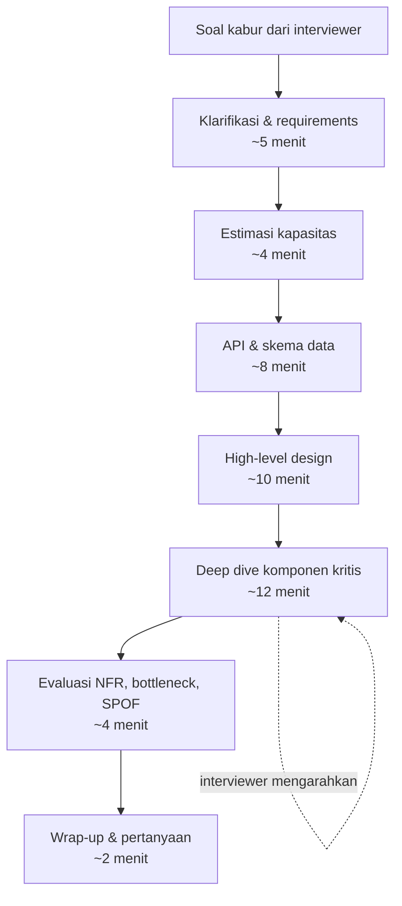

## Tujuan belajar

Setelah pelajaran ini kamu bisa:

- Menjelaskan apa yang **sebenarnya dinilai** dalam system design interview dan kenapa tidak ada "jawaban benar".
- Membagi 45 menit ke dalam tahap dengan anggaran waktu yang realistis.
- Mengenali sinyal yang membuat interviewer yakin, dan sinyal yang membuat mereka ragu.

## Interview ini bukan ujian arsitektur

Soalnya hampir selalu kabur: "rancang Twitter", "rancang sistem notifikasi". Kekaburan itu disengaja. Interviewer ingin melihat bagaimana kamu **mengubah masalah terbuka menjadi sistem yang bisa dibangun**, bukan apakah kamu hafal arsitektur Twitter.

Yang dinilai, kira-kira dengan bobot setara:

| Dimensi             | Yang dicari interviewer                                       | Bukti yang bisa kamu tunjukkan                                       |
| ------------------- | ------------------------------------------------------------- | -------------------------------------------------------------------- |
| Pemahaman masalah   | Bertanya sebelum merancang, membedakan yang penting dan tidak | Daftar functional/non-functional requirements + yang sengaja di-skip |
| Keputusan beralasan | Tiap komponen punya "kenapa" dan "apa alternatifnya"          | Angka estimasi yang dipakai untuk memilih; tabel trade-off kecil     |
| Kedalaman teknis    | Bisa turun ke detail komponen kritis                          | Deep dive 2-3 komponen: internal, failure mode, scaling              |
| Komunikasi          | Interviewer selalu tahu kamu sedang di mana                   | Narasi runtut, diagram yang diberi nama, rangkuman tiap tahap        |
| Manajemen waktu     | Selesai dengan gambaran utuh                                  | Tidak tenggelam di satu komponen; menyatakan asumsi untuk maju       |

Konsekuensinya: dua kandidat dengan desain berbeda bisa sama-sama lulus, dan kandidat dengan desain "benar" bisa gagal kalau tidak bisa menjelaskan kenapa.

## Bentuk sesi yang umum

Pembagian waktu ini bukan aturan, tapi dua pola kegagalan paling sering adalah **menggambar sebelum bertanya** dan **tenggelam di deep dive pertama** sehingga 40% sistem tidak pernah dibahas. Rubrik di mode Mock Interview platform ini memakai pembagian yang sama.

Peran interviewer: memberi batasan ("asumsikan 100 juta DAU"), mengarahkan ke area yang ingin mereka uji ("bagaimana kalau region ini mati?"), dan sesekali menantang keputusanmu. Tantangan bukan tanda kamu salah; itu cara mereka mengukur kedalaman.

## Level yang diharapkan

Ekspektasi berbeda menurut level yang dilamar:

| Level        | Yang cukup                                                                                           | Yang membedakan                                |
| ------------ | ---------------------------------------------------------------------------------------------------- | ---------------------------------------------- |
| Junior / mid | Memahami komponen dasar, bisa merangkai alur end-to-end dengan arahan                                | Bertanya requirement yang tepat                |
| Senior       | Memimpin sesi, estimasi dipakai untuk keputusan, deep dive mandiri, menyebut trade-off tanpa diminta | Mengenali failure mode dan cara operasionalnya |
| Staff+       | Semua di atas, plus menimbang biaya, evolusi sistem, dan dampak organisasi                           | Menolak kompleksitas yang tidak perlu          |

Sebagai backend engineer, keunggulanmu ada di deep dive: database, konsistensi, antrian, idempotency. Pastikan bagian high-level tidak dikorbankan karena terlalu nyaman di sana.

## Trade-off: cara menjalani sesi

| Pilihan                                       | Kelebihan                             | Kekurangan                                   | Saran                                                          |
| --------------------------------------------- | ------------------------------------- | -------------------------------------------- | -------------------------------------------------------------- |
| Lebar dulu (seluruh sistem), baru dalam       | Interviewer dapat gambaran utuh cepat | Risiko dangkal bila waktu habis              | Default: lebar dulu, lalu tanya "mau saya dalami bagian mana?" |
| Dalam dulu di komponen favorit                | Menunjukkan keahlian                  | Bisa dianggap tidak bisa melihat sistem utuh | Hanya bila interviewer memintanya                              |
| Banyak bertanya sepanjang sesi                | Requirement akurat                    | Terkesan tidak bisa memutuskan               | Tanya di awal; setelah itu nyatakan asumsi dan lanjut          |
| Memakai teknologi spesifik (Kafka, Cassandra) | Konkret                               | Akan ditanya internalnya                     | Sebut hanya yang bisa kamu jelaskan cara kerjanya              |

## Pertanyaan yang sering ditanya interviewer

- "Apa yang ingin kamu klarifikasi dulu?" → Ini undangan; jangan langsung menggambar.
- "Berapa skala yang kita bicarakan?" → Bila tidak diberi, usulkan asumsi dan minta konfirmasi.
- "Kenapa komponen ini?" → Jawab dengan masalah yang diselesaikan, alternatif, dan alasan menolaknya.
- "Apa yang terjadi kalau X mati?" → Mereka menguji failure mode; jawab dengan dampak ke user, deteksi, dan pemulihan.
- "Kalau ada waktu lagi, apa yang kamu ubah?" → Sebutkan bagian yang paling kamu tidak yakin; kejujuran dinilai positif.

## Ringkasan

1. Yang dinilai adalah proses: memahami masalah, memutuskan dengan alasan, dan mengomunikasikannya; bukan kecocokan dengan kunci jawaban.
2. Anggaran waktu: klarifikasi → estimasi → API/data → high-level → deep dive → evaluasi; dua kegagalan tersering adalah menggambar terlalu cepat dan tenggelam di satu komponen.
3. Setiap komponen yang kamu sebut harus bisa dijawab dengan "kenapa ini, bukan itu".
