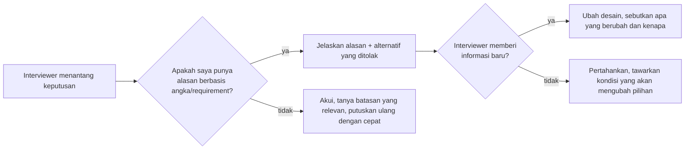

## Tujuan belajar

Setelah pelajaran ini kamu bisa:

- Membedakan kebiasaan yang membuat sesi **mengalir** dari yang membuatnya **tersendat**.
- Merespons tantangan interviewer tanpa menyerah dan tanpa ngotot.
- Memakai beberapa kalimat siap pakai untuk pindah tahap, menyatakan asumsi, dan mengakui batas pengetahuan.

## Do

**Sebelum menggambar**

- Ulangi soal dengan kata-katamu sendiri, lalu tanya 3-5 pertanyaan klarifikasi: siapa user, fitur inti, skala, latency yang dapat diterima, konsistensi vs availability.
- Tulis requirements di papan, termasuk yang **sengaja di-skip**. Interviewer tidak bisa menuduhmu lupa kalau kamu menulis "out of scope".
- Tulis agenda tahap di sudut papan dan coret saat selesai.

**Saat merancang**

- Bicara sambil menggambar. Beri nama tiap kotak dan panah.
- Jelaskan **satu alur baca dan satu alur tulis** end-to-end sebelum deep dive.
- Kaitkan tiap keputusan dengan angka: "4.000 QPS baca dan 40 tulis, jadi cache dulu sebelum read replica."
- Sebut alternatif yang ditolak: "bisa juga X, tapi Y lebih cocok karena Z."

**Saat ditantang**

- Anggap tantangan sebagai pertanyaan, bukan vonis. Jawab dengan data; kalau interviewer memberi informasi baru, ubah desain dan katakan kenapa.
- Jujur pada batas pengetahuan: "Saya tahu polanya, tapi belum pernah mengoperasikan ini di produksi."

## Don't

- **Jangan menggambar sebelum bertanya.** Sistem yang rapi untuk masalah yang salah tidak dinilai.
- **Jangan diam lama.** Interviewer tidak bisa mengarahkan atau memberi kredit untuk pikiran yang tidak diucapkan.
- **Jangan name-dropping.** Setiap teknologi yang disebut adalah undangan untuk ditanya internalnya.
- **Jangan over-engineer.** Multi-region aktif-aktif untuk aplikasi 1.000 user adalah sinyal negatif; mulailah sederhana, lalu tunjukkan jalur scale.
- **Jangan tenggelam di satu komponen.** Setelah ~10 menit deep dive, tanyakan "mau saya lanjut ke bagian lain atau dalami ini lebih jauh?"
- **Jangan mengabaikan failure mode.** Tiap komponen baru: apa yang terjadi kalau ini mati, lambat, atau mengembalikan data basi?
- **Jangan berdebat untuk menang.** Kolaborasi adalah sebagian dari penilaian.

## Pola respons saat ditantang

## Kalimat siap pakai

| Situasi           | Kalimat                                                                                                             |
| ----------------- | ------------------------------------------------------------------------------------------------------------------- |
| Pindah tahap      | "Saya kunci requirements ini dulu; kalau ada yang berubah, kita kembali. Sekarang estimasi."                        |
| Menyatakan asumsi | "Saya asumsikan 10 juta DAU dan rasio baca 100:1. Kalau asumsinya beda, bilang saja."                               |
| Menolak scope     | "Analytics saya keluarkan dari scope supaya kita fokus ke jalur utama; bisa dibahas di akhir kalau ada waktu."      |
| Batas pengetahuan | "Saya belum pernah mengoperasikan ini, tapi polanya adalah ... ; yang penting di sini adalah ..."                   |
| Menawarkan arah   | "Ada tiga bagian yang bisa didalami: key generation, cache, atau failover DB. Mana yang paling menarik untuk Anda?" |
| Menutup           | "Kalau ada waktu lagi, yang paling saya khawatirkan adalah ... karena ..."                                          |

## Trade-off: seberapa detail?

| Pilihan                                                     | Kelebihan                 | Kekurangan                     | Kapan                                        |
| ----------------------------------------------------------- | ------------------------- | ------------------------------ | -------------------------------------------- |
| Sangat detail di awal (tiap endpoint, tiap kolom)           | Terlihat teliti           | Habis waktu sebelum high-level | Hindari; detail secukupnya untuk melanjutkan |
| Abstrak terus ("ada service, ada DB")                       | Cepat                     | Tidak ada bukti kedalaman      | Hindari; pilih 2-3 titik untuk dalam         |
| Lebar dulu, dalam di titik yang dipilih bersama interviewer | Gambaran utuh + kedalaman | Butuh disiplin waktu           | Default                                      |

## Pertanyaan yang sering ditanya interviewer

- "Kenapa tidak pakai X saja?" → Jelaskan kondisi di mana X lebih baik dan kenapa kondisi itu tidak berlaku di sini.
- "Bagaimana kamu tahu angkanya segitu?" → Sebutkan asumsi dan cara menghitungnya; akui bila itu tebakan terdidik.
- "Apa kelemahan desainmu?" → Selalu siapkan satu; menjawab "tidak ada" adalah sinyal negatif.
- "Kalau saya minta disederhanakan, apa yang kamu buang dulu?" → Menguji apakah kamu tahu komponen mana yang esensial.

## Ringkasan

1. Do: bertanya dulu, bicara sambil menggambar, kaitkan keputusan dengan angka, sebut alternatif dan failure mode.
2. Don't: menggambar sebelum bertanya, diam, name-dropping, over-engineering, tenggelam di satu komponen, berdebat untuk menang.
3. Saat ditantang: jawab dengan data, ubah desain bila ada informasi baru, dan jujur pada batas pengetahuan.
