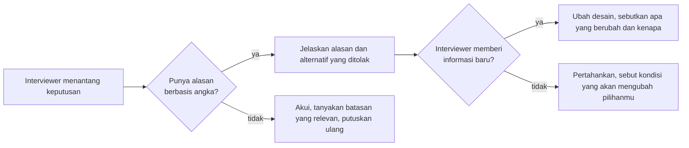

## Tujuan belajar

Setelah pelajaran ini kamu bisa:

- Membedakan kebiasaan yang membuat sesi mengalir dari kebiasaan yang membuatnya tersendat.
- Merespons tantangan interviewer tanpa menyerah dan tanpa ngotot.
- Memakai kalimat siap pakai untuk pindah tahap, menyatakan asumsi, dan mengakui batas pengetahuan.

## Yang sebaiknya kamu lakukan

Sebelum menggambar:

- Ulangi soal dengan kata-katamu sendiri. Lalu ajukan 3 sampai 5 pertanyaan: siapa penggunanya, apa fitur intinya, berapa skalanya, berapa latency yang bisa diterima, dan mana yang lebih penting antara konsistensi atau ketersediaan.
- Tulis requirements di papan, termasuk yang sengaja kamu lewati. Interviewer tidak bisa menuduhmu lupa kalau kamu menulis "di luar cakupan".
- Tulis agenda tahap di sudut papan dan coret saat selesai.

Saat merancang:

- Bicara sambil menggambar. Beri nama setiap kotak dan panah.
- Jelaskan satu alur baca dan satu alur tulis dari awal sampai akhir sebelum masuk deep dive.
- Kaitkan setiap keputusan dengan angka. Contoh: "Ada 4.000 request baca per detik dan 40 tulis, jadi cache dulu sebelum read replica."
- Sebut alternatif yang kamu tolak. Contoh: "Bisa juga pakai X, tetapi Y lebih cocok karena Z."

Saat ditantang:

- Anggap tantangan sebagai pertanyaan, bukan vonis. Jawab dengan data. Kalau interviewer memberi informasi baru, ubah desain dan katakan kenapa.
- Jujur tentang batas pengetahuan. Contoh: "Saya tahu polanya, tetapi belum pernah mengoperasikannya di produksi."

## Yang sebaiknya kamu hindari

- Jangan menggambar sebelum bertanya. Sistem yang rapi untuk masalah yang salah tidak dinilai.
- Jangan diam lama. Interviewer tidak bisa mengarahkan atau memberi nilai untuk pikiran yang tidak diucapkan.
- Jangan menyebut teknologi hanya untuk terdengar hebat. Setiap teknologi yang kamu sebut adalah undangan untuk ditanya cara kerja dalamnya.
- Jangan merancang berlebihan. Arsitektur multi-region untuk aplikasi 1.000 pengguna adalah sinyal negatif. Mulai sederhana, lalu tunjukkan jalur untuk tumbuh.
- Jangan tenggelam di satu komponen. Setelah sekitar 10 menit deep dive, tanyakan apakah interviewer ingin lanjut ke bagian lain.
- Jangan mengabaikan cara sistem gagal. Untuk setiap komponen baru, tanyakan: apa yang terjadi kalau ini mati, lambat, atau mengembalikan data lama?
- Jangan berdebat untuk menang. Kolaborasi adalah bagian dari penilaian.

## Cara merespons saat ditantang

## Kalimat siap pakai

| Situasi           | Kalimat                                                                                                                  |
| ----------------- | ------------------------------------------------------------------------------------------------------------------------ |
| Pindah tahap      | "Saya kunci requirements ini dulu. Kalau ada yang berubah, kita kembali. Sekarang estimasi."                             |
| Menyatakan asumsi | "Saya asumsikan 10 juta pengguna aktif harian dan rasio baca 100 banding 1. Kalau asumsinya beda, tolong koreksi."       |
| Menolak cakupan   | "Analytics saya keluarkan dari cakupan supaya kita fokus ke jalur utama. Bisa dibahas di akhir kalau ada waktu."         |
| Batas pengetahuan | "Saya belum pernah mengoperasikan ini, tetapi polanya begini. Yang penting di sini adalah ini."                          |
| Menawarkan arah   | "Ada tiga bagian yang bisa didalami: pembuatan key, cache, atau failover database. Mana yang paling menarik untuk Anda?" |
| Menutup           | "Kalau ada waktu lagi, yang paling saya khawatirkan adalah bagian ini, karena alasan ini."                               |

## Trade-off: seberapa detail?

| Pilihan                                    | Kelebihan                   | Kekurangan                         | Kapan                                          |
| ------------------------------------------ | --------------------------- | ---------------------------------- | ---------------------------------------------- |
| Sangat detail sejak awal                   | Terlihat teliti             | Waktu habis sebelum gambaran besar | Hindari. Detail secukupnya untuk melanjutkan   |
| Abstrak terus                              | Cepat                       | Tidak ada bukti kedalaman          | Hindari. Pilih 2 sampai 3 titik untuk didalami |
| Lebar dulu, dalam di titik yang disepakati | Gambaran utuh dan kedalaman | Butuh disiplin waktu               | Jadikan default                                |

## Pertanyaan yang sering ditanya interviewer

- "Kenapa tidak pakai X saja?" Jelaskan kondisi saat X lebih baik, dan kenapa kondisi itu tidak berlaku di sini.
- "Dari mana angka itu?" Sebutkan asumsi dan cara menghitungnya. Akui kalau itu tebakan terdidik.
- "Apa kelemahan desainmu?" Selalu siapkan satu. Menjawab "tidak ada" adalah sinyal negatif.
- "Kalau saya minta disederhanakan, apa yang kamu buang dulu?" Ini menguji apakah kamu tahu komponen mana yang esensial.

## Ringkasan

1. Lakukan: bertanya dulu, bicara sambil menggambar, kaitkan keputusan dengan angka, sebut alternatif dan cara gagalnya.
2. Hindari: menggambar sebelum bertanya, diam, menyebut teknologi tanpa alasan, merancang berlebihan, tenggelam di satu komponen, berdebat untuk menang.
3. Saat ditantang: jawab dengan data, ubah desain bila ada informasi baru, dan jujur tentang batas pengetahuanmu.
