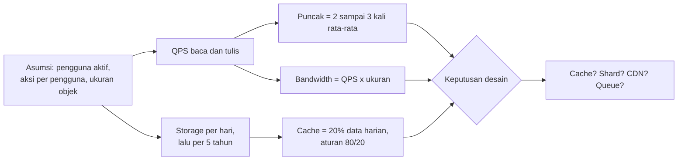

## Tujuan belajar

Setelah pelajaran ini kamu bisa:

- Menghitung QPS baca dan tulis, storage, bandwidth, dan ukuran cache sebuah sistem dalam 3 sampai 5 menit.
- Menghafal orde besaran latency dan memakainya untuk menolak desain yang tidak masuk akal.
- Menjelaskan ke interviewer kenapa sebuah angka mengubah keputusan desain.

## Kenapa estimasi penting

Interviewer tidak peduli apakah jawabannya 578 atau 600 QPS. QPS adalah jumlah query per detik. Mereka peduli apakah kamu tahu bahwa 600 QPS bisa dilayani satu database, sedangkan 60.000 QPS tidak. Estimasi adalah jembatan antara requirements dan arsitektur. Tanpa angka, setiap kotak di diagram hanyalah tebakan.

Prinsipnya tiga:

1. Bulatkan dengan berani. Satu hari adalah 86.400 detik, bulatkan menjadi 100 ribu. Satu juta kira-kira sama dengan 2 pangkat 20. Dua digit sudah cukup.
2. Tulis asumsinya. "Saya asumsikan 100 juta pengguna aktif harian, tiap pengguna 10 request per hari" lebih berharga daripada angka ajaib.
3. Pakai hasilnya. Setiap angka harus berujung pada keputusan. Perlu cache? Perlu shard? Perlu CDN?

## Angka yang harus kamu hafal

### Pangkat dua

| Pangkat      | Nilai             | Nama |
| ------------ | ----------------- | ---- |
| 2 pangkat 10 | sekitar 1 ribu    | KB   |
| 2 pangkat 20 | sekitar 1 juta    | MB   |
| 2 pangkat 30 | sekitar 1 miliar  | GB   |
| 2 pangkat 40 | sekitar 1 triliun | TB   |

### Berapa lama tiap operasi

| Operasi                         | Waktu          | Akibatnya untuk desain                            |
| ------------------------------- | -------------- | ------------------------------------------------- |
| Cache L1 di prosesor            | sekitar 1 ns   | Hampir gratis                                     |
| Memori utama                    | sekitar 100 ns | Cache di memori sangat murah                      |
| Baca acak dari SSD              | sekitar 100 µs | 1.000 kali lebih lambat dari memori               |
| Bolak-balik di dalam datacenter | sekitar 0.5 ms | Setiap hop antar service menambah 0.5 ms          |
| Seek harddisk                   | sekitar 10 ms  | Hindari akses acak ke disk                        |
| Bolak-balik antar benua         | sekitar 150 ms | Tidak bisa dipercepat, hanya dihindari dengan CDN |

Cara mengingatnya: setiap turun satu tingkat, dari memori ke SSD, ke harddisk, ke jaringan lintas benua, waktunya naik 100 sampai 1.000 kali.

### Waktu dan konversi

- Satu hari sekitar 100 ribu detik.
- Satu juta request per hari berarti sekitar 12 QPS. Seratus juta per hari berarti sekitar 1.200 QPS.
- Puncak biasanya 2 sampai 3 kali rata-rata.
- Lima tahun sekitar 2.000 hari.

## Alur estimasi

## Contoh: layanan berbagi foto

Asumsi yang kita tulis di papan:

- 10 juta pengguna aktif harian.
- Setiap pengguna melihat 20 foto per hari dan mengunggah 0.2 foto per hari. Rasio baca dan tulis 100 banding 1.
- Ukuran foto rata-rata 500 KB, metadata 1 KB.

QPS:

- Baca: 10 juta kali 20 adalah 200 juta per hari. Dibagi 100 ribu detik, hasilnya 2.000 QPS. Puncak sekitar 6.000 QPS.
- Tulis: 10 juta kali 0.2 adalah 2 juta per hari, atau 20 QPS. Puncak sekitar 60 QPS.

Storage:

- Foto: 2 juta kali 500 KB adalah 1 TB per hari. Lima tahun berarti sekitar 2 PB.
- Metadata: 2 juta kali 1 KB adalah 2 GB per hari. Lima tahun berarti sekitar 4 TB.

Bandwidth:

- Keluar: 2.000 QPS kali 500 KB adalah sekitar 1 GB per detik. Angka ini langsung memaksa CDN masuk ke desain.
- Masuk: 20 QPS kali 500 KB adalah 10 MB per detik. Kecil.

Cache:

- Aturan 80/20 mengatakan 20% foto yang diakses hari ini menghasilkan 80% trafik.
- Data yang dibaca per hari adalah 200 juta kali 500 KB, yaitu 100 TB. Dua puluh persennya 20 TB.
- Itu terlalu besar untuk memori, jadi cache foto ditaruh di CDN. Cache metadata cukup di Redis, karena 20% dari beberapa GB masih kecil.

Perhatikan bagaimana setiap angka menghasilkan keputusan. Bandwidth membawa kita ke CDN. Storage dalam PB membawa kita ke blob store, bukan database. Tulis 20 QPS berarti satu database primary cukup. Baca metadata 2.000 QPS berarti cache dan read replica.

## Trade-off saat mengestimasi

| Pilihan                        | Kelebihan                        | Kekurangan                          | Kapan dipakai                                         |
| ------------------------------ | -------------------------------- | ----------------------------------- | ----------------------------------------------------- |
| Asumsi dari interviewer        | Akurat untuk konteks mereka      | Butuh waktu bertanya                | Selalu tanya dulu. Kalau tidak diberi, buat sendiri   |
| Bulatkan ke pangkat 10         | Cepat dan mudah dicek            | Bisa meleset 2 sampai 3 kali        | Hampir selalu. Cukup untuk memilih komponen           |
| Hitung puncak secara eksplisit | Desain lebih aman                | Bisa menyediakan kapasitas berlebih | Saat ada pola trafik jelas, misalnya jam makan siang  |
| Estimasi detail per komponen   | Menemukan bottleneck tersembunyi | Memakan waktu interview             | Hanya untuk 1 sampai 2 komponen kritis saat deep dive |

## Pertanyaan yang sering ditanya interviewer

- "Berapa QPS-nya? Apakah satu database cukup?" Hitung, lalu bandingkan dengan kapasitas kasar. Satu primary SQL sanggup ribuan tulis per detik dan puluhan ribu baca per detik dengan cache.
- "Berapa storage untuk 5 tahun, dan di mana disimpan?" Objek besar ke blob store, metadata ke database.
- "Berapa besar cache yang kamu butuhkan?" Dua puluh persen dari data harian. Sebut apakah muat di memori satu node atau perlu cluster.
- "Kalau pengguna naik 10 kali, bagian mana yang pecah duluan?" Ulangi hitungan untuk komponen dengan margin paling tipis.
- "Angkamu meleset 5 kali, apa yang berubah di desain?" Jawab jujur. Sebagian besar keputusan bertahan sampai meleset satu tingkat.

## Ringkasan

1. Estimasi adalah alat pengambil keputusan, bukan ujian berhitung. Setiap angka harus berujung pada "jadi kita butuh X".
2. Hafal orde besarannya: satu hari sekitar 100 ribu detik, memori 100 ns, SSD 100 µs, bolak-balik datacenter 0.5 ms, lintas benua 150 ms.
3. Urutannya tetap: asumsi, lalu QPS baca dan tulis beserta puncaknya, lalu storage, lalu bandwidth, lalu cache. Rujuk angkanya lagi saat menggambar desain.
