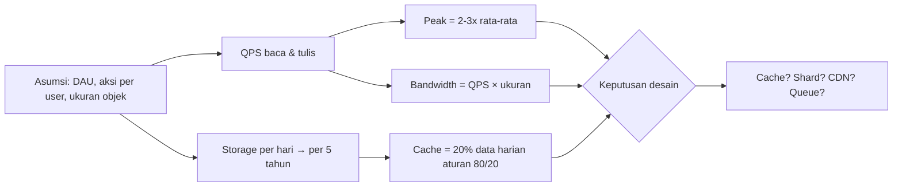

## Tujuan belajar

Setelah pelajaran ini kamu bisa:

- Menghitung **QPS** (baca & tulis), **storage**, **bandwidth**, dan **ukuran cache** sebuah sistem dalam 3-5 menit.
- Menghafal orde besaran _latency numbers_ dan memakainya untuk menolak desain yang tidak masuk akal.
- Menjelaskan ke interviewer _kenapa_ sebuah angka mengubah keputusan desain.

## Kenapa estimasi penting

Interviewer tidak peduli apakah jawabannya 578 QPS atau 600 QPS. Mereka peduli apakah kamu tahu bahwa 600 QPS **bisa dilayani satu database**, sedangkan 60.000 QPS **tidak**. Estimasi adalah jembatan antara requirements dan arsitektur: tanpa angka, setiap kotak di diagram hanyalah tebakan.

Prinsipnya tiga:

1. **Bulatkan agresif.** 86.400 detik/hari ≈ 10^5. 1 juta ≈ 2^20. Dua digit signifikan sudah cukup.
2. **Tulis asumsinya.** "Saya asumsikan 100 juta DAU, tiap user 10 request/hari" lebih berharga daripada angka ajaib.
3. **Pakai hasilnya.** Setiap angka harus berujung pada keputusan: perlu cache? perlu shard? perlu CDN?

## Angka yang harus hafal

### Pangkat dua

| Pangkat | Nilai      | Nama |
| ------- | ---------- | ---- |
| 2^10    | ~1 ribu    | KB   |
| 2^20    | ~1 juta    | MB   |
| 2^30    | ~1 miliar  | GB   |
| 2^40    | ~1 triliun | TB   |

### Latency numbers (orde besaran)

| Operasi                     | Waktu   | Implikasi desain                                  |
| --------------------------- | ------- | ------------------------------------------------- |
| L1 cache                    | ~1 ns   | —                                                 |
| Main memory                 | ~100 ns | In-memory cache sangat murah                      |
| SSD random read             | ~100 µs | 1.000x lebih lambat dari RAM                      |
| Round trip dalam datacenter | ~0.5 ms | Setiap hop service menambah 0.5 ms                |
| HDD seek                    | ~10 ms  | Hindari random I/O di disk                        |
| Round trip antar benua      | ~150 ms | Tidak bisa dipercepat, hanya dihindari (CDN/edge) |

Cara mengingat: tiap turun satu "tingkat" (RAM → SSD → HDD → network lintas benua) kira-kira **100-1.000x lebih lambat**.

### Waktu dan konversi

- 1 hari ≈ 86.400 s ≈ **10^5 s**
- 1 juta request/hari ≈ **12 QPS**; 100 juta/hari ≈ 1.200 QPS
- Peak ≈ **2-3x** rata-rata
- 5 tahun ≈ **2.000 hari**

## Alur estimasi

## Contoh: layanan berbagi foto

Asumsi yang kita tulis di papan:

- 10 juta **DAU**
- Tiap user melihat 20 foto/hari, mengunggah 0.2 foto/hari (rasio baca:tulis = 100:1)
- Ukuran foto rata-rata 500 KB, metadata 1 KB

**QPS**

- Baca: 10M × 20 = 200M/hari ÷ 10^5 ≈ **2.000 QPS**, peak ≈ 6.000 QPS
- Tulis: 10M × 0.2 = 2M/hari ÷ 10^5 ≈ **20 QPS**, peak ≈ 60 QPS

**Storage**

- Foto: 2M × 500 KB = 1 TB/hari → 5 tahun ≈ **2 PB**
- Metadata: 2M × 1 KB = 2 GB/hari → 5 tahun ≈ 4 TB

**Bandwidth**

- Keluar: 2.000 QPS × 500 KB ≈ **1 GB/s** (8 Gbps). Ini angka yang langsung memaksa CDN masuk ke desain.
- Masuk: 20 QPS × 500 KB ≈ 10 MB/s, kecil.

**Cache**

- Aturan 80/20: 20% foto yang diakses hari ini menghasilkan 80% trafik. Data yang dibaca per hari = 200M × 500 KB = 100 TB; 20%-nya = 20 TB. Terlalu besar untuk RAM, jadi cache foto ditaruh di **CDN**, sedangkan cache metadata (20% × 2 GB × beberapa hari) cukup di Redis.

Perhatikan bagaimana tiap angka menghasilkan keputusan: bandwidth → CDN; storage PB → blob store, bukan database; write 20 QPS → satu database primary cukup; read metadata 2.000 QPS → cache + read replica.

## Trade-off saat mengestimasi

| Pilihan                      | Kelebihan                        | Kekurangan            | Kapan dipakai                                       |
| ---------------------------- | -------------------------------- | --------------------- | --------------------------------------------------- |
| Asumsi dari interviewer      | Akurat untuk konteks mereka      | Butuh waktu bertanya  | Selalu tanya dulu; kalau tidak diberi, buat sendiri |
| Bulatkan ke pangkat 10       | Cepat, mudah dicek               | Bisa meleset 2-3x     | Hampir selalu; cukup untuk memilih komponen         |
| Hitung peak secara eksplisit | Desain lebih aman                | Bisa over-provision   | Saat ada pola trafik jelas (jam makan siang, event) |
| Estimasi detail per komponen | Menemukan bottleneck tersembunyi | Makan waktu interview | Hanya untuk 1-2 komponen kritis di deep dive        |

## Pertanyaan yang sering ditanya interviewer

- "Berapa QPS-nya? Apakah satu database cukup?" → Hitung, lalu bandingkan dengan kapasitas kasar: satu primary SQL ~ribuan write/s; read puluhan ribu/s dengan cache.
- "Berapa storage untuk 5 tahun, dan di mana disimpan?" → Objek besar ke blob store, metadata ke DB.
- "Berapa besar cache yang kamu butuhkan?" → 20% dari data harian; sebut apakah muat di RAM satu node atau perlu cluster.
- "Kalau user naik 10x, bagian mana yang pecah duluan?" → Ulangi hitungan untuk komponen dengan margin paling tipis.
- "Angka kamu meleset 5x, apa yang berubah di desain?" → Jawab jujur: sebagian besar keputusan bertahan sampai meleset satu orde.

## Ringkasan

1. Estimasi adalah alat pengambil keputusan, bukan ujian aritmetika: setiap angka harus berujung pada "jadi kita butuh X".
2. Hafal orde besaran: 1 hari ≈ 10^5 detik, RAM 100 ns, SSD 100 µs, RTT datacenter 0.5 ms, lintas benua 150 ms.
3. Urutan tetap: asumsi → QPS (baca/tulis, peak) → storage → bandwidth → cache (80/20), lalu rujuk angkanya lagi di high-level design.
