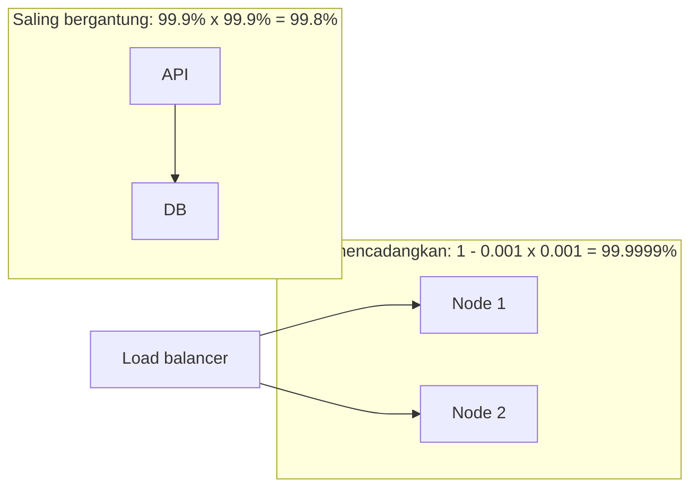

## Tujuan belajar

Setelah pelajaran ini kamu bisa:

- Mendefinisikan availability, reliability, scalability, maintainability, dan fault tolerance dengan ukuran yang bisa ditulis sebagai target.
- Menghitung availability gabungan untuk komponen yang saling bergantung dan komponen cadangan, lalu menerjemahkan angka sembilan ke menit downtime.
- Menjelaskan kenapa latency harus ditarget sebagai persentil, dan apa harga setiap kenaikan target.

## Kenapa target non-fungsional menentukan arsitektur

Dua sistem dengan fitur identik bisa punya arsitektur sangat berbeda hanya karena satu menargetkan 99.9% dan yang lain 99.99%. Functional requirement menentukan apa yang dibangun. Non-functional requirement, sering disingkat NFR, menentukan bagaimana membangunnya dan seberapa mahal. Di interview, NFR yang kamu tulis di awal menjadi alat ukur yang dipakai lagi di tahap evaluasi.

## Availability: bisa diakses

Availability adalah bagian waktu, atau bagian request, saat sistem melayani dengan sukses.

| Target  | Downtime per tahun | Downtime per bulan | Yang biasanya dibutuhkan                                         |
| ------- | ------------------ | ------------------ | ---------------------------------------------------------------- |
| 99%     | 3.65 hari          | 7.3 jam            | Satu server dan restart manual                                   |
| 99.9%   | 8.8 jam            | 44 menit           | Redundansi, failover setengah otomatis, tim on-call              |
| 99.99%  | 53 menit           | 4.4 menit          | Failover otomatis dalam detik, beberapa zona, deploy bertahap    |
| 99.999% | 5.3 menit          | 26 detik           | Beberapa region aktif bersamaan, hampir tanpa perubahan berisiko |

Cara menghitung gabungannya:

- Komponen yang saling bergantung dikalikan. Tiga service 99.9% yang dirangkai menghasilkan sekitar 99.7%. Setiap dependency menurunkan availability, jadi kurangi jumlah hop atau beri cadangan seperti cache dan nilai default.
- Komponen cadangan yang cukup salah satunya hidup dihitung dengan rumus 1 dikurangi hasil kali peluang gagalnya. Dua node 99% yang saling mencadangkan menghasilkan sekitar 99.99%.

Availability juga bisa diukur dari sisi request. Target "99.9% request sukses dalam 30 hari" lebih bermakna daripada "server hidup 99.9%", karena server yang hidup pun bisa mengembalikan error.

## Reliability: melakukan hal yang benar

Sistem yang hidup tetapi salah tidak reliable. Contohnya mengembalikan data basi melewati batas, kehilangan tulisan, atau menghitung dua kali. Ukuran yang lazim adalah tingkat error, rata-rata waktu antar kegagalan, rata-rata waktu pemulihan, dan durability. Durability adalah peluang data tidak hilang. Object storage besar mengklaim durability sebelas angka sembilan.

Reliability dibangun dari validasi input, operasi yang aman diulang, transaksi di batas yang tepat, pengujian, dan pemantauan yang membuat kesalahan cepat terlihat.

## Scalability: beban bertambah tanpa sakit bertambah

Scalability adalah kemampuan menangani pertumbuhan beban dengan menambah sumber daya secara sebanding. Beban bisa berupa jumlah request, ukuran data, atau jumlah pengguna.

| Arah                       | Caranya                   | Batasnya                                                                         |
| -------------------------- | ------------------------- | -------------------------------------------------------------------------------- |
| Vertikal, atau scale up    | Memakai mesin lebih besar | Harga naik lebih cepat dari kapasitas, ada plafon, dan tetap satu titik gagal    |
| Horizontal, atau scale out | Menambah jumlah mesin     | Service harus stateless, data harus dipartisi, dan koordinasi menambah kerumitan |

Pertanyaan yang membedakan kandidat: komponen mana yang pecah duluan kalau trafik naik 10 kali? Jawabannya biasanya database untuk tulis, atau komponen lain yang menyimpan state. Jalur scaling yang lazim: service stateless di belakang load balancer, lalu cache, lalu read replica, lalu partisi data, lalu memindahkan pekerjaan berat ke queue.

## Latency: ukur ekornya

Target latency selalu dinyatakan sebagai persentil seperti p50, p95, atau p99, bukan rata-rata. Alasannya, satu halaman memanggil puluhan backend. Pengguna hampir pasti merasakan request yang terlambat dari salah satunya. Ekor biasanya berasal dari jeda garbage collector, perebutan lock, query lambat, atau node yang setengah sakit. Obatnya antara lain mengirim request cadangan bila yang pertama lambat, timeout per hop, dan membatasi jumlah panggilan paralel.

## Maintainability: murah diubah

Tiga sisinya yang sering dipakai:

- Operability: mudah dijalankan, dengan pemantauan, deploy, dan panduan penanganan insiden.
- Simplicity: abstraksi yang menyembunyikan kerumitan, bukan menambahnya.
- Evolvability: mudah diubah saat kebutuhan berubah, lewat skema yang bisa berevolusi dan API berversi.

Di interview, ini muncul sebagai pertanyaan "bagaimana kamu mengubah skema data ini nanti?" dan "bagaimana kamu men-deploy tanpa downtime?".

## Fault tolerance: tetap berjalan saat sebagian rusak

Fault tolerance berbeda dari "tidak pernah gagal". Sistem mengantisipasi kegagalan komponen dan terus melayani, mungkin dengan kemampuan berkurang. Alatnya:

- Redundansi, misalnya satu node cadangan dan beberapa zona, ditambah failover otomatis.
- Isolasi, supaya kegagalan satu fitur tidak menjatuhkan fitur lain.
- Degradasi yang anggun, misalnya menampilkan feed dari cache saat service ranking mati.
- Menolak sebagian request saat kewalahan, karena itu lebih baik daripada mati semua.
- Static stability: sistem tetap berjalan saat komponen pengendali seperti autoscaler tidak tersedia, karena kapasitasnya sudah ada sebelumnya.

## Trade-off antar target

| Yang didorong             | Yang dikorbankan                                       | Contoh                                                       |
| ------------------------- | ------------------------------------------------------ | ------------------------------------------------------------ |
| Availability lebih tinggi | Konsistensi saat partition, biaya, kecepatan perubahan | Beberapa region aktif bersamaan memaksa konsistensi eventual |
| Konsistensi kuat          | Latency, availability                                  | Tulis menunggu konfirmasi dari zona lain                     |
| Latency rendah            | Biaya, kesegaran data                                  | CDN menyajikan konten yang mungkin basi beberapa menit       |
| Scalability horizontal    | Kesederhanaan, transaksi lintas partisi                | Sharding membuat join dan transaksi global sulit             |
| Maintainability           | Optimasi kecil-kecilan                                 | Memilih abstraksi jelas daripada trik cepat                  |

## Pertanyaan yang sering ditanya interviewer

- "Berapa target availability-nya, dan apa artinya dalam menit per bulan?" Pakai tabel angka sembilan, lalu sebut akibat operasionalnya.
- "Komponen mana yang menjadi single point of failure?" Tunjuk komponennya, lalu beri cadangan atau alasan menerimanya.
- "Apa yang dikurangi saat komponen X mati?" Siapkan jawaban untuk setiap dependency penting.
- "Kenapa p99, bukan rata-rata?" Jelaskan efek banyak panggilan paralel.
- "Sistem ini CP atau AP?" Jawab per fitur, dan kaitkan dengan target yang kamu tulis di awal.

## Ringkasan

1. Target non-fungsional harus bisa diukur: availability dalam angka sembilan atau persen request, latency dalam persentil, reliability dalam tingkat error, dan scalability sebagai "apa yang pecah pada 10 kali beban".
2. Komponen yang saling bergantung mengalikan availability ke bawah, sedangkan komponen cadangan menaikkannya. Kurangi dependency dan beri cadangan.
3. Setiap tambahan angka sembilan memperkecil jatah downtime 10 kali dan memaksa otomatisasi. Sebutkan harganya saat menargetkan.
