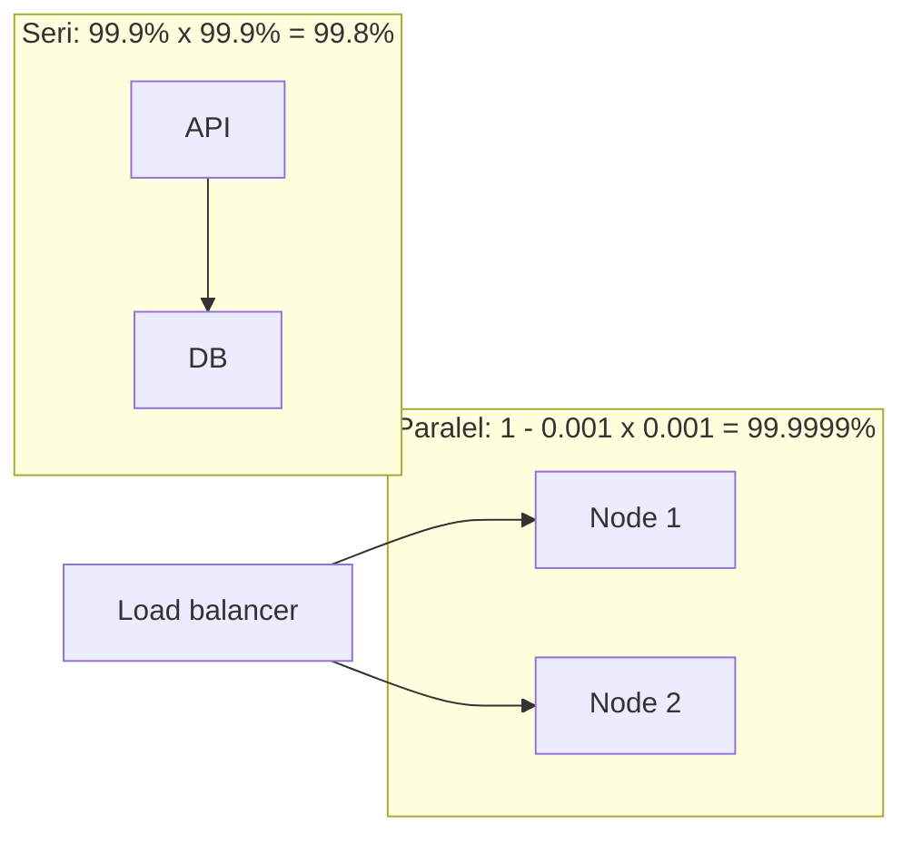

## Tujuan belajar

Setelah pelajaran ini kamu bisa:

- Mendefinisikan availability, reliability, scalability, maintainability, dan fault tolerance dengan **ukuran yang bisa ditulis sebagai target**.
- Menghitung availability gabungan komponen seri dan paralel, serta menerjemahkan "nines" ke menit downtime.
- Menjelaskan kenapa latency harus ditarget sebagai persentil, dan apa harga tiap peningkatan target.

## Kenapa NFR menentukan arsitektur

Dua sistem dengan fitur identik bisa punya arsitektur sangat berbeda hanya karena satu menargetkan 99.9% dan yang lain 99.99%. Functional requirements menentukan **apa** yang dibangun; non-functional requirements menentukan **bagaimana** dan **seberapa mahal**. Di interview, NFR yang kamu tulis di awal adalah alat ukur yang dipakai lagi di tahap evaluasi.

## Availability: bisa diakses

Fraksi waktu (atau fraksi request) di mana sistem melayani dengan sukses.

| Target  | Downtime / tahun | Downtime / bulan | Yang biasanya dibutuhkan                                      |
| ------- | ---------------- | ---------------- | ------------------------------------------------------------- |
| 99%     | 3.65 hari        | 7.3 jam          | Satu server, restart manual                                   |
| 99.9%   | 8.8 jam          | 44 menit         | Redundansi + failover semi-otomatis, on-call                  |
| 99.99%  | 53 menit         | 4.4 menit        | Failover otomatis detik, multi-AZ, deploy bertahap            |
| 99.999% | 5.3 menit        | 26 detik         | Multi-region aktif-aktif, hampir tidak ada perubahan berisiko |

Menghitung gabungan:

- **Seri** (A bergantung pada B): A × B. Tiga service 99.9% seri ≈ 99.7%. Setiap dependency menurunkan availability, maka kurangi hop atau beri fallback (cache, nilai default, degradasi).
- **Paralel / redundan** (cukup satu yang hidup): 1 − (1−a)(1−b). Dua node 99% paralel ≈ 99.99%.

Availability juga diukur dari sisi **request**: "99.9% request sukses dalam 30 hari" lebih bermakna daripada "server up 99.9%" karena server yang hidup pun bisa mengembalikan error.

## Reliability: melakukan hal yang benar

Sistem yang hidup tapi salah tidak reliable: mengembalikan data basi melewati batas, kehilangan tulisan, menghitung ganda. Ukuran yang lazim: **error rate** (fraksi respons salah/5xx), **MTBF** (rata-rata waktu antar kegagalan), **MTTR** (rata-rata waktu pemulihan), dan **durability** (peluang data hilang, mis. "11 nines" untuk object storage).

Reliability dibangun dari: validasi input, idempotency, transaksi di batas yang tepat, test, dan observability yang membuat kesalahan terlihat cepat.

## Scalability: bertambah beban tanpa bertambah sakit

Kemampuan menangani pertumbuhan **beban** (QPS, data, user) dengan menambah sumber daya secara **proporsional**. Dua arah:

| Arah                   | Cara               | Batas                                                                     |
| ---------------------- | ------------------ | ------------------------------------------------------------------------- |
| Vertikal (scale up)    | Mesin lebih besar  | Harga naik lebih cepat dari kapasitas; ada plafon; tetap satu titik gagal |
| Horizontal (scale out) | Lebih banyak mesin | Butuh stateless service, partisi data, koordinasi; kompleksitas naik      |

Pertanyaan yang membedakan kandidat: "**komponen mana yang pecah duluan kalau trafik naik 10x?**" Jawabannya biasanya database (write) atau sesuatu yang stateful. Jalur scale yang lazim: stateless service di belakang load balancer → cache → read replica → partisi/sharding → pemisahan beban async lewat queue.

## Latency: ukur ekornya

Target latency selalu dinyatakan sebagai **persentil** (p50, p95, p99), bukan rata-rata. Alasannya: satu halaman memanggil puluhan backend, sehingga user hampir pasti merasakan request terlambat dari salah satunya. Ekor biasanya berasal dari GC pause, lock contention, query lambat, atau node yang setengah sakit; obatnya antara lain hedged request, timeout per hop, dan membatasi fan-out.

## Maintainability: murah diubah

Tiga sisi yang sering dipakai: **operability** (mudah dijalankan: observability, deploy, runbook), **simplicity** (abstraksi yang menyembunyikan kerumitan, bukan menambahnya), **evolvability** (mudah diubah saat requirement berubah: skema yang bisa berevolusi, API berversi). Di interview ini muncul sebagai: "bagaimana kamu men-deploy perubahan tanpa downtime?" dan "bagaimana mengubah skema data ini nanti?".

## Fault tolerance: tetap berjalan saat sebagian rusak

Berbeda dari "tidak pernah gagal": sistem **mengantisipasi** kegagalan komponen dan terus melayani, mungkin dengan degradasi. Alatnya:

- **Redundansi** (N+1 node, multi-AZ) dan **failover** otomatis.
- **Isolasi** (bulkhead): kegagalan satu fitur tidak menjatuhkan fitur lain.
- **Degradasi anggun**: tampilkan feed dari cache saat ranking service mati.
- **Load shedding & rate limiting**: menolak sebagian request lebih baik daripada mati semua.
- **Static stability**: sistem tetap jalan saat control plane (mis. autoscaler) tidak tersedia, karena kapasitas sudah ada sebelumnya.

## Trade-off antar NFR

| Dorongan                  | Yang dikorbankan                                         | Contoh                                                 |
| ------------------------- | -------------------------------------------------------- | ------------------------------------------------------ |
| Availability lebih tinggi | Konsistensi (saat partition), biaya, kecepatan perubahan | Multi-region aktif-aktif memaksa eventual consistency  |
| Konsistensi kuat          | Latency, availability                                    | Tulis menunggu quorum lintas AZ                        |
| Latency rendah            | Biaya (cache, edge), kesegaran data                      | CDN menyajikan konten yang mungkin basi beberapa menit |
| Scalability horizontal    | Simplicity, transaksi lintas partisi                     | Sharding membuat join dan transaksi global sulit       |
| Maintainability           | Performa micro-optimization                              | Memilih abstraksi jelas daripada trik cepat            |

## Pertanyaan yang sering ditanya interviewer

- "Berapa target availability-nya, dan apa artinya dalam menit per bulan?" → Pakai tabel nines, sebut konsekuensi operasional.
- "Komponen mana yang menjadi single point of failure?" → Tunjuk, lalu beri redundansi atau alasan menerimanya.
- "Apa yang didegradasi saat X mati?" → Siapkan jawaban per dependency penting.
- "Kenapa p99, bukan rata-rata?" → Jelaskan efek fan-out.
- "Sistem ini CP atau AP?" → Jawab per fitur; kaitkan dengan NFR yang ditulis di awal.

## Ringkasan

1. NFR harus bisa diukur: availability dalam nines/persen request, latency dalam persentil, reliability dalam error rate dan durability, scalability sebagai "apa yang pecah pada 10x".
2. Komponen seri mengalikan availability ke bawah; redundansi paralel menaikkannya. Kurangi dependency seri, beri fallback.
3. Tiap nine tambahan memperkecil anggaran downtime 10x dan memaksa otomatisasi; sebutkan harganya saat menargetkan.
