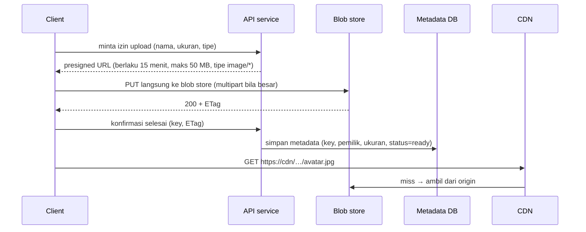

## Tujuan belajar

Setelah pelajaran ini kamu bisa:

- Menjelaskan model object storage (bucket, key, objek, metadata) dan kenapa ia berbeda dari filesystem dan database.
- Merancang jalur upload/download yang tidak melewati API server (presigned URL, multipart, CDN).
- Menjelaskan arsitektur dalamnya: metadata service, placement, replikasi vs erasure coding, dan penanganan objek kecil.

## Masalah yang diselesaikan

Gambar, video, backup, log arsip: objek besar, immutable (ditulis sekali, dibaca berkali-kali), tanpa kebutuhan transaksi atau query isi. Database relasional dan filesystem POSIX membayar mahal untuk fitur yang tidak dibutuhkan di sini (transaksi, hirarki direktori, kunci, update parsial). **Blob/object store** menukar fitur itu dengan skala petabyte, durability sangat tinggi (S3 mengklaim 11 nines), dan biaya rendah.

Model API-nya datar: `PUT /bucket/key`, `GET /bucket/key`, `DELETE`, `LIST prefix`. Key terlihat seperti path (`users/42/avatar.jpg`) tetapi tidak ada direktori sungguhan.

## Pola pemakaian di desain sistem

Prinsip: **data path tidak melewati API server**. API hanya menerbitkan izin dan mencatat metadata; byte besar mengalir langsung client ↔ blob store ↔ CDN.

- **Presigned URL**: tanda tangan HMAC atas (bucket, key, method, kedaluwarsa, batasan) sehingga client bisa menulis/membaca satu objek tanpa kredensial.
- **Multipart upload**: objek dipecah menjadi bagian (5 MB–5 GB), diunggah paralel, bisa diulang per bagian, digabung di akhir. Wajib untuk file besar dan koneksi mobile.
- **Pemrosesan async**: setelah upload, event (`ObjectCreated`) memicu worker untuk transcoding, thumbnail, pemindaian; hasilnya ditulis sebagai objek baru.
- **Lifecycle**: aturan otomatis memindahkan objek dingin ke kelas penyimpanan murah dan menghapus setelah N hari.

## Arsitektur di dalam blob store

**Pemisahan metadata dan data**: metadata (key, ukuran, checksum, lokasi chunk, versi, ACL) kecil dan diakses by key, cocok di KV store terpartisi; data mentah tersebar di storage node.

**Penulisan**: objek dipecah menjadi chunk tetap (mis. 64 MB), tiap chunk ditulis ke beberapa node (replikasi) atau di-encode menjadi fragmen (erasure coding), dengan checksum per chunk. Sukses dikembalikan setelah quorum tulis durable. **Pembacaan**: metadata → lokasi → ambil chunk (paralel), verifikasi checksum, kembalikan.

### Durability: replikasi vs erasure coding

|                              | Replikasi 3x                         | Erasure coding (k data + m parity, mis. 10+4) |
| ---------------------------- | ------------------------------------ | --------------------------------------------- |
| Overhead storage             | 3x                                   | (k+m)/k ≈ 1.4x                                |
| Toleransi kehilangan         | 2 salinan                            | m fragmen                                     |
| Baca normal                  | 1 node, latency rendah               | k node, paralel                               |
| Baca saat ada fragmen hilang | Salinan lain                         | Rekonstruksi, CPU + latency                   |
| Cocok untuk                  | Objek kecil, panas, latency sensitif | Objek besar, dingin, biaya sensitif           |

Keduanya dilengkapi **scrubbing** (membaca ulang dan memverifikasi checksum berkala) dan **repair** otomatis saat node mati. Penempatan menyebar salinan/fragmen lintas rack, zone, atau region (failure domain).

### Objek kecil

Miliaran file 50 KB membuat overhead metadata filesystem (inode, direktori) lebih mahal dari datanya. Solusi ala Haystack: gabungkan objek kecil ke **volume** besar yang append-only, simpan `(key → volume, offset, size)` di index memori; satu baca objek = satu baca disk.

### Konsistensi dan versi

Modern object store memberi **strong read-after-write** untuk objek tunggal (S3 sejak 2020); listing bisa sedikit tertinggal. Objek immutable: update = tulis versi baru (versioning), hapus = tombstone lalu GC. Ini menyederhanakan cache dan CDN: key + versi tidak pernah berubah isinya.

## Trade-off ringkas

| Keputusan                                            | Pilih A bila                           | Pilih B bila                                                           |
| ---------------------------------------------------- | -------------------------------------- | ---------------------------------------------------------------------- |
| Upload via presigned URL (A) vs via API server (B)   | Hampir selalu; file &gt; beberapa MB   | Perlu inspeksi/transformasi sinkron sebelum disimpan dan filenya kecil |
| Replikasi (A) vs erasure coding (B)                  | Objek kecil/panas, latency utama       | Objek besar/dingin, biaya utama                                        |
| Managed (S3/GCS) (A) vs self-hosted (MinIO/Ceph) (B) | Hampir selalu                          | Regulasi data on-prem, skala yang membuat biaya egress dominan         |
| Satu bucket + prefix (A) vs banyak bucket (B)        | Sederhana, aturan lifecycle per prefix | Isolasi kebijakan/akun per tenant                                      |

## Pertanyaan yang sering ditanya interviewer

- "Di mana file disimpan, dan apa yang ada di DB?" → Biner di blob store, URL/key + metadata di DB.
- "Bagaimana upload file besar dari koneksi buruk?" → Presigned multipart, resume per bagian.
- "Bagaimana menjaga agar API server tidak menjadi bottleneck bandwidth?" → Data path langsung ke blob store dan CDN.
- "11 nines durability dari mana?" → Replikasi/erasure coding lintas failure domain, checksum, scrubbing, repair.
- "Objek diubah, bagaimana cache CDN?" → Objek immutable; versi baru = key/versi baru.
- "Bagaimana menghapus data user sesuai regulasi?" → Tombstone + GC terjadwal, lifecycle, bukti penghapusan.

## Ringkasan

1. Blob store menukar transaksi dan hirarki dengan skala, durability, dan biaya rendah; biner di sini, metadata di DB, dan data path tidak melewati API server.
2. Presigned URL + multipart + CDN adalah pola jalur upload/download; event ObjectCreated memicu pemrosesan asinkron.
3. Di dalamnya: metadata service terpisah, chunk dengan checksum, replikasi untuk objek panas dan erasure coding untuk objek dingin, scrubbing/repair, dan penggabungan objek kecil ke volume.
