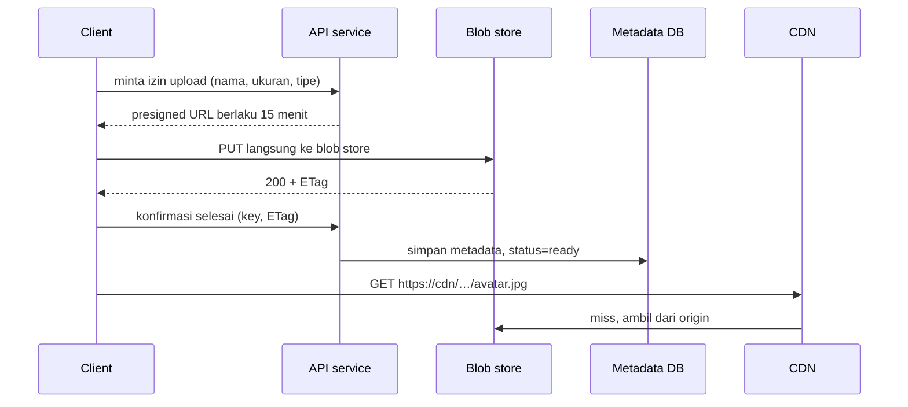
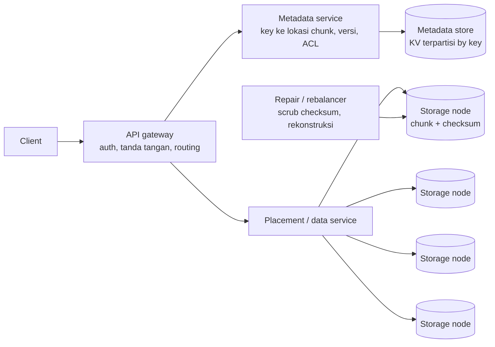

## Tujuan belajar

Setelah pelajaran ini kamu bisa:

- Menjelaskan model object storage dan kenapa ia berbeda dari filesystem dan database.
- Merancang jalur upload dan download yang tidak melewati API server dengan presigned URL, multipart, dan CDN.
- Menjelaskan arsitektur dalamnya: metadata service, penempatan chunk, replikasi atau erasure coding, dan penanganan objek kecil.

## Masalah yang diselesaikan

Gambar, video, backup, dan log arsip punya sifat yang sama. Objeknya besar, ditulis sekali, dibaca berkali-kali, dan tidak butuh transaksi atau query isi. Database relasional dan filesystem POSIX membayar mahal untuk fitur yang tidak dibutuhkan di sini, seperti transaksi dan hirarki direktori. Blob store menukar fitur itu dengan skala petabyte, durability sangat tinggi, dan biaya rendah. S3 misalnya mengklaim durability sebelas angka sembilan.

Model API-nya datar. Ada PUT, GET, DELETE, dan LIST berdasarkan prefix. Key terlihat seperti path, misalnya users/42/avatar.jpg, tetapi tidak ada direktori sungguhan.

## Pola pemakaian di desain sistem

Prinsipnya, jalur data tidak melewati API server. API hanya menerbitkan izin dan mencatat metadata. Byte besar mengalir langsung antara client, blob store, dan CDN.

- Presigned URL adalah URL bertanda tangan untuk satu objek dengan masa berlaku dan batasan. Client bisa menulis atau membaca tanpa kredensial.
- Multipart upload memecah objek menjadi bagian 5 MB sampai 5 GB. Bagian diunggah paralel, bisa diulang satu per satu, dan digabung di akhir. Ini wajib untuk file besar dan koneksi mobile.
- Pemrosesan async. Setelah upload, event ObjectCreated memicu worker untuk transcoding, thumbnail, atau pemindaian. Hasilnya ditulis sebagai objek baru.
- Lifecycle. Aturan otomatis memindahkan objek dingin ke kelas penyimpanan murah dan menghapus setelah N hari.

## Arsitektur di dalam blob store

Metadata dan data dipisah. Metadata berisi key, ukuran, checksum, lokasi chunk, versi, dan ACL. Ukurannya kecil dan diakses berdasarkan key, jadi cocok di KV store terpartisi. Data mentahnya tersebar di storage node.

Saat menulis, objek dipecah menjadi chunk tetap, misalnya 64 MB. Tiap chunk ditulis ke beberapa node dengan replikasi, atau dipecah menjadi fragmen dengan erasure coding. Setiap chunk punya checksum. Sukses dikembalikan setelah quorum tulis selesai. Saat membaca, sistem mencari lokasi di metadata, mengambil chunk secara paralel, memverifikasi checksum, lalu mengembalikan.

### Durability: replikasi atau erasure coding

|                              | Replikasi 3 kali                     | Erasure coding k data dan m parity, misalnya 10 dan 4 |
| ---------------------------- | ------------------------------------ | ----------------------------------------------------- |
| Overhead storage             | 3 kali                               | Sekitar 1.4 kali                                      |
| Toleransi kehilangan         | 2 salinan                            | m fragmen                                             |
| Baca normal                  | Satu node, latency rendah            | k node secara paralel                                 |
| Baca saat ada fragmen hilang | Salinan lain                         | Rekonstruksi dengan CPU dan latency tambahan          |
| Cocok untuk                  | Objek kecil, panas, sensitif latency | Objek besar, dingin, sensitif biaya                   |

Keduanya dilengkapi scrubbing, yaitu membaca ulang dan memverifikasi checksum berkala, dan repair otomatis saat node mati. Salinan atau fragmen disebar lintas rack, zone, atau region.

### Objek kecil

Miliaran file 50 KB membuat overhead metadata filesystem lebih mahal dari datanya. Solusi ala Haystack menggabungkan objek kecil ke volume besar yang append-only. Index di memori menyimpan key beserta volume, offset, dan ukurannya. Satu baca objek cukup satu baca disk.

### Konsistensi dan versi

Object store modern memberi read-after-write yang kuat untuk objek tunggal. S3 mendukungnya sejak 2020. Listing bisa sedikit tertinggal. Objek bersifat immutable, artinya update sama dengan menulis versi baru. Hapus berarti tombstone yang dibersihkan garbage collector. Ini menyederhanakan cache dan CDN karena isi dari key dan versi yang sama tidak pernah berubah.

## Trade-off ringkas

| Keputusan                                             | Pilih A bila                                     | Pilih B bila                                              |
| ----------------------------------------------------- | ------------------------------------------------ | --------------------------------------------------------- |
| Upload via presigned URL A atau via API server B      | Hampir selalu, untuk file lebih dari beberapa MB | Perlu inspeksi sinkron sebelum disimpan dan filenya kecil |
| Replikasi A atau erasure coding B                     | Objek kecil dan panas, latency utama             | Objek besar dan dingin, biaya utama                       |
| Managed seperti S3 A atau self-hosted seperti MinIO B | Hampir selalu                                    | Regulasi data on-prem, atau biaya egress dominan          |
| Satu bucket dengan prefix A atau banyak bucket B      | Sederhana, aturan lifecycle per prefix           | Isolasi kebijakan atau akun per tenant                    |

## Pertanyaan yang sering ditanya interviewer

- "Di mana file disimpan, dan apa yang ada di database?" Biner di blob store, URL dan metadata di database.
- "Bagaimana upload file besar dari koneksi buruk?" Presigned multipart dengan resume per bagian.
- "Bagaimana API server tidak menjadi bottleneck bandwidth?" Jalur data langsung ke blob store dan CDN.
- "Dari mana durability sebelas angka sembilan?" Replikasi atau erasure coding lintas failure domain, checksum, scrubbing, dan repair.
- "Objek diubah, bagaimana cache CDN?" Objek immutable. Versi baru berarti key atau versi baru.
- "Bagaimana menghapus data pengguna sesuai regulasi?" Tombstone, garbage collector terjadwal, lifecycle, dan bukti penghapusan.

## Ringkasan

1. Blob store menukar transaksi dan hirarki dengan skala, durability, dan biaya rendah. Biner di sini, metadata di database, dan jalur data tidak melewati API server.
2. Presigned URL, multipart, dan CDN adalah pola jalur upload dan download. Event ObjectCreated memicu pemrosesan async.
3. Di dalamnya ada metadata service terpisah, chunk dengan checksum, replikasi untuk objek panas dan erasure coding untuk objek dingin, scrubbing, repair, dan penggabungan objek kecil ke volume.
