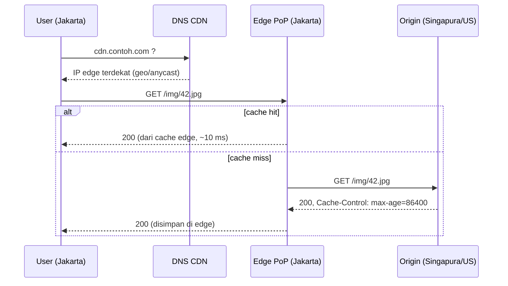

## Tujuan belajar

Setelah pelajaran ini kamu bisa:

- Menjelaskan bagaimana CDN memotong latency lintas benua **dan** bandwidth origin, dan kapan ia wajib masuk ke desain.
- Membedakan pull vs push CDN, dan memakai header cache HTTP (`Cache-Control`, `ETag`) dengan benar.
- Merancang invalidasi dan versioning aset tanpa merusak hit ratio.

## Masalah yang diselesaikan

Di pelajaran estimasi, layanan foto berujung pada bandwidth keluar ~1 GB/s. Dua kenyataan fisik membuat ini sulit dari satu datacenter: **RTT lintas benua ~150 ms** tidak bisa dipercepat, dan **setiap byte** harus keluar dari pipa origin. CDN memindahkan salinan konten ke ratusan titik (edge / PoP) dekat user, sehingga request berulang tidak menempuh jarak dan tidak membebani origin.

## Cara kerja

Pemilihan edge terdekat dilakukan lewat DNS geo/latency-based atau **anycast** (satu IP untuk semua PoP). CDN besar menambahkan lapisan **shield/mid-tier** di antara edge dan origin agar satu cache miss di banyak edge tidak menjadi banyak request ke origin.

## Pull vs push

|             | Pull CDN                                             | Push CDN                                                      |
| ----------- | ---------------------------------------------------- | ------------------------------------------------------------- |
| Cara        | Edge mengambil dari origin saat miss                 | Kamu mengunggah ke CDN lebih dulu                             |
| Cocok untuk | Konten banyak dan long-tail, trafik tidak terduga    | Konten besar yang jarang berubah (installer, video on demand) |
| Kelebihan   | Hanya yang diminta yang disalin; setup mudah         | Request pertama pun cepat; kontrol penuh isi edge             |
| Kekurangan  | Miss pertama lambat; origin harus siap menerima miss | Storage CDN dibayar untuk semua konten; pipeline unggah       |

Mayoritas kasus interview memakai pull; sebutkan push bila kontennya besar dan katalognya terbatas.

## Aturan cache HTTP yang harus dikuasai

| Header                                                          | Arti                                                                 | Dipakai untuk                                                 |
| --------------------------------------------------------------- | -------------------------------------------------------------------- | ------------------------------------------------------------- |
| `Cache-Control: public, max-age=31536000, immutable`            | Boleh di-cache siapa pun selama setahun, tidak perlu revalidasi      | Aset dengan hash di nama (JS, CSS, gambar versi)              |
| `Cache-Control: public, max-age=60, stale-while-revalidate=300` | Cache 60 s; setelah itu layani versi lama sambil mengambil yang baru | Halaman/API publik yang boleh sedikit basi                    |
| `Cache-Control: private, no-store`                              | Jangan di-cache CDN/proxy                                            | Data personal, respons ber-auth                               |
| `ETag` / `Last-Modified` + `If-None-Match`                      | Revalidasi: 304 tanpa body bila belum berubah                        | Menghemat bandwidth saat TTL habis                            |
| `Vary: Accept-Encoding`                                         | Cache terpisah per nilai header                                      | Kompresi, bahasa; jangan `Vary: Cookie` atau hit ratio runtuh |

Cache key default adalah URL; query string dan header di `Vary` menambah variasi. Terlalu banyak variasi = hit ratio rendah.

## Invalidasi tanpa drama

Masalah klasik: konten sudah berubah di origin, edge masih memegang yang lama.

1. **Versioning di URL** (cache-busting): `app.3f9a1c.js` dengan TTL sangat panjang; hanya HTML (TTL pendek) yang berubah merujuk nama baru. Ini solusi utama untuk aset build.
2. **TTL pendek + stale-while-revalidate** untuk konten yang berubah tetapi boleh sedikit basi.
3. **Purge API** untuk kasus darurat (konten salah, takedown). Purge global memakan detik–menit dan memicu gelombang miss; gunakan **surrogate key / tag** agar bisa purge per kelompok.
4. **Jangan** menurunkan TTL semua aset ke beberapa detik: hit ratio runtuh dan origin kembali menjadi bottleneck.

## Apa yang dilayani CDN selain file statis

- **Konten dinamis yang bisa dibagi**: halaman produk, hasil pencarian populer, respons API publik, dengan TTL pendek.
- **Video**: segmen HLS/DASH adalah file statis kecil, ideal untuk cache; CDN sendiri (Netflix Open Connect) menaruh server di dalam ISP.
- **Fungsi di edge**: redirect, A/B routing, header manipulation, bahkan logika ringan, untuk memotong RTT ke origin.
- **Perlindungan**: TLS termination, DDoS absorption, WAF, karena semua trafik lewat edge.

Yang **tidak** boleh di-cache CDN: respons personal ber-auth (kecuali dengan cache key per user yang hati-hati), data yang butuh konsistensi kuat, dan apa pun dengan `Set-Cookie`.

## Trade-off ringkas

| Keputusan                                      | Pilih A bila                                | Pilih B bila                                     |
| ---------------------------------------------- | ------------------------------------------- | ------------------------------------------------ |
| Pull (A) vs push (B)                           | Katalog besar/long-tail, trafik tak terduga | Konten besar, terbatas, harus langsung cepat     |
| TTL panjang + versioning (A) vs TTL pendek (B) | Konten immutable atau bisa diberi versi     | Konten berubah dan URL harus tetap               |
| CDN pihak ketiga (A) vs CDN sendiri (B)        | Hampir selalu                               | Skala Netflix/YouTube, ingin server di dalam ISP |
| Cache di edge (A) vs hanya proxy (B)           | Konten bisa dibagi antar user               | Respons personal; manfaat hanya TLS/DDoS         |

## Pertanyaan yang sering ditanya interviewer

- "Di mana CDN masuk ke desain ini, dan untuk konten apa?" → Tunjuk aset dan respons yang bisa dibagi; sebutkan yang tidak.
- "Bagaimana memastikan user mendapat versi terbaru setelah deploy?" → Versioning URL + HTML TTL pendek.
- "Bagaimana menghitung hit ratio yang dibutuhkan?" → Dari estimasi bandwidth: origin hanya boleh menerima (1 − hit ratio) × trafik.
- "Apa yang terjadi saat cache miss masif (cold start, purge global)?" → Origin shield, request coalescing, warm-up bertahap.
- "Bagaimana upload file besar user?" → Presigned URL langsung ke blob store; CDN hanya untuk jalur baca.

## Ringkasan

1. CDN memindahkan salinan konten ke edge dekat user, memotong RTT lintas benua dan beban origin sekaligus; hanya cache miss yang mencapai origin.
2. Pull untuk mayoritas kasus, push untuk katalog besar yang terbatas; kendalikan dengan `Cache-Control`, `ETag`, dan `Vary` yang hemat.
3. Invalidasi yang benar adalah versioning URL dengan TTL panjang; purge hanya untuk darurat, dan jangan pernah mengorbankan hit ratio demi kesegaran.
