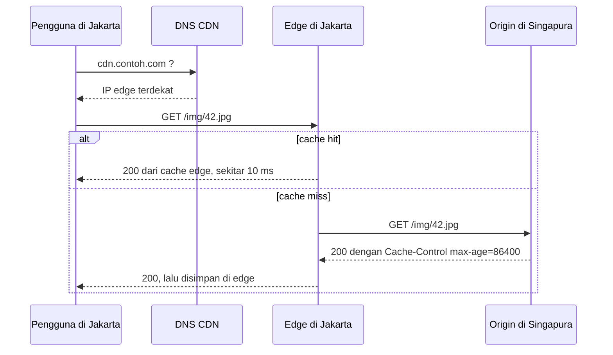

## Tujuan belajar

Setelah pelajaran ini kamu bisa:

- Menjelaskan bagaimana CDN memotong latency lintas benua dan beban origin sekaligus, dan kapan ia wajib masuk ke desain.
- Membedakan pull CDN dan push CDN, serta memakai header cache HTTP dengan benar.
- Merancang cara membatalkan cache dan memberi versi pada aset tanpa merusak hit ratio.

## Masalah yang diselesaikan

Di pelajaran estimasi, layanan foto berujung pada bandwidth keluar sekitar 1 GB per detik. Dua kenyataan fisik membuat ini sulit dari satu datacenter. Pertama, waktu bolak-balik lintas benua sekitar 150 ms dan tidak bisa dipercepat. Kedua, setiap byte harus keluar dari pipa origin.

CDN, atau content delivery network, adalah jaringan server yang tersebar di ratusan kota. Server ini disebut edge. CDN memindahkan salinan konten ke edge dekat pengguna. Request yang berulang tidak lagi menempuh jarak jauh dan tidak lagi membebani origin.

## Cara kerja

Pengguna diarahkan ke edge terdekat lewat DNS berbasis lokasi atau lewat anycast. Anycast adalah satu alamat IP yang diiklankan dari banyak lokasi sekaligus. CDN besar menambah lapisan di antara edge dan origin yang disebut origin shield. Lapisan ini mencegah satu cache miss di banyak edge menjadi banyak request ke origin.

## Pull dan push

| Hal         | Pull CDN                                                 | Push CDN                                                          |
| ----------- | -------------------------------------------------------- | ----------------------------------------------------------------- |
| Cara kerja  | Edge mengambil dari origin saat cache miss               | Kamu mengunggah konten ke CDN lebih dulu                          |
| Cocok untuk | Konten banyak dan jarang diminta, trafik tidak terduga   | Konten besar yang jarang berubah, seperti installer dan video     |
| Kelebihan   | Hanya konten yang diminta yang disalin, dan setup mudah  | Request pertama pun cepat, dan isi edge terkendali                |
| Kekurangan  | Miss pertama lambat, dan origin harus siap menerima miss | Storage CDN dibayar untuk semua konten, dan butuh pipeline unggah |

Mayoritas kasus interview memakai pull. Sebutkan push bila kontennya besar dan katalognya terbatas.

## Aturan cache HTTP yang harus dikuasai

| Header                                                          | Artinya                                                           | Dipakai untuk                                                     |
| --------------------------------------------------------------- | ----------------------------------------------------------------- | ----------------------------------------------------------------- |
| `Cache-Control: public, max-age=31536000, immutable`            | Boleh di-cache siapa pun selama setahun tanpa pengecekan ulang    | Aset dengan hash di namanya, seperti JS, CSS, dan gambar berversi |
| `Cache-Control: public, max-age=60, stale-while-revalidate=300` | Cache 60 detik, lalu layani versi lama sambil mengambil yang baru | Halaman atau API publik yang boleh sedikit basi                   |
| `Cache-Control: private, no-store`                              | Jangan di-cache oleh CDN atau proxy                               | Data personal dan respons yang butuh login                        |
| `ETag` dan `If-None-Match`                                      | Pengecekan ulang yang menjawab 304 tanpa isi bila belum berubah   | Menghemat bandwidth saat TTL habis                                |
| `Vary: Accept-Encoding`                                         | Cache terpisah untuk tiap nilai header itu                        | Kompresi dan bahasa                                               |

Kunci cache secara default adalah URL. Query string dan header di `Vary` menambah variasi. Terlalu banyak variasi membuat hit ratio rendah. Jangan pernah memakai `Vary: Cookie`, karena setiap pengguna akan punya cache sendiri.

## Membatalkan cache tanpa drama

Masalah klasiknya begini. Konten sudah berubah di origin, tetapi edge masih memegang yang lama. Ada empat cara menanganinya.

1. Beri versi di URL. Contohnya `app.3f9a1c.js` dengan TTL sangat panjang. Hanya HTML yang ber-TTL pendek dan merujuk nama baru. Ini solusi utama untuk aset hasil build.
2. Pakai TTL pendek ditambah `stale-while-revalidate` untuk konten yang berubah tetapi boleh sedikit basi.
3. Pakai API purge hanya untuk darurat, misalnya konten salah atau harus diturunkan. Purge global memakan detik sampai menit dan memicu gelombang miss. Gunakan tag agar bisa purge per kelompok.
4. Jangan menurunkan TTL semua aset ke beberapa detik. Hit ratio akan runtuh dan origin kembali menjadi bottleneck.

## Apa lagi yang bisa dilayani CDN

- Konten dinamis yang bisa dibagi antar pengguna, seperti halaman produk dan hasil pencarian populer, dengan TTL pendek.
- Video. Segmen HLS dan DASH adalah file statis kecil yang ideal untuk cache. Netflix bahkan menaruh server CDN miliknya di dalam jaringan ISP.
- Logika ringan di edge, seperti redirect dan pengujian A/B, untuk memotong perjalanan ke origin.
- Perlindungan. Semua trafik lewat edge, jadi TLS, penyerapan DDoS, dan firewall aplikasi bisa dipasang di sana.

Yang tidak boleh di-cache CDN: respons personal yang butuh login, data yang butuh konsistensi kuat, dan apa pun yang mengirim `Set-Cookie`.

## Trade-off ringkas

| Keputusan                                                | Pilih A bila                                | Pilih B bila                                         |
| -------------------------------------------------------- | ------------------------------------------- | ---------------------------------------------------- |
| Pull sebagai A, push sebagai B                           | Katalog besar dan trafik tidak terduga      | Konten besar, terbatas, dan harus langsung cepat     |
| TTL panjang dengan versi sebagai A, TTL pendek sebagai B | Konten tidak berubah atau bisa diberi versi | Konten berubah dan URL harus tetap                   |
| CDN pihak ketiga sebagai A, CDN sendiri sebagai B        | Hampir selalu                               | Skala sebesar Netflix atau YouTube                   |
| Cache di edge sebagai A, hanya proxy sebagai B           | Konten bisa dibagi antar pengguna           | Respons personal, jadi manfaatnya hanya TLS dan DDoS |

## Pertanyaan yang sering ditanya interviewer

- "Di mana CDN masuk ke desain ini, dan untuk konten apa?" Tunjuk aset dan respons yang bisa dibagi, lalu sebutkan yang tidak boleh.
- "Bagaimana memastikan pengguna mendapat versi terbaru setelah deploy?" Versi di URL ditambah HTML ber-TTL pendek.
- "Berapa hit ratio yang dibutuhkan?" Hitung dari estimasi bandwidth. Origin hanya boleh menerima sisa trafik yang tidak kena cache.
- "Apa yang terjadi saat cache miss masal, misalnya setelah purge global?" Origin shield, penggabungan request yang sama, dan pemanasan cache bertahap.
- "Bagaimana unggah file besar dari pengguna?" Langsung ke blob store lewat URL bertanda tangan. CDN hanya untuk jalur baca.

## Ringkasan

1. CDN memindahkan salinan konten ke edge dekat pengguna. Ini memotong waktu bolak-balik lintas benua dan beban origin sekaligus, karena hanya cache miss yang sampai ke origin.
2. Pull cocok untuk mayoritas kasus, push untuk katalog besar yang terbatas. Kendalikan dengan `Cache-Control`, `ETag`, dan `Vary` yang hemat.
3. Cara membatalkan cache yang benar adalah versi di URL dengan TTL panjang. Purge hanya untuk darurat, dan jangan korbankan hit ratio demi kesegaran.
