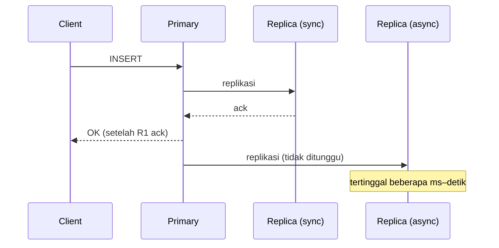
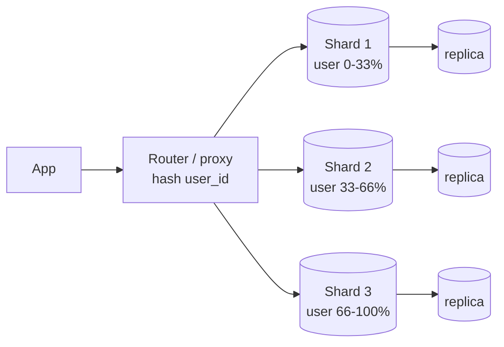

## Tujuan belajar

Setelah pelajaran ini kamu bisa:

- Menjelaskan replikasi (single-leader, multi-leader, leaderless), sinkron vs async, dan apa yang terjadi saat failover.
- Memilih strategi partitioning (range vs hash) dan shard key, serta tahu query mana yang menjadi mahal.
- Menjawab "SQL atau NoSQL?" dengan pola akses, bukan dengan ideologi.
- Menyusun jalur scale database dari satu node sampai sharding.

## Database adalah tempat bottleneck berakhir

Service stateless bisa digandakan sesuka hati; data tidak. Hampir setiap pertanyaan "kalau trafik 10x, apa yang pecah?" berujung pada database. Dua alat utamanya: **replication** (salinan yang sama di banyak node, untuk availability dan skala baca) dan **partitioning/sharding** (data dibelah ke banyak node, untuk skala tulis dan ukuran).

## Replication

### Topologi

| Topologi      | Tulis ke                               | Kelebihan                                              | Kekurangan                                       | Contoh                                             |
| ------------- | -------------------------------------- | ------------------------------------------------------ | ------------------------------------------------ | -------------------------------------------------- |
| Single-leader | Satu primary; replica hanya baca       | Sederhana, tidak ada konflik tulis                     | Primary = batas tulis; failover butuh koordinasi | PostgreSQL, MySQL, MongoDB replica set             |
| Multi-leader  | Beberapa primary (biasanya per region) | Tulis lokal di tiap region; tahan partisi antar region | Konflik tulis harus direkonsiliasi               | Replikasi antar-datacenter, aplikasi offline-first |
| Leaderless    | Node mana pun; quorum W + R &gt; N     | Availability tinggi, tanpa failover                    | Konsistensi lemah, read repair/anti-entropy      | Dynamo-style: Cassandra, Riak                      |

### Sinkron vs asinkron

- **Async**: tulis cepat; tulisan terakhir bisa hilang saat primary mati sebelum replica menerimanya.
- **Sync**: durable, tapi satu replica lambat memperlambat semua tulisan.
- **Semi-sync**: satu replica sync, sisanya async; kompromi yang paling sering dipilih di produksi.

### Replication lag dan jaminan baca

Replica async selalu tertinggal. Dampaknya terlihat pada: _read-your-writes_ (user tidak melihat tulisannya sendiri), _monotonic reads_ (timeline "mundur" saat berganti replica), dan _causal_ (balasan muncul sebelum pertanyaannya). Solusi praktis: baca dari primary untuk data yang baru ditulis user, sticky replica per user, atau menunggu replica mencapai posisi log (LSN) tertentu.

### Failover

Deteksi primary mati (timeout heartbeat) → pilih replica paling mutakhir → alihkan client. Risiko: **split brain** (primary lama hidup lagi dan menerima tulisan) dan **kehilangan tulisan** yang belum tereplikasi. Mitigasi: fencing (primary lama dimatikan paksa), lease, quorum, dan menerima bahwa failover otomatis punya jeda puluhan detik.

## Partitioning (sharding)

Membelah data ke beberapa node agar setiap node memegang sebagian. Semua query harus tahu **shard mana** yang dituju; itulah peran _shard key_.

| Strategi  | Cara                                     | Kelebihan                    | Kekurangan                                            |
| --------- | ---------------------------------------- | ---------------------------- | ----------------------------------------------------- |
| Range     | Key terurut dibagi rentang (A–F, G–M, …) | Range scan efisien           | Hot spot bila key monoton (timestamp, ID urut)        |
| Hash      | hash(key) mod N atau consistent hashing  | Sebaran merata               | Range scan harus ke semua shard                       |
| Directory | Tabel lookup key → shard                 | Fleksibel, rebalancing mudah | Lookup = komponen tambahan yang harus sangat tersedia |

Memilih shard key: harus ada di **hampir semua query**, tersebar **merata**, dan **jarang berubah**. `user_id` sering cocok untuk aplikasi konsumer; `tenant_id` untuk SaaS; `created_at` hampir selalu buruk karena menimbulkan hot shard.

Yang menjadi mahal setelah sharding: join lintas shard, transaksi lintas shard, query tanpa shard key (scatter-gather), unique constraint global, auto-increment. Jawaban interview: denormalisasi, index sekunder asinkron, ID generator terdistribusi, dan memilih batas transaksi di dalam satu shard.

Rebalancing (menambah shard) memindahkan data; consistent hashing atau partisi virtual (banyak partisi kecil per node) membuat perpindahan minimal.

## SQL vs NoSQL: tanya pola aksesnya

| Kebutuhan dominan                                            | Condong ke                                    | Alasan                           |
| ------------------------------------------------------------ | --------------------------------------------- | -------------------------------- |
| Join, transaksi multi-baris, integritas referensial          | Relasional (PostgreSQL, MySQL)                | ACID, optimizer, skema eksplisit |
| Akses by key, tulis sangat tinggi, skala horizontal otomatis | Key-value / wide-column (DynamoDB, Cassandra) | Partisi bawaan, tanpa join       |
| Dokumen bersarang, skema berubah cepat                       | Document (MongoDB)                            | Satu dokumen = satu unit atomik  |
| Relasi banyak-hop                                            | Graph (Neo4j)                                 | Traversal native                 |
| Analitik agregat besar                                       | Column store (ClickHouse, BigQuery)           | Kompresi kolom, scan cepat       |

Catatan jujur untuk interview: relasional modern menangani JSON, replikasi, dan bisa di-shard; NoSQL punya hot partition dan tetap butuh desain skema (query-first). Pilih yang kamu bisa jelaskan trade-off-nya.

## Jalur scale yang disarankan

1. Optimasi query dan index; ukur dulu.
2. Scale up mesin.
3. Cache di depan (cache-aside) untuk beban baca.
4. Read replica; tangani replication lag.
5. Federation: pisahkan tabel per domain ke database berbeda (users, orders, catalog).
6. Sharding, dengan shard key yang dipilih dari pola akses.
7. Pisahkan beban analitik (OLAP) lewat CDC/ETL agar tidak mengganggu OLTP.

Urutan ini adalah jawaban untuk "kenapa tidak sharding dari awal?": tiap langkah lebih murah dari langkah berikutnya.

## Trade-off ringkas

| Keputusan                             | Pilih A bila                                     | Pilih B bila                                            |
| ------------------------------------- | ------------------------------------------------ | ------------------------------------------------------- |
| Sync (A) vs async (B) replikasi       | Kehilangan tulisan terakhir tidak dapat diterima | Latency tulis lebih penting; toleransi lag              |
| Single-leader (A) vs multi-leader (B) | Satu region utama, ingin tanpa konflik           | Tulis lintas region harus lokal; siap menangani konflik |
| Range (A) vs hash (B) sharding        | Range query dominan dan key tidak monoton        | Akses by key, ingin sebaran merata                      |
| Relasional (A) vs NoSQL (B)           | Join dan transaksi nyata dibutuhkan              | Pola akses sederhana dengan skala tulis besar           |

## Pertanyaan yang sering ditanya interviewer

- "Apa yang terjadi saat primary mati?" → Deteksi, promosi, risiko kehilangan tulisan dan split brain, fencing.
- "Shard key apa dan kenapa?" → Ada di hampir semua query, merata, stabil; sebutkan query yang jadi mahal.
- "Bagaimana transaksi lintas shard?" → Hindari lewat desain batas; bila terpaksa: saga atau 2PC dengan biaya.
- "Kenapa Postgres, bukan Cassandra?" → Jawab dengan pola akses dan skala tulis saat ini; sebutkan titik pindah.
- "Replica tertinggal, user komplain" → Read-your-writes.
- "Bagaimana menambah shard tanpa downtime?" → Partisi virtual / consistent hashing, dual-write sementara, backfill, cutover.

## Ringkasan

1. Replikasi memberi availability dan skala baca; async cepat tapi bisa kehilangan tulisan terakhir saat failover, dan lag memaksa kamu memikirkan read-your-writes.
2. Sharding memberi skala tulis dan ukuran; shard key dipilih dari pola akses, dan query tanpa shard key, join, serta transaksi lintas shard menjadi mahal.
3. SQL vs NoSQL diputuskan oleh pola akses, bukan label; jalur scale berjenjang (index → scale up → cache → replica → federation → sharding) adalah alasan kenapa sharding bukan langkah pertama.
