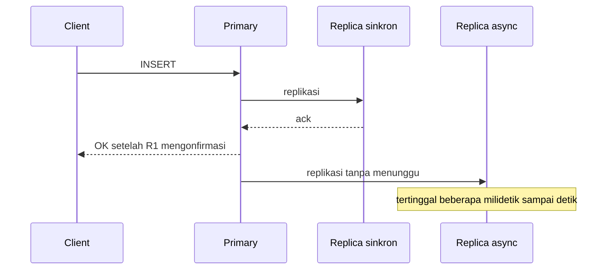
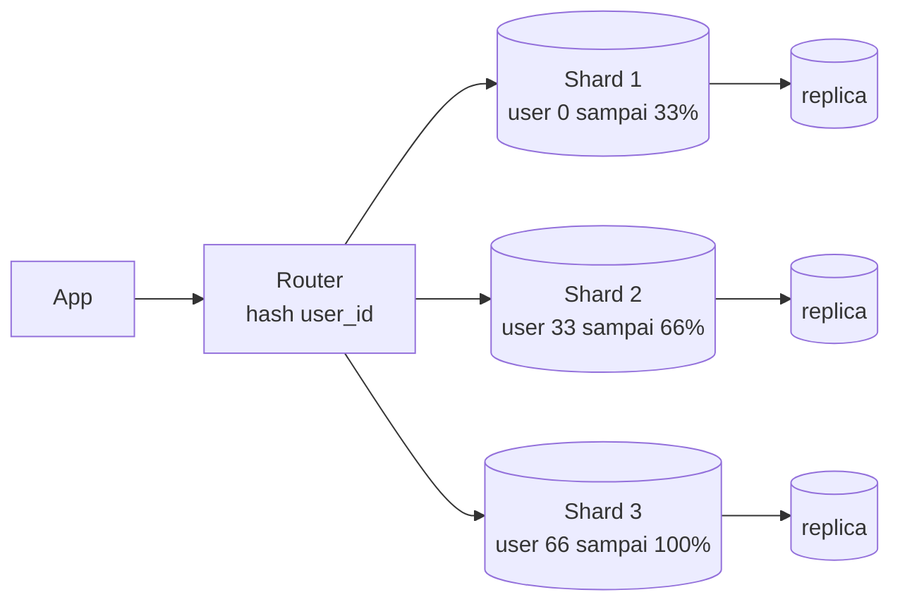

## Tujuan belajar

Setelah pelajaran ini kamu bisa:

- Menjelaskan replikasi dengan satu leader, banyak leader, atau tanpa leader, serta sinkron dan async, dan apa yang terjadi saat failover.
- Memilih strategi partisi dan shard key, serta tahu query mana yang menjadi mahal.
- Menjawab "SQL atau NoSQL?" dengan pola akses, bukan ideologi, dan menyusun jalur scaling dari satu node sampai sharding.

## Database adalah tempat bottleneck berakhir

Service tanpa state bisa digandakan sesuka hati. Data tidak bisa. Hampir setiap pertanyaan "kalau trafik 10 kali, apa yang pecah?" berujung pada database. Dua alat utamanya adalah replikasi dan partisi. Replikasi menyimpan salinan yang sama di banyak node, untuk ketersediaan dan skala baca. Partisi, disebut juga sharding, membelah data ke banyak node, untuk skala tulis dan ukuran.

## Replikasi

### Topologi

| Topologi      | Tulis ke                                   | Kelebihan                                                 | Kekurangan                                              | Contoh                                             |
| ------------- | ------------------------------------------ | --------------------------------------------------------- | ------------------------------------------------------- | -------------------------------------------------- |
| Satu leader   | Satu primary, replica hanya untuk baca     | Sederhana dan tanpa konflik tulis                         | Primary membatasi tulis, dan failover butuh koordinasi  | PostgreSQL, MySQL, MongoDB replica set             |
| Banyak leader | Beberapa primary, biasanya satu per region | Tulis lokal di tiap region dan tahan partisi antar region | Konflik tulis harus direkonsiliasi                      | Replikasi antar datacenter, aplikasi offline-first |
| Tanpa leader  | Node mana pun, dengan quorum               | Ketersediaan tinggi tanpa failover                        | Konsistensi lemah dan butuh perbaikan di latar belakang | Cassandra, Riak                                    |

Quorum berarti tulisan dan bacaan masing-masing harus disetujui sejumlah node, sehingga keduanya selalu beririsan.

### Sinkron dan async

- Async: tulis cepat, tetapi tulisan terakhir bisa hilang bila primary mati sebelum replica menerimanya.
- Sinkron: aman, tetapi satu replica lambat memperlambat semua tulisan.
- Semi-sync: satu replica sinkron, sisanya async. Ini kompromi yang paling sering dipilih di produksi.

### Jeda replikasi dan jaminan baca

Replica async selalu tertinggal. Dampaknya terlihat dalam tiga bentuk. Pengguna tidak melihat tulisannya sendiri. Timeline terlihat "mundur" saat berganti replica. Balasan muncul sebelum pertanyaannya. Solusi praktisnya: baca dari primary untuk data yang baru ditulis pengguna, tempelkan satu replica per pengguna, atau tunggu replica mencapai posisi log tertentu.

### Failover

1. Deteksi primary mati lewat heartbeat yang tidak datang.
2. Pilih replica paling mutakhir.
3. Alihkan client ke primary baru.

Risikonya dua. Split brain, yaitu primary lama hidup lagi dan menerima tulisan. Dan kehilangan tulisan yang belum tereplikasi. Mitigasinya adalah fencing untuk mematikan paksa primary lama, lease, dan quorum. Terima juga bahwa failover otomatis punya jeda puluhan detik.

## Partisi atau sharding

Partisi membelah data ke beberapa node agar setiap node memegang sebagian. Setiap query harus tahu shard mana yang dituju. Itulah peran shard key.

| Strategi  | Cara kerja                     | Kelebihan                    | Kekurangan                                                  |
| --------- | ------------------------------ | ---------------------------- | ----------------------------------------------------------- |
| Range     | Key terurut dibagi rentang     | Range scan efisien           | Partisi panas bila key monoton, misalnya timestamp          |
| Hash      | Hash dari key menentukan shard | Sebaran merata               | Range scan harus ke semua shard                             |
| Directory | Tabel lookup dari key ke shard | Fleksibel dan mudah dipindah | Lookup menjadi komponen tambahan yang harus sangat tersedia |

Shard key yang baik ada di hampir semua query, tersebar merata, dan jarang berubah. Untuk aplikasi konsumer, `user_id` sering cocok. Untuk SaaS, `tenant_id`. Kolom `created_at` hampir selalu buruk karena menimbulkan partisi panas.

Setelah sharding, beberapa hal menjadi mahal: join lintas shard, transaksi lintas shard, query tanpa shard key, unique constraint global, dan auto-increment. Jawaban di interview: denormalisasi, index sekunder async, generator ID terdistribusi, dan batas transaksi di dalam satu shard.

Menambah shard memindahkan data. Consistent hashing atau partisi virtual, yaitu banyak partisi kecil per node, membuat perpindahan minimal.

## SQL atau NoSQL: tanya pola aksesnya

| Kebutuhan dominan                                            | Condong ke                                                | Alasan                               |
| ------------------------------------------------------------ | --------------------------------------------------------- | ------------------------------------ |
| Join, transaksi multi-baris, integritas referensial          | Relasional seperti PostgreSQL dan MySQL                   | ACID, optimizer, skema eksplisit     |
| Akses by key, tulis sangat tinggi, skala horizontal otomatis | Key-value atau wide-column seperti DynamoDB dan Cassandra | Partisi bawaan tanpa join            |
| Dokumen bersarang, skema berubah cepat                       | Document store seperti MongoDB                            | Satu dokumen adalah satu unit atomik |
| Relasi banyak hop                                            | Graph database seperti Neo4j                              | Penelusuran relasi bawaan            |
| Analitik agregat besar                                       | Column store seperti ClickHouse dan BigQuery              | Kompresi kolom dan scan cepat        |

Catatan jujur untuk interview: database relasional modern menangani JSON, replikasi, dan bisa di-shard. NoSQL punya partisi panas dan tetap butuh desain skema. Pilih yang trade-off-nya bisa kamu jelaskan.

## Jalur scaling yang disarankan

1. Optimasi query dan index. Ukur dulu.
2. Scale up mesin.
3. Pasang cache di depan untuk beban baca.
4. Tambah read replica dan tangani jeda replikasi.
5. Federation: pisahkan tabel per domain ke database berbeda, misalnya users, orders, catalog.
6. Sharding, dengan shard key dari pola akses.
7. Pisahkan beban analitik lewat CDC atau ETL agar tidak mengganggu transaksi.

Urutan ini adalah jawaban untuk "kenapa tidak sharding dari awal?". Setiap langkah lebih murah dari langkah berikutnya.

## Trade-off ringkas

| Keputusan                      | Pilih yang pertama bila                          | Pilih yang kedua bila                                      |
| ------------------------------ | ------------------------------------------------ | ---------------------------------------------------------- |
| Replikasi sinkron atau async   | Kehilangan tulisan terakhir tidak dapat diterima | Latency tulis lebih penting dan jeda bisa ditoleransi      |
| Satu leader atau banyak leader | Ada satu region utama dan ingin tanpa konflik    | Tulis lintas region harus lokal dan siap menangani konflik |
| Sharding range atau hash       | Range query dominan dan key tidak monoton        | Akses by key dan ingin sebaran merata                      |
| Relasional atau NoSQL          | Join dan transaksi nyata dibutuhkan              | Pola akses sederhana dengan skala tulis besar              |

## Pertanyaan yang sering ditanya interviewer

- "Apa yang terjadi saat primary mati?" Deteksi, promosi, risiko kehilangan tulisan dan split brain, fencing.
- "Shard key apa dan kenapa?" Ada di hampir semua query, merata, stabil. Sebutkan query yang jadi mahal.
- "Bagaimana transaksi lintas shard?" Hindari lewat desain batas. Bila terpaksa, saga atau two-phase commit dengan biayanya.
- "Kenapa PostgreSQL, bukan Cassandra?" Jawab dengan pola akses dan skala tulis saat ini, lalu sebutkan titik pindahnya.
- "Replica tertinggal dan pengguna komplain?" Read-your-writes.
- "Bagaimana menambah shard tanpa downtime?" Partisi virtual atau consistent hashing, tulis ganda sementara, backfill, lalu cutover.

## Ringkasan

1. Replikasi memberi ketersediaan dan skala baca. Async cepat tetapi bisa kehilangan tulisan terakhir saat failover, dan jedanya memaksa kamu memikirkan read-your-writes.
2. Sharding memberi skala tulis dan ukuran. Shard key dipilih dari pola akses, dan query tanpa shard key, join, serta transaksi lintas shard menjadi mahal.
3. SQL atau NoSQL diputuskan oleh pola akses. Jalur scaling berjenjang adalah alasan sharding bukan langkah pertama.
