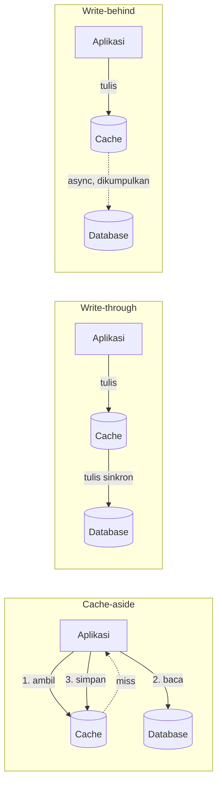
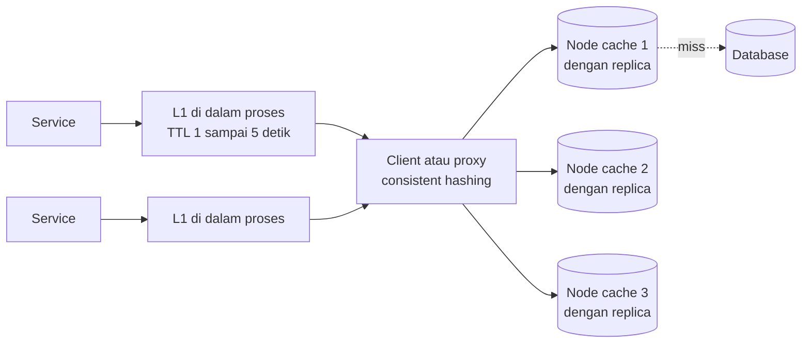

## Tujuan belajar

Setelah pelajaran ini kamu bisa:

- Menempatkan cache di lapisan yang tepat dan tahu apa yang layak di-cache.
- Memilih antara cache-aside, read-through, write-through, dan write-behind, serta menjelaskan balapan yang menyertainya.
- Mendiagnosis dan mengobati stampede, hot key, dan penetration, lalu merancang cluster cache yang tahan node mati.

## Kenapa cache

Dari pelajaran estimasi, kita punya 4.000 request baca dan 40 request tulis per detik. Database bisa melayani puluhan ribu baca per detik. Tetapi setiap baca yang bisa dihindari berarti latency lebih rendah dan ruang untuk tumbuh. Memori diakses dalam 100 nanodetik, sedangkan disk dan jaringan dalam milidetik.

Aturan 80/20 membuat cache sangat efektif. Sebagian kecil data menghasilkan sebagian besar baca.

## Di mana cache berada

| Lapisan                            | Contoh                         | Menyimpan apa                           |
| ---------------------------------- | ------------------------------ | --------------------------------------- |
| Client atau browser                | Cache HTTP                     | Aset statis                             |
| CDN                                | Server edge                    | Konten yang bisa dibagi antar pengguna  |
| Di dalam proses, sering disebut L1 | Map atau LRU di memori service | Konfigurasi, key panas, hasil komputasi |
| Terdistribusi, sering disebut L2   | Cluster Redis atau Memcached   | Objek, hasil query, sesi                |
| Database                           | Buffer pool                    | Halaman data yang sering dibaca         |

Modul ini fokus pada L2, yaitu cache terdistribusi yang dibagi oleh semua instance service.

## Strategi baca dan tulis

| Strategi      | Cara kerja                                                       | Kelebihan                                                                                | Kekurangan                                                                              | Kapan dipakai                              |
| ------------- | ---------------------------------------------------------------- | ---------------------------------------------------------------------------------------- | --------------------------------------------------------------------------------------- | ------------------------------------------ |
| Cache-aside   | Aplikasi cek cache dulu. Bila miss, baca database lalu isi cache | Sederhana, hanya data yang diminta yang di-cache, dan sistem tetap jalan bila cache mati | Miss pertama lambat, ada balapan saat update, dan aplikasi mengelola pembatalan sendiri | Default untuk beban baca tinggi            |
| Read-through  | Cache sendiri yang membaca database saat miss                    | Aplikasi lebih sederhana                                                                 | Cache harus tahu cara memuat, dan terikat vendor                                        | Library cache seperti Caffeine             |
| Write-through | Tulis ke cache dan database secara sinkron                       | Cache selalu segar                                                                       | Latency tulis naik, dan data yang tidak pernah dibaca ikut di-cache                     | Data yang pasti dibaca setelah ditulis     |
| Write-behind  | Tulis ke cache, database diperbarui belakangan                   | Tulis sangat cepat dan bisa dikumpulkan                                                  | Tulisan bisa hilang bila cache mati                                                     | Counter dan metrik yang toleran kehilangan |
| Write-around  | Tulis langsung ke database, cache diisi saat baca                | Cache tidak dipenuhi data dingin                                                         | Baca setelah tulis selalu miss                                                          | Data yang jarang dibaca setelah ditulis    |

### Pembatalan dan balapan cache-aside

Saat data berubah, hapus key, jangan perbarui isinya. Biarkan pembaca berikutnya mengisi ulang. Urutan yang lazim adalah tulis database dulu, lalu hapus cache.

Tetap ada celah balapan. Pembaca lama bisa menulis nilai basi setelah penghapusan terjadi. Ada tiga mitigasi berjenjang. Pertama, TTL sebagai jaring pengaman. Kedua, hapus sekali lagi setelah beberapa ratus milidetik. Ketiga, isi cache dari log perubahan database, seperti yang dilakukan Facebook, sehingga cache selalu mengikuti database.

## Pengosongan dan TTL

Memori terbatas. Saat penuh, sesuatu harus keluar.

| Kebijakan      | Menjaga apa                | Cocok untuk                            |
| -------------- | -------------------------- | -------------------------------------- |
| LRU            | Key yang baru dipakai      | Beban umum yang condong ke sedikit key |
| LFU            | Key yang sering dipakai    | Kumpulan key panas yang stabil         |
| Berbasis TTL   | Key yang belum kedaluwarsa | Data dengan masa berlaku jelas         |
| FIFO atau acak | Tidak ada yang dijaga      | Jarang tepat, hanya murah              |

Redis dan Memcached memakai perkiraan LRU dan LFU dengan sampling, karena LRU yang tepat terlalu mahal. Beri TTL pada hampir semua key. TTL menutup balapan, membatasi data basi, dan mencegah key yatim. Tambahkan unsur acak pada TTL agar key yang diisi bersamaan tidak kedaluwarsa bersamaan.

## Tiga kegagalan klasik

| Masalah     | Gejalanya                                                            | Obatnya                                                                                                                                 |
| ----------- | -------------------------------------------------------------------- | --------------------------------------------------------------------------------------------------------------------------------------- |
| Stampede    | Key populer kedaluwarsa, lalu ribuan miss serentak menyerbu database | Satu pengisi per key sementara yang lain menunggu, refresh lebih awal, TTL dengan unsur acak, dan layani data lama sambil mengisi ulang |
| Hot key     | Satu key membebani satu node cache                                   | Salin key ke beberapa node dengan akhiran acak, cache lokal di service, dan gabungkan request                                           |
| Penetration | Request untuk key yang tidak ada selalu miss dan tembus ke database  | Simpan jawaban "tidak ada" dengan TTL pendek, dan pasang bloom filter di depan                                                          |

Ada satu lagi yang lebih jarang disebut, yaitu avalanche. Sebagian besar cache mati sekaligus, misalnya saat cluster restart, dan database tertimpa seluruh beban. Obatnya pemanasan cache bertahap, pembatasan laju ke database, circuit breaker, dan kapasitas database yang tidak mengasumsikan semua request kena cache.

## Arsitektur cluster

- Partisi memakai consistent hashing di sisi client untuk Memcached, atau 16.384 hash slot untuk Redis Cluster. Menambah node hanya memindahkan sebagian kecil key.
- Replikasi di Redis memakai primary dan replica per shard, dengan failover otomatis. Memcached biasanya tanpa replikasi. Node mati berarti miss, dan itu diterima.
- Cache adalah salinan yang boleh basi. Sumber kebenaran tetap database. Jangan menaruh data yang butuh konsistensi kuat hanya di cache.
- Ukuran cache dihitung dari aturan 80/20. Pantau hit ratio, laju pengosongan, dan latency p99 cache. Target hit ratio untuk beban baca tinggi di atas 90 persen.

## Trade-off ringkas

| Keputusan                                              | Pilih A bila                                              | Pilih B bila                                                   |
| ------------------------------------------------------ | --------------------------------------------------------- | -------------------------------------------------------------- |
| Cache-aside sebagai A, write-through sebagai B         | Beban baca tinggi dan miss pertama bisa diterima          | Data pasti dibaca setelah ditulis dan cache harus selalu segar |
| Redis sebagai A, Memcached sebagai B                   | Butuh struktur data, persistensi, replikasi, atau pub/sub | Cache murni yang sederhana dengan memori maksimal              |
| Hapus key sebagai A, perbarui key sebagai B saat tulis | Hampir selalu, untuk menghindari nilai basi               | Komputasi ulang sangat mahal dan urutan tulis terjamin         |
| L1 dan L2 sebagai A, L2 saja sebagai B                 | Ada hot key dan butuh latency di bawah satu milidetik     | Ingin konsistensi antar instance lebih ketat                   |

## Pertanyaan yang sering ditanya interviewer

- "Apa yang di-cache, dan dengan key apa?" Objek per ID dan hasil query populer. Key berisi jenis, ID, dan versi.
- "Bagaimana menjaga cache tetap konsisten dengan database?" Hapus saat tulis ditambah TTL. Akui ada celah balapan dan sebutkan mitigasinya.
- "Cache mati, apa yang terjadi?" Database menerima semua beban. Sebutkan avalanche dan pengamannya.
- "Key populer kedaluwarsa bersamaan?" Stampede. Satu pengisi per key, TTL acak, refresh lebih awal.
- "Berapa besar cache-nya?" Dua puluh persen data harian. Verifikasi dengan hit ratio.
- "Kenapa tidak write-through saja?" Latency tulis naik dan data dingin memenuhi cache.

## Ringkasan

1. Cache adalah salinan yang boleh basi di depan database. Cache-aside dengan hapus saat tulis ditambah TTL adalah default, dan celah balapannya harus diakui.
2. Pengosongan LRU atau LFU menjaga key panas. TTL dengan unsur acak menutup kebocoran dan mencegah kedaluwarsa serentak.
3. Tiga kegagalan klasik punya obat masing-masing: stampede dengan satu pengisi, hot key dengan salinan atau L1, penetration dengan jawaban negatif atau bloom filter.
