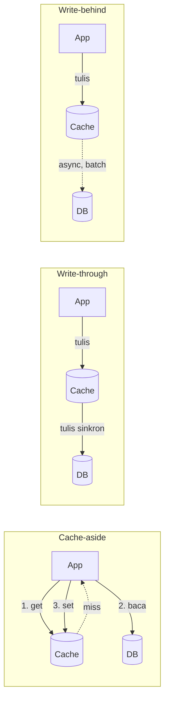
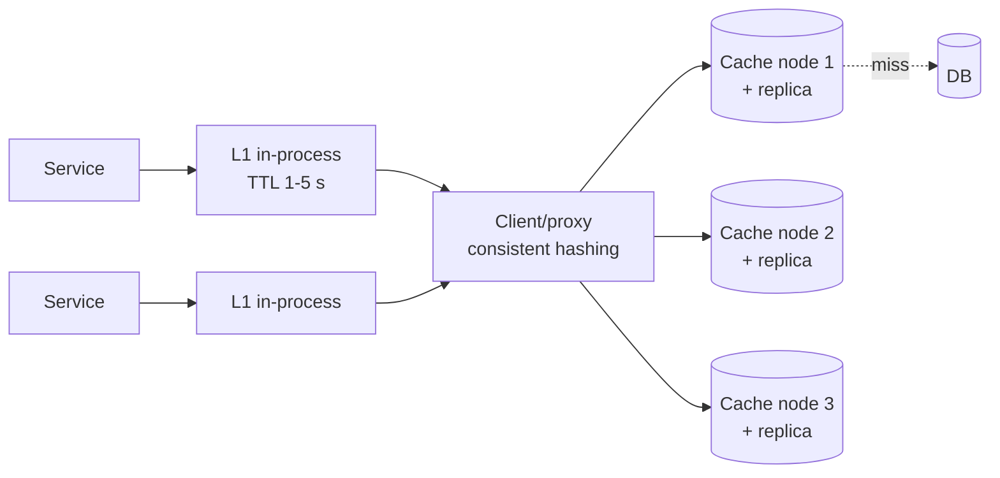

## Tujuan belajar

Setelah pelajaran ini kamu bisa:

- Menempatkan cache di lapisan yang tepat (client, CDN, aplikasi, in-process, database) dan tahu apa yang di-cache.
- Memilih strategi cache-aside, read-through, write-through, write-behind, dan menjelaskan race condition yang menyertainya.
- Mendiagnosis dan mengobati stampede, hot key, dan penetration, serta merancang cluster cache yang tahan node mati.

## Kenapa cache

Dari pelajaran estimasi: baca 4.000 QPS dan tulis 40 QPS. Database bisa melayani puluhan ribu baca per detik, tapi setiap baca yang bisa dihindari adalah latency yang lebih rendah (RAM ~100 ns vs disk/network ~ms) dan ruang untuk tumbuh. Aturan 80/20 membuat cache sangat efektif: sebagian kecil data menghasilkan sebagian besar baca.

## Di mana cache berada

| Lapisan          | Contoh                    | Menyimpan                             |
| ---------------- | ------------------------- | ------------------------------------- |
| Client / browser | HTTP cache                | Aset statis                           |
| CDN              | Edge                      | Konten yang bisa dibagi               |
| In-process (L1)  | Map/LRU di memori service | Konfigurasi, hot key, hasil komputasi |
| Distributed (L2) | Redis, Memcached cluster  | Objek, hasil query, sesi              |
| Database         | Buffer pool, query cache  | Halaman data panas                    |

Modul ini fokus pada **L2**: cache terdistribusi yang dibagi oleh semua instance service.

## Strategi baca/tulis

| Strategi                  | Cara                                        | Kelebihan                                                                         | Kekurangan                                                            | Kapan                                                |
| ------------------------- | ------------------------------------------- | --------------------------------------------------------------------------------- | --------------------------------------------------------------------- | ---------------------------------------------------- |
| Cache-aside (lazy)        | App cek cache; miss → baca DB → isi cache   | Sederhana; hanya data yang diminta yang di-cache; cache mati = sistem tetap jalan | Miss pertama lambat; race saat update; app harus mengelola invalidasi | Default untuk read-heavy                             |
| Read-through              | Cache yang membaca DB saat miss             | App lebih sederhana                                                               | Cache harus tahu cara memuat; vendor-specific                         | Library cache (Caffeine, Guava)                      |
| Write-through             | Tulis ke cache dan DB sinkron               | Cache selalu segar                                                                | Latency tulis naik; data yang tidak pernah dibaca ikut di-cache       | Data yang pasti dibaca setelah ditulis               |
| Write-behind (write-back) | Tulis ke cache, DB diperbarui async         | Tulis sangat cepat, batch ke DB                                                   | Risiko kehilangan tulisan bila cache mati; kompleks                   | Counter, metrik, beban tulis tinggi yang toleran     |
| Write-around              | Tulis langsung ke DB, cache diisi saat baca | Cache tidak dipenuhi data dingin                                                  | Baca setelah tulis = miss                                             | Data yang jarang dibaca setelah ditulis (log, arsip) |

### Invalidasi dan race cache-aside

Saat data berubah: **hapus** key (bukan perbarui), lalu biarkan pembaca berikutnya mengisi ulang. Urutan yang lazim: tulis DB → hapus cache. Tetap ada jendela race (pembaca lama menulis nilai basi setelah penghapusan). Mitigasi berjenjang: TTL sebagai jaring pengaman, _delayed double delete_ (hapus lagi setelah beberapa ratus ms), atau mengisi cache dari **CDC/binlog** (Facebook memakai pendekatan ini) sehingga cache selalu mengikuti DB.

## Eviction dan TTL

Memori terbatas; saat penuh, sesuatu harus keluar.

| Kebijakan     | Menjaga                | Cocok untuk                                      |
| ------------- | ---------------------- | ------------------------------------------------ |
| LRU           | Yang baru dipakai      | Beban umum, long-tail                            |
| LFU           | Yang sering dipakai    | Hot set stabil; tahan terhadap scan sekali lewat |
| TTL-based     | Yang belum kedaluwarsa | Data dengan masa berlaku jelas                   |
| FIFO / random | —                      | Jarang tepat; murah                              |

Redis dan Memcached memakai **aproksimasi** LRU/LFU (sampling) karena LRU eksak mahal. Beri TTL pada hampir semua key: menutup race, membatasi data basi, dan mencegah key yatim. Tambahkan **jitter** pada TTL agar key yang diisi bersamaan tidak kedaluwarsa bersamaan.

## Tiga kegagalan klasik

| Masalah                        | Gejala                                                          | Obat                                                                                                                                      |
| ------------------------------ | --------------------------------------------------------------- | ----------------------------------------------------------------------------------------------------------------------------------------- |
| **Stampede** (thundering herd) | Key populer kedaluwarsa → ribuan miss serentak ke DB            | Single-flight/lock per key (satu yang mengisi, lainnya menunggu), early/background refresh, TTL dengan jitter, serve-stale sambil refresh |
| **Hot key**                    | Satu key membebani satu node cache                              | Replikasi key ke N salinan (suffix acak), cache lokal L1 di service, batching request                                                     |
| **Penetration**                | Request untuk key yang tidak ada selalu miss dan menembus ke DB | Negative cache (simpan "tidak ada" dengan TTL pendek), bloom filter di depan                                                              |

Satu lagi yang lebih jarang disebut: **avalanche**, sebagian besar cache mati sekaligus (restart cluster) dan DB tertimpa seluruh beban. Obat: cache warm-up bertahap, rate limit ke DB, circuit breaker, dan kapasitas DB yang tidak mengasumsikan hit ratio 100%.

## Arsitektur cluster

- **Partisi**: consistent hashing di sisi client (Memcached) atau hash slot 16.384 (Redis Cluster); menambah node memindahkan sebagian kecil key.
- **Replikasi**: Redis primary-replica per shard; failover otomatis lewat Sentinel/Cluster. Memcached biasanya tanpa replikasi: node mati = miss, dan itu diterima.
- **Konsistensi**: cache adalah **salinan yang boleh basi**; sumber kebenaran tetap DB. Jangan menaruh data yang butuh konsistensi kuat hanya di cache.
- **Ukuran**: dari estimasi 80/20; pantau hit ratio (target &gt; 90% untuk read-heavy), eviction rate, dan latency p99 cache.

## Trade-off ringkas

| Keputusan                                    | Pilih A bila                                               | Pilih B bila                                                |
| -------------------------------------------- | ---------------------------------------------------------- | ----------------------------------------------------------- |
| Cache-aside (A) vs write-through (B)         | Read-heavy, toleransi miss pertama                         | Data pasti dibaca setelah ditulis; ingin cache selalu segar |
| Redis (A) vs Memcached (B)                   | Struktur data, persistence, replikasi, pub/sub             | Cache murni, multi-thread sederhana, memori maksimal        |
| Hapus key (A) vs perbarui key (B) saat tulis | Hampir selalu; menghindari menulis nilai yang mungkin basi | Komputasi ulang sangat mahal dan urutan tulis terjamin      |
| L1 + L2 (A) vs L2 saja (B)                   | Hot key, latency sub-ms                                    | Ingin konsistensi antar instance lebih ketat                |

## Pertanyaan yang sering ditanya interviewer

- "Apa yang di-cache, dan dengan key apa?" → Objek per ID, hasil query populer; key = jenis + id + versi.
- "Bagaimana menjaga cache tetap konsisten dengan DB?" → Hapus saat tulis + TTL; akui jendela race dan mitigasinya.
- "Cache mati, apa yang terjadi?" → DB menerima semua beban; sebutkan avalanche dan pengaman.
- "Key populer kedaluwarsa bersamaan?" → Stampede: single-flight, jitter, early refresh.
- "Berapa besar cache-nya?" → 20% data harian; verifikasi dengan hit ratio.
- "Kenapa tidak write-through saja?" → Latency tulis dan data dingin yang memenuhi cache.

## Ringkasan

1. Cache adalah salinan yang boleh basi di depan DB; cache-aside dengan hapus-saat-tulis plus TTL adalah default, dan jendela race-nya harus diakui.
2. Eviction LRU/LFU menjaga hot set; TTL dengan jitter menutup kebocoran dan mencegah kedaluwarsa serentak.
3. Tiga kegagalan klasik: stampede (single-flight), hot key (replikasi key/L1), penetration (negative cache/bloom filter); cluster dipartisi dengan consistent hashing dan hit ratio dipantau.
