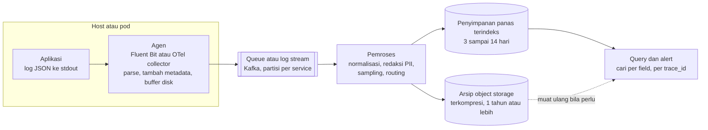

## Tujuan belajar

Setelah pelajaran ini kamu bisa:

- Merancang pipeline log dari aplikasi, agen, buffer, pemroses, sampai penyimpanan dan query.
- Menjelaskan prinsip log terstruktur, korelasi lewat trace_id, dan kenapa logging tidak boleh memblokir.
- Mengendalikan biaya dan volume dengan level, sampling, retensi bertingkat, dan kardinalitas yang terjaga.

## Masalah yang diselesaikan

Di satu server, kamu cukup menjalankan `tail -f app.log`. Di seribu container yang hidup beberapa jam, log tersebar dan hilang saat container mati. Satu request pun melintasi sepuluh service. Distributed logging mengumpulkan semuanya ke satu tempat yang bisa dicari, dengan konteks yang cukup untuk menjawab kenapa sebuah request gagal pukul 03:12.

Peran log dibanding dua sinyal lain:

- Log menjawab kenapa, karena berisi detail kejadian.
- Metrik menjawab ada apa dan seberapa parah.
- Trace menjawab di mana waktu habis.

Log paling mahal per kejadian, jadi harus dikelola dengan sadar.

## Pipeline

Enam tahapnya:

1. Aplikasi menulis log terstruktur ke stdout atau file lokal, dan tidak pernah memanggil jaringan untuk log. Field standarnya adalah timestamp UTC, level, nama service, versi, host, trace_id, request_id, pesan, dan field domain.
2. Agen di tiap host membaca stdout atau file, mem-parse, lalu menambah metadata seperti nama pod dan region. Agen menyimpan buffer di disk dengan batas ukuran, lalu mengirim secara asinkron dengan batch, kompresi, dan jeda yang membesar saat gagal.
3. Queue seperti Kafka memisahkan laju produksi dari laju konsumsi. Ia menyerap lonjakan dan memungkinkan beberapa consumer membaca log yang sama.
4. Pemroses menormalkan skema, meredaksi data sensitif seperti PII dan token, menyampel log yang repetitif, dan merutekan ke tier penyimpanan.
5. Penyimpanan panas mengindeks log untuk pencarian cepat. Penyimpanan dingin menyimpan arsip terkompresi di object storage untuk kepatuhan dan investigasi yang jarang.
6. Lapisan query mencari per field dan rentang waktu, menampilkan semua log satu trace_id, dan memicu alert dari pola seperti lonjakan error per service.

Ada dua gaya penyimpanan panas. Gaya pertama mengindeks setiap field dengan inverted index, seperti Elasticsearch atau OpenSearch. Gaya kedua hanya mengindeks label dan menyimpan isi log sebagai chunk di object storage, seperti Loki.

## Prinsip yang menentukan kualitas

- Tidak memblokir. Log tidak boleh memperlambat atau menjatuhkan request. Tulis lokal, kirim asinkron.
- Terstruktur. Pakai JSON dengan field yang jelas. Pesan untuk manusia tetap ada, tetapi data ada di field.
- Berkorelasi. Setiap baris memuat trace_id. Nilainya diteruskan antar service lewat header, misalnya standar W3C Trace Context.
- Toleran duplikat. Pengiriman ulang bisa membuat baris ganda. Timestamp sumber dan id baris membantu dedup. Urutan lintas host tidak dijamin, jadi pakai timestamp sumber dan trace untuk urutan sebab akibat.
- Aman. Redaksi PII dan kredensial sebelum disimpan, akses berbasis peran, dan retensi sesuai regulasi.
- Konsisten. Nama field sama lintas tim, misalnya selalu `user_id`, dengan tipe yang stabil supaya index tidak rusak.

## Biaya dan volume

| Tuas               | Caranya                                                                         | Efeknya                     |
| ------------------ | ------------------------------------------------------------------------------- | --------------------------- |
| Level              | Matikan DEBUG di produksi, tetapi bisa dinaikkan sementara per service          | Volume turun drastis        |
| Sampling           | Simpan 1% log sukses yang repetitif, tetapi 100% untuk error dan request lambat | Volume turun, sinyal tetap  |
| Retensi bertingkat | Panas 3 sampai 14 hari, dingin 1 tahun atau lebih di object storage             | Biaya index turun           |
| Pindah ke metrik   | Hitung counter di aplikasi, bukan dengan menghitung baris log                   | Log tinggal untuk konteks   |
| Kardinalitas index | Index hanya field yang memang dicari, sisanya disimpan tanpa index              | Index kecil dan tulis cepat |
| Kompresi dan batch | Lakukan di agen dan di storage                                                  | Bandwidth dan storage turun |

Estimasi kasar untuk interview: 1.000 service dikali 100 baris per detik dikali 300 byte menghasilkan sekitar 30 MB per detik. Itu sekitar 2.5 TB per hari sebelum kompresi. Dengan kompresi 5 sampai 10 kali dan retensi bertingkat, tier panas 7 hari berukuran beberapa TB.

## Trade-off ringkas

| Keputusan                                     | Pilih yang pertama bila                           | Pilih yang kedua bila                                                         |
| --------------------------------------------- | ------------------------------------------------- | ----------------------------------------------------------------------------- |
| Index penuh per field atau index label saja   | Butuh query ad-hoc yang kaya dan analitik log     | Biaya adalah faktor utama dan query biasanya per service, waktu, dan trace_id |
| Agen per host atau sidecar per pod            | Ingin hemat sumber daya dan platform seragam      | Butuh isolasi konfigurasi per aplikasi atau multi-tenant                      |
| Queue di tengah atau agen langsung ke storage | Skala besar, banyak consumer, dan lonjakan sering | Setup kecil dan ingin sederhana                                               |
| Sampling di agen atau di pemroses             | Ingin hemat bandwidth sejak sumber                | Keputusan sampling butuh konteks global                                       |

## Pertanyaan yang sering ditanya interviewer

- "Bagaimana menemukan semua log satu request lintas service?" Lewat trace_id di setiap baris dan propagasi header.
- "Pipeline log mati, apakah aplikasi terdampak?" Tidak boleh. Aplikasi menulis ke stdout, agen menyimpan buffer di disk, dan drop dihitung sebagai metrik.
- "Berapa biayanya dan bagaimana mengendalikannya?" Estimasi volume dulu, lalu sampling, retensi bertingkat, dan kardinalitas.
- "Bagaimana log sensitif ditangani?" Redaksi di pemroses, akses berbasis peran, dan retensi terbatas.
- "Bagaimana urutan log lintas host?" Tidak dijamin. Pakai timestamp sumber dengan toleransi, dan trace untuk urutan sebab akibat.
- "Bisakah alert dari log?" Bisa untuk pola error per service. Alert untuk SLO sebaiknya dari metrik.

## Ringkasan

1. Pipeline log terdiri dari aplikasi yang menulis log terstruktur, agen yang mengirim asinkron dengan buffer, queue yang menyerap lonjakan, pemroses yang meredaksi dan menyampel, serta penyimpanan panas dan arsip dingin.
2. Trace_id di setiap baris mengubah log yang terpisah menjadi cerita satu request. Logging tidak pernah boleh memblokir atau menjatuhkan aplikasi.
3. Biaya dikendalikan lewat level, sampling, retensi bertingkat, index selektif, dan memindahkan hitungan ke metrik.
