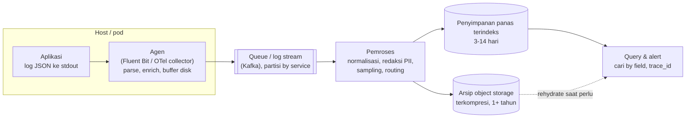

## Tujuan belajar

Setelah pelajaran ini kamu bisa:

- Merancang pipeline log: aplikasi → agen → buffer/queue → pemroses → penyimpanan terindeks + arsip → query.
- Menjelaskan prinsip log terstruktur, korelasi lewat trace_id, dan kenapa logging harus non-blocking.
- Mengendalikan biaya dan volume: level, sampling, retensi bertingkat, kardinalitas.

## Masalah yang diselesaikan

Satu server: `tail -f app.log`. Seribu container yang hidup beberapa jam: log tersebar, hilang saat container mati, dan satu request melintasi sepuluh service. Distributed logging mengumpulkan semuanya ke satu tempat yang **bisa dicari**, dengan konteks yang cukup untuk menjawab "kenapa request ini gagal pukul 03:12".

Peran log dibanding metrik dan trace: log menjawab **kenapa** (detail kejadian), metrik menjawab **ada apa dan seberapa parah**, trace menjawab **di mana**. Log adalah yang paling mahal per kejadian, maka harus dikelola.

## Pipeline

1. **Aplikasi** menulis log terstruktur ke stdout/file lokal; tidak pernah memanggil jaringan untuk log. Field standar: timestamp (UTC, ISO), level, service, versi, host, `trace_id`/`span_id`, `request_id`, pesan, dan field domain.
2. **Agen per host** (daemon/sidecar) membaca stdout/file, mem-parse, menambah metadata (pod, namespace, region), menyimpan **buffer di disk** dengan batas, dan mengirim asinkron dengan batch, kompresi, backoff. Kegagalan backend tidak menyentuh aplikasi.
3. **Queue** (Kafka) memisahkan laju produksi dari konsumsi, menyerap lonjakan, dan memungkinkan beberapa consumer (index, arsip, deteksi anomali).
4. **Pemroses** menormalkan skema, meredaksi data sensitif (PII, token), melakukan sampling, dan merutekan ke tier penyimpanan.
5. **Penyimpanan**: tier **panas** terindeks (inverted index per field ala Elasticsearch/OpenSearch, atau index-label-saja ala Loki dengan chunk di object storage) untuk pencarian cepat; tier **dingin** di object storage terkompresi untuk kepatuhan dan investigasi jarang.
6. **Query/alert**: cari by field dan rentang waktu, tampilkan semua log satu `trace_id`, alert pola (mis. lonjakan ERROR per service), dashboard dari log teragregasi.

## Prinsip yang menentukan kualitas

- **Non-blocking**: log tidak boleh memperlambat atau menjatuhkan request. Tulis lokal, kirim asinkron.
- **Terstruktur**: JSON dengan field; pesan manusia tetap ada, tetapi data di field.
- **Korelasi**: `trace_id` di setiap baris; propagasi lewat header (W3C Trace Context) antar service.
- **Idempotent/ordering**: duplikat mungkin terjadi saat retry; timestamp dari sumber + id baris membantu dedup; urutan lintas host tidak dijamin, pakai timestamp sumber dan toleransi.
- **Keamanan**: redaksi PII/kredensial sebelum penyimpanan, akses berbasis peran, retensi sesuai regulasi.
- **Skema**: nama field konsisten lintas tim (`user_id` bukan `uid`/`userId`), tipe stabil agar index tidak rusak.

## Biaya dan volume

| Tuas               | Cara                                                               | Efek                        |
| ------------------ | ------------------------------------------------------------------ | --------------------------- |
| Level              | DEBUG off di produksi, bisa dinaikkan per service sementara        | Volume turun drastis        |
| Sampling           | Simpan 1% log sukses yang repetitif, 100% error dan request lambat | Volume turun, sinyal tetap  |
| Retensi bertingkat | Panas 3–14 hari, dingin 1+ tahun di object storage                 | Biaya index turun           |
| Agregasi ke metrik | Hitung counter di aplikasi, jangan "log lalu hitung"               | Log tinggal untuk konteks   |
| Kardinalitas index | Index hanya field yang dicari; sisanya disimpan tanpa index        | Index kecil, tulis cepat    |
| Kompresi dan batch | Di agen dan storage                                                | Bandwidth dan storage turun |

Estimasi kasar untuk interview: 1.000 service × 100 baris/detik × 300 byte ≈ 30 MB/s ≈ 2.5 TB/hari mentah; dengan kompresi 5–10x dan retensi bertingkat, tier panas 7 hari ≈ beberapa TB.

## Trade-off ringkas

| Keputusan                                                 | Pilih A bila                           | Pilih B bila                                              |
| --------------------------------------------------------- | -------------------------------------- | --------------------------------------------------------- |
| Index penuh per field (A) vs index label + grep chunk (B) | Query ad-hoc kaya, analitik log        | Biaya utama, query biasanya by service + waktu + trace_id |
| Agen per host (A) vs sidecar per pod (B)                  | Hemat sumber daya, platform seragam    | Isolasi konfigurasi per aplikasi, multi-tenant            |
| Queue di tengah (A) vs agen langsung ke storage (B)       | Skala besar, banyak consumer, lonjakan | Setup kecil, ingin sederhana                              |
| Sampling di agen (A) vs di pemroses (B)                   | Hemat bandwidth sejak sumber           | Keputusan sampling butuh konteks global                   |

## Pertanyaan yang sering ditanya interviewer

- "Bagaimana menemukan semua log satu request lintas service?" → trace_id di setiap baris, propagasi header.
- "Pipeline log mati, aplikasi terdampak?" → Tidak boleh: stdout + agen + buffer disk + drop terukur.
- "Berapa biaya dan bagaimana mengendalikannya?" → Estimasi volume, sampling, retensi bertingkat, kardinalitas.
- "Bagaimana log sensitif ditangani?" → Redaksi di pemroses, RBAC, retensi.
- "Urutan log lintas host?" → Tidak dijamin; timestamp sumber, toleransi, trace untuk urutan kausal.
- "Alert dari log?" → Pola/laju ERROR per service; tetapi SLO alert sebaiknya dari metrik.

## Ringkasan

1. Pipeline: aplikasi menulis log terstruktur ke stdout, agen per host mengirim asinkron dengan buffer, queue menyerap lonjakan, pemroses meredaksi dan menyampel, penyimpanan panas terindeks dan arsip dingin.
2. trace_id di setiap baris mengubah log dari potongan terpisah menjadi cerita satu request; logging tidak pernah boleh memblokir atau menjatuhkan aplikasi.
3. Biaya dikendalikan lewat level, sampling, retensi bertingkat, index selektif, dan memindahkan hitungan ke metrik.
