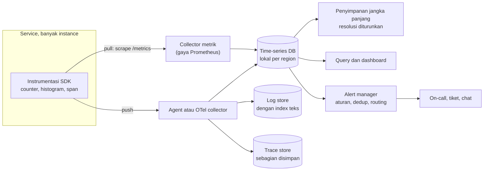

## Tujuan belajar

Setelah pelajaran ini kamu bisa:

- Membedakan metrik, log, dan trace, serta memilih mana yang dipakai untuk pertanyaan apa.
- Merancang pipeline monitoring dari instrumentasi, pengumpulan, penyimpanan, sampai alert.
- Menulis alert berbasis gejala, dan menghindari jebakan kardinalitas serta persentil yang dirata-rata.

## Kenapa monitoring adalah bagian dari desain

Setiap target non-fungsional yang kamu tulis hanyalah niat sampai bisa diukur. Monitoring adalah cara sistem memberi tahu bahwa ia melenceng dari target, sebelum pengguna yang memberi tahu. Di interview, komponen ini sering diminta saat deep dive operasional lewat pertanyaan "bagaimana kamu tahu sistem ini sehat?".

## Tiga pilar

| Pilar  | Bentuknya                                                              | Pertanyaan yang dijawab                         | Biaya                                         |
| ------ | ---------------------------------------------------------------------- | ----------------------------------------------- | --------------------------------------------- |
| Metrik | Angka per interval dengan label, berupa counter, gauge, atau histogram | Ada masalah? Bagaimana trennya? Seberapa parah? | Rendah, karena sudah teragregasi              |
| Log    | Catatan terstruktur per kejadian                                       | Kenapa? Apa persisnya yang terjadi?             | Tinggi, sebanding dengan jumlah request       |
| Trace  | Pohon langkah satu request lintas service                              | Di mana waktu habis? Service mana yang gagal?   | Sedang, biasanya hanya sebagian yang disimpan |

Alur praktis saat insiden begini. Metrik memicu alert. Trace menunjukkan service yang lambat. Log service itu menjelaskan sebabnya.

## Metrik apa yang diukur

- RED untuk tiap service, dari sudut pandang pengguna: rate atau jumlah request per detik, errors atau bagian yang gagal, dan duration atau sebaran latency.
- USE untuk tiap sumber daya, dari sudut pandang mesin: utilization, saturation atau panjang antrian, dan errors.
- Empat sinyal emas versi SRE: latency, trafik, error, dan saturasi. Kalau hanya bisa empat, ini empatnya.
- Metrik bisnis, seperti jumlah pesanan per menit. Metrik ini sering mendeteksi masalah yang tidak terlihat di metrik teknis.

Ada tiga tipe metrik. Counter hanya naik, dan lajunya dihitung belakangan. Gauge adalah nilai saat ini, seperti panjang antrian atau memori. Histogram adalah bucket latency yang bisa dijumlahkan antar instance, lalu persentilnya dihitung dari gabungannya.

## Arsitektur pipeline

### Push atau pull

| Hal          | Pull, server mengambil dari endpoint                                                                            | Push, agent mengirim ke collector                                               |
| ------------ | --------------------------------------------------------------------------------------------------------------- | ------------------------------------------------------------------------------- |
| Kelebihan    | Server tahu target mana yang hilang, mudah di-debug lewat endpoint, dan tidak kebanjiran saat target bermasalah | Cocok untuk job singkat, serverless, dan target di balik NAT                    |
| Kekurangan   | Butuh penemuan target, dan sulit untuk job yang hidup sebentar                                                  | Target yang mati terlihat sebagai tidak ada data, dan collector bisa kebanjiran |
| Dipakai oleh | Prometheus                                                                                                      | StatsD, OpenTelemetry, dan kebanyakan produk komersial                          |

Keduanya sering digabung. Pull untuk service berumur panjang, push lewat gateway untuk job batch.

### Penyimpanan time-series

Beban time-series database punya ciri khas. Tulisnya sangat tinggi dan hanya menambah di ujung. Bacanya berupa rentang waktu per deret. Data lama jarang disentuh.

Desain yang lazim memakai blok per rentang waktu, kompresi untuk timestamp dan nilai, index dari label ke deret, dan penurunan resolusi untuk data lama. Contohnya resolusi 15 detik untuk 2 minggu, lalu 5 menit untuk 1 tahun.

Jebakan terbesarnya adalah kardinalitas. Label seperti user_id atau request_id meledakkan jumlah deret, karena tiap kombinasi label disimpan sebagai deret terpisah.

### Log dan trace

Log ditulis terstruktur dalam JSON dengan trace_id, dikirim tanpa memblokir request, dan disimpan dengan retensi pendek. Arsip murah dipakai untuk jangka panjang. Ini dibahas lebih dalam di modul distributed logging.

Trace bekerja begini. Setiap hop menambah satu span dengan trace_id yang sama, yang diteruskan lewat header HTTP. Hanya sebagian trace yang disimpan, misalnya 1 persen, ditambah semua trace yang error atau lambat. Menyimpan semuanya terlalu mahal.

## Alert yang tidak menyiksa

Prinsip SRE: alert pada gejala yang dirasakan pengguna, bukan pada penyebab seperti CPU tinggi. Setiap alert yang membangunkan orang harus bisa ditindaklanjuti dan mendesak. Sisanya menjadi tiket atau dashboard.

Pola yang disarankan adalah burn rate dari error budget. Error budget adalah jatah kegagalan yang masih diizinkan target. Kalau target 99.9 persen per 30 hari, jatahnya 0.1 persen. Alert berbunyi bila laju pembakaran satu jam terakhir akan menghabiskan jatah itu dalam kurang dari 2 hari. Jendela pendek 5 menit dipakai untuk konfirmasi agar alert tidak berkedip.

Hal operasional yang perlu ada: penggabungan alert serupa, pembisuan saat pemeliharaan, routing per tim, dan tautan panduan penanganan di setiap alert.

## Trade-off ringkas

| Keputusan                                           | Pilih A bila                                   | Pilih B bila                                    |
| --------------------------------------------------- | ---------------------------------------------- | ----------------------------------------------- |
| Pull sebagai A, push sebagai B                      | Service berumur panjang dengan penemuan target | Job singkat, serverless, atau di balik NAT      |
| Histogram sebagai A, summary per instance sebagai B | Perlu persentil lintas instance                | Hanya satu instance atau tidak perlu agregasi   |
| Sampling di awal sebagai A, di akhir sebagai B      | Sederhana dan murah                            | Ingin menjamin trace error dan lambat tersimpan |
| Alert gejala sebagai A, alert penyebab sebagai B    | Hampir selalu untuk membangunkan orang         | Hanya sebagai tiket atau dashboard pendukung    |

## Pertanyaan yang sering ditanya interviewer

- "Bagaimana kamu tahu sistem ini memenuhi target?" Sinyal emas, histogram, dan dashboard per target.
- "Metrik apa yang memicu alert?" Error rate dan latency berbasis target, dengan burn rate. Bukan CPU.
- "Bagaimana menemukan service yang membuat request lambat?" Tracing terdistribusi, dengan trace_id di log.
- "Kenapa p99 tidak boleh dirata-rata?" Persentil tidak bisa digabung. Jumlahkan bucket histogram.
- "Kalau sistem monitoring sendiri mati?" Pantau dari sistem terpisah, alert bila tidak ada data, dan buat collector cadangan lintas region.
- "Berapa biaya menyimpan semua ini?" Turunkan resolusi, atur retensi bertingkat, simpan sebagian trace, dan kendalikan kardinalitas.

## Ringkasan

1. Metrik untuk mendeteksi dan mengukur target, trace untuk menemukan lokasi masalah, log untuk menjelaskan sebabnya. Ketiganya dihubungkan oleh trace_id.
2. Pipeline-nya: instrumentasi dengan RED, USE, dan histogram, lalu pengumpulan dengan pull atau push, lalu time-series database dengan kompresi dan label berkardinalitas rendah.
3. Alert pada gejala yang terkait target, dengan burn rate, penggabungan, routing, dan panduan penanganan. CPU tinggi adalah dashboard, bukan alarm.
