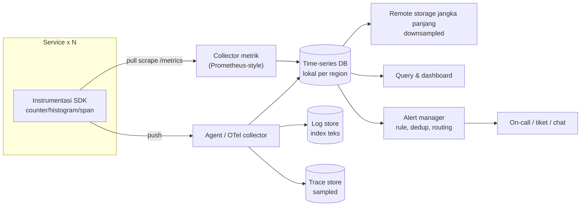

## Tujuan belajar

Setelah pelajaran ini kamu bisa:

- Membedakan metrik, log, dan trace, serta memilih mana yang dipakai untuk pertanyaan apa.
- Merancang pipeline monitoring: instrumentasi → pengumpulan (push/pull) → penyimpanan time-series → query/dashboard → alert.
- Menulis alert berbasis gejala dan SLO, dan menghindari jebakan kardinalitas serta persentil yang dirata-rata.

## Kenapa monitoring adalah bagian dari desain

Setiap NFR yang kamu tulis (availability 99.9%, p99 &lt; 200 ms) hanyalah niat sampai bisa **diukur**. Monitoring adalah cara sistem memberi tahu bahwa ia melenceng dari NFR, sebelum user yang memberi tahu. Di interview, komponen ini sering diminta saat deep dive operasional: "bagaimana kamu tahu sistem ini sehat?"

## Tiga pilar

| Pilar  | Bentuk                                                      | Pertanyaan yang dijawab                       | Biaya                            |
| ------ | ----------------------------------------------------------- | --------------------------------------------- | -------------------------------- |
| Metrik | Angka per interval dengan label (counter, gauge, histogram) | Ada masalah? Tren? Seberapa parah?            | Rendah; teragregasi              |
| Log    | Event terstruktur per kejadian                              | Kenapa? Apa persisnya yang terjadi?           | Tinggi; sebanding volume request |
| Trace  | Pohon span satu request lintas service                      | Di mana waktu habis? Service mana yang gagal? | Sedang; biasanya di-sample       |

Alur praktis saat insiden: metrik memicu alert → trace menunjukkan service/hop yang lambat → log service itu menjelaskan sebabnya.

## Metrik apa yang diukur

- **RED** untuk tiap service (sudut pandang user): _Rate_ (request/s), _Errors_ (fraksi gagal), _Duration_ (distribusi latency).
- **USE** untuk tiap sumber daya (sudut pandang mesin): _Utilization_, _Saturation_ (antrian), _Errors_.
- **Four golden signals** (SRE): latency, traffic, errors, saturation. Kalau hanya bisa empat, ini empatnya.
- **Metrik bisnis**: order/menit, pembayaran sukses; sering mendeteksi masalah yang tidak terlihat di metrik teknis.

Tipe metrik: **counter** (hanya naik; dihitung laju dengan `rate()`), **gauge** (nilai saat ini: antrian, memori), **histogram** (bucket latency yang bisa dijumlahkan antar instance; persentil dihitung dari gabungannya).

## Arsitektur pipeline

### Push vs pull

|              | Pull (server scrape endpoint)                                                                                         | Push (agent mengirim ke collector)                                             |
| ------------ | --------------------------------------------------------------------------------------------------------------------- | ------------------------------------------------------------------------------ |
| Kelebihan    | Server tahu target mana yang hilang ("up" = 0); mudah debug lewat `/metrics`; tidak membanjiri saat target bermasalah | Cocok untuk job singkat, serverless, dan target di balik NAT; agregasi di edge |
| Kekurangan   | Butuh service discovery; sulit untuk job yang hidup sebentar                                                          | Target mati terlihat sebagai "tidak ada data"; collector bisa kebanjiran       |
| Dipakai oleh | Prometheus                                                                                                            | StatsD, OpenTelemetry (OTLP), kebanyakan APM komersial                         |

Keduanya sering digabung: pull untuk service berumur panjang, push lewat gateway untuk batch job.

### Penyimpanan time-series

Ciri beban: tulis sangat tinggi dan append-only (jutaan sampel/detik), baca berupa rentang waktu per seri, data lama jarang disentuh. Desain yang lazim: blok per rentang waktu, kompresi delta/XOR untuk timestamp dan nilai, index terbalik label → seri, **downsampling** (resolusi 15 s untuk 2 minggu, 5 menit untuk 1 tahun), dan retensi bertingkat. Jebakan terbesar: **kardinalitas**; label `user_id` atau `request_id` meledakkan jumlah seri.

### Log dan trace

- Log **terstruktur** (JSON) dengan `trace_id`, dikirim asinkron agar tidak memperlambat request; disimpan terindeks (inverted index) dengan retensi pendek, arsip murah untuk jangka panjang. Dibahas lebih dalam di modul distributed logging.
- Trace: setiap hop menambah **span** dengan `trace_id` yang sama (W3C Trace Context di header). Disample (mis. 1%, plus 100% untuk request error/lambat, _tail-based sampling_) karena menyimpan semua trace terlalu mahal.

## Alerting yang tidak menyiksa

Prinsip SRE: alert pada **gejala** (yang dirasakan user), bukan **penyebab** (CPU tinggi); setiap page harus **dapat ditindaklanjuti** dan **mendesak**; sisanya menjadi tiket atau dashboard.

Pola yang direkomendasikan: **error budget burn rate**. Bila SLO 99.9% per 30 hari, error budget = 0.1%. Alert bila laju pembakaran dalam 1 jam terakhir akan menghabiskan budget dalam &lt; 2 hari (burn rate ~14x), dengan jendela pendek (5 menit) untuk konfirmasi agar tidak flapping.

Hal operasional: dedup dan grouping (100 instance gagal = 1 alert), silence saat maintenance, routing per tim, dan runbook yang ditautkan di alert.

## Trade-off ringkas

| Keputusan                                       | Pilih A bila                             | Pilih B bila                                  |
| ----------------------------------------------- | ---------------------------------------- | --------------------------------------------- |
| Pull (A) vs push (B)                            | Service berumur panjang dengan discovery | Job singkat, serverless, NAT                  |
| Histogram (A) vs summary per instance (B)       | Perlu persentil lintas instance          | Hanya satu instance atau tidak perlu agregasi |
| Sampling trace head-based (A) vs tail-based (B) | Sederhana, murah                         | Ingin menjamin trace error/lambat tersimpan   |
| Alert gejala (A) vs penyebab (B)                | Hampir selalu untuk page                 | Sebagai tiket/dashboard pendukung             |

## Pertanyaan yang sering ditanya interviewer

- "Bagaimana kamu tahu sistem ini memenuhi SLO?" → RED/golden signals, histogram, dashboard per SLO.
- "Metrik apa yang memicu alert?" → Error rate dan latency berbasis SLO, burn rate; bukan CPU.
- "Bagaimana menemukan service yang membuat request lambat?" → Distributed tracing, trace_id di log.
- "Kenapa p99 tidak boleh dirata-rata?" → Persentil tidak komposabel; jumlahkan bucket histogram.
- "Monitoring-nya sendiri mati, bagaimana?" → Meta-monitoring dari sistem terpisah, alert "no data", redundansi collector lintas region.
- "Berapa biaya menyimpan semua ini?" → Downsampling, retensi bertingkat, sampling trace, log level dan kardinalitas yang dikendalikan.

## Ringkasan

1. Metrik untuk mendeteksi dan mengukur SLO, trace untuk melokalisasi, log untuk menjelaskan; ketiganya dihubungkan oleh trace_id.
2. Pipeline: instrumentasi (RED/USE, histogram) → pengumpulan (pull untuk service, push untuk job singkat) → time-series DB dengan kompresi, downsampling, dan label berkardinalitas rendah.
3. Alert pada gejala yang terkait SLO dengan burn rate, dengan dedup, routing, dan runbook; CPU tinggi adalah dashboard, bukan page.
