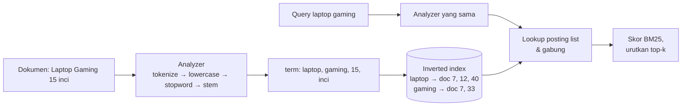
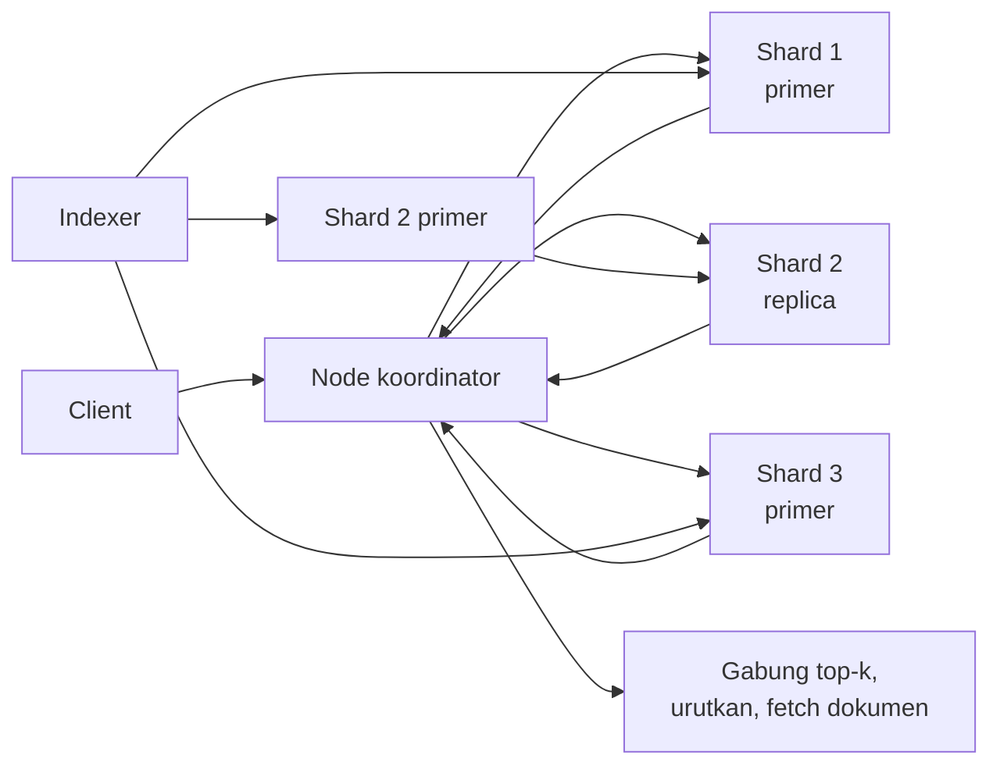
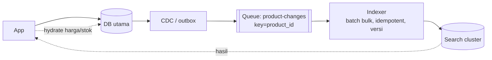

## Tujuan belajar

Setelah pelajaran ini kamu bisa:

- Menjelaskan inverted index, analisis teks, dan skor relevansi (TF-IDF/BM25) pada level yang cukup untuk interview.
- Merancang cluster pencarian: shard, replica, scatter-gather, dan segmen immutable.
- Menjaga index sinkron dengan database utama lewat CDC/queue, dan tahu kapan mengindeks ulang.

## Masalah yang diselesaikan

Query `WHERE name LIKE '%laptop%'` memindai seluruh tabel, tidak mengenali "Laptops", tidak mengurutkan berdasarkan relevansi, dan tidak bisa memberi faset ("merek: 12 hasil"). Pencarian butuh struktur data sendiri: **inverted index** dari term ke daftar dokumen, dibangun dari teks yang sudah dinormalisasi, dengan skor relevansi.

## Dari teks ke index

- **Posting list**: untuk tiap term, daftar id dokumen (plus frekuensi dan posisi untuk frasa), terkompresi dan terurut agar penggabungan (AND/OR) cepat.
- **Analyzer**: tokenisasi, lowercase, stopword, stemming, sinonim; bergantung bahasa (Indonesia ≠ Inggris). Harus **sama** saat index dan saat query.
- **Ranking**: TF-IDF/BM25 (term sering di dokumen ini, jarang di koleksi = relevan), dikombinasikan dengan sinyal bisnis (popularitas, kesegaran, boost field judul) dan terkadang tahap kedua (model ML) untuk top-N.
- **Fitur lain**: faset/agregasi, filter terstruktur (harga, kategori), highlight, typo tolerance (fuzzy), autocomplete (dibahas di studi kasus typeahead).

## Segmen immutable

Index tidak diubah di tempat. Dokumen baru masuk buffer memori, lalu di-_flush_ menjadi **segmen** kecil yang immutable (mirip SSTable). Query membaca semua segmen dan menggabung hasil; segmen kecil digabung berkala (**merge**) di latar belakang. Penghapusan/update = tandai dokumen lama terhapus + tulis dokumen baru. Konsekuensinya: dokumen baru **terlihat setelah refresh** (default ~1 detik), yang disebut _near real-time_.

## Cluster: shard, replica, scatter-gather

- **Shard**: index dipartisi (biasanya hash id dokumen); tiap shard adalah index Lucene mandiri. Jumlah shard primer sulit diubah tanpa reindex; rencanakan dari estimasi ukuran (puluhan GB per shard adalah angka kasar yang sehat).
- **Replica**: salinan shard untuk throughput baca dan ketahanan; tulis masuk ke primer lalu direplikasi.
- **Query**: koordinator menyebar ke satu salinan tiap shard, tiap shard menghitung top-k lokal (fase query), koordinator menggabung lalu mengambil dokumen top-k gabungan (fase fetch). Paginasi dalam (halaman 1.000) mahal karena tiap shard harus mengembalikan k × halaman; pakai _search-after_ / cursor.
- **Routing**: bila query selalu dibatasi tenant, routing dokumen by tenant_id mengirim query ke satu shard saja (hati-hati tenant raksasa).

## Menjaga index sinkron

Index adalah **turunan** dari sumber kebenaran (DB). Jangan dual-write dari aplikasi ke DB dan index; tidak atomik.

- **Indexer** memakai bulk API, dedup by id, dan versi/timestamp agar event lama tidak menimpa yang baru (out-of-order).
- **Reindex penuh** diperlukan saat analyzer/mapping berubah: bangun index baru di samping yang lama, lalu pindahkan **alias**; tanpa downtime.
- **Field kritis** (harga, stok) sebaiknya diambil dari DB saat menampilkan hasil, atau diterima sedikit basi dengan jelas.

## Trade-off ringkas

| Keputusan                                                            | Pilih A bila                                              | Pilih B bila                                       |
| -------------------------------------------------------------------- | --------------------------------------------------------- | -------------------------------------------------- |
| Full-text DB bawaan (Postgres tsvector) (A) vs cluster pencarian (B) | Volume kecil-sedang, fitur dasar cukup, ingin satu sistem | Faset, relevansi kaya, skala besar, bahasa majemuk |
| Shard banyak kecil (A) vs sedikit besar (B)                          | Paralelisme query, pertumbuhan                            | Overhead per shard, query kecil sering             |
| Refresh cepat (A) vs throughput index (B)                            | Konten harus segera terlihat (chat, log)                  | Bulk indexing besar; refresh 30 s+                 |
| Ranking BM25 saja (A) vs + model ML (B)                              | Awal, sederhana, dapat dijelaskan                         | Ada data klik dan tim yang bisa merawatnya         |

## Pertanyaan yang sering ditanya interviewer

- "Kenapa tidak query database langsung?" → Scan penuh, tanpa relevansi/analisis.
- "Bagaimana index tetap sinkron?" → CDC/outbox → queue → indexer idempotent; near real-time; hydrate field kritis.
- "Bagaimana menangani typo dan sinonim?" → Analyzer + fuzzy; sebutkan biaya.
- "Query lambat di halaman dalam?" → Scatter-gather dan deep paging; search-after.
- "Ubah analyzer tanpa downtime?" → Reindex ke index baru + alias switch.
- "Satu shard panas?" → Routing by tenant, pecah tenant besar, replica tambahan.

## Ringkasan

1. Pencarian memakai inverted index dari teks yang dianalisis; relevansi dihitung (BM25) dan digabung sinyal bisnis; analyzer harus sama di index dan query.
2. Cluster membagi index ke shard dan replica; query adalah scatter-gather dua fase; segmen immutable membuat hasil near real-time.
3. Index adalah turunan DB: sinkronkan lewat CDC/queue dengan indexer idempotent, reindex lewat alias, dan hydrate field kritis dari sumber kebenaran.
