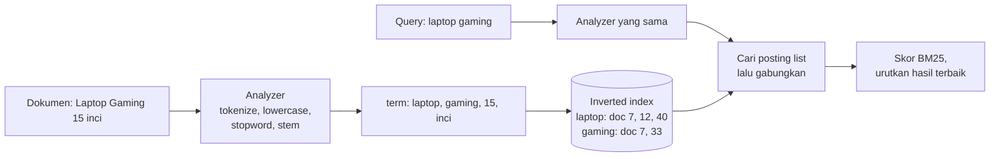
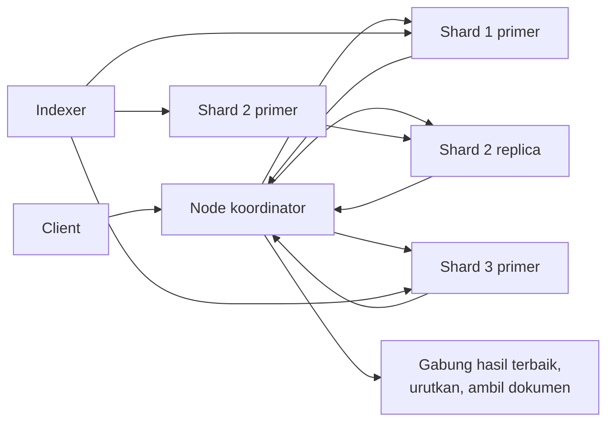
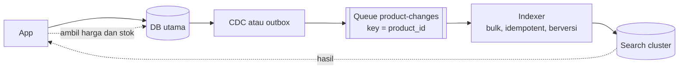

## Tujuan belajar

Setelah pelajaran ini kamu bisa:

- Menjelaskan inverted index, analisis teks, dan skor relevansi pada tingkat yang cukup untuk interview.
- Merancang cluster pencarian dengan shard, replica, dan pola scatter-gather.
- Menjaga index tetap sinkron dengan database utama lewat CDC, dan tahu kapan harus mengindeks ulang.

## Masalah yang diselesaikan

Query `WHERE name LIKE '%laptop%'` memindai seluruh tabel. Ia tidak mengenali "Laptops", tidak mengurutkan berdasarkan relevansi, dan tidak bisa memberi hitungan per kategori. Pencarian butuh struktur data sendiri. Struktur itu adalah inverted index, yaitu peta dari setiap kata ke daftar dokumen yang memuatnya.

## Dari teks ke index

Ada empat bagian yang perlu kamu pahami.

Posting list adalah daftar dokumen untuk satu term. Daftar ini menyimpan id dokumen, frekuensi, dan kadang posisi kata untuk pencarian frasa. Daftarnya terurut dan terkompresi supaya penggabungan AND dan OR cepat.

Analyzer mengubah teks menjadi term yang seragam. Langkahnya memecah kata, menyamakan huruf besar kecil, membuang kata umum, dan memotong imbuhan. Setiap bahasa butuh analyzer berbeda. Analyzer yang sama harus dipakai saat mengindeks dan saat mencari.

Ranking memberi skor relevansi. Rumus yang lazim adalah BM25. Intinya, term yang sering muncul di dokumen ini tetapi jarang di koleksi dianggap relevan. Skor itu lalu digabung dengan sinyal bisnis seperti popularitas dan kesegaran.

Fitur lain yang sering diminta adalah hitungan per kategori, filter terstruktur, highlight, toleransi salah ketik, dan autocomplete. Autocomplete dibahas di studi kasus typeahead.

## Segmen yang tidak pernah diubah

Index tidak diubah di tempat. Dokumen baru masuk ke buffer memori dulu. Buffer itu lalu ditulis menjadi segmen kecil yang tidak pernah diubah lagi, mirip SSTable di key-value store. Query membaca semua segmen dan menggabungkan hasilnya. Segmen kecil digabung berkala di latar belakang.

Penghapusan dan update bekerja dengan menandai dokumen lama sebagai terhapus, lalu menulis dokumen baru. Akibatnya, dokumen baru baru terlihat setelah refresh, biasanya sekitar satu detik. Inilah yang disebut near real-time.

## Cluster: shard, replica, dan scatter-gather

Shard adalah potongan index. Dokumen biasanya dibagi berdasarkan hash id. Tiap shard adalah index Lucene yang berdiri sendiri. Jumlah shard primer sulit diubah tanpa mengindeks ulang, jadi rencanakan dari estimasi ukuran. Puluhan GB per shard adalah angka kasar yang sehat.

Replica adalah salinan shard. Ia menambah kapasitas baca dan ketahanan. Tulisan masuk ke shard primer lalu disalin ke replica.

Query berjalan dalam dua fase. Koordinator menyebar query ke satu salinan tiap shard. Tiap shard menghitung hasil terbaiknya secara lokal. Koordinator menggabungkan, mengurutkan, lalu mengambil dokumen untuk hasil gabungan. Paginasi dalam, misalnya halaman ke-1.000, mahal karena tiap shard harus mengembalikan ribuan kandidat. Pakai cursor seperti search-after untuk itu.

Routing bisa menghemat kerja. Kalau query selalu dibatasi satu tenant, kirim dokumen tenant itu ke satu shard. Query pun hanya menyentuh satu shard. Hati-hati dengan tenant raksasa yang membuat satu shard jauh lebih besar.

## Menjaga index tetap sinkron

Index adalah turunan dari sumber kebenaran, yaitu database. Jangan menulis dari aplikasi ke database dan index sekaligus, karena keduanya tidak bisa dijamin sama.

Cara kerjanya:

1. Aplikasi menulis hanya ke database.
2. CDC, yaitu pembacaan log perubahan database, mengirim setiap perubahan ke queue.
3. Indexer membaca queue dan memperbarui index secara batch.
4. Indexer memakai versi atau timestamp supaya event lama tidak menimpa event baru.
5. Aplikasi mengambil data kritis seperti harga dan stok dari database saat menampilkan hasil.

Indexer harus idempotent, artinya memproses event yang sama dua kali tidak merusak apa pun. Dedup dilakukan berdasarkan id dokumen.

Mengindeks ulang penuh diperlukan saat analyzer atau skema berubah. Caranya, bangun index baru di samping index lama, lalu pindahkan alias. Dengan begitu tidak ada downtime.

## Trade-off ringkas

| Keputusan                                        | Pilih yang pertama bila                                | Pilih yang kedua bila                                                        |
| ------------------------------------------------ | ------------------------------------------------------ | ---------------------------------------------------------------------------- |
| Full-text bawaan database atau cluster pencarian | Volume kecil sampai sedang dan fitur dasar sudah cukup | Butuh hitungan per kategori, relevansi kaya, skala besar, atau banyak bahasa |
| Banyak shard kecil atau sedikit shard besar      | Query butuh paralelisme dan data akan tumbuh           | Query kecil sangat sering dan overhead per shard terasa                      |
| Refresh cepat atau throughput index              | Konten harus segera terlihat, seperti chat dan log     | Sedang mengindeks massal dan refresh 30 detik masih bisa diterima            |
| Ranking BM25 saja atau ditambah model ML         | Baru mulai dan ingin hasil yang bisa dijelaskan        | Sudah ada data klik dan tim yang bisa merawat modelnya                       |

## Pertanyaan yang sering ditanya interviewer

- "Kenapa tidak query database langsung?" Karena hasilnya pemindaian penuh tanpa relevansi dan tanpa analisis teks.
- "Bagaimana index tetap sinkron?" Lewat CDC atau outbox ke queue, lalu indexer yang idempotent. Data kritis diambil dari sumber saat tampil.
- "Bagaimana menangani salah ketik dan sinonim?" Lewat analyzer dan pencarian fuzzy. Sebutkan juga biayanya.
- "Kenapa halaman dalam lambat?" Karena scatter-gather harus mengumpulkan kandidat dari semua shard. Pakai search-after.
- "Bagaimana mengubah analyzer tanpa downtime?" Indeks ulang ke index baru, lalu pindahkan alias.
- "Bagaimana kalau satu shard sangat panas?" Routing per tenant, pecah tenant besar, dan tambah replica.

## Ringkasan

1. Pencarian memakai inverted index dari teks yang sudah dianalisis. Relevansi dihitung dengan BM25 lalu digabung sinyal bisnis, dan analyzer harus sama di index dan query.
2. Cluster membagi index ke shard dan replica. Query berjalan dua fase lewat scatter-gather, dan segmen yang tidak pernah diubah membuat hasil terlihat dalam sekitar satu detik.
3. Index adalah turunan database. Sinkronkan lewat CDC dan indexer yang idempotent, indeks ulang lewat alias, dan ambil data kritis dari sumber kebenaran.
