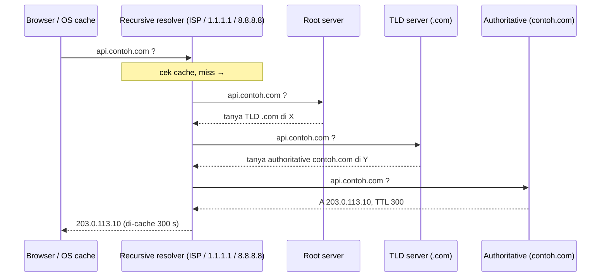
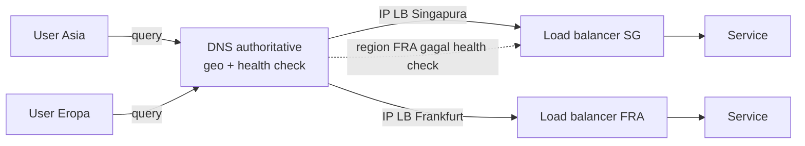

## Tujuan belajar

Setelah pelajaran ini kamu bisa:

- Menjelaskan alur resolusi nama dari browser sampai server authoritative, dan di mana cache berada.
- Memilih jenis record yang tepat dan mengatur TTL untuk migrasi tanpa drama.
- Memakai DNS sebagai alat **routing** (geo, latency, weighted) dan **failover** dalam high-level design, sekaligus tahu batasnya.

## Apa yang diselesaikan DNS

Manusia mengingat nama, jaringan butuh alamat. DNS adalah basis data terdistribusi hirarkis yang memetakan `api.contoh.com` ke `203.0.113.10` (atau ke nama lain, atau ke data lain). Dalam desain sistem, DNS hampir selalu menjadi **kotak pertama** yang dilewati request, dan sering menjadi lapisan routing global yang paling murah.

## Alur resolusi

Tiga hal yang penting untuk desain:

1. **Cache ada di mana-mana**: browser, OS, resolver, bahkan library HTTP. Konsekuensinya perubahan record **tidak instan**; ia menyebar seiring TTL habis.
2. **Resolver rekursif menanggung kerja berat**; authoritative server kamu hanya menerima cache miss. Itulah sebabnya DNS murah dan tahan beban.
3. **Jawaban bisa berbeda per penanya**: authoritative server boleh menjawab berdasarkan siapa yang bertanya. Inilah dasar geo-routing.

## Jenis record yang sering muncul

| Record        | Memetakan                   | Dipakai untuk                                                                   |
| ------------- | --------------------------- | ------------------------------------------------------------------------------- |
| A / AAAA      | nama → IPv4 / IPv6          | Server atau load balancer dengan IP tetap                                       |
| CNAME         | nama → nama lain            | Menunjuk ke load balancer/CDN penyedia yang IP-nya berubah; tidak boleh di apex |
| ALIAS / ANAME | nama apex → nama lain       | Varian CNAME untuk apex, disediakan penyedia DNS                                |
| NS            | zona → server authoritative | Delegasi subdomain ke tim/penyedia lain                                         |
| MX            | domain → mail server        | Email                                                                           |
| TXT           | nama → teks                 | Verifikasi domain, SPF/DKIM                                                     |
| SRV           | layanan → host:port         | Service discovery internal                                                      |

## TTL: tuas kontrol utama

TTL adalah berapa lama jawaban boleh di-cache.

| TTL                       | Kelebihan                                                | Kekurangan                                                      | Kapan                                  |
| ------------------------- | -------------------------------------------------------- | --------------------------------------------------------------- | -------------------------------------- |
| Panjang (jam–hari)        | Beban authoritative kecil, tahan bila authoritative mati | Perubahan lambat menyebar                                       | Record stabil (MX, NS, apex)           |
| Pendek (30–300 s)         | Migrasi dan failover cepat                               | Lebih banyak query ke authoritative; failover tetap butuh ≥ TTL | Endpoint yang bisa berpindah (API, LB) |
| Sangat pendek (&lt; 30 s) | Hampir real-time                                         | Banyak resolver mengabaikan TTL terlalu kecil; latency naik     | Jarang layak                           |

Resep migrasi IP: turunkan TTL ke 60 detik **beberapa hari sebelum** perubahan, ganti record, tunggu, lalu naikkan lagi.

## DNS sebagai alat desain sistem

Dalam high-level design, DNS biasanya muncul untuk tiga tujuan:

1. **Routing global**: _geo_ atau _latency-based_ mengarahkan user ke region terdekat; _weighted_ membagi persentase trafik (berguna untuk canary antar region).
2. **Failover kasar**: health check di penyedia DNS mencabut IP region yang mati. Kasar, karena butuh TTL habis dan ada resolver yang tidak patuh. Untuk failover halus, gunakan load balancer/anycast di lapisan bawah.
3. **Dekoupling**: tim lain cukup diberi nama, bukan IP; infrastruktur bisa berpindah tanpa mengubah client.

Batas yang harus disebut di interview: DNS tidak melihat beban nyata server, keputusan berbasis lokasi **resolver** (bukan user, kecuali EDNS Client Subnet), dan client lama bisa memegang IP basi.

## Kenapa DNS hampir tidak pernah down

- Hirarki + replikasi: 13 alamat root dilayani ratusan server lewat **anycast** (satu IP, banyak lokasi; routing BGP membawa query ke yang terdekat).
- Cache berlapis: mayoritas query tidak pernah mencapai authoritative.
- Stateless UDP: murah; TCP hanya untuk jawaban besar atau zone transfer.
- Namun bukan kebal: serangan DDoS ke penyedia DNS besar pernah menjatuhkan banyak situs sekaligus, karena banyak domain bergantung pada satu penyedia. Mitigasi: dua penyedia DNS authoritative.

## Pertanyaan yang sering ditanya interviewer

- "Bagaimana user tahu harus ke server mana?" → Jelaskan resolusi + geo-routing.
- "Kalau satu region mati, bagaimana user dialihkan?" → DNS health check + TTL pendek, dan sebut bahwa failover sejati butuh waktu ≥ TTL.
- "Kenapa tidak taruh IP langsung di client?" → Dekoupling dan rotasi infrastruktur.
- "Apa risiko mengandalkan DNS untuk failover?" → Cache yang tidak patuh TTL, lokasi resolver, tidak melihat beban.
- "Bagaimana service di dalam cluster saling menemukan?" → DNS internal / service discovery (SRV, CoreDNS di Kubernetes), lebih dinamis dari DNS publik.

## Ringkasan

1. DNS adalah basis data hirarkis dengan cache di setiap lapisan; perubahan menyebar seiring TTL, bukan seketika.
2. Pakai CNAME/ALIAS untuk menunjuk ke penyedia, A untuk IP tetap, dan atur TTL sebagai tuas migrasi dan failover.
3. Dalam desain sistem DNS adalah lapisan routing global yang murah (geo, weighted, failover kasar), tetapi tidak melihat beban nyata dan tidak instan.
