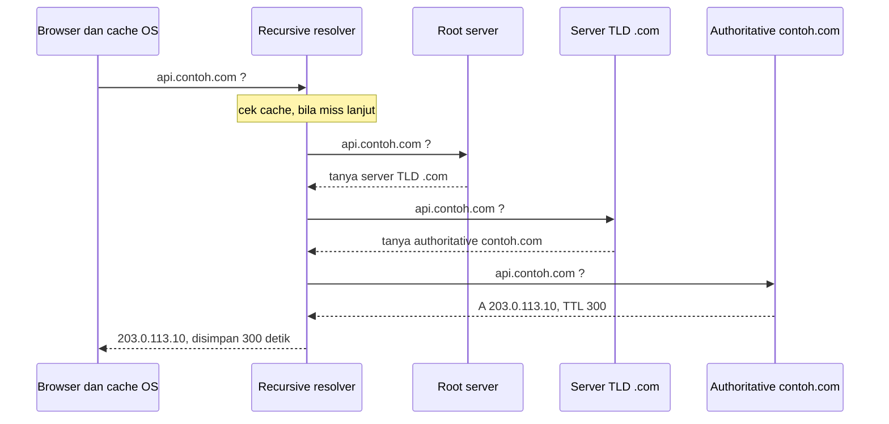
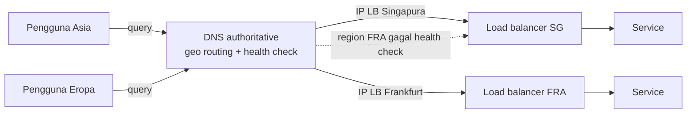

## Tujuan belajar

Setelah pelajaran ini kamu bisa:

- Menjelaskan alur resolusi nama dari browser sampai server authoritative, dan di mana cache berada.
- Memilih jenis record yang tepat dan mengatur TTL untuk migrasi tanpa drama.
- Memakai DNS sebagai alat routing dan failover dalam high-level design, sekaligus tahu batasnya.

## Apa yang diselesaikan DNS

Manusia mengingat nama, sedangkan jaringan butuh alamat. DNS adalah basis data terdistribusi yang memetakan nama seperti `api.contoh.com` ke alamat IP, ke nama lain, atau ke data lain. Dalam desain sistem, DNS hampir selalu menjadi kotak pertama yang dilewati request. Ia juga sering menjadi lapisan routing global yang paling murah.

## Alur resolusi

Ada tiga hal yang penting untuk desain:

1. Cache ada di mana-mana: di browser, sistem operasi, resolver, bahkan library HTTP. Karena itu perubahan record tidak instan. Ia menyebar seiring TTL habis.
2. Resolver rekursif menanggung kerja berat. Server authoritative milikmu hanya menerima cache miss. Itulah sebabnya DNS murah dan tahan beban.
3. Jawaban bisa berbeda per penanya. Server authoritative boleh menjawab berdasarkan siapa yang bertanya. Inilah dasar geo routing.

## Jenis record yang sering muncul

| Record     | Memetakan                    | Dipakai untuk                                                                                       |
| ---------- | ---------------------------- | --------------------------------------------------------------------------------------------------- |
| A dan AAAA | Nama ke IPv4 atau IPv6       | Server atau load balancer dengan IP tetap                                                           |
| CNAME      | Nama ke nama lain            | Menunjuk ke load balancer atau CDN penyedia yang IP-nya berubah. Tidak boleh dipakai di apex domain |
| ALIAS      | Nama apex ke nama lain       | Varian CNAME untuk apex domain, disediakan oleh penyedia DNS                                        |
| NS         | Zona ke server authoritative | Mendelegasikan subdomain ke tim atau penyedia lain                                                  |
| MX         | Domain ke mail server        | Email                                                                                               |
| TXT        | Nama ke teks                 | Verifikasi domain, SPF, DKIM                                                                        |
| SRV        | Layanan ke host dan port     | Penemuan layanan internal                                                                           |

## TTL: tuas kendali utama

TTL adalah berapa lama jawaban boleh di-cache.

| TTL                                     | Kelebihan                                                   | Kekurangan                                                                      | Kapan dipakai                                              |
| --------------------------------------- | ----------------------------------------------------------- | ------------------------------------------------------------------------------- | ---------------------------------------------------------- |
| Panjang, berjam-jam sampai berhari-hari | Beban authoritative kecil dan tahan bila authoritative mati | Perubahan lambat menyebar                                                       | Record stabil seperti MX, NS, apex                         |
| Pendek, 30 sampai 300 detik             | Migrasi dan failover cepat                                  | Lebih banyak query ke authoritative, dan failover tetap butuh waktu sebesar TTL | Endpoint yang bisa berpindah seperti API dan load balancer |
| Sangat pendek, di bawah 30 detik        | Hampir real-time                                            | Banyak resolver mengabaikan TTL sekecil ini, dan latency naik                   | Jarang layak                                               |

Resep migrasi IP: turunkan TTL ke 60 detik beberapa hari sebelum perubahan. Ganti record, tunggu, lalu naikkan TTL lagi.

## DNS sebagai alat desain sistem

Dalam high-level design, DNS biasanya muncul untuk tiga tujuan.

1. Routing global. Geo routing atau routing berbasis latency mengarahkan pengguna ke region terdekat. Weighted routing membagi persentase trafik, berguna untuk canary antar region.
2. Failover kasar. Health check di penyedia DNS mencabut IP region yang mati. Ini kasar karena butuh TTL habis, dan ada resolver yang tidak patuh. Untuk failover halus, pakai load balancer atau anycast di lapisan bawah.
3. Pemisahan. Tim lain cukup diberi nama, bukan IP. Infrastruktur bisa berpindah tanpa mengubah client.

Batas yang harus kamu sebut di interview: DNS tidak melihat beban nyata server. Keputusannya berdasarkan lokasi resolver, bukan pengguna. Client lama juga bisa memegang IP basi.

## Kenapa DNS hampir tidak pernah mati

- Hirarki dan replikasi. Tiga belas alamat root dilayani ratusan server lewat anycast. Anycast berarti satu IP diiklankan dari banyak lokasi, dan routing membawa query ke lokasi terdekat.
- Cache berlapis. Mayoritas query tidak pernah mencapai server authoritative.
- UDP tanpa state. Query murah. TCP hanya dipakai untuk jawaban besar atau transfer zona.
- Meski begitu, DNS tidak kebal. Serangan DDoS ke penyedia DNS besar pernah menjatuhkan banyak situs sekaligus. Mitigasinya memakai dua penyedia DNS authoritative.

## Pertanyaan yang sering ditanya interviewer

- "Bagaimana pengguna tahu harus ke server mana?" Jelaskan resolusi dan geo routing.
- "Kalau satu region mati, bagaimana pengguna dialihkan?" DNS health check dan TTL pendek. Sebut bahwa failover sejati butuh waktu minimal sebesar TTL.
- "Kenapa tidak taruh IP langsung di client?" Supaya infrastruktur bisa berpindah tanpa mengubah client.
- "Apa risiko mengandalkan DNS untuk failover?" Cache yang tidak patuh TTL, lokasi resolver, dan DNS tidak melihat beban.
- "Bagaimana service di dalam cluster saling menemukan?" DNS internal atau service discovery, misalnya record SRV atau CoreDNS di Kubernetes.

## Ringkasan

1. DNS adalah basis data hirarkis dengan cache di setiap lapisan. Perubahan menyebar seiring TTL, bukan seketika.
2. Pakai CNAME atau ALIAS untuk menunjuk ke penyedia, A untuk IP tetap, dan atur TTL sebagai tuas migrasi dan failover.
3. Dalam desain sistem, DNS adalah lapisan routing global yang murah. Tetapi ia tidak melihat beban nyata dan tidak instan.
