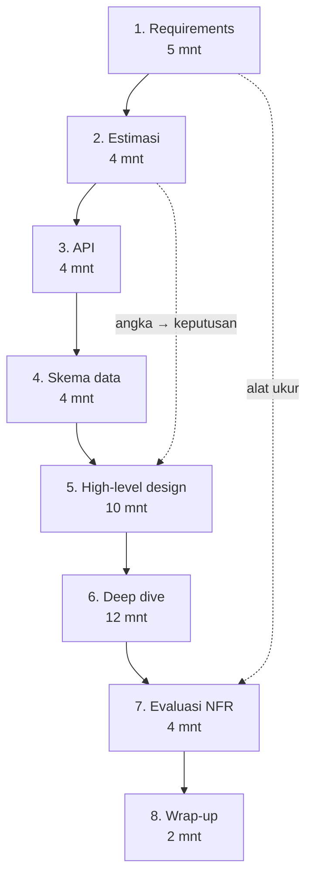

## Tujuan belajar

Setelah pelajaran ini kamu bisa:

- Menjalankan delapan tahap yang sama untuk soal apa pun, dengan anggaran waktu yang total 45 menit.
- Memakai kalimat pembuka dan checklist tiap tahap sehingga tidak ada yang terlewat di bawah tekanan.
- Merangkai building block dari Bagian 2 berdasarkan pola akses yang ditemukan di requirements dan estimasi.

## Kenapa butuh framework

Di bawah tekanan, orang kembali ke kebiasaan. Kalau kebiasaannya "langsung menggambar", itulah yang terjadi. Framework adalah kebiasaan yang disengaja: urutan tetap yang membuat setiap keputusan punya alasan dan setiap menit punya tujuan. Mode Mock Interview di platform ini memakai urutan dan anggaran waktu yang sama, jadi latihlah sampai otomatis.

## Delapan tahap

### 1. Requirements (5 menit)

Kalimat pembuka: "Sebelum menggambar, saya ingin memastikan scope-nya."

- Functional: 3–5 fitur inti; tulis yang **out of scope** secara eksplisit.
- Non-functional: skala (DAU, data), latency target, konsistensi vs availability per fitur, durability, keamanan/privasi bila relevan.
- Tanya: siapa user, rasio baca/tulis, pola trafik (peak), apakah global.

Checklist: fitur inti ditulis · out of scope ditulis · NFR punya angka · asumsi dikonfirmasi.

### 2. Estimasi (4 menit)

Kalimat pembuka: "Saya hitung cepat supaya tahu komponen mana yang perlu scaling."

- QPS baca/tulis + peak (2–3x), storage 5 tahun, bandwidth, ukuran cache (80/20).
- Setiap angka diakhiri keputusan: "jadi butuh cache", "jadi satu DB cukup untuk tulis".

Checklist: QPS · storage · bandwidth · cache · tiap angka → keputusan.

### 3. API (4 menit)

Kalimat pembuka: "Ini kontrak yang dipakai client."

- Endpoint utama (buat, baca, daftar), parameter, paginasi cursor, idempotency key untuk tulis, auth, rate limit, error utama.

Checklist: endpoint inti · idempotency · paginasi · error.

### 4. Skema data (4 menit)

Kalimat pembuka: "Pola aksesnya menentukan model datanya."

- Entitas dan relasi, kunci akses utama, pilihan jenis DB dengan alasan (lihat modul database), kandidat shard key, apa yang disimpan di blob store vs DB.

Checklist: entitas · kunci akses · jenis DB + alasan · shard key · biner ke blob.

### 5. High-level design (10 menit)

Kalimat pembuka: "Saya gambar alur end-to-end dulu, baru kita dalami."

- Client → DNS/CDN → LB → service → cache → DB, plus queue/worker untuk kerja async, blob store untuk file, search bila ada pencarian.
- Jelaskan **satu alur baca** dan **satu alur tulis** end-to-end.
- Kaitkan ke angka: "4.000 QPS baca lewat cache; 40 tulis ke primary".

Checklist: semua fitur inti punya jalur · alur baca & tulis dijelaskan · komponen diberi nama · angka dirujuk.

### 6. Deep dive (12 menit)

Kalimat pembuka: "Tiga bagian yang paling berisiko adalah X, Y, Z. Mana yang ingin Anda dalami?"

- Pilih 2–3 komponen kritis: biasanya data (partisi, replikasi, konsistensi), cache (strategi, stampede, hot key), queue (semantik, idempotency, urutan), atau komponen khusus soal (ID generator, geo-index, fanout).
- Untuk tiap komponen: cara kerja internal, failure mode, alternatif yang ditolak.

Checklist: 2–3 komponen · internal · failure mode · alternatif + alasan · tidak tenggelam &gt; 5 menit di satu komponen tanpa cek ke interviewer.

### 7. Evaluasi NFR (4 menit)

Kalimat pembuka: "Saya cek lagi terhadap target di awal."

- Tabel cepat: tiap NFR → bagaimana dipenuhi → risiko tersisa.
- Single point of failure, bottleneck pertama saat 10x, apa yang didegradasi saat komponen X mati.
- Observability: metrik dan alert utama.

Checklist: tiap NFR dicek · SPOF · bottleneck 10x · degradasi · monitoring.

### 8. Wrap-up (2 menit)

Kalimat pembuka: "Kalau ada waktu lagi, saya akan…"

- Rangkuman 2 kalimat, bagian yang paling tidak yakin, perbaikan berikutnya.

## Peta building block ke sinyal requirements

| Sinyal di requirements/estimasi                | Building block yang biasanya masuk                   |
| ---------------------------------------------- | ---------------------------------------------------- |
| Baca ≫ tulis                                   | Cache, read replica, CDN                             |
| Tulis tinggi / data besar                      | Sharding, KV/wide-column, LSM store                  |
| Kerja lambat atau rentan gagal di request path | Message queue + worker, task scheduler               |
| Banyak pihak peduli satu kejadian              | Pub-sub, outbox                                      |
| File besar                                     | Blob store + presigned URL + CDN                     |
| Pencarian teks / faset                         | Distributed search via CDC                           |
| ID unik di banyak node                         | Snowflake / UUID v7                                  |
| Counter panas                                  | Sharded counter, agregasi memori                     |
| Abuse / kuota                                  | Rate limiter di gateway                              |
| Global, latency sensitif                       | DNS geo-routing, multi-region, CDN                   |
| "Bagaimana kamu tahu ini sehat?"               | Monitoring (RED, SLO alert), logging dengan trace_id |

## Manajemen waktu

- Tulis agenda 8 tahap di sudut papan; coret saat selesai.
- Kalau sebuah tahap melewati anggaran 50%, kunci asumsi dan lanjut; katakan itu keras-keras.
- Interviewer yang mengarahkan ke satu area berarti itu yang dinilai; ikuti, tapi tetap sisakan 5 menit untuk evaluasi dan wrap-up.

## Trade-off: seberapa kaku memakai framework

| Pilihan                       | Kelebihan                              | Kekurangan                                         | Saran                                                              |
| ----------------------------- | -------------------------------------- | -------------------------------------------------- | ------------------------------------------------------------------ |
| Kaku, urutan selalu sama      | Tidak ada yang terlewat; mudah dilatih | Terasa mekanis bila interviewer punya alur sendiri | Default; sebutkan agendanya di awal agar interviewer bisa mengubah |
| Adaptif mengikuti interviewer | Terasa kolaboratif                     | Mudah kehilangan tahap (sering evaluasi)           | Ikuti arahan, tapi kembali ke checklist di 5 menit terakhir        |
| Melompat ke deep dive favorit | Menunjukkan keahlian cepat             | Interviewer tidak melihat gambaran utuh            | Hanya bila interviewer memintanya                                  |

## Pertanyaan yang sering ditanya interviewer

- "Mau mulai dari mana?" → Requirements; sebut agenda 8 tahap.
- "Kita hanya punya 30 menit." → Potong: estimasi 2, API+data 4, HLD 8, deep dive 8, evaluasi 3, wrap-up 1; tetap semua tahap.
- "Lewati estimasi, langsung desain." → Patuhi, tapi sebutkan asumsi skala dalam satu kalimat karena desain bergantung padanya.
- "Mana yang paling kamu khawatirkan?" → Jawaban dari tahap evaluasi; selalu siapkan satu.

## Ringkasan

1. Delapan tahap dengan anggaran 45 menit: requirements → estimasi → API → skema data → high-level → deep dive → evaluasi → wrap-up; requirements di awal menjadi alat ukur di akhir.
2. Setiap tahap punya kalimat pembuka dan checklist; angka dari estimasi harus terlihat sebagai keputusan di high-level design.
3. Soal baru diubah menjadi kombinasi building block yang dikenal lewat sinyal requirements; latih urutannya di mode Mock Interview sampai otomatis.
