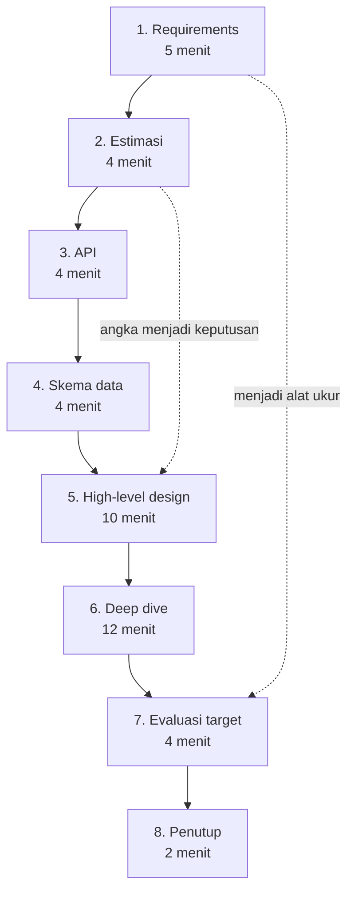

## Tujuan belajar

Setelah pelajaran ini kamu bisa:

- Menjalankan delapan tahap yang sama untuk soal apa pun, dengan jatah waktu yang totalnya 45 menit.
- Memakai kalimat pembuka dan checklist tiap tahap supaya tidak ada yang terlewat di bawah tekanan.
- Merangkai building block dari Bagian 2 berdasarkan pola akses yang ditemukan di requirements dan estimasi.

## Kenapa butuh framework

Di bawah tekanan, orang kembali ke kebiasaan. Kalau kebiasaannya langsung menggambar, itulah yang terjadi. Framework adalah kebiasaan yang disengaja. Urutannya tetap, sehingga setiap keputusan punya alasan dan setiap menit punya tujuan. Mode Mock Interview di platform ini memakai urutan dan jatah waktu yang sama, jadi latihlah sampai otomatis.

## Delapan tahap

### 1. Requirements, 5 menit

Kalimat pembuka: "Sebelum menggambar, saya ingin memastikan cakupannya."

- Tulis 3 sampai 5 fitur inti, dan tulis juga yang sengaja tidak dibahas.
- Tulis target non-fungsional dengan angka: skala pengguna dan data, latency, konsistensi atau ketersediaan per fitur, durability, dan keamanan bila relevan.
- Tanyakan siapa penggunanya, rasio baca dan tulis, pola trafik, dan apakah sistemnya global.

Checklist: fitur inti tertulis, cakupan yang dilewati tertulis, target punya angka, asumsi dikonfirmasi.

### 2. Estimasi, 4 menit

Kalimat pembuka: "Saya hitung cepat supaya tahu komponen mana yang perlu scaling."

- Hitung QPS baca dan tulis, lalu puncaknya sekitar 2 sampai 3 kali rata-rata.
- Hitung storage 5 tahun, bandwidth, dan ukuran cache dengan aturan 80/20.
- Akhiri setiap angka dengan keputusan, misalnya "jadi butuh cache" atau "jadi satu database cukup untuk tulis".

Checklist: QPS, storage, bandwidth, cache, dan tiap angka menghasilkan keputusan.

### 3. API, 4 menit

Kalimat pembuka: "Ini kontrak yang dipakai client."

- Tulis endpoint utama untuk membuat, membaca, dan mendaftar.
- Sebutkan parameter, paginasi dengan cursor, dan idempotency key untuk request tulis.
- Sebutkan autentikasi, rate limit, dan error utama.

Checklist: endpoint inti, idempotency, paginasi, error.

### 4. Skema data, 4 menit

Kalimat pembuka: "Pola aksesnya menentukan model datanya."

- Tulis entitas dan relasinya, serta kunci akses utama.
- Pilih jenis database dengan alasan, lihat modul database.
- Sebutkan kandidat shard key, dan pisahkan apa yang masuk blob store dari apa yang masuk database.

Checklist: entitas, kunci akses, jenis database dengan alasan, shard key, biner ke blob store.

### 5. High-level design, 10 menit

Kalimat pembuka: "Saya gambar alurnya dari awal sampai akhir dulu, baru kita dalami."

- Gambar dari client ke DNS atau CDN, load balancer, service, cache, dan database. Tambahkan queue dan worker untuk kerja asinkron, blob store untuk file, dan search bila ada pencarian.
- Jelaskan satu alur baca dan satu alur tulis dari awal sampai akhir.
- Kaitkan ke angka, misalnya "4.000 request baca per detik lewat cache, 40 tulis ke primary".

Checklist: semua fitur inti punya jalur, alur baca dan tulis dijelaskan, komponen diberi nama, angka dirujuk.

### 6. Deep dive, 12 menit

Kalimat pembuka: "Tiga bagian yang paling berisiko adalah X, Y, dan Z. Mana yang ingin Anda dalami?"

- Pilih 2 sampai 3 komponen kritis. Biasanya data dengan partisi, replikasi, dan konsistensinya. Lalu cache dengan strateginya dan key panasnya. Lalu queue dengan jaminan pengiriman dan urutannya. Atau komponen khusus soal, seperti ID generator atau index geospasial.
- Untuk tiap komponen, jelaskan cara kerja dalamnya, cara gagalnya, dan alternatif yang ditolak.

Checklist: 2 sampai 3 komponen, cara kerja dalam, cara gagal, alternatif dan alasan, dan tidak lebih dari 5 menit di satu komponen tanpa mengecek ke interviewer.

### 7. Evaluasi target, 4 menit

Kalimat pembuka: "Saya cek lagi terhadap target di awal."

- Buat tabel cepat: tiap target, cara memenuhinya, risiko yang tersisa.
- Sebutkan titik yang kalau mati menjatuhkan semuanya, bottleneck pertama saat beban 10 kali, dan apa yang dikurangi saat komponen X mati.
- Sebutkan metrik dan alert utama.

Checklist: tiap target dicek, titik lemah, bottleneck 10 kali, degradasi, pemantauan.

### 8. Penutup, 2 menit

Kalimat pembuka: "Kalau ada waktu lagi, saya akan..."

- Rangkum dalam dua kalimat, sebut bagian yang paling tidak kamu yakini, dan sebut perbaikan berikutnya.

## Peta building block ke sinyal requirements

| Sinyal di requirements atau estimasi               | Building block yang biasanya masuk                                    |
| -------------------------------------------------- | --------------------------------------------------------------------- |
| Baca jauh lebih banyak dari tulis                  | Cache, read replica, CDN                                              |
| Tulis tinggi atau data besar                       | Sharding, key-value atau wide-column store, LSM store                 |
| Kerja lambat atau rentan gagal di jalur request    | Message queue dengan worker, task scheduler                           |
| Banyak pihak peduli satu kejadian                  | Pub-sub, outbox                                                       |
| File besar                                         | Blob store dengan presigned URL dan CDN                               |
| Pencarian teks atau faset                          | Distributed search yang diisi lewat CDC                               |
| ID unik di banyak node                             | ID ala Snowflake atau UUID v7                                         |
| Counter panas                                      | Sharded counter, agregasi memori                                      |
| Penyalahgunaan atau kuota                          | Rate limiter di gateway                                               |
| Global dan sensitif latency                        | DNS geo-routing, multi-region, CDN                                    |
| Pertanyaan "bagaimana kamu tahu sistem ini sehat?" | Monitoring dengan RED dan alert berbasis SLO, logging dengan trace_id |

## Manajemen waktu

- Tulis agenda 8 tahap di sudut papan dan coret saat selesai.
- Kalau sebuah tahap melewati jatahnya 50%, kunci asumsi dan lanjut. Katakan itu keras-keras.
- Interviewer yang mengarahkan ke satu area berarti area itu yang dinilai. Ikuti, tetapi sisakan 5 menit untuk evaluasi dan penutup.

## Trade-off: seberapa kaku memakai framework

| Pilihan                        | Kelebihan                                 | Kekurangan                                         | Saran                                                                            |
| ------------------------------ | ----------------------------------------- | -------------------------------------------------- | -------------------------------------------------------------------------------- |
| Kaku dengan urutan selalu sama | Tidak ada yang terlewat dan mudah dilatih | Terasa mekanis bila interviewer punya alur sendiri | Jadikan default, dan sebutkan agendanya di awal supaya interviewer bisa mengubah |
| Adaptif mengikuti interviewer  | Terasa kolaboratif                        | Mudah kehilangan tahap, terutama evaluasi          | Ikuti arahan, tetapi kembali ke checklist di 5 menit terakhir                    |
| Melompat ke deep dive favorit  | Menunjukkan keahlian dengan cepat         | Interviewer tidak melihat gambaran utuh            | Hanya bila interviewer memintanya                                                |

## Pertanyaan yang sering ditanya interviewer

- "Mau mulai dari mana?" Dari requirements. Sebutkan agenda 8 tahapnya.
- "Kita hanya punya 30 menit." Potong jatahnya: estimasi 2, API dan data 4, high-level 8, deep dive 8, evaluasi 3, penutup 1. Semua tahap tetap ada.
- "Lewati estimasi, langsung desain." Patuhi, tetapi sebutkan asumsi skala dalam satu kalimat karena desain bergantung padanya.
- "Mana yang paling kamu khawatirkan?" Jawab dari tahap evaluasi. Selalu siapkan satu.

## Ringkasan

1. Delapan tahap dengan jatah 45 menit: requirements, estimasi, API, skema data, high-level, deep dive, evaluasi, penutup. Requirements di awal menjadi alat ukur di akhir.
2. Setiap tahap punya kalimat pembuka dan checklist. Angka dari estimasi harus terlihat sebagai keputusan di high-level design.
3. Soal baru diubah menjadi kombinasi building block yang dikenal lewat sinyal requirements. Latih urutannya di mode Mock Interview sampai otomatis.
