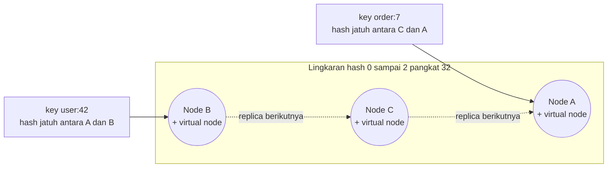
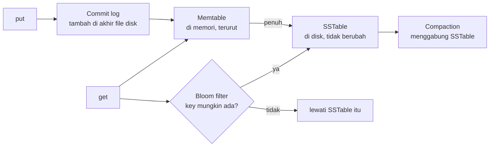

## Tujuan belajar

Setelah pelajaran ini kamu bisa:

- Merancang KV store terdistribusi dari nol: API, partisi, replikasi, konsistensi, dan kegagalan.
- Menjelaskan consistent hashing dengan virtual node, dan quorum dengan N, W, dan R.
- Menyebut cara menangani konflik tulis dan cara satu node menyimpan data dengan LSM-tree.

## Masalah yang diselesaikan

API-nya hanya dua: `put(key, value)` dan `get(key)`. Yang sulit adalah membuatnya tersebar di banyak node, tahan node mati, dan tetap cepat. Hampir semua sistem NoSQL skala besar seperti Dynamo, Cassandra, Riak, dan Redis Cluster adalah variasi dari pola yang akan kita bahas. Pertanyaan "rancang key-value store" adalah cara interviewer menguji pemahaman distributed system secara menyeluruh.

## Requirements yang biasa diasumsikan

- Key kecil, di bawah 1 KB. Value kecil sampai sedang, di bawah 1 MB.
- Data terlalu besar untuk satu node, jadi harus dipartisi.
- Ketersediaan tinggi, dengan konsistensi yang bisa disetel.
- Latency baca dan tulis dalam hitungan milidetik.

## Partisi: consistent hashing

Cara naif memakai hash dibagi N node. Saat N berubah, hampir semua pemetaan ikut berubah. Consistent hashing menaruh node dan key di satu lingkaran. Sebuah key dimiliki node pertama searah jarum jam. Menambah atau menghapus node hanya memindahkan key di satu segmen.

Dua penyempurnaan yang selalu disebut:

- Virtual node. Tiap node fisik menempati banyak titik di lingkaran, supaya sebaran merata. Node yang lebih besar bisa diberi lebih banyak virtual node.
- Replikasi ke N node berikutnya di lingkaran, dengan melompati virtual node milik node fisik yang sama.

## Replikasi dan quorum

Setiap key disimpan di N replica. Tulisan menunggu W ack. Bacaan menunggu R jawaban.

| Setelan                                                 | Sifat                                           | Dipakai untuk                               |
| ------------------------------------------------------- | ----------------------------------------------- | ------------------------------------------- |
| W ditambah R lebih besar dari N, misalnya N 3, W 2, R 2 | Bacaan selalu beririsan dengan tulisan terakhir | Pilihan default yang seimbang               |
| W 1 dan R sama dengan N                                 | Tulis sangat cepat, baca mahal                  | Beban tulis berat dengan bacaan jarang      |
| W sama dengan N dan R 1                                 | Baca cepat, tulis lambat dan rapuh              | Beban baca berat dengan data jarang berubah |
| W 1 dan R 1                                             | Paling cepat, paling tidak konsisten            | Cache dan metrik yang boleh basi            |

Quorum bukan linearizability. Tulisan yang gagal sebagian, tulisan bersamaan, dan sloppy quorum bisa membuat bacaan melihat versi berbeda. Sloppy quorum berarti menulis ke node pengganti saat replica sebenarnya mati, lalu hinted handoff mengembalikannya nanti. Karena itu dibutuhkan versi pada setiap value.

## Konflik dan versi

| Mekanisme       | Cara kerja                                                             | Kelebihan                                 | Kekurangan                                             |
| --------------- | ---------------------------------------------------------------------- | ----------------------------------------- | ------------------------------------------------------ |
| Last-write-wins | Timestamp terbesar menang                                              | Sederhana                                 | Diam-diam membuang tulisan dan bergantung pada jam     |
| Vector clock    | Tiap replica menaikkan counternya, sehingga versi bersamaan terdeteksi | Tidak ada data hilang tanpa sepengetahuan | Aplikasi harus merekonsiliasi, dan clock bisa membesar |
| CRDT            | Tipe data yang bisa digabung secara matematis                          | Rekonsiliasi otomatis                     | Hanya untuk operasi yang urutannya tidak penting       |

Replica dijaga sinkron di latar belakang dengan dua cara. Read repair memperbarui replica basi saat bacaan menemukan versi berbeda. Anti-entropy memakai Merkle tree, yaitu pohon hash per rentang key, agar hanya bagian berbeda yang ditransfer.

## Kegagalan: mendeteksi dan bertahan

- Deteksi memakai gossip protocol. Tiap node bertukar daftar anggota dan heartbeat secara acak, sehingga tidak ada koordinator pusat.
- Node mati sementara ditangani sloppy quorum dan hinted handoff.
- Node mati permanen ditangani anti-entropy yang membangun ulang replica dari node lain.
- Datacenter mati ditangani dengan menempatkan replica lintas rack, zona, atau region.

## Jalur tulis dan baca di satu node

Pola ini disebut LSM-tree. Tulisan selalu sekuensial, jadi cepat dan tahan crash lewat commit log. Bacaan memeriksa memtable lalu SSTable dari yang terbaru. Bloom filter adalah struktur kecil yang menjawab "key ini pasti tidak ada" dengan cepat, sehingga file yang tidak relevan dilewati. Alternatifnya adalah B-tree yang memperbarui data di tempat. B-tree lebih cepat untuk bacaan acak, tetapi lebih lambat untuk tulisan masif. Pola LSM-tree dipakai Cassandra, RocksDB, dan LevelDB.

## Trade-off ringkas

| Keputusan                            | Pilih yang pertama bila                                           | Pilih yang kedua bila                               |
| ------------------------------------ | ----------------------------------------------------------------- | --------------------------------------------------- |
| Quorum tanpa leader atau satu leader | Ketersediaan tulis di banyak region, dan konflik bisa ditoleransi | Ingin tanpa konflik dan urutan tulis jelas          |
| Last-write-wins atau vector clock    | Kehilangan tulisan bersamaan dapat diterima                       | Setiap tulisan berharga, misalnya keranjang belanja |
| LSM-tree atau B-tree                 | Beban tulis berat                                                 | Beban baca acak berat dengan latency stabil         |
| Di memori atau di disk               | Latency di bawah satu milidetik dan data muat di RAM              | Data besar dan durability utama                     |

## Pertanyaan yang sering ditanya interviewer

- "Bagaimana menambah node tanpa memindahkan semua data?" Consistent hashing dengan virtual node.
- "Pilih W dan R berapa, kenapa?" Kaitkan dengan rasio baca tulis dan kebutuhan konsistensi.
- "Dua tulisan bersamaan ke key yang sama, siapa menang?" Last-write-wins atau vector clock, dan kenapa.
- "Bagaimana node tahu node lain mati?" Gossip dan heartbeat, lalu sloppy quorum saat mati sementara.
- "Bagaimana satu node menyimpan data agar tulis cepat?" Commit log, memtable, SSTable, compaction, dan bloom filter.
- "Kapan tidak memakai KV store?" Saat butuh join, transaksi banyak key, atau query sekunder yang kaya.

## Ringkasan

1. KV store terdistribusi memakai consistent hashing untuk partisi, replikasi ke N node berikutnya, dan quorum W dan R yang bisa disetel. Irisan quorum bukan berarti linearizable.
2. Konflik tulis tidak bisa dihindari pada sistem AP. Pilih last-write-wins yang sederhana atau vector clock yang aman, dan sinkronkan replica lewat read repair dan Merkle tree.
3. Di satu node, LSM-tree membuat tulisan sekuensial dan cepat. Bacaan dibantu bloom filter dan compaction.
