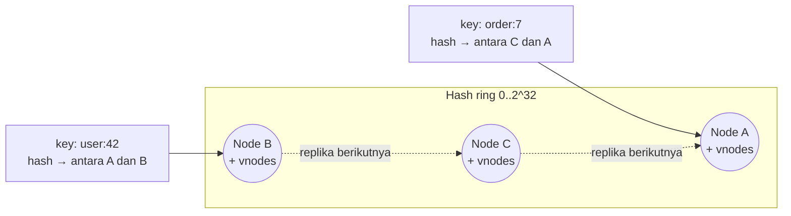
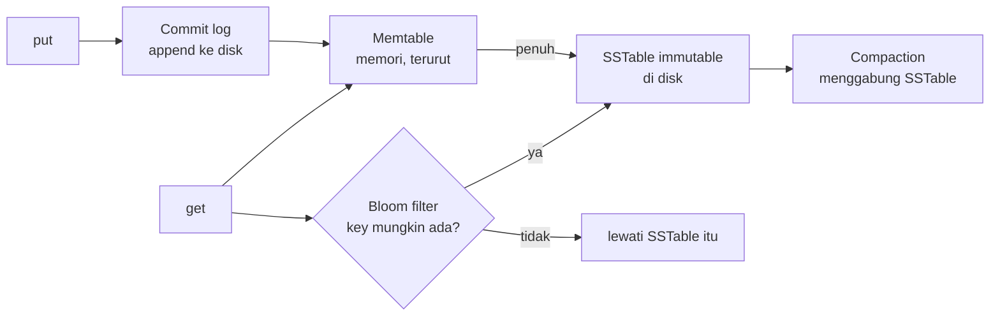

## Tujuan belajar

Setelah pelajaran ini kamu bisa:

- Merancang KV store terdistribusi dari nol: API, partisi, replikasi, konsistensi, dan kegagalan.
- Menjelaskan consistent hashing (dengan virtual node) dan quorum N/W/R.
- Menyebut cara menangani konflik tulis (vector clock, LWW) dan cara satu node menyimpan data (LSM-tree).

## Masalah yang diselesaikan

API-nya hanya dua: `put(key, value)` dan `get(key)`. Yang sulit adalah membuatnya **tersebar di banyak node**, **tahan node mati**, dan **tetap cepat**. Hampir semua sistem "NoSQL" skala besar (Dynamo, Cassandra, Riak, Redis Cluster) adalah variasi dari pola yang akan kita bahas, dan pertanyaan "rancang key-value store" adalah cara interviewer menguji pemahaman distributed system secara menyeluruh.

## Requirements yang biasa diasumsikan

- Key kecil (&lt; 1 KB), value kecil-sedang (&lt; 10 KB–1 MB).
- Data terlalu besar untuk satu node; harus dipartisi.
- Availability tinggi; mentoleransi konsistensi yang bisa disetel (tunable).
- Latency baca/tulis rendah (ms).

## Partisi: consistent hashing

Cara naif `hash(key) mod N` mengacak hampir semua pemetaan saat N berubah. **Consistent hashing** menaruh node dan key di satu ring; key dimiliki node pertama searah jarum jam. Menambah/menghapus node hanya memindahkan key di satu segmen.

Dua penyempurnaan yang selalu disebut:

- **Virtual node**: tiap node fisik menempati banyak titik di ring supaya sebaran merata dan node yang lebih besar bisa diberi lebih banyak vnode.
- **Replikasi ke N node berikutnya** di ring (preference list), melompati vnode milik node fisik yang sama.

## Replikasi dan quorum

Setiap key disimpan di N replica. Tulis menunggu **W** ack, baca menunggu **R** jawaban.

| Setelan                           | Sifat                                       | Dipakai untuk                   |
| --------------------------------- | ------------------------------------------- | ------------------------------- |
| W + R &gt; N (mis. N=3, W=2, R=2) | Baca selalu beririsan dengan tulis terakhir | Default yang seimbang           |
| W = 1, R = N                      | Tulis sangat cepat, baca mahal              | Write-heavy, baca jarang        |
| W = N, R = 1                      | Baca cepat, tulis lambat dan rapuh          | Read-heavy, data jarang berubah |
| W = 1, R = 1                      | Paling cepat, paling tidak konsisten        | Cache, metrik yang boleh basi   |

Quorum bukan linearizability: tulis yang gagal sebagian, concurrent write, dan **sloppy quorum** (menulis ke node pengganti saat replica sebenarnya mati, lalu _hinted handoff_ mengembalikannya) semuanya bisa membuat baca melihat versi berbeda. Karena itu dibutuhkan **versioning**.

## Konflik dan versi

| Mekanisme             | Cara                                                           | Kelebihan                                 | Kekurangan                                                  |
| --------------------- | -------------------------------------------------------------- | ----------------------------------------- | ----------------------------------------------------------- |
| Last-write-wins (LWW) | Timestamp terbesar menang                                      | Sederhana                                 | Diam-diam membuang tulisan; bergantung pada jam             |
| Vector clock          | Tiap replica menaikkan counternya; versi concurrent terdeteksi | Tidak ada data hilang tanpa sepengetahuan | Aplikasi harus merekonsiliasi siblings; clock bisa membesar |
| CRDT                  | Tipe data yang bisa digabung secara matematis (counter, set)   | Rekonsiliasi otomatis                     | Hanya untuk operasi yang komutatif                          |

Menjaga replica tetap sinkron di latar belakang: **read repair** (saat baca menemukan versi berbeda, perbarui yang basi) dan **anti-entropy** dengan **Merkle tree** (membandingkan hash per rentang key agar hanya bagian berbeda yang ditransfer).

## Kegagalan: mendeteksi dan bertahan

- **Deteksi**: gossip protocol; tiap node bertukar daftar anggota dan heartbeat secara acak, sehingga tidak ada koordinator pusat.
- **Node mati sementara**: sloppy quorum + hinted handoff.
- **Node mati permanen**: anti-entropy membangun ulang replica dari node lain.
- **Datacenter mati**: replica ditempatkan lintas rack/zone/region (rack-aware placement).

## Jalur tulis dan baca di satu node (LSM-tree)

Tulis selalu sekuensial (cepat, durable lewat commit log). Baca memeriksa memtable lalu SSTable dari yang terbaru; bloom filter menghindari pembacaan file yang pasti tidak punya key. Alternatifnya **B-tree** (update in-place), lebih cepat untuk baca acak, lebih lambat untuk tulis masif. Pola ini sama dengan yang dipakai Cassandra, RocksDB, dan LevelDB.

## Trade-off ringkas

| Keputusan                                                 | Pilih A bila                                            | Pilih B bila                                      |
| --------------------------------------------------------- | ------------------------------------------------------- | ------------------------------------------------- |
| Leaderless quorum (A) vs single-leader (B)                | Availability tulis di banyak region; toleransi konflik  | Ingin tanpa konflik dan urutan tulis jelas        |
| LWW (A) vs vector clock (B)                               | Kehilangan tulisan concurrent dapat diterima            | Setiap tulisan berharga (keranjang belanja)       |
| LSM-tree (A) vs B-tree (B)                                | Write-heavy, append dominan                             | Read-heavy acak, range scan dengan latency stabil |
| In-memory (Redis) (A) vs on-disk (Cassandra/DynamoDB) (B) | Latency sub-ms, data muat di RAM, boleh hilang sebagian | Data besar, durability utama                      |

## Pertanyaan yang sering ditanya interviewer

- "Bagaimana menambah node tanpa memindahkan semua data?" → Consistent hashing + vnode.
- "Pilih W dan R berapa, kenapa?" → Kaitkan dengan rasio baca/tulis dan kebutuhan konsistensi.
- "Dua tulisan bersamaan ke key yang sama, siapa menang?" → LWW vs vector clock, dan kenapa.
- "Bagaimana node tahu node lain mati?" → Gossip + heartbeat; sloppy quorum saat mati sementara.
- "Bagaimana satu node menyimpan data agar tulis cepat?" → Commit log + memtable + SSTable + compaction + bloom filter.
- "Kapan tidak memakai KV store?" → Saat butuh join, transaksi multi-key, atau query sekunder yang kaya.

## Ringkasan

1. KV store terdistribusi = consistent hashing untuk partisi, replikasi ke N node berikutnya, dan quorum W/R yang bisa disetel; W + R &gt; N memberi irisan, bukan linearizability.
2. Konflik tulis tidak bisa dihindari pada sistem AP; pilih LWW (sederhana, bisa kehilangan data) atau vector clock (aman, aplikasi merekonsiliasi), dan sinkronkan replica lewat read repair dan Merkle tree.
3. Di satu node, LSM-tree membuat tulis sekuensial dan cepat; baca dibantu bloom filter dan compaction.
