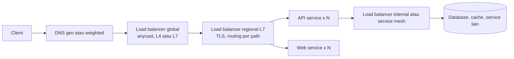

## Tujuan belajar

Setelah pelajaran ini kamu bisa:

- Menjelaskan apa yang dilakukan load balancer selain membagi trafik: health check, TLS, routing, dan perlindungan.
- Memilih antara L4 dan L7, serta algoritma pembagian yang cocok untuk pola trafik tertentu.
- Menjawab pertanyaan "bagaimana load balancer-nya sendiri tidak menjadi titik gagal?" dan menempatkannya di tiga lapisan arsitektur.

## Kenapa ada load balancer

Begitu satu server tidak cukup, kamu menambah server. Dua masalah langsung muncul. Siapa yang membagi request? Bagaimana client tidak perlu tahu server mana yang hidup? Load balancer menjawab keduanya. Ia juga menjadi titik kendali untuk hal-hal yang berlaku lintas server: TLS, routing, rate limit, dan pemantauan.

## Di mana load balancer berada

Tiga lapisan yang lazim disebut di interview:

1. Global: memilih region, lewat DNS atau anycast.
2. Edge atau regional: menerima trafik publik, memutus TLS, dan mengarahkan per path atau host ke kelompok service.
3. Internal: antar service di dalam datacenter, sering berupa sidecar, service mesh, atau load balancing di sisi client.

## L4 dan L7

L4 bekerja di lapisan transport. L7 bekerja di lapisan aplikasi dan memahami HTTP.

| Aspek        | L4                                              | L7                                                                   |
| ------------ | ----------------------------------------------- | -------------------------------------------------------------------- |
| Yang dilihat | IP, port, dan nama host di TLS                  | Method, path, header, cookie, gRPC                                   |
| Keputusan    | Per koneksi                                     | Per request                                                          |
| Kemampuan    | Throughput sangat tinggi untuk protokol apa pun | Routing cerdas, TLS termination, kompresi, rate limit, retry, canary |
| Biaya        | CPU rendah                                      | CPU lebih tinggi, karena harus mem-parse protokol                    |
| Contoh       | IPVS, Maglev, cloud NLB                         | NGINX, Envoy, HAProxy, cloud ALB                                     |

Pola umumnya: L4 di depan untuk menyerap volume dan serangan, L7 di belakangnya untuk kecerdasan.

## Algoritma pembagian

| Algoritma                             | Cara kerja                                    | Cocok untuk                                        | Jebakan                                                                                 |
| ------------------------------------- | --------------------------------------------- | -------------------------------------------------- | --------------------------------------------------------------------------------------- |
| Round robin                           | Bergiliran                                    | Request pendek dengan server seragam               | Buta terhadap beban nyata dan koneksi panjang                                           |
| Weighted round robin                  | Bergiliran dengan bobot                       | Server berbeda kapasitas, atau canary 95 banding 5 | Bobot statis tidak mengikuti kondisi                                                    |
| Least connections                     | Ke server dengan koneksi aktif paling sedikit | Koneksi panjang seperti WebSocket dan database     | Butuh state per server di load balancer                                                 |
| Least response time                   | Ke server yang paling cepat merespons         | Beban yang tidak seragam                           | Perlu pengukuran terus-menerus                                                          |
| Hash berdasarkan IP, cookie, atau key | Deterministik per kunci                       | Afinitas dan cache lokal per server                | Beban bisa menumpuk. Perubahan jumlah server mengacak, kecuali pakai consistent hashing |
| Power of two choices                  | Pilih dua acak, ambil yang lebih ringan       | Skala besar dengan banyak load balancer            | Hampir selalu bagus                                                                     |

## Fitur yang membuat load balancer pintar

- Health check aktif. Load balancer memanggil endpoint health berkala, mengeluarkan server yang gagal beberapa kali, dan memasukkannya lagi setelah sehat. Buat endpoint health memeriksa dependency secukupnya saja.
- Outlier detection, disebut juga pemeriksaan pasif. Load balancer mengamati error dan latency respons nyata, lalu mengeluarkan server yang lolos health check tetapi sakit.
- TLS termination. Sertifikat dikelola di satu tempat. Backend bicara HTTP biasa atau TLS internal.
- Afinitas sesi, disebut juga sticky session. Pengguna dikunci ke server yang sama lewat cookie. Hindari bila bisa. Buat service tanpa state dan simpan sesi di cache bersama.
- Connection draining. Saat deploy, server berhenti menerima koneksi baru tetapi menyelesaikan yang sedang berjalan.
- Rate limit, WAF, retry dengan batas, dan timeout per route sebagai pengaman lintas service.

## Load balancer sendiri bukan titik gagal tunggal

Pertanyaan ini hampir selalu muncul. Jawabannya berlapis:

- Beberapa instance load balancer di belakang anycast atau ECMP. Anycast berarti satu IP diiklankan dari banyak mesin. ECMP berarti router membagi trafik ke beberapa jalur berikutnya. Maglev adalah contoh desain seperti ini.
- Pasangan aktif-pasif dengan IP virtual. Bila yang aktif mati, IP berpindah ke pasangannya.
- DNS mengembalikan beberapa IP load balancer sebagai lapisan tambahan.
- Tanpa state. Load balancer L4 modern memakai consistent hashing. Koneksi tetap ke backend yang sama walau instance load balancer berganti, tanpa sinkronisasi state.

## Trade-off saat memilih

| Keputusan                                  | Pilih yang pertama bila                                          | Pilih yang kedua bila                                                                   |
| ------------------------------------------ | ---------------------------------------------------------------- | --------------------------------------------------------------------------------------- |
| L4 atau L7                                 | Volume sangat tinggi, protokol bukan HTTP, cukup membagi koneksi | Butuh routing per path, TLS termination, retry, canary                                  |
| Load balancer terpusat atau di sisi client | Client beragam dan ingin kendali terpusat                        | Antar service internal, ingin menghindari hop ekstra, dan sudah punya service discovery |
| Sticky session atau tanpa state            | Aplikasi lama menyimpan state di memori                          | Hampir selalu. Scaling dan failover jauh lebih mudah                                    |
| Layanan cloud atau kelola sendiri          | Ingin operasional minimal dan integrasi autoscaling              | Butuh kendali penuh atau fitur khusus                                                   |

## Pertanyaan yang sering ditanya interviewer

- "Kalau load balancer-nya mati?" Anycast atau ECMP, IP virtual aktif-pasif, DNS dengan beberapa IP.
- "Bagaimana load balancer tahu server mati?" Health check aktif ditambah outlier detection. Sebutkan jeda deteksinya.
- "Apakah service kamu tanpa state? Kenapa penting?" Supaya load balancer bebas mengarahkan, dan server bebas ditambah atau dikurangi.
- "Di mana TLS diputus?" Di load balancer edge atau regional. TLS internal ke dalam bila perlu.
- "Bagaimana melakukan canary deployment?" Weighted routing atau routing berdasarkan header di L7.
- "Kalau trafik naik 10 kali?" Tambah instance load balancer dan backend lewat autoscaling, lalu periksa apakah bottleneck berpindah ke database.

## Ringkasan

1. Load balancer adalah syarat horizontal scaling. Ia membagi trafik, menyembunyikan server mati, dan menjadi titik kendali untuk TLS, routing, dan rate limit.
2. L4 untuk volume dan protokol apa pun, L7 untuk kecerdasan per request. Algoritmanya dipilih dari pola trafik.
3. Load balancer bukan titik gagal tunggal bila dijalankan sebagai beberapa instance di belakang anycast atau IP virtual, dan backend harus tanpa state agar semua itu bekerja.
