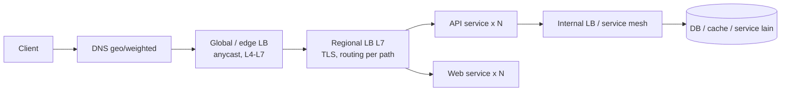

## Tujuan belajar

Setelah pelajaran ini kamu bisa:

- Menjelaskan apa yang dilakukan load balancer selain "membagi trafik": health check, TLS termination, routing, dan perlindungan.
- Memilih antara L4 dan L7, serta algoritma pembagian yang cocok untuk pola trafik tertentu.
- Menjawab "bagaimana load balancer-nya sendiri tidak menjadi SPOF?" dan menempatkannya di tiga lapisan arsitektur.

## Kenapa ada load balancer

Begitu satu server tidak cukup, kamu menambah server. Dua masalah langsung muncul: siapa yang membagi request, dan bagaimana client tidak perlu tahu server mana yang hidup. Load balancer (LB) menjawab keduanya dan sekaligus menjadi **titik kendali** tempat kamu menaruh hal-hal lintas-server: TLS, routing, rate limit, observability.

## Di mana LB berada

Tiga lapisan yang lazim disebut di interview:

1. **Global**: memilih region (DNS atau anycast).
2. **Edge/regional**: menerima trafik publik, TLS termination, routing per path atau host ke kelompok service.
3. **Internal**: antar service di dalam datacenter, sering berupa sidecar/service mesh atau client-side load balancing.

## L4 vs L7

|           | L4 (transport)                             | L7 (application)                                                     |
| --------- | ------------------------------------------ | -------------------------------------------------------------------- |
| Melihat   | IP, port, (SNI)                            | HTTP method, path, header, cookie, gRPC                              |
| Keputusan | Per koneksi                                | Per request                                                          |
| Bisa      | Throughput sangat tinggi, protokol apa pun | Routing cerdas, TLS termination, kompresi, rate limit, retry, canary |
| Biaya     | CPU rendah                                 | CPU lebih tinggi; harus memahami protokol                            |
| Contoh    | IPVS, Maglev, cloud NLB                    | NGINX, Envoy, HAProxy (bisa keduanya), cloud ALB                     |

Pola umum: L4 di depan untuk menyerap volume dan DDoS, L7 di belakangnya untuk kecerdasan.

## Algoritma pembagian

| Algoritma                        | Cara                                          | Cocok untuk                             | Jebakan                                                               |
| -------------------------------- | --------------------------------------------- | --------------------------------------- | --------------------------------------------------------------------- |
| Round robin                      | Bergiliran                                    | Request pendek, server seragam          | Buta terhadap beban nyata dan koneksi panjang                         |
| Weighted round robin             | Bergiliran dengan bobot                       | Server berbeda kapasitas; canary (95/5) | Bobot statis tidak mengikuti kondisi                                  |
| Least connections                | Ke server dengan koneksi aktif paling sedikit | Koneksi panjang (WebSocket, DB)         | Butuh state per server di LB                                          |
| Least response time / least load | Ke server tercepat/termurah                   | Beban heterogen                         | Perlu pengukuran kontinu                                              |
| Hash (IP, cookie, key)           | Deterministik per kunci                       | Stickiness, cache lokal per server      | Hot spot; perubahan jumlah server mengacak (pakai consistent hashing) |
| Power of two choices             | Pilih 2 acak, ambil yang lebih ringan         | Skala besar, LB terdistribusi           | — (hampir selalu bagus)                                               |

## Fitur yang membuat LB "pintar"

- **Health check aktif**: memanggil `/health` berkala, mengeluarkan server yang gagal N kali, memasukkan kembali setelah sehat. Buat endpoint health memeriksa dependency kritis secukupnya, jangan sampai health check sendiri memberatkan.
- **Passive health / outlier detection**: mengamati error dan latency respons nyata; mengeluarkan server "abu-abu" yang lulus health check tapi sakit.
- **TLS termination**: sertifikat dikelola di satu tempat; backend bicara HTTP biasa atau mTLS internal.
- **Session affinity (sticky)**: mengunci user ke server yang sama lewat cookie. Hindari bila bisa; buat service **stateless** dan simpan sesi di cache bersama.
- **Connection draining**: saat deploy, server berhenti menerima koneksi baru tetapi menyelesaikan yang ada.
- **Rate limiting, WAF, retry dengan budget, timeout per route**: pengaman lintas service.

## LB sendiri bukan SPOF

Pertanyaan ini hampir selalu muncul. Jawaban berlapis:

- **Beberapa instance LB** di belakang **anycast** (satu IP diiklankan dari banyak mesin, router memilih yang terdekat) atau **ECMP** (router membagi ke beberapa next-hop); Maglev adalah contoh desain seperti ini.
- **Aktif-pasif dengan virtual IP** (VRRP/keepalived): IP berpindah ke pasangan bila yang aktif mati.
- **DNS mengembalikan beberapa IP** LB sebagai lapisan tambahan.
- **Stateless**: LB L4 modern memakai consistent hashing agar koneksi tetap ke backend yang sama meski instance LB berganti, tanpa sinkronisasi state.

## Trade-off saat memilih

| Keputusan                                        | Pilih A bila                                                | Pilih B bila                                                             |
| ------------------------------------------------ | ----------------------------------------------------------- | ------------------------------------------------------------------------ |
| L4 (A) vs L7 (B)                                 | Volume sangat tinggi, protokol non-HTTP, cukup bagi koneksi | Butuh routing per path/header, TLS termination, retry, canary            |
| LB terpusat (A) vs client-side/service mesh (B)  | Client heterogen, kendali terpusat                          | Antar service internal, ingin menghindari hop ekstra dan punya discovery |
| Sticky session (A) vs stateless + cache sesi (B) | Legacy yang menyimpan state di memori                       | Hampir selalu: scaling dan failover jauh lebih mudah                     |
| Managed cloud LB (A) vs self-hosted (B)          | Operasional minimal, integrasi autoscaling                  | Kontrol penuh, fitur khusus, biaya egress                                |

## Pertanyaan yang sering ditanya interviewer

- "Kalau load balancer-nya mati?" → Anycast/ECMP, VIP aktif-pasif, DNS multi-IP.
- "Bagaimana LB tahu server mati?" → Health check aktif + outlier detection; sebutkan jeda deteksi.
- "Apakah service kamu stateless? Kenapa penting?" → Supaya LB bebas mengarahkan dan server bebas ditambah/dikurangi.
- "Di mana TLS diputus?" → Di edge/regional LB; mTLS ke dalam bila perlu.
- "Bagaimana melakukan canary deployment?" → Weighted routing di L7 atau header-based routing.
- "Kalau trafik 10x?" → LB horizontal, tambah backend lewat autoscaling, dan cek bahwa bottleneck berpindah ke database.

## Ringkasan

1. Load balancer adalah syarat horizontal scaling: membagi trafik, menyembunyikan server mati, dan menjadi titik kendali lintas server (TLS, routing, rate limit).
2. L4 untuk volume dan protokol apa pun, L7 untuk kecerdasan per request; algoritma dipilih dari pola trafik (round robin untuk request pendek, least connections untuk koneksi panjang, hash untuk afinitas).
3. LB bukan SPOF bila dijalankan sebagai beberapa instance di belakang anycast/ECMP atau VIP, dan backend harus stateless agar semua itu bekerja.
