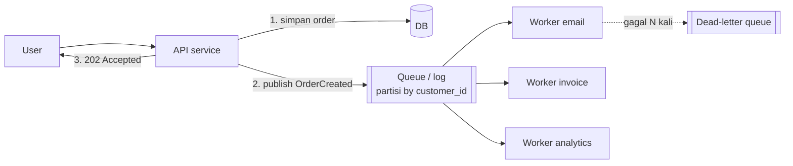

## Tujuan belajar

Setelah pelajaran ini kamu bisa:

- Menjelaskan tiga manfaat queue (decoupling, buffering, retry) dan kapan pekerjaan sebaiknya dipindahkan dari request path.
- Membedakan at-most-once, at-least-once, dan "exactly-once", serta membuat consumer idempotent.
- Merancang partisi untuk urutan dan paralelisme, menangani consumer lambat, pesan beracun, dan back pressure.

## Masalah yang diselesaikan

Request user seharusnya selesai dalam ratusan milidetik; mengirim email, membuat thumbnail, atau memperbarui index pencarian bisa memakan detik dan bisa gagal. Queue memisahkan **menerima** dari **mengerjakan**: producer menaruh pesan dan langsung menjawab user; consumer mengerjakannya kapan sanggup.

Tiga manfaat yang harus bisa kamu sebut:

1. **Decoupling**: producer tidak tahu siapa consumer, tidak menunggu, dan tidak jatuh bila consumer mati.
2. **Buffering**: lonjakan 10x ditampung di antrian; consumer memproses pada laju stabil.
3. **Retry dan isolasi kegagalan**: pekerjaan gagal diulang tanpa melibatkan user; pesan beracun dikarantina.

## Dua keluarga broker

|                            | Antrian klasik (RabbitMQ, SQS)                                       | Log terpartisi (Kafka, Pulsar)                                                                            |
| -------------------------- | -------------------------------------------------------------------- | --------------------------------------------------------------------------------------------------------- |
| Model                      | Pesan dihapus setelah ack; routing fleksibel (exchange, routing key) | Pesan ditulis ke log append-only per partisi; consumer menyimpan offset; retensi berdasarkan waktu/ukuran |
| Urutan                     | Per antrian (kira-kira); hilang saat ada prefetch dan redelivery     | Ketat di dalam partisi                                                                                    |
| Konsumsi ulang             | Tidak bisa setelah ack                                               | Bisa: reset offset, replay dari masa lalu                                                                 |
| Banyak consumer independen | Perlu antrian per consumer (fanout exchange)                         | Consumer group masing-masing punya offset sendiri                                                         |
| Throughput                 | Ribuan–puluhan ribu/s per antrian                                    | Jutaan/s dengan partisi                                                                                   |
| Cocok untuk                | Task queue, RPC async, routing kompleks                              | Event streaming, integrasi banyak sistem, audit/replay                                                    |

Keduanya "message queue" dalam percakapan interview; sebutkan mana yang kamu maksud dan kenapa.

## Jaminan pengiriman

| Semantik               | Cara                                                                                                               | Risiko                                  | Kapan                             |
| ---------------------- | ------------------------------------------------------------------------------------------------------------------ | --------------------------------------- | --------------------------------- |
| At-most-once           | Ack sebelum/ tanpa memproses; tanpa retry                                                                          | Pesan hilang                            | Metrik, log yang boleh hilang     |
| At-least-once          | Ack setelah memproses; redeliver bila tidak ada ack                                                                | Duplikat                                | Default hampir semua kasus bisnis |
| Exactly-once (efektif) | At-least-once + consumer idempotent, atau transaksi broker+consumer dalam ekosistem yang sama (Kafka transactions) | Kompleks; hanya di dalam batas tertentu | Keuangan, counter penting         |

Kalimat yang aman di interview: "Saya pakai at-least-once dan membuat consumer idempotent; exactly-once end-to-end lintas sistem eksternal tidak bisa dijamin broker."

### Membuat consumer idempotent

- Simpan `message_id` / `idempotency_key` yang sudah diproses (tabel dedup atau set di Redis dengan TTL), cek **sebelum** efek samping, catat **dalam transaksi yang sama** dengan efek samping bila efeknya di DB.
- Rancang operasi agar alami idempotent: `set status = paid` alih-alih `balance += x`; upsert alih-alih insert.
- Untuk efek samping eksternal (email, pembayaran), teruskan idempotency key ke penyedia yang mendukungnya.

### Outbox pattern

Masalah: menulis ke DB **dan** mempublikasikan pesan bukan satu transaksi; salah satu bisa gagal. Solusi: tulis event ke tabel `outbox` dalam transaksi yang sama dengan data, lalu relay terpisah (atau CDC) membaca outbox dan mempublikasikannya. At-least-once, tanpa dual-write yang tidak konsisten.

## Urutan dan paralelisme

Urutan global dan paralelisme tidak bisa keduanya. Pilih **kunci partisi** dari entitas yang butuh urutan (customer_id, account_id); pesan dengan kunci sama masuk partisi sama dan diproses berurutan oleh satu consumer; partisi berbeda berjalan paralel. Jumlah partisi membatasi paralelisme maksimum consumer dalam satu group. Hati-hati hot partition (satu pelanggan raksasa).

## Consumer lambat, pesan beracun, back pressure

- **Lag** (pesan belum diproses) adalah metrik utama; alert bila tumbuh terus.
- **Skala consumer** horizontal sampai partisi habis; lalu tambah partisi.
- **Visibility timeout / ack deadline**: pesan "disembunyikan" saat diproses; bila consumer mati, muncul lagi. Setel lebih panjang dari waktu proses, atau perpanjang secara berkala.
- **Retry dengan backoff** dan **DLQ** setelah N kali gagal; pantau DLQ dan sediakan alat replay.
- **Back pressure**: bila queue mendekati batas, producer diperlambat (blocking publish), request ditolak dengan 429/503, atau pekerjaan diprioritaskan; "antrian tak terbatas" hanya menunda keputusan.
- **Pesan besar**: taruh payload di blob store, kirim referensinya (claim check).

## Trade-off ringkas

| Keputusan                                 | Pilih A bila                                     | Pilih B bila                                                 |
| ----------------------------------------- | ------------------------------------------------ | ------------------------------------------------------------ |
| Sinkron (A) vs async via queue (B)        | User butuh hasil sekarang, kerja cepat dan andal | Kerja lambat/gagal-rentan, boleh ditunda, perlu buffer       |
| Antrian klasik (A) vs log terpartisi (B)  | Task queue, routing kompleks, konsumsi sekali    | Replay, banyak consumer independen, throughput sangat tinggi |
| At-least-once (A) vs at-most-once (B)     | Hampir selalu; consumer dibuat idempotent        | Data boleh hilang dan duplikat lebih merugikan               |
| Push ke consumer (A) vs consumer pull (B) | Latency rendah, consumer seragam                 | Consumer mengatur lajunya sendiri (back pressure alami)      |

## Pertanyaan yang sering ditanya interviewer

- "Kenapa pakai queue di sini, kenapa tidak panggil langsung?" → Decoupling, buffering, retry; sebut biaya: eventual, kompleksitas, observability.
- "Pesan diproses dua kali, apa dampaknya?" → Idempotent consumer, dedup table.
- "Bagaimana memastikan event terkirim bila DB sudah commit?" → Outbox pattern / CDC.
- "Consumer tidak terkejar?" → Lag, skala consumer dan partisi, back pressure.
- "Urutan terjamin?" → Hanya per partisi/kunci; desain kunci partisi.
- "Broker mati?" → Replikasi partisi (Kafka ISR), quorum queue (RabbitMQ), dan producer yang menahan/menulis ulang.

## Ringkasan

1. Queue memisahkan menerima dari mengerjakan: decoupling, buffering lonjakan, retry terisolasi; pilih antrian klasik untuk task dan log terpartisi untuk event stream.
2. Jaminan realistis adalah at-least-once plus consumer idempotent; outbox pattern menghubungkan transaksi DB dengan publikasi pesan.
3. Urutan hanya per partisi (pilih kunci dari entitas yang butuh urutan); pantau lag, pakai visibility timeout, retry dengan backoff, DLQ, dan back pressure.
