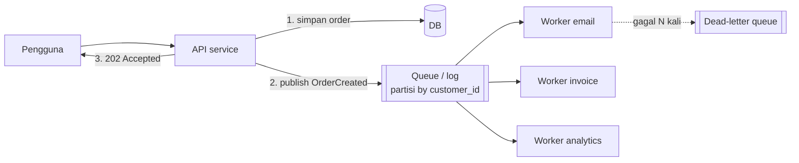

## Tujuan belajar

Setelah pelajaran ini kamu bisa:

- Menjelaskan tiga manfaat queue dan kapan pekerjaan sebaiknya dipindahkan dari jalur request.
- Membedakan at-most-once, at-least-once, dan exactly-once, serta membuat consumer yang aman diulang.
- Merancang partisi untuk urutan dan paralelisme, lalu menangani consumer lambat, pesan beracun, dan back pressure.

## Masalah yang diselesaikan

Request pengguna seharusnya selesai dalam ratusan milidetik. Mengirim email, membuat thumbnail, atau memperbarui index pencarian bisa memakan detik dan bisa gagal. Queue memisahkan "menerima" dari "mengerjakan". Producer menaruh pesan dan langsung menjawab pengguna. Consumer mengerjakannya kapan pun sanggup.

Tiga manfaat yang harus bisa kamu sebut:

1. Decoupling. Producer tidak tahu siapa consumer, tidak menunggu, dan tidak jatuh bila consumer mati.
2. Buffering. Lonjakan 10 kali ditampung di antrian, lalu consumer memproses pada laju yang stabil.
3. Retry dan isolasi kegagalan. Pekerjaan yang gagal diulang tanpa melibatkan pengguna. Pesan beracun dikarantina.

## Dua keluarga broker

|                            | Antrian klasik seperti RabbitMQ dan SQS                                   | Log terpartisi seperti Kafka dan Pulsar                                                                        |
| -------------------------- | ------------------------------------------------------------------------- | -------------------------------------------------------------------------------------------------------------- |
| Model                      | Pesan dihapus setelah ack, dengan routing fleksibel                       | Pesan ditulis ke log append-only per partisi, consumer menyimpan offset, retensi berdasarkan waktu atau ukuran |
| Urutan                     | Kira-kira per antrian, bisa hilang saat ada prefetch dan pengiriman ulang | Ketat di dalam satu partisi                                                                                    |
| Konsumsi ulang             | Tidak bisa setelah ack                                                    | Bisa, dengan reset offset dan replay dari masa lalu                                                            |
| Banyak consumer independen | Perlu antrian terpisah per consumer                                       | Setiap consumer group punya offset sendiri                                                                     |
| Throughput                 | Ribuan sampai puluhan ribu per detik per antrian                          | Jutaan per detik dengan partisi                                                                                |
| Cocok untuk                | Task queue, RPC async, routing yang rumit                                 | Event streaming, integrasi banyak sistem, audit dan replay                                                     |

Keduanya disebut "message queue" dalam percakapan interview. Sebutkan mana yang kamu maksud dan kenapa.

## Jaminan pengiriman

| Semantik             | Caranya                                                                                               | Risikonya                              | Kapan dipakai                           |
| -------------------- | ----------------------------------------------------------------------------------------------------- | -------------------------------------- | --------------------------------------- |
| At-most-once         | Ack sebelum memproses, tanpa retry                                                                    | Pesan hilang                           | Metrik dan log yang boleh hilang        |
| At-least-once        | Ack setelah memproses, kirim ulang bila tidak ada ack                                                 | Duplikat                               | Default untuk hampir semua kasus bisnis |
| Exactly-once efektif | At-least-once ditambah consumer idempotent, atau transaksi broker dan consumer di ekosistem yang sama | Rumit, hanya berlaku di batas tertentu | Keuangan, counter penting               |

Kalimat yang aman di interview: "Saya memakai at-least-once dan membuat consumer idempotent. Exactly-once lintas sistem eksternal tidak bisa dijamin broker."

### Membuat consumer idempotent

Idempotent artinya operasi yang hasilnya sama walau dijalankan berkali-kali. Caranya:

- Simpan message id yang sudah diproses di tabel dedup atau set di Redis dengan TTL. Cek sebelum efek samping, dan catat dalam transaksi yang sama dengan efek samping bila efeknya di database.
- Rancang operasi agar alami idempotent. Pakai "set status = paid" alih-alih "balance += x". Pakai upsert alih-alih insert.
- Untuk efek samping eksternal seperti email dan pembayaran, teruskan idempotency key ke penyedia yang mendukungnya.

### Outbox pattern

Menulis ke database dan mempublikasikan pesan bukan satu transaksi. Salah satunya bisa gagal. Solusinya adalah outbox pattern. Tulis event ke tabel outbox dalam transaksi yang sama dengan data. Lalu relay terpisah membaca outbox dan mempublikasikannya. Hasilnya at-least-once tanpa dual-write yang tidak konsisten.

## Urutan dan paralelisme

Urutan global dan paralelisme tidak bisa didapat bersamaan. Pilih kunci partisi dari entitas yang butuh urutan, misalnya customer_id atau account_id. Pesan dengan kunci sama masuk partisi yang sama dan diproses berurutan oleh satu consumer. Partisi berbeda berjalan paralel. Jumlah partisi membatasi jumlah consumer dalam satu group. Hati-hati dengan hot partition, misalnya satu pelanggan raksasa.

## Consumer lambat, pesan beracun, back pressure

Lag adalah jumlah pesan yang belum diproses. Ini metrik utama, jadi beri alert bila tumbuh terus.

- Skala consumer secara horizontal sampai partisi habis. Setelah itu tambah partisi.
- Visibility timeout menyembunyikan pesan saat diproses. Bila consumer mati, pesan muncul lagi. Setel lebih panjang dari waktu proses, atau perpanjang secara berkala.
- Retry dengan jeda yang membesar, lalu pindahkan ke dead-letter queue setelah N kali gagal. Pantau dead-letter queue dan sediakan alat replay.
- Back pressure adalah cara memperlambat producer saat queue mendekati batas. Bentuknya bisa publish yang memblokir, request yang ditolak dengan 429, atau pekerjaan yang diprioritaskan. Antrian tanpa batas hanya menunda keputusan.
- Pesan besar sebaiknya disimpan di blob store. Kirim referensinya saja, pola ini disebut claim check.

## Trade-off ringkas

| Keputusan                               | Pilih A bila                                         | Pilih B bila                                                 |
| --------------------------------------- | ---------------------------------------------------- | ------------------------------------------------------------ |
| Sinkron A atau async via queue B        | Pengguna butuh hasil sekarang dan pekerjaannya cepat | Pekerjaan lambat, rentan gagal, atau perlu buffer            |
| Antrian klasik A atau log terpartisi B  | Task queue, routing rumit, konsumsi sekali           | Replay, banyak consumer independen, throughput sangat tinggi |
| At-least-once A atau at-most-once B     | Hampir selalu, dengan consumer idempotent            | Data boleh hilang dan duplikat lebih merugikan               |
| Push ke consumer A atau consumer pull B | Latency rendah dan consumer seragam                  | Consumer mengatur lajunya sendiri                            |

## Pertanyaan yang sering ditanya interviewer

- "Kenapa pakai queue, kenapa tidak panggil langsung?" Jawab dengan decoupling, buffering, dan retry. Sebut juga biayanya: eventual consistency dan kerumitan tambahan.
- "Pesan diproses dua kali, apa dampaknya?" Jawab dengan consumer idempotent dan tabel dedup.
- "Bagaimana memastikan event terkirim bila database sudah commit?" Jawab dengan outbox pattern.
- "Consumer tidak terkejar?" Jawab dengan lag, skala consumer dan partisi, dan back pressure.
- "Apakah urutan terjamin?" Hanya per partisi. Jelaskan cara memilih kunci partisi.
- "Broker mati?" Jawab dengan replikasi partisi di Kafka atau quorum queue di RabbitMQ.

## Ringkasan

1. Queue memisahkan menerima dari mengerjakan. Manfaatnya decoupling, buffering lonjakan, dan retry yang terisolasi.
2. Jaminan yang realistis adalah at-least-once ditambah consumer idempotent. Outbox pattern menghubungkan transaksi database dengan publikasi pesan.
3. Urutan hanya berlaku per partisi. Pantau lag, pakai visibility timeout, retry dengan jeda, dead-letter queue, dan back pressure.
