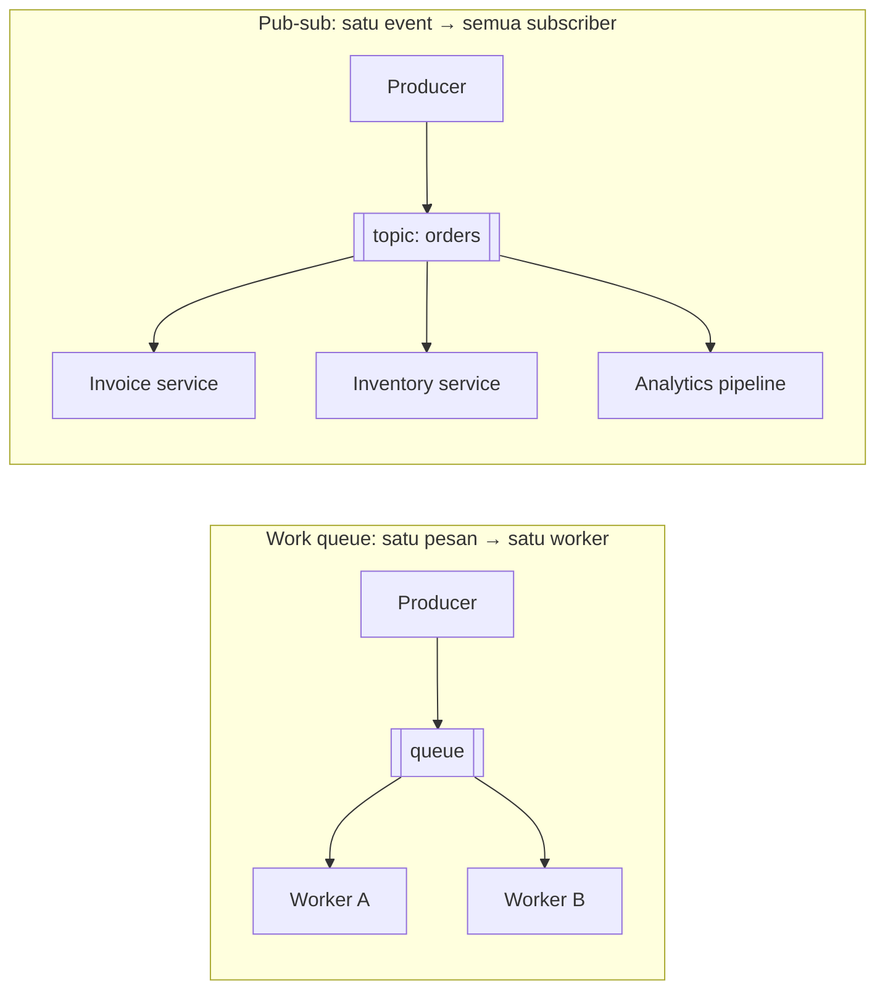
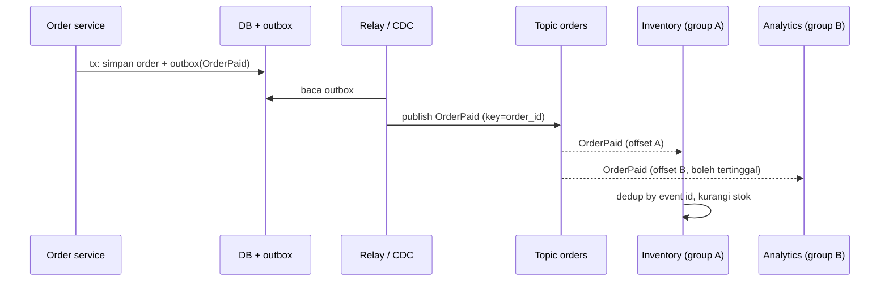

## Tujuan belajar

Setelah pelajaran ini kamu bisa:

- Menjelaskan perbedaan queue (satu pesan, satu pekerja) dan pub-sub (satu pesan, semua pelanggan), dan kapan masing-masing dipakai.
- Merancang topic, subscription/consumer group, dan fanout, termasuk pilihan broker yang persisten vs fire-and-forget.
- Menyebut harga pub-sub: duplikasi kerja, retensi, lag per subscriber, dan skema event yang harus kompatibel.

## Queue vs pub-sub

Di message queue, satu pesan diambil **satu** consumer: cocok untuk membagi pekerjaan. Di pub-sub, producer menerbitkan ke **topic** dan setiap **subscriber** menerima salinannya: cocok untuk memberi tahu banyak pihak tentang satu kejadian tanpa producer tahu siapa mereka.

Keduanya sering disediakan oleh broker yang sama. Di Kafka, **consumer group** menyatukan keduanya: di dalam satu group, partisi dibagi (work queue); antar group, semua menerima aliran penuh (pub-sub).

## Komponen

| Komponen                      | Peran                                                                             |
| ----------------------------- | --------------------------------------------------------------------------------- |
| Topic                         | Nama saluran; biasanya per jenis event atau per entitas (`orders`, `user-events`) |
| Partisi                       | Pembagian topic untuk paralelisme dan urutan per kunci                            |
| Subscription / consumer group | Satu "salinan aliran" dengan offset/ack sendiri                                   |
| Broker                        | Menyimpan, mereplikasi, dan menyajikan pesan; terdistribusi                       |
| Schema registry               | Kontrak format event (Avro/Protobuf/JSON) dan aturan kompatibilitas               |

## Dua gaya pengiriman

| Gaya                   | Contoh                                                       | Persistensi        | Subscriber offline            | Replay | Cocok untuk                                             |
| ---------------------- | ------------------------------------------------------------ | ------------------ | ----------------------------- | ------ | ------------------------------------------------------- |
| Fire-and-forget        | Redis Pub/Sub, Core NATS                                     | Tidak              | Kehilangan pesan              | Tidak  | Invalidasi cache, presence, chat real-time yang toleran |
| Persisten (log/stream) | Kafka, Pulsar, Google Pub/Sub, Redis Streams, NATS JetStream | Ya, dengan retensi | Menyusul dari offset terakhir | Ya     | Event bisnis, integrasi antar tim, audit                |

Pertanyaan pertama yang harus dijawab di interview: bolehkah pesan hilang bila subscriber sedang mati? Jika tidak, pilih yang persisten.

## Fanout dan isolasi

Setiap subscriber baru menambah **pembacaan**, bukan **penulisan**: producer menulis sekali, broker melayani N pembaca. Dengan log, tiap group membaca pada lajunya sendiri sehingga subscriber lambat tidak menghambat yang cepat. Harganya: retensi harus melebihi lag terburuk, dan lag per group harus dipantau.

Untuk fanout ke **jutaan** penerima (notifikasi push ke user), pub-sub antar service tidak cukup; dibutuhkan lapisan terpisah (notification service yang menyimpan langganan per user dan mengirim lewat koneksi/push provider). Pub-sub di sini adalah pemicu, bukan jalur ke user akhir.

## Desain event

- **Nama dan isi**: kejadian masa lalu (`OrderPaid`), berisi id dan data yang cukup agar subscriber tidak perlu memanggil balik producer (atau sengaja minimal, _notification_ vs _event-carried state transfer_; pilih dan jelaskan).
- **Kompatibilitas skema**: tambah field boleh, hapus/ubah tipe tidak; versi di schema registry. Subscriber lama harus tetap bisa membaca event baru.
- **Kunci partisi**: entitas yang butuh urutan (order_id, user_id).
- **Idempotency**: subscriber tetap menghadapi at-least-once; sama seperti consumer queue.
- **Outbox**: event diterbitkan dari transaksi yang sama dengan perubahan data.

## Trade-off ringkas

| Keputusan                                          | Pilih A bila                                             | Pilih B bila                                           |
| -------------------------------------------------- | -------------------------------------------------------- | ------------------------------------------------------ |
| Pub-sub (A) vs panggilan langsung (B)              | Banyak pendengar, boleh eventual, pendengar berubah-ubah | Butuh jawaban sinkron, satu konsumen, alur sederhana   |
| Fire-and-forget (A) vs persisten (B)               | Pesan boleh hilang, latency minimal                      | Pesan tidak boleh hilang, perlu replay                 |
| Topic per jenis event (A) vs topic per entitas (B) | Subscriber peduli jenis tertentu                         | Subscriber butuh urutan semua kejadian satu entitas    |
| Event gemuk (A) vs event kurus + callback (B)      | Mengurangi coupling runtime dan beban producer           | Payload sensitif/besar; subscriber jarang butuh detail |

## Pertanyaan yang sering ditanya interviewer

- "Bedanya dengan message queue?" → Satu-ke-satu vs satu-ke-banyak; consumer group.
- "Subscriber baru ingin data sejak kemarin?" → Replay dari offset bila broker persisten dengan retensi cukup.
- "Subscriber lambat?" → Tidak menghambat yang lain; pantau lag; retensi.
- "Bagaimana memastikan event dan data konsisten?" → Outbox/CDC.
- "Skema event berubah?" → Schema registry, kompatibilitas mundur.
- "Pub-sub ini sampai ke device user?" → Tidak langsung; notification service + push/WebSocket.

## Ringkasan

1. Pub-sub mengirim satu event ke semua subscriber dan membebaskan producer dari mengetahui pendengarnya; consumer group menyatukan pola queue dan pub-sub di satu broker.
2. Pilih broker persisten bila pesan tidak boleh hilang saat subscriber mati; fire-and-forget hanya untuk sinyal real-time yang toleran.
3. Harganya: idempotency di tiap subscriber, retensi lebih panjang dari lag terburuk, skema event yang kompatibel, dan outbox agar event konsisten dengan data.
