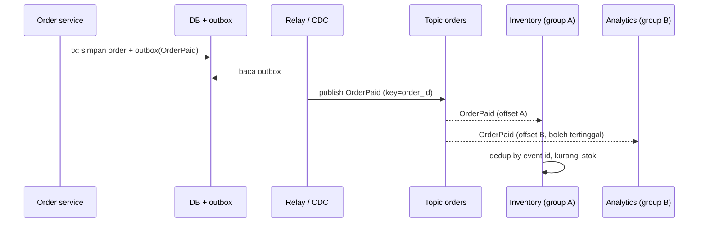

## Tujuan belajar

Setelah pelajaran ini kamu bisa:

- Menjelaskan perbedaan queue dan pub-sub, serta kapan masing-masing dipakai.
- Merancang topic, subscription, dan fanout, termasuk memilih broker yang persisten atau fire-and-forget.
- Menyebut harga pub-sub: duplikasi kerja, retensi, lag per subscriber, dan skema event yang harus kompatibel.

## Queue dibandingkan pub-sub

Di message queue, satu pesan diambil satu consumer. Ini cocok untuk membagi pekerjaan. Di pub-sub, producer menerbitkan ke topic dan setiap subscriber menerima salinannya. Ini cocok untuk memberi tahu banyak pihak tentang satu kejadian tanpa producer tahu siapa mereka.

Keduanya sering disediakan oleh broker yang sama. Di Kafka, consumer group menyatukan keduanya. Di dalam satu group, partisi dibagi seperti work queue. Antar group, semua menerima aliran penuh seperti pub-sub.

## Komponen

| Komponen                         | Perannya                                                                                  |
| -------------------------------- | ----------------------------------------------------------------------------------------- |
| Topic                            | Nama saluran, biasanya per jenis event atau per entitas, misalnya orders atau user-events |
| Partisi                          | Pembagian topic untuk paralelisme dan urutan per kunci                                    |
| Subscription atau consumer group | Satu salinan aliran dengan offset atau ack sendiri                                        |
| Broker                           | Menyimpan, mereplikasi, dan menyajikan pesan secara terdistribusi                         |
| Schema registry                  | Kontrak format event dan aturan kompatibilitasnya                                         |

## Dua gaya pengiriman

| Gaya            | Contoh                                                       | Persistensi         | Subscriber offline            | Replay     | Cocok untuk                                             |
| --------------- | ------------------------------------------------------------ | ------------------- | ----------------------------- | ---------- | ------------------------------------------------------- |
| Fire-and-forget | Redis Pub/Sub, Core NATS                                     | Tidak ada           | Kehilangan pesan              | Tidak bisa | Invalidasi cache, presence, chat real-time yang toleran |
| Persisten       | Kafka, Pulsar, Google Pub/Sub, Redis Streams, NATS JetStream | Ada, dengan retensi | Menyusul dari offset terakhir | Bisa       | Event bisnis, integrasi antar tim, audit                |

Pertanyaan pertama yang harus kamu jawab di interview: bolehkah pesan hilang bila subscriber sedang mati? Jika tidak boleh, pilih yang persisten.

## Fanout dan isolasi

Setiap subscriber baru menambah pembacaan, bukan penulisan. Producer menulis sekali, lalu broker melayani N pembaca. Dengan log, tiap group membaca pada lajunya sendiri. Subscriber lambat tidak menghambat yang cepat. Harganya, retensi harus melebihi lag terburuk, dan lag per group harus dipantau.

Fanout ke jutaan penerima, misalnya notifikasi push ke pengguna, tidak cukup dengan pub-sub antar service. Dibutuhkan notification service yang menyimpan langganan per pengguna dan mengirim lewat koneksi atau push provider. Pub-sub di sini hanya pemicu, bukan jalur ke pengguna akhir.

## Desain event

- Nama dan isi. Gunakan kejadian masa lalu seperti OrderPaid. Sertakan id dan data yang cukup agar subscriber tidak perlu memanggil balik producer. Atau sengaja minimal dan biarkan subscriber mengambil detail sendiri. Pilih salah satu dan jelaskan.
- Kompatibilitas skema. Menambah field boleh, menghapus atau mengubah tipe tidak boleh. Simpan versi di schema registry. Subscriber lama harus tetap bisa membaca event baru.
- Kunci partisi. Pilih entitas yang butuh urutan, misalnya order_id atau user_id.
- Idempotency. Subscriber tetap menghadapi at-least-once, sama seperti consumer queue.
- Outbox. Terbitkan event dari transaksi yang sama dengan perubahan data.

## Trade-off ringkas

| Keputusan                                        | Pilih A bila                                             | Pilih B bila                                                |
| ------------------------------------------------ | -------------------------------------------------------- | ----------------------------------------------------------- |
| Pub-sub A atau panggilan langsung B              | Banyak pendengar, boleh eventual, pendengar berubah-ubah | Butuh jawaban sinkron, satu consumer, alur sederhana        |
| Fire-and-forget A atau persisten B               | Pesan boleh hilang dan latency harus minimal             | Pesan tidak boleh hilang dan perlu replay                   |
| Topic per jenis event A atau per entitas B       | Subscriber peduli jenis tertentu                         | Subscriber butuh urutan semua kejadian satu entitas         |
| Event gemuk A atau event kurus dengan callback B | Ingin mengurangi coupling dan beban producer             | Payload sensitif atau besar, subscriber jarang butuh detail |

## Pertanyaan yang sering ditanya interviewer

- "Apa bedanya dengan message queue?" Satu-ke-satu dibandingkan satu-ke-banyak. Jelaskan consumer group.
- "Subscriber baru ingin data sejak kemarin?" Replay dari offset, bila broker persisten dengan retensi cukup.
- "Subscriber lambat?" Tidak menghambat yang lain. Pantau lag dan atur retensi.
- "Bagaimana memastikan event dan data konsisten?" Jawab dengan outbox atau CDC.
- "Skema event berubah?" Schema registry dengan kompatibilitas mundur.
- "Apakah pub-sub ini sampai ke device pengguna?" Tidak langsung. Butuh notification service dengan push atau WebSocket.

## Ringkasan

1. Pub-sub mengirim satu event ke semua subscriber dan membebaskan producer dari mengetahui pendengarnya. Consumer group menyatukan pola queue dan pub-sub di satu broker.
2. Pilih broker persisten bila pesan tidak boleh hilang saat subscriber mati. Fire-and-forget hanya untuk sinyal real-time yang toleran.
3. Harganya adalah idempotency di tiap subscriber, retensi yang lebih panjang dari lag terburuk, skema event yang kompatibel, dan outbox agar event konsisten dengan data.
