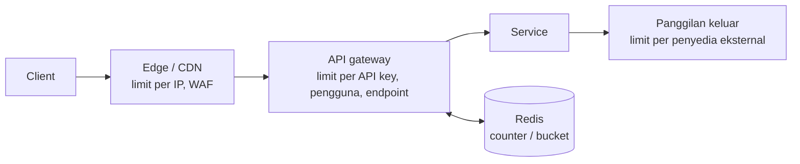
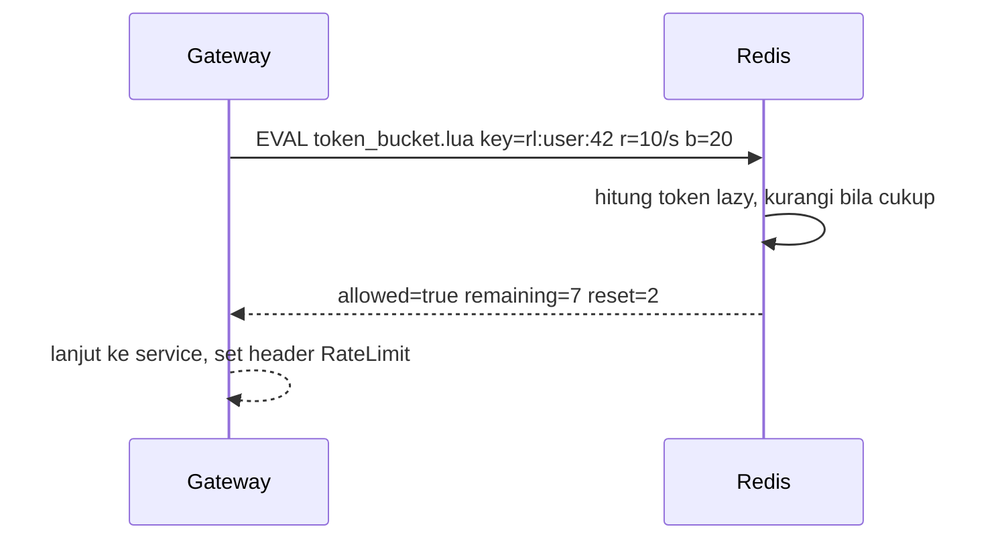

## Tujuan belajar

Setelah pelajaran ini kamu bisa:

- Menjelaskan untuk apa rate limiter dan di lapisan mana ia ditaruh.
- Membandingkan fixed window, sliding window log, sliding window counter, token bucket, dan leaky bucket.
- Merancang rate limiter terdistribusi dengan Redis dan operasi atomik, lalu menolak request dengan benar.

## Kenapa membatasi

Sistem punya kapasitas terbatas. Tanpa pembatas, satu client yang salah konfigurasi atau jahat bisa memakai semua kapasitas. Saat beban melebihi kapasitas, semua orang menjadi lambat lalu gagal. Rate limiter menolak sebagian request lebih awal dan murah, supaya sisanya dilayani dengan baik.

Alasannya tiga. Perlindungan dari DoS, brute force, dan scraping. Keadilan antar tenant. Dan biaya, misalnya API pihak ketiga yang berbayar atau kuota per paket.

## Di mana ditaruh



- Edge: per IP, kasar, menyerap volume besar.
- Gateway atau middleware: per API key, pengguna, endpoint, atau tenant. Aturan bisnis ada di sini.
- Di dalam service: membatasi panggilan keluar ke dependency agar tidak melanggar kuota mereka.

Kunci pembatas adalah keputusan produk. Bisa IP yang lemah karena NAT, user id, API key, tenant, atau kombinasi.

## Algoritma

| Algoritma              | Caranya                                                                | Memori per kunci | Akurasi                              | Burst        | Catatan                              |
| ---------------------- | ---------------------------------------------------------------------- | ---------------- | ------------------------------------ | ------------ | ------------------------------------ |
| Fixed window counter   | Counter per jendela, misalnya per menit                                | 1 counter        | Rendah di batas jendela, bisa 2 kali | Ya, di batas | Paling sederhana                     |
| Sliding window log     | Simpan timestamp tiap request, hitung yang masih dalam jendela         | Sebanyak limit   | Tepat                                | Tidak        | Boros memori untuk limit besar       |
| Sliding window counter | Bobot counter jendela sebelumnya ditambah jendela sekarang             | 2 counter        | Aproksimasi baik                     | Halus        | Kompromi favorit, dipakai Cloudflare |
| Token bucket           | Token terisi dengan laju r sampai kapasitas b, request mengambil token | 2 angka          | Baik                                 | Ya, sampai b | Standar untuk API                    |
| Leaky bucket           | Request masuk antrian, keluar dengan laju tetap                        | Sebesar antrian  | Laju keluar tetap                    | Dihaluskan   | Menambah latency                     |

Token bucket dihitung secara lazy, artinya token baru dihitung hanya saat ada request:

```text
tokens = min(b, tokens + (now - last) * r)
if tokens >= 1: tokens -= 1; izinkan   else: tolak
last = now
```

## Versi terdistribusi

Dengan banyak instance gateway, counter harus dibagi. Pola standarnya adalah Redis dengan operasi atomik.

- Fixed atau sliding window: INCR ditambah EXPIRE, dengan key seperti rl:pengguna:menit.
- Token bucket: satu script Lua yang membaca token dan timestamp, menghitung, memutuskan, dan menulis kembali secara atomik. Ini menghindari balapan check-then-set antar instance.
- Latency tambahannya satu bolak-balik ke Redis, di bawah 1 ms di datacenter yang sama.

Beban bisa dikurangi dengan cache lokal per instance. Cache ini memeriksa ke Redis setiap N request, atau meminjam token dalam jumlah besar, dengan toleransi sedikit melewati limit.

Kalau Redis mati, kamu harus memilih. Fail open mengizinkan semua request dan mencatat alert, cocok untuk kebanyakan API. Fail closed menolak semua, cocok untuk endpoint sensitif seperti login dan OTP.



## Menolak dengan benar

- Pakai status 429 Too Many Requests dengan header Retry-After dalam detik. Tambahkan header RateLimit-Limit, RateLimit-Remaining, dan RateLimit-Reset.
- Jangan membalas 500 atau memutus koneksi. Client akan retry agresif.
- Catat metrik penolakan per kunci dan per aturan. Penolakan masif sering menjadi sinyal insiden, bukan abuse.
- Pertimbangkan soft limit yang hanya mencatat sebelum menerapkan hard limit saat memperkenalkan aturan baru.

## Trade-off ringkas

| Keputusan                                           | Pilih A bila                                        | Pilih B bila                                            |
| --------------------------------------------------- | --------------------------------------------------- | ------------------------------------------------------- |
| Token bucket A atau sliding window counter B        | Ingin burst terkendali dan semantik laju yang jelas | Ingin batas per jendela yang mudah dijelaskan ke client |
| State terpusat di Redis A atau lokal per instance B | Limit harus global dan adil                         | Limit kasar untuk perlindungan diri                     |
| Fail open A atau fail closed B saat store mati      | Ketersediaan API lebih penting                      | Endpoint sensitif seperti auth dan pembayaran           |
| Per pengguna atau API key A atau per IP B           | Client terautentikasi                               | Trafik anonim di lapisan edge                           |

## Pertanyaan yang sering ditanya interviewer

- "Di mana rate limiter-nya?" Gateway untuk aturan bisnis, edge untuk volume, client untuk dependency.
- "Algoritma apa dan kenapa?" Token bucket untuk API umum. Sebut kelemahan fixed window.
- "Bagaimana dengan banyak instance?" Redis dengan operasi atomik. Cache lokal sebagai optimasi.
- "Redis mati?" Jelaskan pilihan fail open atau fail closed.
- "Bagaimana client tahu harus melambat?" Status 429, Retry-After, dan header RateLimit.
- "Limit berbeda per paket langganan?" Aturan dari config yang di-cache di gateway, dengan kunci tenant dan endpoint.

## Ringkasan

1. Rate limiter menolak lebih awal dan murah agar sisanya hidup. Taruh di edge per IP, di gateway per pengguna, dan di client untuk dependency.
2. Token bucket adalah default karena mengatur laju dan burst. Sliding window counter adalah kompromi yang akurat dan hemat. Fixed window bocor dua kali di batas jendela.
3. Versi terdistribusi memakai Redis dengan operasi atomik. Putuskan fail open atau fail closed, tolak dengan 429 dan Retry-After, lalu pantau penolakan.
