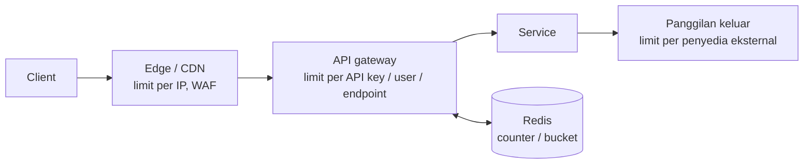
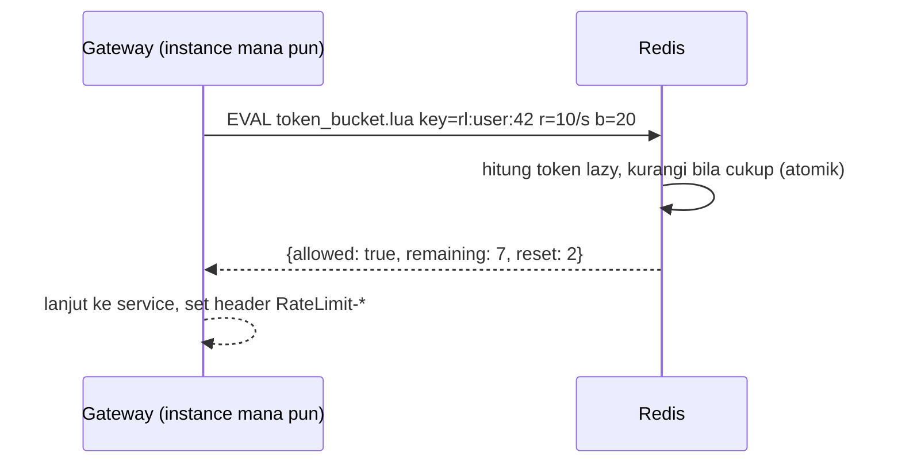

## Tujuan belajar

Setelah pelajaran ini kamu bisa:

- Menjelaskan untuk apa rate limiter (perlindungan, keadilan, biaya) dan di lapisan mana ia ditaruh.
- Membandingkan fixed window, sliding window log, sliding window counter, token bucket, leaky bucket.
- Merancang rate limiter terdistribusi dengan Redis dan operasi atomik, dan menolak request dengan benar (429, Retry-After).

## Kenapa membatasi

Sistem punya kapasitas terbatas. Tanpa pembatas, satu client yang salah konfigurasi (atau jahat) bisa memakai semua kapasitas, dan saat beban lebih tinggi dari kapasitas semua orang menjadi lambat lalu gagal. Rate limiter **menolak sebagian request lebih awal dan murah** agar sisanya dilayani dengan baik. Alasannya tiga: perlindungan (DoS, brute force, scraping), keadilan antar tenant, dan biaya (API pihak ketiga berbayar, kuota per paket).

## Di mana ditaruh



- **Edge**: per IP, kasar, menyerap volume besar.
- **Gateway/middleware**: per API key, user, endpoint, tenant; aturan bisnis ada di sini.
- **Di dalam service / client**: membatasi panggilan keluar ke dependency agar tidak melanggar kuota mereka (self-throttling).

Kunci pembatas (siapa yang dihitung) adalah keputusan produk: IP (lemah, NAT), user id, API key, tenant, atau kombinasi.

## Algoritma

| Algoritma              | Cara                                                                   | Memori per kunci           | Akurasi                             | Burst        | Catatan                               |
| ---------------------- | ---------------------------------------------------------------------- | -------------------------- | ----------------------------------- | ------------ | ------------------------------------- |
| Fixed window counter   | Counter per jendela (mis. per menit)                                   | 1 counter                  | Rendah di batas jendela (hingga 2x) | Ya, di batas | Paling sederhana                      |
| Sliding window log     | Simpan timestamp tiap request; hitung yang masih dalam jendela         | O(limit)                   | Tepat                               | Tidak        | Boros memori untuk limit besar        |
| Sliding window counter | Bobot counter jendela sebelumnya + jendela sekarang                    | 2 counter                  | Aproksimasi baik                    | Halus        | Kompromi favorit (dipakai Cloudflare) |
| Token bucket           | Token terisi dengan laju r sampai kapasitas b; request mengambil token | 2 angka (token, timestamp) | Baik                                | Ya, sampai b | Standar untuk API; burst terkendali   |
| Leaky bucket (antrian) | Request masuk antrian, keluar dengan laju tetap                        | O(antrian)                 | Laju keluar tetap                   | Dihaluskan   | Shaping, menambah latency             |

Token bucket, dihitung lazy:

```text
tokens = min(b, tokens + (now - last) * r)
if tokens >= 1: tokens -= 1; izinkan   else: tolak
last = now
```

## Versi terdistribusi

Dengan banyak instance gateway, counter harus **bersama**. Pola standar: Redis dengan operasi atomik.

- Fixed/sliding window: `INCR key` + `EXPIRE` (atau `MULTI`), key = `rl:{user}:{menit}`.
- Token bucket: satu **script Lua** yang membaca token dan timestamp, menghitung, memutuskan, dan menulis kembali secara atomik; menghindari race check-then-set antar instance.
- Latency tambahan: satu round trip Redis (&lt; 1 ms di datacenter yang sama).

Pengurangan beban: **cache lokal** per instance yang memeriksa ke Redis setiap N request atau secara batch (meminjam token dalam jumlah), dengan toleransi sedikit over-limit; atau sinkronisasi asinkron ala Cloudflare untuk limit yang tidak perlu presisi.

Kalau Redis mati: **fail open** (izinkan semua, catat alert) untuk kebanyakan API; **fail closed** untuk endpoint sensitif seperti login/OTP. Sebutkan pilihanmu.



## Menolak dengan benar

- Status **429 Too Many Requests**, header `Retry-After` (detik), dan header informatif `RateLimit-Limit`, `RateLimit-Remaining`, `RateLimit-Reset` (IETF draft; banyak API memakai prefix `X-`).
- Jangan 500 atau memutus koneksi: client akan retry agresif.
- Catat metrik penolakan per kunci dan aturan; penolakan masif seringkali adalah sinyal insiden, bukan abuse.
- Pertimbangkan **soft limit** (hanya mencatat) sebelum **hard limit** saat memperkenalkan aturan baru.

## Trade-off ringkas

| Keputusan                                          | Pilih A bila                                     | Pilih B bila                                                   |
| -------------------------------------------------- | ------------------------------------------------ | -------------------------------------------------------------- |
| Token bucket (A) vs sliding window counter (B)     | Ingin burst terkendali dan semantik "laju" jelas | Ingin batas per jendela yang mudah dijelaskan ke client        |
| State terpusat Redis (A) vs lokal per instance (B) | Limit harus global dan adil                      | Limit kasar untuk perlindungan diri; toleransi ketidakakuratan |
| Fail open (A) vs fail closed (B) saat store mati   | Ketersediaan API lebih penting                   | Endpoint sensitif (auth, pembayaran)                           |
| Per user/API key (A) vs per IP (B)                 | Client terautentikasi                            | Trafik anonim, lapisan edge                                    |

## Pertanyaan yang sering ditanya interviewer

- "Di mana rate limiter-nya?" → Gateway untuk aturan bisnis, edge untuk volume, client-side untuk dependency.
- "Algoritma apa dan kenapa?" → Token bucket untuk API umum; sebut kelemahan fixed window.
- "Bagaimana dengan banyak instance?" → Redis + atomik (Lua); cache lokal sebagai optimasi.
- "Redis mati?" → Fail open vs closed.
- "Bagaimana client tahu harus melambat?" → 429 + Retry-After + header RateLimit.
- "Limit berbeda per paket langganan?" → Aturan dari config/DB di-cache di gateway; kunci = tenant + endpoint.

## Ringkasan

1. Rate limiter menolak lebih awal dan murah agar sisanya hidup; ditaruh di edge (per IP), gateway (per user/API key), dan di client untuk dependency.
2. Token bucket adalah default (laju + burst); sliding window counter adalah kompromi akurat-hemat; fixed window bocor 2x di batas jendela.
3. Versi terdistribusi memakai Redis dengan operasi atomik; putuskan fail open/closed; tolak dengan 429 dan Retry-After, dan pantau penolakan.
