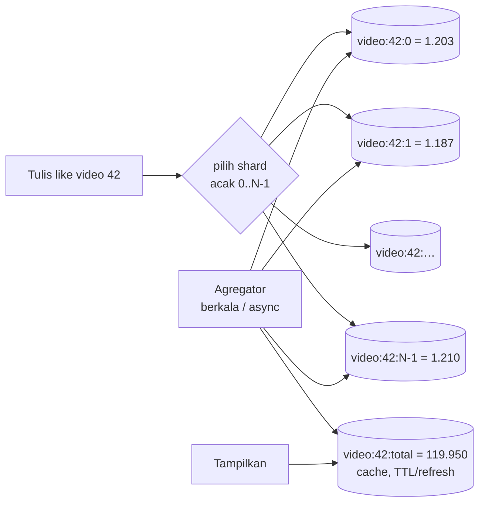

## Tujuan belajar

Setelah pelajaran ini kamu bisa:

- Menjelaskan kenapa satu counter menjadi hot spot dan cara membelahnya (sharded counter).
- Memisahkan jalur tulis (tersebar) dan jalur baca (agregat) dengan toleransi kebasian yang disengaja.
- Memilih antara eksak dan perkiraan (HyperLogLog), dan tahu kapan counter butuh konsistensi kuat.

## Masalah yang diselesaikan

Like, view, follower, jumlah komentar: angka sederhana dengan laju tulis yang bisa meledak untuk satu objek (viral). `UPDATE ... SET n = n + 1` pada satu baris menyerialkan semua tulisan: lock baris, WAL, replikasi. Satu baris sanggup ribuan update/detik, bukan puluhan ribu. **Hot row** adalah bentuk hot spot yang paling sering muncul di interview.

## Sharded counter

Ide: satu counter logis = N baris/key fisik; tulis ke salah satu secara acak; total = jumlah semuanya.

- **N** dipilih dari laju tulis puncak dibagi kapasitas satu baris (mis. 50.000/s ÷ 1.000/s ≈ 50, bulatkan 64). N bisa adaptif: objek biasa N=1, naik saat terdeteksi panas.
- **Tulis**: `INCR` pada shard acak; di Redis ini O(1) tanpa lock; di DB, kontensi tersebar ke N baris.
- **Baca**: jangan menjumlahkan N shard setiap tampilan. Agregator menjumlahkan berkala (tiap 1–5 detik untuk objek panas) atau pembaca menjumlahkan lalu meng-cache dengan TTL. Total yang ditampilkan **sedikit basi**, dan itu diterima untuk like/view.

## Pola alternatif dan pelengkap

| Pola                                      | Cara                                                                              | Cocok untuk                                               | Catatan                                                              |
| ----------------------------------------- | --------------------------------------------------------------------------------- | --------------------------------------------------------- | -------------------------------------------------------------------- |
| Agregasi di memori + flush (write-behind) | Service menghitung di memori lokal per objek, menulis delta ke store tiap ~1 s    | Laju sangat tinggi, toleransi kehilangan ≤ 1 s saat crash | Mengurangi tulisan 1.000x; gabungkan dengan sharded counter di store |
| Event stream + agregator                  | Setiap like = event di Kafka; consumer mengagregasi per jendela dan menulis total | Perlu audit, replay, analitik turunan                     | Latency detik; total eksak akhirnya                                  |
| CRDT counter (G/PN-Counter)               | Tiap replica menaikkan counternya sendiri; total = jumlah vector                  | Multi-region aktif-aktif, offline-first                   | Tanpa koordinasi, konvergen                                          |
| HyperLogLog                               | Sketsa probabilistik untuk hitung unik                                            | Pengunjung unik, memori konstan                           | Error ~1%, bisa di-union                                             |
| Count-Min Sketch / top-k                  | Sketsa frekuensi                                                                  | Item terpopuler, trending                                 | Perkiraan, memori kecil                                              |

## Konsistensi: eksak atau kira-kira?

| Kebutuhan                   | Contoh                                       | Pola                                                                                 |
| --------------------------- | -------------------------------------------- | ------------------------------------------------------------------------------------ |
| Perkiraan, boleh basi detik | Like, view, follower untuk tampilan          | Sharded counter + agregat cache, atau in-memory flush                                |
| Eksak akhirnya (eventual)   | Statistik harian, billing usage              | Event stream + agregator idempotent, rekonsiliasi batch                              |
| Eksak sekarang (strong)     | Saldo, stok, kuota yang menentukan keputusan | Satu baris per entitas + transaksi, atau ledger; kontensi per entitas biasanya kecil |

Aturan praktis: angka yang hanya **ditampilkan** boleh kira-kira; angka yang menjadi dasar **keputusan** harus eksak di tempat keputusan dibuat. Stok produk flash sale adalah kasus sulit: eksak dibutuhkan tetapi hot; jawabannya adalah reservasi via queue terurut atau membagi stok ke bucket dengan alokasi per bucket.

## Hal operasional

- **Idempotency** untuk like: user yang sama tidak boleh menambah dua kali; simpan relasi `(user, objek)` (set/tabel) sebagai sumber kebenaran, counter hanyalah turunan. Unlike = kurangi.
- **Rekonsiliasi**: job berkala menghitung ulang total dari sumber kebenaran untuk memperbaiki drift (crash saat flush, duplikat event).
- **Deteksi objek panas**: naikkan N atau aktifkan agregasi memori saat laju melewati ambang; turunkan kembali saat dingin.
- **Cache hot key**: total objek viral dibaca jutaan kali; replikasi key atau L1 cache (lihat modul distributed cache).

## Trade-off ringkas

| Keputusan                                                       | Pilih A bila                               | Pilih B bila                                      |
| --------------------------------------------------------------- | ------------------------------------------ | ------------------------------------------------- |
| Sharded counter di store (A) vs agregasi di memori (B)          | Setiap tulisan harus durable               | Boleh kehilangan ≤ 1 s saat crash demi throughput |
| Agregat berkala (A) vs jumlahkan saat baca (B)                  | Objek dibaca sering                        | Objek dibaca jarang, tulis sering                 |
| Eksak (A) vs probabilistik (B)                                  | Angka dipakai untuk keputusan atau tagihan | Analitik, hitung unik skala besar                 |
| Counter sebagai sumber kebenaran (A) vs turunan dari relasi (B) | Tidak ada relasi (view anonim)             | Ada relasi (like per user): rekonsiliasi mudah    |

## Pertanyaan yang sering ditanya interviewer

- "Video viral 50.000 like/detik, bagaimana counternya?" → Hot row; sharded counter + agregat; atau in-memory flush.
- "Bagaimana menampilkan total tanpa membaca semua shard?" → Agregat cache dengan refresh berkala.
- "User like dua kali?" → Relasi (user, objek) sebagai sumber kebenaran; counter turunan.
- "Jumlah pengunjung unik?" → HyperLogLog.
- "Kalau prosesnya crash sebelum flush?" → Kehilangan ≤ interval flush; rekonsiliasi batch; atau durable per tulis bila tidak boleh hilang.
- "Stok flash sale?" → Bukan kasus kira-kira; reservasi terurut atau bucket stok.

## Ringkasan

1. Satu baris counter adalah hot spot; sharded counter membagi tulisan ke N baris dan agregat berkala menyediakan satu nilai baca yang sedikit basi.
2. Untuk laju ekstrem, agregasi di memori dengan flush berkala atau event stream + agregator mengurangi tulisan ribuan kali; HyperLogLog untuk hitung unik.
3. Pilih pola dari kebutuhan konsistensi: tampilan boleh kira-kira, keputusan (saldo, stok) butuh eksak; counter sebaiknya turunan dari relasi yang bisa direkonsiliasi.
