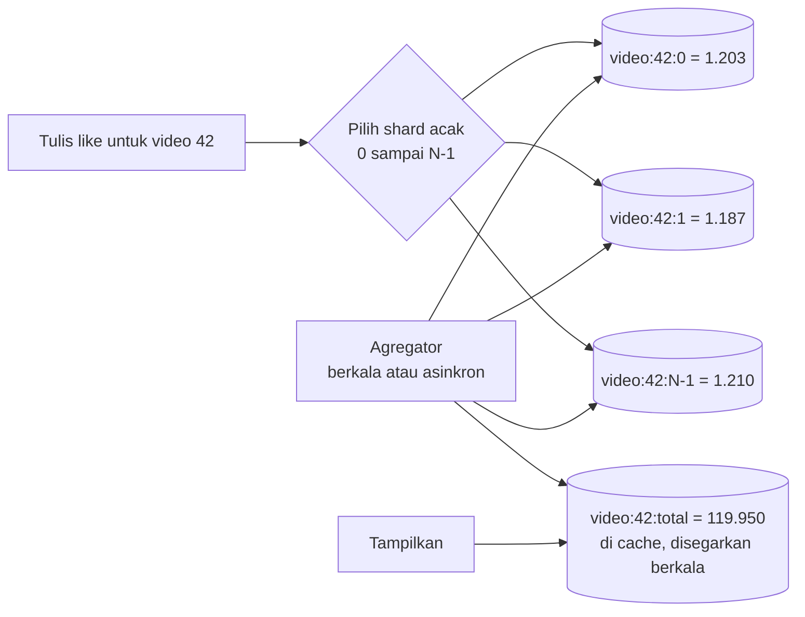

## Tujuan belajar

Setelah pelajaran ini kamu bisa:

- Menjelaskan kenapa satu counter menjadi titik panas dan cara membelahnya menjadi sharded counter.
- Memisahkan jalur tulis yang tersebar dari jalur baca yang teragregasi, dengan kebasian yang disengaja.
- Memilih antara hitungan eksak dan perkiraan seperti HyperLogLog, dan tahu kapan counter butuh konsistensi kuat.

## Masalah yang diselesaikan

Like, view, follower, dan jumlah komentar adalah angka sederhana dengan laju tulis yang bisa meledak untuk satu objek yang viral. Query `UPDATE ... SET n = n + 1` pada satu baris membuat semua tulisan antre. Setiap tulisan menunggu lock baris, menulis log, dan direplikasi. Satu baris sanggup ribuan update per detik, bukan puluhan ribu. Baris panas seperti ini adalah bentuk titik panas yang paling sering muncul di interview.

## Sharded counter

Idenya sederhana. Satu counter logis dibelah menjadi N baris atau key fisik. Setiap tulisan masuk ke salah satu secara acak. Totalnya adalah jumlah semuanya.

Cara menentukan N: bagi laju tulis puncak dengan kapasitas satu baris. Misalnya 50.000 per detik dibagi 1.000 per detik memberi 50, bulatkan ke 64. N boleh adaptif, yaitu 1 untuk objek biasa dan naik saat objek terdeteksi panas.

Jalur tulis memakai `INCR` pada shard acak. Di Redis, operasi ini sangat cepat dan tanpa lock. Di database, perebutan tersebar ke N baris.

Jalur baca jangan menjumlahkan N shard setiap kali tampil. Agregator menjumlahkan berkala, misalnya tiap 1 sampai 5 detik untuk objek panas. Atau pembaca menjumlahkan lalu menyimpannya di cache dengan TTL. Total yang ditampilkan sedikit tertinggal, dan untuk like atau view itu bisa diterima.

## Pola alternatif dan pelengkap

| Pola                          | Caranya                                                                                          | Cocok untuk                                                                 | Catatan                                      |
| ----------------------------- | ------------------------------------------------------------------------------------------------ | --------------------------------------------------------------------------- | -------------------------------------------- |
| Agregasi di memori lalu flush | Service menghitung di memori per objek, lalu menulis selisihnya ke store tiap sekitar satu detik | Laju sangat tinggi dan toleran kehilangan kurang dari satu detik saat crash | Mengurangi tulisan sampai seribu kali        |
| Event stream dan agregator    | Setiap like menjadi event di Kafka, lalu consumer mengagregasi per jendela waktu                 | Butuh audit, pemutaran ulang, dan analitik turunan                          | Latency beberapa detik, total akhirnya eksak |
| Counter CRDT                  | Tiap replica menaikkan counternya sendiri, total adalah jumlah semuanya                          | Beberapa region aktif bersamaan atau offline-first                          | Tanpa koordinasi dan pasti konvergen         |
| HyperLogLog                   | Sketsa probabilistik untuk menghitung nilai unik                                                 | Pengunjung unik dengan memori tetap                                         | Galat sekitar satu persen, bisa digabung     |
| Count-Min Sketch              | Sketsa frekuensi                                                                                 | Item terpopuler dan trending                                                | Perkiraan dengan memori kecil                |

## Eksak atau kira-kira?

| Kebutuhan                                  | Contoh                                       | Pola                                                            |
| ------------------------------------------ | -------------------------------------------- | --------------------------------------------------------------- |
| Perkiraan, boleh tertinggal beberapa detik | Like, view, follower untuk tampilan          | Sharded counter dengan agregat di cache, atau agregasi memori   |
| Eksak pada akhirnya                        | Statistik harian, tagihan pemakaian          | Event stream dengan agregator idempotent dan rekonsiliasi batch |
| Eksak sekarang juga                        | Saldo, stok, kuota yang menentukan keputusan | Satu baris per entitas dengan transaksi, atau ledger            |

Aturan praktisnya: angka yang hanya ditampilkan boleh kira-kira, tetapi angka yang menjadi dasar keputusan harus eksak di tempat keputusan dibuat. Stok flash sale adalah kasus sulit karena eksak dibutuhkan tetapi barisnya panas. Jawabannya adalah reservasi lewat queue terurut, atau membagi stok ke beberapa bucket dengan alokasi per bucket.

## Hal operasional

- Idempotency untuk like. Pengguna yang sama tidak boleh menambah dua kali. Simpan relasi pengguna dan objek sebagai sumber kebenaran, dan jadikan counter hanya turunan. Batal like berarti mengurangi.
- Rekonsiliasi. Job berkala menghitung ulang total dari sumber kebenaran untuk memperbaiki selisih akibat crash saat flush atau event ganda.
- Deteksi objek panas. Naikkan N atau aktifkan agregasi memori saat laju melewati ambang, lalu turunkan kembali saat dingin.
- Cache untuk key panas. Total objek viral dibaca jutaan kali, jadi replikasi key atau pakai cache lokal di service seperti dibahas di modul distributed cache.

## Trade-off ringkas

| Keputusan                                            | Pilih yang pertama bila                    | Pilih yang kedua bila                                             |
| ---------------------------------------------------- | ------------------------------------------ | ----------------------------------------------------------------- |
| Sharded counter di store atau agregasi di memori     | Setiap tulisan harus tahan crash           | Boleh kehilangan kurang dari satu detik demi throughput           |
| Agregat berkala atau jumlahkan saat baca             | Objek dibaca sering                        | Objek dibaca jarang tetapi ditulis sering                         |
| Eksak atau probabilistik                             | Angka dipakai untuk keputusan atau tagihan | Analitik dan hitung unik skala besar                              |
| Counter sebagai sumber kebenaran atau turunan relasi | Tidak ada relasi, seperti view anonim      | Ada relasi seperti like per pengguna, sehingga rekonsiliasi mudah |

## Pertanyaan yang sering ditanya interviewer

- "Video viral menerima 50.000 like per detik, bagaimana counternya?" Barisnya panas. Pakai sharded counter dengan agregat, atau agregasi di memori lalu flush.
- "Bagaimana menampilkan total tanpa membaca semua shard?" Pakai agregat di cache yang disegarkan berkala.
- "Pengguna menekan like dua kali?" Relasi pengguna dan objek menjadi sumber kebenaran, counter hanya turunan.
- "Bagaimana menghitung pengunjung unik?" HyperLogLog.
- "Prosesnya crash sebelum flush?" Kamu kehilangan paling banyak satu interval flush. Rekonsiliasi batch memperbaikinya, atau tulis durable per tulisan bila tidak boleh hilang.
- "Stok flash sale?" Bukan kasus kira-kira. Pakai reservasi terurut atau bucket stok.

## Ringkasan

1. Satu baris counter adalah titik panas. Sharded counter membagi tulisan ke N baris, dan agregat berkala menyediakan satu nilai baca yang sedikit tertinggal.
2. Untuk laju ekstrem, agregasi di memori dengan flush berkala atau event stream dengan agregator mengurangi tulisan ribuan kali. HyperLogLog dipakai untuk hitung unik.
3. Pilih pola dari kebutuhan konsistensi. Tampilan boleh kira-kira, tetapi saldo dan stok butuh eksak, dan counter sebaiknya turunan dari relasi yang bisa direkonsiliasi.
