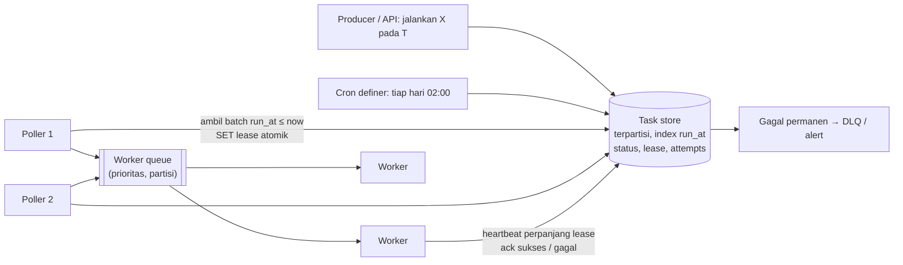
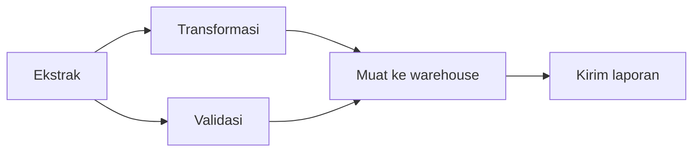

## Tujuan belajar

Setelah pelajaran ini kamu bisa:

- Membedakan tiga kebutuhan: delayed job, recurring job (cron), dan workflow/DAG.
- Merancang scheduler terdistribusi dengan store terurut by waktu, poller, lease/heartbeat, dan worker idempotent.
- Menjawab pertanyaan tentang eksekusi ganda, jadwal terlewat, prioritas, dan skala.

## Masalah yang diselesaikan

Tidak semua pekerjaan terjadi saat request datang. "Hapus akun 30 hari setelah permintaan", "tagih langganan tiap bulan", "hitung ulang rekomendasi tiap jam", "jalankan pipeline ETL dengan 40 langkah berurutan". Di satu mesin, `cron` dan `sleep` cukup. Di banyak mesin yang bisa mati kapan saja, kita butuh scheduler yang **durable** (tidak lupa), **tepat sekali secara efektif** (tidak dua kali), dan **tahan worker mati**.

## Tiga jenis kebutuhan

| Jenis              | Contoh                                                        | Inti desain                                                |
| ------------------ | ------------------------------------------------------------- | ---------------------------------------------------------- |
| Delayed / one-shot | Pengingat 24 jam, kedaluwarsa reservasi, retry dengan backoff | Store terurut by waktu + poller                            |
| Recurring (cron)   | Laporan harian, tagihan bulanan, pembersihan                  | Jadwal + satu eksekutor per tick (lease) + catatan run     |
| Workflow / DAG     | Pipeline data, proses onboarding multi-langkah                | Status per langkah, dependensi, retry lokal, durable state |

## Arsitektur dasar

- **Task store**: tabel (atau KV) dengan `id, run_at, status, lease_until, attempts, payload, idempotency_key`, index pada `(status, run_at)`. Redis sorted set (score = run_at) adalah versi ringan.
- **Poller**: beberapa instance mengambil batch yang jatuh tempo dengan operasi **atomik** (`UPDATE ... WHERE status='pending' AND run_at <= now ... RETURNING` dengan `FOR UPDATE SKIP LOCKED`, atau `ZPOPMIN`/script Lua) sehingga dua poller tidak mengambil task yang sama.
- **Lease dan heartbeat**: task yang diambil mendapat `lease_until = now + N`; worker memperpanjang selama bekerja; lease habis tanpa ack = task kembali pending. Ini mengubah "worker mati" menjadi "task tertunda".
- **Worker idempotent**: karena worker lambat tidak bisa dibedakan dari mati, task bisa berjalan dua kali. Idempotency key dan efek samping yang aman diulang wajib.
- **Retry dan DLQ**: `attempts` naik, `run_at` digeser dengan backoff + jitter; setelah batas, status `failed` dan alert.

## Cron terdistribusi

Jadwal `0 2 * * *` di N instance tanpa koordinasi = N eksekusi. Pilihan:

1. **Leader election** (etcd/ZooKeeper/lease di DB): hanya leader yang menerjemahkan jadwal menjadi task; bila leader mati, lease kedaluwarsa dan instance lain mengambil alih.
2. **Materialisasi**: cron definer menulis satu task per tick ke task store dengan `idempotency_key = job_id + waktu_tick`; unique constraint menolak duplikat, sehingga beberapa definer pun aman.
3. Kebijakan **jadwal terlewat** (scheduler mati jam 02:00): jalankan sekali saat hidup (catch-up), lewati, atau jalankan semua yang terlewat; dan **concurrency**: boleh tumpang tindih dengan run sebelumnya atau tidak (Kubernetes CronJob menamai ini `concurrencyPolicy`).

## Workflow / DAG

Untuk pekerjaan multi-langkah, scheduler menyimpan **status per langkah** dan dependensi.

- Langkah dijalankan saat semua pendahulunya sukses; gagal → retry lokal → bila permanen, hilir ditandai dan run gagal.
- Durable execution (Temporal-style): state workflow disimpan sebagai event history sehingga proses bisa mati dan dilanjutkan dari langkah terakhir; kode workflow harus deterministik, efek samping di "activity" yang idempotent.
- Pengamatan: status run, durasi per langkah, SLA per DAG.

## Skala dan prioritas

- **Partisi** task store by waktu (bucket per menit/jam) atau by tenant agar poller tidak memindai tabel raksasa; **hot bucket** saat jutaan task jatuh tempo bersamaan (tengah malam) diatasi dengan menyebar jitter saat penjadwalan.
- **Prioritas**: beberapa queue (tinggi/normal/rendah) atau skor gabungan; hindari starvation dengan aging.
- **Isolasi**: worker pool per jenis task agar task berat tidak menghalangi task ringan.
- **Timeliness**: presisi detik biasanya cukup; poller tiap 1 s dengan batch; untuk sub-detik gunakan timer wheel di memori yang dipulihkan dari store saat restart.

## Trade-off ringkas

| Keputusan                                                          | Pilih A bila                                  | Pilih B bila                                               |
| ------------------------------------------------------------------ | --------------------------------------------- | ---------------------------------------------------------- |
| Tabel DB + SKIP LOCKED (A) vs Redis sorted set (B)                 | Durability utama, sudah ada DB, volume sedang | Volume tinggi, latency rendah, toleransi persistensi Redis |
| Leader election (A) vs materialisasi + unique key (B) untuk cron   | Perlu satu "otak" untuk logika kompleks       | Ingin tanpa komponen leader; DB sudah ada                  |
| Queue generik + kode sendiri (A) vs mesin workflow (B)             | Task sederhana, independen                    | Langkah berantai, kompensasi, state tahan lama             |
| At-least-once + idempotent (A) vs "exactly-once" via transaksi (B) | Hampir selalu                                 | Efek samping dan state di DB yang sama                     |

## Pertanyaan yang sering ditanya interviewer

- "Bagaimana memastikan task tidak jalan dua kali?" → Lease atomik, idempotency key; akui at-least-once.
- "Worker mati di tengah jalan?" → Lease habis → kembali pending; heartbeat untuk task panjang.
- "Scheduler mati jam 02:00, laporan harian?" → Kebijakan jadwal terlewat; catatan run per tick.
- "Jutaan task jatuh tempo bersamaan?" → Partisi by waktu, jitter, batch, worker pool.
- "Bagaimana membatalkan task yang sudah dijadwalkan?" → Update status; worker memeriksa status sebelum efek samping.
- "Pipeline 40 langkah dengan dependensi?" → DAG scheduler dengan status per langkah dan retry lokal.

## Ringkasan

1. Scheduler terdistribusi = task store terurut by waktu + poller dengan pengambilan atomik + lease/heartbeat + worker idempotent + retry/DLQ.
2. Cron di banyak instance butuh koordinasi: leader election atau materialisasi tick dengan unique key, plus kebijakan jadwal terlewat dan concurrency.
3. Workflow multi-langkah butuh status per langkah dan dependensi; mesin durable execution menyimpan history agar proses bisa dilanjutkan setelah mati.
