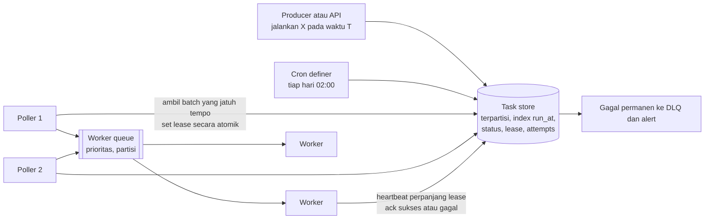
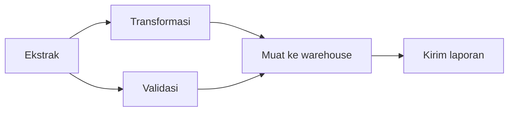

## Tujuan belajar

Setelah pelajaran ini kamu bisa:

- Membedakan tiga kebutuhan: delayed job, recurring job atau cron, dan workflow bertahap.
- Merancang scheduler terdistribusi dengan store terurut berdasarkan waktu, poller, lease dan heartbeat, serta worker yang idempotent.
- Menjawab pertanyaan tentang eksekusi ganda, jadwal terlewat, prioritas, dan skala.

## Masalah yang diselesaikan

Tidak semua pekerjaan terjadi saat request datang. Contohnya menghapus akun 30 hari setelah permintaan, menagih langganan tiap bulan, atau menjalankan pipeline data dengan 40 langkah berurutan. Di satu mesin, `cron` dan `sleep` sudah cukup. Di banyak mesin yang bisa mati kapan saja, kita butuh scheduler yang durable, tidak menjalankan dua kali, dan tahan worker mati.

## Tiga jenis kebutuhan

| Jenis                          | Contoh                                                           | Inti desainnya                                                           |
| ------------------------------ | ---------------------------------------------------------------- | ------------------------------------------------------------------------ |
| Delayed job, dijalankan sekali | Pengingat 24 jam, kedaluwarsa reservasi, pengulangan dengan jeda | Store terurut berdasarkan waktu dan poller                               |
| Recurring job atau cron        | Laporan harian, tagihan bulanan, pembersihan                     | Jadwal, satu eksekutor per tick lewat lease, catatan run                 |
| Workflow bertahap              | Pipeline data, proses onboarding banyak langkah                  | Status per langkah, dependensi, pengulangan lokal, state yang tahan lama |

## Arsitektur dasar

Komponennya:

- Task store menyimpan tiap task dengan kolom id, run_at, status, lease_until, attempts, payload, dan idempotency_key. Index dibuat pada status dan run_at. Redis sorted set dengan score berupa waktu adalah versi ringannya.
- Poller mengambil batch task yang jatuh tempo. Pengambilannya harus atomik, misalnya `UPDATE ... RETURNING` dengan `FOR UPDATE SKIP LOCKED` di PostgreSQL, atau script Lua di Redis. Dengan begitu dua poller tidak mengambil task yang sama.
- Lease adalah izin berbatas waktu. Task yang diambil mendapat lease_until beberapa menit ke depan. Worker memperpanjangnya selama bekerja lewat heartbeat. Kalau lease habis tanpa ack, task kembali ke status pending. Worker mati pun hanya menjadi task tertunda.
- Worker harus idempotent, artinya aman dijalankan dua kali. Worker yang lambat tidak bisa dibedakan dari worker yang mati, jadi task memang bisa berjalan dua kali.
- Pengulangan dan DLQ. Setiap kegagalan menaikkan attempts dan menggeser run_at dengan jeda yang membesar. Setelah batas, task ditandai gagal dan masuk dead-letter queue dengan alert.

## Cron terdistribusi

Jadwal `0 2 * * *` di N instance tanpa koordinasi berarti N eksekusi. Ada dua cara mengatasinya.

Cara pertama adalah leader election. Hanya leader yang menerjemahkan jadwal menjadi task. Kalau leader mati, lease-nya kedaluwarsa dan instance lain mengambil alih.

Cara kedua adalah materialisasi. Cron definer menulis satu task per tick ke task store dengan idempotency_key berupa gabungan job_id dan waktu tick. Unique constraint menolak duplikat, jadi beberapa definer pun aman.

Dua kebijakan harus kamu putuskan. Pertama, apa yang terjadi bila scheduler mati pada jam 02:00: jalankan sekali saat hidup, lewati, atau jalankan semua yang terlewat. Kedua, bolehkah run baru tumpang tindih dengan run sebelumnya yang masih berjalan. Kubernetes CronJob menamai kebijakan kedua ini `concurrencyPolicy`.

## Workflow bertahap

Untuk pekerjaan banyak langkah, scheduler menyimpan status tiap langkah dan dependensinya.

Sebuah langkah dijalankan saat semua pendahulunya sukses. Langkah yang gagal diulang secara lokal. Kalau gagal permanen, langkah di hilir ditandai dan run dinyatakan gagal.

Durable execution ala Temporal menyimpan state workflow sebagai riwayat event. Proses bisa mati dan dilanjutkan dari langkah terakhir. Syaratnya, kode workflow harus deterministik, dan efek samping dipisahkan ke activity yang idempotent.

## Skala dan prioritas

- Partisi task store berdasarkan waktu atau tenant supaya poller tidak memindai tabel raksasa. Jutaan task yang jatuh tempo bersamaan pada tengah malam diatasi dengan menyebar jitter saat dijadwalkan.
- Prioritas memakai beberapa queue atau skor gabungan. Hindari task prioritas rendah yang tidak pernah kebagian dengan menaikkan prioritasnya seiring waktu.
- Isolasi worker pool per jenis task supaya task berat tidak menghalangi task ringan.
- Ketepatan waktu dalam hitungan detik biasanya cukup. Poller tiap satu detik dengan batch sudah memadai. Untuk kebutuhan di bawah satu detik, pakai timer di memori yang dipulihkan dari store saat restart.

## Trade-off ringkas

| Keputusan                                               | Pilih yang pertama bila                            | Pilih yang kedua bila                                              |
| ------------------------------------------------------- | -------------------------------------------------- | ------------------------------------------------------------------ |
| Tabel database dengan SKIP LOCKED atau Redis sorted set | Durability adalah hal utama dan database sudah ada | Volume tinggi, latency rendah, dan persistensi Redis bisa diterima |
| Leader election atau materialisasi dengan unique key    | Butuh satu otak untuk logika jadwal yang rumit     | Ingin tanpa komponen leader dan database sudah ada                 |
| Queue generik dengan kode sendiri atau mesin workflow   | Task sederhana dan berdiri sendiri                 | Langkah berantai, kompensasi, dan state yang harus tahan lama      |
| At-least-once dengan idempotency atau transaksi penuh   | Hampir selalu                                      | Efek samping dan state ada di database yang sama                   |

## Pertanyaan yang sering ditanya interviewer

- "Bagaimana memastikan task tidak jalan dua kali?" Lease atomik dan idempotency key. Akui bahwa jaminannya at-least-once.
- "Worker mati di tengah jalan?" Lease habis, task kembali pending, dan heartbeat dipakai untuk task panjang.
- "Scheduler mati jam 02:00, bagaimana laporan harian?" Terapkan kebijakan jadwal terlewat dan catat run per tick.
- "Jutaan task jatuh tempo bersamaan?" Partisi berdasarkan waktu, jitter, batch, dan worker pool.
- "Bagaimana membatalkan task yang sudah dijadwalkan?" Ubah statusnya. Worker memeriksa status sebelum menjalankan efek samping.
- "Pipeline 40 langkah dengan dependensi?" Scheduler workflow dengan status per langkah dan pengulangan lokal.

## Ringkasan

1. Scheduler terdistribusi terdiri dari task store terurut berdasarkan waktu, poller dengan pengambilan atomik, lease dan heartbeat, worker idempotent, serta pengulangan dan DLQ.
2. Cron di banyak instance butuh koordinasi lewat leader election atau materialisasi tick dengan unique key, ditambah kebijakan untuk jadwal terlewat dan run yang tumpang tindih.
3. Workflow banyak langkah butuh status per langkah dan dependensi. Mesin durable execution menyimpan riwayat supaya proses bisa dilanjutkan setelah mati.
