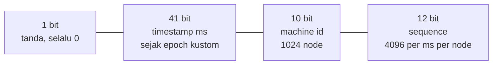
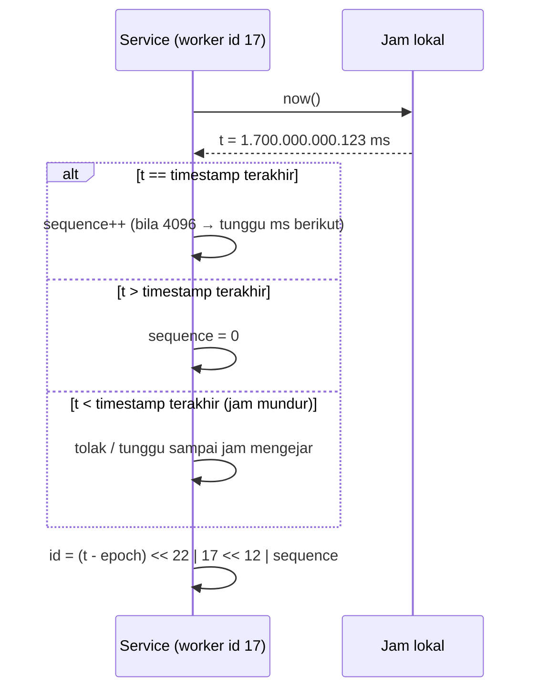

## Tujuan belajar

Setelah pelajaran ini kamu bisa:

- Menyebut sifat ID yang biasanya diminta (unik, 64-bit, terurut kasar, tanpa koordinasi) dan kenapa masing-masing penting.
- Membandingkan auto-increment, ticket server, UUID, dan Snowflake-style dengan trade-off yang jelas.
- Menjelaskan tata letak bit Snowflake, masalah jam, dan cara membagikan machine ID.

## Kenapa ini sulit

Di satu database, `AUTO_INCREMENT` sudah cukup. Begitu data di-shard atau tulisan datang dari banyak service, tidak ada lagi satu counter. Kita butuh ID yang:

| Sifat                                    | Alasan                                                                               |
| ---------------------------------------- | ------------------------------------------------------------------------------------ |
| Unik global                              | Primary key, dedup, referensi antar service                                          |
| Muat 64 bit                              | Index kecil, join cepat, cocok dengan `BIGINT`                                       |
| Terurut kasar menurut waktu              | Sisipan index di ujung (B-tree ramah), `ORDER BY id` ≈ urutan waktu, paginasi cursor |
| Dibuat tanpa koordinasi                  | Latency tulis tidak boleh menunggu round trip ke "layanan ID"                        |
| Tidak mudah ditebak berurutan (opsional) | Mencegah enumerasi dan membocorkan volume bisnis                                     |

## Pilihan yang biasa dibandingkan

| Pendekatan                    | Cara                                           | Unik       | Terurut | Koordinasi               | Catatan                                                                               |
| ----------------------------- | ---------------------------------------------- | ---------- | ------- | ------------------------ | ------------------------------------------------------------------------------------- |
| Auto-increment DB pusat       | Satu DB memberi ID                             | ya         | ya      | setiap ID                | SPOF dan bottleneck tulis                                                             |
| Multi-master increment        | DB ke-k mulai dari k, step N                   | ya         | kasar   | tidak                    | Sulit menambah DB (N berubah); Flickr ticket server adalah varian dua DB ganjil/genap |
| UUID v4                       | 122 bit acak                                   | praktis ya | tidak   | tidak                    | 128 bit, index acak, tidak informatif                                                 |
| UUID v7                       | 48 bit timestamp ms + acak                     | praktis ya | ya      | tidak                    | 128 bit, standar (RFC 9562), ramah index                                              |
| Snowflake-style               | timestamp + machine id + sequence              | ya         | ya      | sekali, untuk machine id | 64 bit, cepat, butuh jam yang tidak mundur                                            |
| DB-side Snowflake (Instagram) | ID dibuat oleh fungsi di tiap shard PostgreSQL | ya         | ya      | tidak                    | Shard id tertanam di ID; tanpa layanan tambahan                                       |
| Range dari KV/etcd            | Service mengambil blok 1.000 ID                | ya         | kasar   | per blok                 | Lubang ID saat crash; urutan antar service tidak terjaga                              |

## Snowflake: tata letak bit

- 41 bit ms ≈ 69 tahun dari epoch kustom; pilih epoch saat sistem lahir, bukan 1970.
- 10 bit machine id bisa dibagi (5 bit datacenter + 5 bit worker).
- 12 bit sequence = 4.096 ID/ms/node ≈ 4 juta ID/detik/node. Bila habis dalam satu ms, tunggu ms berikutnya.
- Hasilnya terurut menurut waktu **antar node hanya kira-kira** (jam tiap node berbeda beberapa ms); di dalam satu node terurut ketat.

### Dua masalah operasional

1. **Jam mundur** (NTP step, migrasi VM): bisa mengulang timestamp. Simpan timestamp terakhir; tolak atau tunggu bila jam mundur. Alternatif: pakai monotonic/logical clock yang hanya naik.
2. **Membagikan machine id**: harus unik di antara node yang hidup. Cara: konfigurasi statis, lease dari ZooKeeper/etcd saat start (dilepas saat mati), atau diturunkan dari identitas pod/host. Dua node dengan id sama = ID duplikat yang senyap.

## Menyembunyikan volume

ID terurut membocorkan laju pembuatan (selisih dua ID = jumlah objek di antaranya). Bila itu masalah, tampilkan ID publik yang di-encode (base62 dengan bit-shuffle atau enkripsi format-preserving) sementara ID internal tetap terurut.

## Trade-off ringkas

| Keputusan                                           | Pilih A bila                                     | Pilih B bila                                                |
| --------------------------------------------------- | ------------------------------------------------ | ----------------------------------------------------------- |
| 64-bit Snowflake (A) vs 128-bit UUID v7 (B)         | Index kecil penting, kontrol machine id tersedia | Tidak ingin mengelola machine id; interoperabilitas standar |
| Dibuat di aplikasi (A) vs di database per shard (B) | Banyak service menulis, ingin ID sebelum INSERT  | Satu jalur tulis lewat DB; ingin shard id tertanam          |
| Terurut (A) vs acak (B)                             | Paginasi cursor, index ramah                     | Harus tidak tertebak dan volume rahasia                     |

## Pertanyaan yang sering ditanya interviewer

- "Kenapa tidak UUID saja?" → Ukuran, urutan acak di index, tidak informatif; UUID v7 memperbaiki urutannya.
- "Bagaimana memastikan dua node tidak memakai machine id yang sama?" → Lease terkoordinasi saat start, atau alokasi statis yang diaudit.
- "Jam server mundur, apa yang terjadi?" → Duplikat; tolak/tunggu; sebutkan monotonic clock.
- "Berapa ID per detik yang bisa dibuat?" → 4.096/ms/node; 1.024 node → jutaan per detik.
- "Bagaimana kalau butuh ID terurut ketat secara global?" → Tidak bisa tanpa koordinasi; pakai satu sequencer (Raft log) dan terima latency-nya.

## Ringkasan

1. ID terdistribusi yang baik: unik, 64-bit, terurut kasar menurut waktu, dibuat tanpa round trip; auto-increment pusat gagal di koordinasi, UUID v4 gagal di urutan dan ukuran.
2. Snowflake membagi 64 bit menjadi timestamp (41), machine id (10), sequence (12); dua risikonya adalah jam mundur dan machine id ganda.
3. Bila tidak ingin mengelola machine id, UUID v7 adalah standar yang terurut; bila volume harus rahasia, encode ID untuk konsumsi publik.
