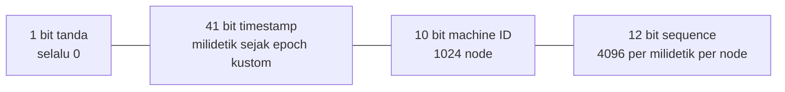
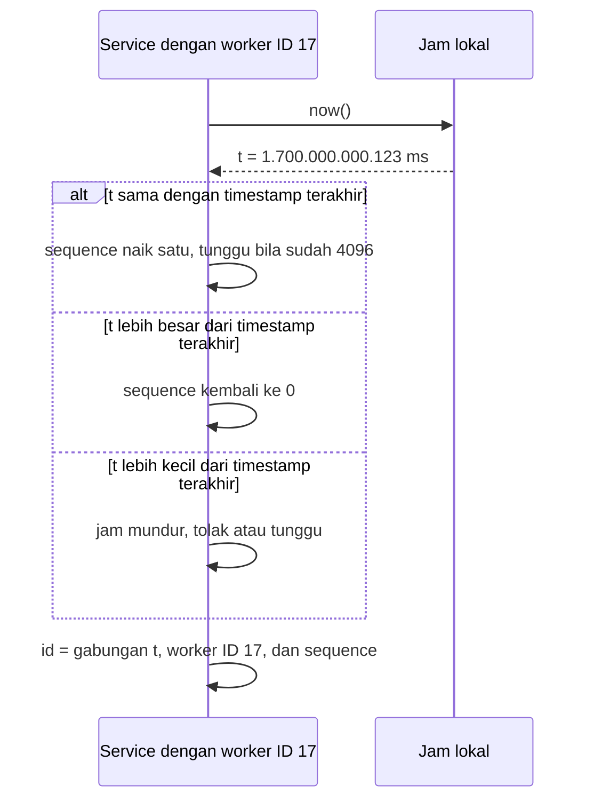

## Tujuan belajar

Setelah pelajaran ini kamu bisa:

- Menyebut sifat ID yang biasanya diminta dan kenapa masing-masing penting.
- Membandingkan auto-increment, ticket server, UUID, dan Snowflake dengan trade-off yang jelas.
- Menjelaskan tata letak bit Snowflake, masalah jam, dan cara membagikan machine ID.

## Kenapa ini sulit

Di satu database, auto-increment sudah cukup. Begitu data dipecah ke banyak server atau tulisan datang dari banyak service, tidak ada lagi satu penghitung bersama. Kita butuh ID yang memenuhi beberapa sifat sekaligus.

| Sifat                         | Alasan                                                                           |
| ----------------------------- | -------------------------------------------------------------------------------- |
| Unik secara global            | Dipakai sebagai primary key, pembeda duplikat, dan rujukan antar service         |
| Muat dalam 64 bit             | Index kecil, join cepat, dan cocok dengan tipe BIGINT                            |
| Terurut kasar menurut waktu   | Sisipan index selalu di ujung, dan mengurutkan by ID setara mengurutkan by waktu |
| Dibuat tanpa koordinasi       | Latency tulis tidak boleh menunggu perjalanan ke layanan ID                      |
| Tidak mudah ditebak berurutan | Mencegah orang menebak ID lain dan membaca volume bisnismu                       |

## Pilihan yang biasa dibandingkan

| Pendekatan                    | Cara kerja                                     | Unik       | Terurut | Butuh koordinasi        | Catatan                                                                    |
| ----------------------------- | ---------------------------------------------- | ---------- | ------- | ----------------------- | -------------------------------------------------------------------------- |
| Auto-increment database pusat | Satu database memberi nomor                    | Ya         | Ya      | Setiap ID               | Satu titik gagal dan bottleneck                                            |
| Multi-master increment        | Database ke-k mulai dari k dengan langkah N    | Ya         | Kasar   | Tidak                   | Sulit menambah database baru. Flickr memakai dua database ganjil dan genap |
| UUID v4                       | 122 bit acak                                   | Praktis ya | Tidak   | Tidak                   | 128 bit, merusak index, tidak berisi informasi                             |
| UUID v7                       | 48 bit timestamp ditambah bit acak             | Praktis ya | Ya      | Tidak                   | 128 bit, standar RFC 9562, ramah index                                     |
| Snowflake                     | Timestamp, machine ID, dan sequence            | Ya         | Ya      | Sekali untuk machine ID | 64 bit, cepat, butuh jam yang tidak mundur                                 |
| Snowflake di database         | ID dibuat oleh fungsi di tiap shard PostgreSQL | Ya         | Ya      | Tidak                   | Instagram memakainya. Shard ID tertanam di dalam ID                        |
| Blok dari KV store            | Service mengambil blok 1.000 ID sekaligus      | Ya         | Kasar   | Per blok                | Ada lubang ID saat crash. Urutan antar service tidak terjaga               |

## Snowflake: tata letak bit

Beberapa hal yang perlu kamu ketahui:

- 41 bit milidetik bertahan sekitar 69 tahun dari epoch kustom. Pilih epoch saat sistem lahir, bukan tahun 1970.
- 10 bit machine ID bisa dibagi menjadi 5 bit datacenter dan 5 bit worker.
- 12 bit sequence memberi 4.096 ID per milidetik per node. Kalau habis dalam satu milidetik, tunggu milidetik berikutnya.
- Hasilnya terurut ketat di dalam satu node. Antar node, urutannya hanya kira-kira, karena jam tiap node berbeda beberapa milidetik.

## Dua masalah operasional

Jam mundur bisa terjadi karena sinkronisasi NTP atau migrasi VM. Akibatnya timestamp bisa terulang. Simpan timestamp terakhir, lalu tolak atau tunggu bila jam mundur. Alternatifnya, pakai jam logis yang hanya naik.

Machine ID harus unik di antara node yang hidup. Ada tiga cara membagikannya. Pertama, konfigurasi statis. Kedua, lease dari ZooKeeper atau etcd saat node mulai, yang dilepas saat node mati. Ketiga, diturunkan dari identitas pod atau host. Dua node dengan ID yang sama akan menghasilkan duplikat tanpa ada yang menyadari.

## Menyembunyikan volume

ID yang terurut membocorkan laju pembuatan. Selisih dua ID memberi tahu jumlah objek di antaranya. Kalau itu masalah, tampilkan ID publik yang diacak, misalnya dengan base62 dan pengacakan bit. ID internal tetap terurut.

## Trade-off ringkas

| Keputusan                                                     | Pilih A bila                                           | Pilih B bila                                                |
| ------------------------------------------------------------- | ------------------------------------------------------ | ----------------------------------------------------------- |
| Snowflake 64 bit sebagai A, UUID v7 128 bit sebagai B         | Index kecil penting dan kamu bisa mengelola machine ID | Tidak ingin mengelola machine ID dan butuh standar          |
| Dibuat di aplikasi sebagai A, di database per shard sebagai B | Banyak service menulis dan butuh ID sebelum INSERT     | Satu jalur tulis lewat database dan ingin shard ID tertanam |
| Terurut sebagai A, acak sebagai B                             | Butuh paginasi cursor dan index yang ramah             | ID harus tidak tertebak dan volume dirahasiakan             |

## Pertanyaan yang sering ditanya interviewer

- "Kenapa tidak UUID saja?" Ukurannya dua kali lipat, urutannya acak di index, dan tidak berisi informasi. UUID v7 memperbaiki urutannya.
- "Bagaimana memastikan dua node tidak memakai machine ID yang sama?" Lease terkoordinasi saat node mulai, atau alokasi statis yang diaudit.
- "Jam server mundur, apa yang terjadi?" ID bisa duplikat. Tolak atau tunggu, dan sebutkan jam logis sebagai alternatif.
- "Berapa ID per detik yang bisa dibuat?" 4.096 per milidetik per node. Dengan 1.024 node, jutaan per detik.
- "Bagaimana kalau butuh ID terurut ketat secara global?" Tidak bisa tanpa koordinasi. Pakai satu pengurut dan terima latency-nya.

## Ringkasan

1. ID terdistribusi yang baik bersifat unik, 64 bit, terurut kasar menurut waktu, dan dibuat tanpa perjalanan jaringan. Auto-increment pusat gagal di koordinasi, UUID v4 gagal di urutan dan ukuran.
2. Snowflake membagi 64 bit menjadi timestamp 41 bit, machine ID 10 bit, dan sequence 12 bit. Dua risikonya adalah jam mundur dan machine ID ganda.
3. Kalau tidak ingin mengelola machine ID, UUID v7 adalah standar yang terurut. Kalau volume harus rahasia, acak ID untuk konsumsi publik.
