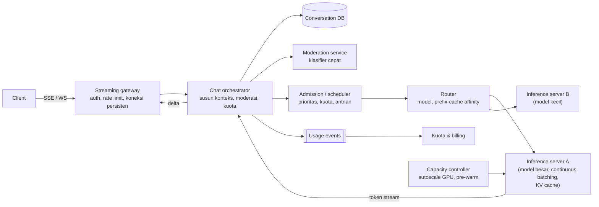
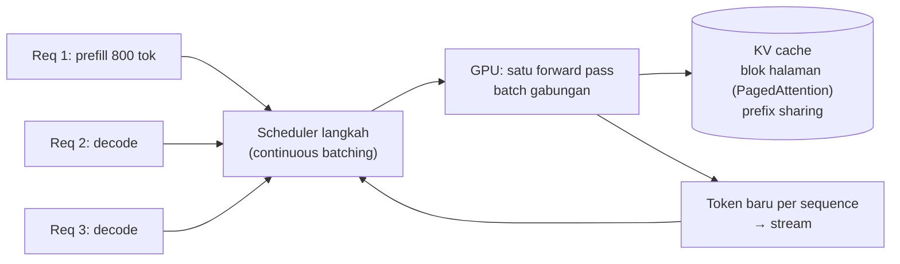

## 1. Requirements

Klarifikasi: satu model atau beberapa (ukuran/tier)? Modal: teks saja atau gambar/file? Tool use (pencarian web, kode)? Multi-tenant dengan tier gratis/berbayar? Retensi percakapan dan privasi?

Asumsi: produk chat teks dengan dua tier model, streaming, riwayat percakapan tersimpan, tool use sebagai ekstensi.

### Functional

- User membuat percakapan, mengirim pesan, menerima jawaban yang di-stream; bisa membatalkan; regenerate.
- Riwayat percakapan tersimpan, bisa dilanjutkan dari perangkat lain, dicari judulnya.
- Kuota per tier; pemilihan model.
- Moderasi input/output; penolakan sesuai kebijakan.
- Out of scope: pelatihan/fine-tuning, multimodal, plugin pihak ketiga (disebut), RAG (kasus berikutnya).

### Non-functional

| NFR                        | Target                                                                       | Alasan                                 |
| -------------------------- | ---------------------------------------------------------------------------- | -------------------------------------- |
| Time-to-first-token (TTFT) | p50 &lt; 1 s, p95 &lt; 3 s                                                   | Terasa responsif                       |
| Throughput token           | ≥ 30 token/detik per stream yang terlihat user                               | Lebih cepat dari membaca               |
| Availability               | 99.9% (chat), 99.99% untuk membaca riwayat                                   | GPU adalah sumber daya rapuh dan mahal |
| Skala                      | 10 juta DAU, 100.000 request bersamaan puncak                                | —                                      |
| Biaya                      | Utilisasi GPU tinggi; batas token; cache                                     | GPU dominan                            |
| Privasi                    | Percakapan terenkripsi, retensi terkendali, tidak dipakai melatih tanpa izin | Kepercayaan                            |

## 2. Estimasi kapasitas

Asumsi: 10 juta DAU × 10 pesan/hari; prompt rata-rata 1.000 token (termasuk riwayat), output 300 token; model besar menghasilkan ~2.000 token/detik agregat per GPU dengan batching (angka kasar; sangat bergantung model dan hardware).

- Request: 10^8 / 10^5 ≈ **1.000 request/detik** rata-rata, puncak 3.000/s.
- Token output: 1.000 × 300 = 300.000 token/s rata-rata; puncak 900.000 token/s → **~450 GPU** untuk decode pada puncak dengan utilisasi baik; prefill 1.000 token/request menambah beban compute yang signifikan (prefill compute-bound, decode memory-bound) → total ratusan hingga seribu GPU; biaya adalah faktor desain utama.
- Memori KV cache: per token per sequence puluhan–ratusan KB tergantung model; 1.300 token × 100 KB ≈ 130 MB per request; 100 request bersamaan per GPU ≈ 13 GB; PagedAttention mencegah fragmentasi.
- Koneksi streaming bersamaan: 100.000; gateway koneksi persisten (SSE/WebSocket) seperti kasus chat.
- Storage percakapan: 10^8 pesan/hari × 2 KB ≈ 200 GB/hari; 1 tahun ≈ 70 TB; DB terpartisi by user + blob untuk lampiran.

Keputusan: inference tier terpisah (stateless terhadap user, stateful terhadap KV cache), gateway streaming, antrian admission dengan prioritas, cache prefix, penyimpanan percakapan di DB biasa.

## 3. API design

```text
POST /v1/conversations                       → { conversationId }
POST /v1/conversations/{id}/messages          { content, model: "large"|"small", stream: true, Idempotency-Key }
     → 200, Content-Type: text/event-stream
       event: message_start {messageId}
       event: content_delta {text}      (berulang)
       event: message_end   {usage: {inputTokens, outputTokens}, stopReason}
       event: error         {code}
POST /v1/messages/{id}/cancel                → 202
GET  /v1/conversations?cursor=               → daftar (judul, updated)
GET  /v1/conversations/{id}?cursor=          → pesan
GET  /v1/usage                               → kuota tersisa per periode
```

SSE untuk web (sederhana, lewat HTTP/2); WebSocket untuk mobile bila perlu dua arah. Idempotency key mencegah pesan ganda saat retry; `cancel` menghentikan generasi dan membebaskan GPU.

## 4. Skema data

```sql
users(id, tier, quota_tokens_per_day, ...)
conversations(id, user_id, title, model_default, created_at, updated_at, archived)   -- shard by user_id
messages(id, conversation_id, role: user|assistant|system, content, tokens, model, status, created_at)
       -- shard by conversation_id; content terenkripsi at-rest; status: streaming|complete|cancelled|error
usage_events(user_id, ts, model, input_tokens, output_tokens, request_id)   -- stream → agregasi kuota & billing
moderation_results(message_id, verdict, categories, score)
-- Cache: usage counter per user per hari (Redis, sharded counter); session stream state (gateway, memori)
```

Model tidak menyimpan apa pun antar request; "memori" percakapan = pesan yang dikirim ulang sebagai konteks (dengan pemangkasan/ringkasan).

## 5. High-level design



**Alur pesan**: client mengirim pesan → gateway memeriksa auth dan rate limit → orchestrator menyimpan pesan user, memeriksa kuota, moderasi input (cepat), menyusun konteks (system prompt + riwayat yang dipangkas/diringkas) → admission memberi prioritas dan antrian bila GPU penuh (dengan estimasi tunggu ke client) → router memilih replika model yang mungkin memegang prefix cache percakapan ini → inference server menghasilkan token via continuous batching → token di-stream kembali melalui orchestrator (moderasi output streaming) ke gateway ke client → selesai: pesan assistant disimpan, usage dicatat.

## 6. Detailed design

### 6.1 Inference server



- **Prefill** (memproses prompt) compute-bound; **decode** (satu token per langkah) memory-bandwidth-bound: batching lintas request menaikkan throughput decode besar-besaran.
- **Continuous batching**: request baru disisipkan di langkah berikutnya; yang selesai keluar; chunked prefill agar prompt panjang tidak memblokir decode request lain.
- **KV cache** per sequence disimpan sebagai blok halaman; **prefix caching** membagi blok untuk prefix identik (system prompt yang sama untuk semua, riwayat percakapan untuk giliran berikutnya). Router mengirim giliran lanjutan ke replika yang memegang cache (affinity by conversation id, dengan fallback).
- Model besar dipecah antar GPU (tensor/pipeline parallel) dalam satu node; replika = satu grup GPU.
- Batas: max tokens output, max konteks, timeout; pembatalan menghentikan sequence dan membebaskan blok KV.
- Kuantisasi dan speculative decoding sebagai optimasi throughput/latency yang disebut, bukan dibahas dalam.

### 6.2 Admission control dan kapasitas

- Antrian per model dengan prioritas: tier berbayar &gt; gratis; interaktif &gt; batch/API offline; request dengan konteks pendek dapat disisipkan lebih cepat (shortest-job heuristik dengan batas fairness).
- Kuota: token per hari per user (sharded counter), rate limit request/menit di gateway; respons 429 dengan `Retry-After`; UI menunjukkan antrian.
- Kapasitas GPU tidak elastis dalam detik: prediksi beban (harian/jam), pre-warm replika sebelum puncak, scale-down bertahap; degradasi: tier gratis ke model kecil saat tekanan, batas output lebih pendek.
- Backpressure end-to-end: inference server melaporkan slot bebas; admission tidak mengirim melebihi kapasitas agar latency tidak meledak (antri di depan, bukan di GPU).

### 6.3 Streaming end-to-end

- Gateway memegang koneksi SSE/WebSocket; token diteruskan dari inference server lewat orchestrator (gRPC stream) dengan buffer kecil; chunk digabung per ~20–50 ms agar tidak membanjiri client.
- Pemutusan client → cancel ke inference (bebaskan GPU); pemutusan inference → event error ke client + pesan ditandai `error` dengan konten parsial tersimpan; client dapat "lanjutkan".
- Moderasi output di jalur stream: klasifier ringan per jendela token; bila melanggar, hentikan dan ganti dengan pesan kebijakan.
- Keep-alive dan reconnect; `messageId` memungkinkan client menyambung ulang dan menerima sisa stream (gateway menyimpan buffer pesan yang sedang berjalan beberapa detik).

### 6.4 Konteks dan memori percakapan

- Susun konteks: system prompt + ringkasan percakapan lama (dibuat async oleh model kecil saat melewati ambang) + N pesan terakhir, dalam batas token model.
- Prefix stabil ditempatkan di awal (system prompt, ringkasan) agar prefix cache efektif; bagian yang berubah di akhir.
- Judul percakapan dibuat async dari pesan pertama.

### 6.5 Keamanan dan privasi

- Enkripsi at-rest percakapan, kunci per tenant untuk enterprise; retensi dan penghapusan sesuai kebijakan; opt-out pelatihan.
- Prompt injection bukan ancaman di chat murni, tetapi relevan saat tool use/RAG (kasus berikutnya).
- Audit akses manusia ke percakapan; log tanpa konten (hanya metadata) secara default.

### 6.6 Observability

TTFT, token/detik per stream, antrian admission, utilisasi GPU, hit ratio prefix cache, rasio pembatalan, error per model; alert pada TTFT p95 dan panjang antrian; A/B per versi model.

## 7. Evaluasi terhadap non-functional requirements

| NFR                | Dipenuhi oleh                                                                                                  | Risiko tersisa                                                          |
| ------------------ | -------------------------------------------------------------------------------------------------------------- | ----------------------------------------------------------------------- |
| TTFT &lt; 1 s      | Admission tidak melebihi kapasitas, chunked prefill, prefix cache, routing affinity                            | Prompt sangat panjang: prefill lama; batasi konteks                     |
| ≥ 30 token/s       | Batching terkendali (ukuran batch vs latency per token), model tier                                            | Saat tekanan: batas output, model kecil untuk tier gratis               |
| Availability 99.9% | Replika model di beberapa node/zona, antrian durable untuk request yang diterima, riwayat di DB biasa (99.99%) | Kehilangan node GPU memutus stream aktif: client reconnect, "lanjutkan" |
| Skala              | Horizontal replika model, gateway stateless, DB shard by user                                                  | GPU supply; multi-region untuk latency dan kapasitas                    |
| Biaya              | Utilisasi tinggi via batching, prefix cache, pembatalan dini, kuota, kuantisasi                                | Trade-off batch besar vs latency harus dipantau                         |
| Privasi            | Enkripsi, retensi, log tanpa konten                                                                            | Akses operasional: RBAC dan audit                                       |

Bottleneck 10x: GPU (kapasitas dan biaya) dan memori KV; SPOF: admission/scheduler (replikasi dengan lease) dan gateway (horizontal).

## 8. Pertanyaan lanjutan interviewer

- "Bagaimana menambahkan tool use (pencarian, kode)?" → Loop orchestrator: model mengeluarkan panggilan tool terstruktur → orchestrator mengeksekusi (dengan sandbox/timeout) → hasil dikirim kembali sebagai konteks → lanjut; stream event tool ke client.
- "Multi-region?" → Replika model per region, percakapan direplikasi, routing ke region terdekat dengan kapasitas; failover lintas region dengan latency lebih tinggi.
- "Bagaimana mengukur kualitas jawaban?" → Umpan balik user, evaluasi offline per versi model, A/B terkontrol, pemantauan rasio regenerate.
- "Request batch/API non-interaktif besar?" → Antrian prioritas rendah yang mengisi celah kapasitas malam hari, SLA jam, harga lebih murah.
- "Rate limit per organisasi dengan banyak user?" → Hirarki kuota (org → user), token bucket bertingkat.
- "Bagaimana rollout model baru?" → Canary per persen trafik dengan metrik kualitas dan latency, rollback cepat, versi model di setiap pesan untuk analisis.
