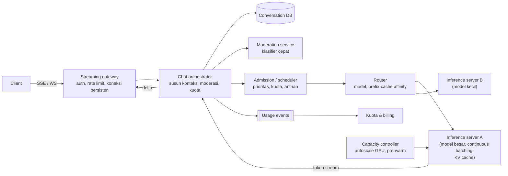
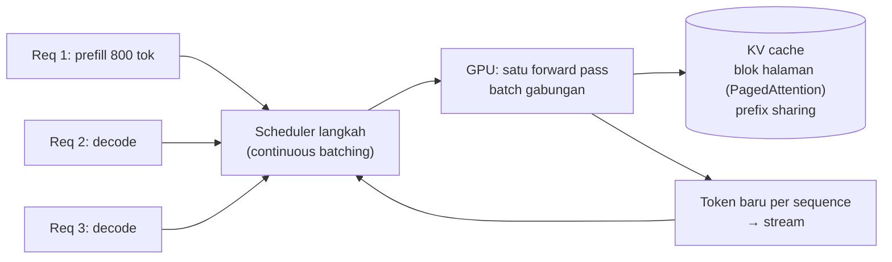

## 1. Requirements

Pertanyaan klarifikasi: satu model atau beberapa tier model? Hanya teks atau juga gambar dan file? Apakah model boleh memanggil alat seperti pencarian web? Apakah ada tier gratis dan berbayar? Bagaimana retensi percakapan dan privasinya?

Asumsi: produk chat teks dengan dua tier model, jawaban di-stream, riwayat percakapan tersimpan, dan pemanggilan alat sebagai ekstensi.

### Functional

- Pengguna membuat percakapan, mengirim pesan, dan menerima jawaban yang di-stream. Pengguna bisa membatalkan dan meminta jawaban ulang.
- Riwayat percakapan tersimpan, bisa dilanjutkan dari perangkat lain, dan bisa dicari berdasarkan judul.
- Kuota per tier dan pilihan model.
- Moderasi input dan output sesuai kebijakan.
- Di luar cakupan: pelatihan model, multimodal, plugin pihak ketiga, dan RAG. RAG dibahas di kasus berikutnya.

### Non-functional

| Target              | Nilai                                                                        | Alasan                                 |
| ------------------- | ---------------------------------------------------------------------------- | -------------------------------------- |
| Time-to-first-token | Median di bawah 1 detik, p95 di bawah 3 detik                                | Terasa responsif                       |
| Kecepatan token     | Minimal 30 token per detik per stream                                        | Lebih cepat dari kecepatan membaca     |
| Availability        | 99.9% untuk chat, 99.99% untuk membaca riwayat                               | GPU adalah sumber daya rapuh dan mahal |
| Skala               | 10 juta pengguna aktif harian dan 100.000 request bersamaan saat puncak      | Produk konsumen                        |
| Biaya               | Utilisasi GPU tinggi, batas token, dan cache                                 | GPU mendominasi biaya                  |
| Privasi             | Percakapan terenkripsi, retensi terkendali, tidak dipakai melatih tanpa izin | Kepercayaan                            |

Time-to-first-token, disingkat TTFT, adalah waktu dari pesan dikirim sampai token pertama muncul.

## 2. Estimasi kapasitas

Asumsi: 10 juta pengguna aktif harian mengirim 10 pesan per hari. Prompt rata-rata 1.000 token termasuk riwayat, dan jawaban 300 token. Satu GPU menghasilkan sekitar 2.000 token per detik secara agregat dengan batching. Angka ini kasar dan sangat bergantung pada model dan perangkat keras.

- Request: 100 juta per hari dibagi 100 ribu detik adalah 1.000 request per detik rata-rata. Puncaknya sekitar 3.000 per detik.
- Token keluar: 1.000 request dikali 300 token adalah 300.000 token per detik rata-rata. Puncaknya 900.000 token per detik.
- GPU untuk decode: 900.000 dibagi 2.000 adalah sekitar 450 GPU saat puncak dengan utilisasi baik.
- Prefill, yaitu pemrosesan prompt 1.000 token per request, menambah beban komputasi yang besar. Totalnya ratusan sampai seribu GPU. Biaya adalah faktor desain utama.
- Memori KV cache: tiap token per percakapan memakan puluhan sampai ratusan KB. Satu request dengan 1.300 token memakan sekitar 130 MB. Seratus request bersamaan per GPU memakan 13 GB. PagedAttention mencegah memori terpecah-pecah.
- Koneksi streaming bersamaan: 100.000. Gateway koneksi persisten dipakai seperti di kasus chat.
- Storage percakapan: 100 juta pesan per hari dikali 2 KB adalah 200 GB per hari. Satu tahun sekitar 70 TB di database yang dibagi per pengguna.

Keputusan desain: tier inference terpisah yang tidak menyimpan state pengguna tetapi menyimpan KV cache, gateway streaming, antrian admission dengan prioritas, cache awalan prompt, dan penyimpanan percakapan di database biasa.

## 3. API design

```text
POST /v1/conversations                       → { conversationId }
POST /v1/conversations/{id}/messages          { content, model: "large"|"small", stream: true, Idempotency-Key }
     → 200, Content-Type: text/event-stream
       event: message_start {messageId}
       event: content_delta {text}      (berulang)
       event: message_end   {usage: {inputTokens, outputTokens}, stopReason}
       event: error         {code}
POST /v1/messages/{id}/cancel                → 202
GET  /v1/conversations?cursor=               → daftar (judul, updated)
GET  /v1/conversations/{id}?cursor=          → pesan
GET  /v1/usage                               → kuota tersisa per periode
```

Web memakai Server-Sent Events karena sederhana dan berjalan di atas HTTP/2. Mobile memakai WebSocket bila butuh komunikasi dua arah. Idempotency key mencegah pesan ganda saat client mengulang request. Endpoint `cancel` menghentikan generasi dan membebaskan GPU.

## 4. Skema data

```sql
users(id, tier, quota_tokens_per_day, ...)
conversations(id, user_id, title, model_default, created_at, updated_at, archived)   -- shard by user_id
messages(id, conversation_id, role: user|assistant|system, content, tokens, model, status, created_at)
       -- shard by conversation_id; content terenkripsi at-rest; status: streaming|complete|cancelled|error
usage_events(user_id, ts, model, input_tokens, output_tokens, request_id)   -- stream → agregasi kuota & billing
moderation_results(message_id, verdict, categories, score)
-- Cache: usage counter per user per hari (Redis, sharded counter); session stream state (gateway, memori)
```

Model tidak menyimpan apa pun antar request. Ingatan percakapan adalah pesan yang dikirim ulang sebagai konteks, setelah dipangkas atau diringkas.

## 5. High-level design



Alur satu pesan:

1. Client mengirim pesan lewat gateway yang memeriksa auth dan rate limit.
2. Orchestrator menyimpan pesan pengguna dan memeriksa kuota.
3. Moderation service memeriksa input dengan klasifier cepat.
4. Orchestrator menyusun konteks dari system prompt, ringkasan percakapan lama, dan pesan terakhir.
5. Admission memberi prioritas dan mengantrikan request bila GPU penuh, sambil mengirim perkiraan waktu tunggu ke client.
6. Router memilih replika model yang kemungkinan masih memegang cache awalan percakapan ini.
7. Inference server menghasilkan token lewat continuous batching.
8. Orchestrator meneruskan token ke gateway sambil memoderasi output, dan gateway mengirimnya ke client.
9. Setelah selesai, orchestrator menyimpan pesan assistant dan mencatat pemakaian token.

## 6. Detailed design

### 6.1 Inference server



Prefill memproses prompt dan terbatas oleh komputasi. Decode menghasilkan satu token per langkah dan terbatas oleh bandwidth memori. Karena itu, batching lintas request menaikkan throughput decode berkali lipat.

Continuous batching menyisipkan request baru di langkah berikutnya dan mengeluarkan request yang selesai. Chunked prefill memecah prompt panjang supaya tidak memblokir decode request lain.

KV cache per percakapan disimpan sebagai blok halaman. Prefix caching membagi blok untuk awalan yang identik, misalnya system prompt yang sama untuk semua pengguna atau riwayat percakapan untuk giliran berikutnya. Router mengirim giliran lanjutan ke replika yang memegang cache itu, dengan jalur cadangan bila replika sibuk.

Model besar dipecah antar GPU dalam satu node. Satu replika berarti satu grup GPU. Batas yang diterapkan meliputi jumlah token keluar maksimum, panjang konteks maksimum, dan timeout. Pembatalan menghentikan sequence dan membebaskan blok KV. Kuantisasi dan speculative decoding adalah optimasi tambahan yang cukup disebut.

### 6.2 Admission control dan kapasitas

Antrian per model punya prioritas. Tier berbayar di atas gratis, dan request interaktif di atas batch. Request dengan konteks pendek boleh disisipkan lebih cepat, dengan batas keadilan supaya request panjang tidak kelaparan.

Kuota token per hari per pengguna dihitung dengan sharded counter. Rate limit request per menit diterapkan di gateway. Penolakan memakai respons 429 dengan header `Retry-After`, dan antarmuka menunjukkan posisi antrian.

Kapasitas GPU tidak elastis dalam detik. Beban diprediksi dari pola harian, replika dinyalakan sebelum puncak, dan diturunkan bertahap. Saat tekanan tinggi, tier gratis dialihkan ke model kecil dan batas jawaban dipendekkan.

Backpressure, yaitu sinyal untuk memperlambat pengirim, berjalan dari ujung ke ujung. Inference server melaporkan slot bebas, dan admission tidak mengirim melebihi kapasitas. Request mengantri di depan, bukan di GPU, supaya latency tidak meledak.

### 6.3 Streaming end-to-end

Gateway memegang koneksi SSE atau WebSocket. Token mengalir dari inference server lewat orchestrator dengan buffer kecil. Potongan digabung tiap 20 sampai 50 milidetik supaya client tidak kebanjiran.

Bila client putus, orchestrator mengirim cancel ke inference untuk membebaskan GPU. Bila inference putus, client menerima event error dan pesan ditandai `error` dengan isi parsial tersimpan. Client bisa meminta "lanjutkan".

Moderasi output berjalan di jalur stream dengan klasifier ringan per jendela token. Bila melanggar, generasi dihentikan dan diganti pesan kebijakan.

Koneksi punya keep-alive dan dukungan sambung ulang. Gateway menyimpan buffer pesan yang sedang berjalan selama beberapa detik, sehingga client yang menyambung ulang dengan `messageId` menerima sisa stream.

### 6.4 Konteks dan ingatan percakapan

Konteks disusun dari system prompt, ringkasan percakapan lama, dan beberapa pesan terakhir dalam batas token model. Ringkasan dibuat secara asinkron oleh model kecil saat percakapan melewati ambang panjang.

Bagian yang stabil ditaruh di awal, yaitu system prompt dan ringkasan, supaya prefix cache efektif. Bagian yang berubah ditaruh di akhir. Judul percakapan dibuat asinkron dari pesan pertama.

### 6.5 Keamanan dan privasi

Percakapan dienkripsi saat disimpan, dengan kunci per tenant untuk pelanggan enterprise. Retensi dan penghapusan mengikuti kebijakan, dan pengguna bisa menolak datanya dipakai untuk pelatihan.

Prompt injection bukan ancaman di chat murni, tetapi menjadi relevan saat model memanggil alat atau membaca dokumen. Akses manusia ke percakapan diaudit, dan log hanya menyimpan metadata, bukan isi.

### 6.6 Observability

Metrik utamanya adalah TTFT, token per detik per stream, panjang antrian admission, utilisasi GPU, rasio hit prefix cache, rasio pembatalan, dan error per model. Alert dipasang pada TTFT p95 dan panjang antrian. Versi model dicatat di tiap pesan untuk pengujian A/B.

## 7. Evaluasi terhadap non-functional requirements

| Target                     | Dipenuhi oleh                                                                                                   | Risiko tersisa                                                                             |
| -------------------------- | --------------------------------------------------------------------------------------------------------------- | ------------------------------------------------------------------------------------------ |
| TTFT di bawah 1 detik      | Admission tidak melebihi kapasitas, chunked prefill, prefix cache, routing ke replika yang memegang cache       | Prompt sangat panjang membuat prefill lama. Mitigasi: batasi konteks                       |
| Minimal 30 token per detik | Ukuran batch dijaga agar latency per token tetap terjaga, ditambah tier model                                   | Saat tekanan tinggi, batasi jawaban dan alihkan tier gratis ke model kecil                 |
| Availability 99.9%         | Replika model di beberapa node dan zona, antrian durable untuk request yang diterima, riwayat di database biasa | Node GPU mati memutus stream aktif. Mitigasi: client menyambung ulang dan meminta lanjutan |
| Skala                      | Replika model horizontal, gateway stateless, database dibagi per pengguna                                       | Pasokan GPU terbatas. Mitigasi: multi-region untuk kapasitas dan latency                   |
| Biaya                      | Utilisasi tinggi lewat batching, prefix cache, pembatalan dini, kuota, kuantisasi                               | Batch besar menaikkan latency per token. Pantau keseimbangannya                            |
| Privasi                    | Enkripsi, retensi, log tanpa isi                                                                                | Akses operasional. Mitigasi: kontrol akses berbasis peran dan audit                        |

Bottleneck pertama saat beban 10 kali lipat adalah GPU, baik kapasitas maupun biaya, dan memori KV. Titik kegagalan tunggal ada di admission scheduler dan gateway. Scheduler direplikasi dengan lease, dan gateway ditambah secara horizontal.

## 8. Pertanyaan lanjutan interviewer

- "Bagaimana menambahkan pemanggilan alat seperti pencarian dan eksekusi kode?" Orchestrator menjalankan loop. Model mengeluarkan panggilan alat terstruktur, orchestrator mengeksekusinya di sandbox dengan timeout, hasilnya dikirim kembali sebagai konteks, lalu model melanjutkan. Event alat ikut di-stream ke client.
- "Bagaimana multi-region?" Replika model per region, percakapan direplikasi, dan routing ke region terdekat yang punya kapasitas. Failover lintas region menerima latency lebih tinggi.
- "Bagaimana mengukur kualitas jawaban?" Umpan balik pengguna, evaluasi offline per versi model, pengujian A/B terkontrol, dan rasio permintaan jawaban ulang.
- "Bagaimana request batch besar yang tidak interaktif?" Antrian berprioritas rendah yang mengisi kapasitas kosong di malam hari, dengan SLA berjam-jam dan harga lebih murah.
- "Bagaimana rate limit untuk organisasi dengan banyak pengguna?" Kuota berjenjang dari organisasi ke pengguna dengan token bucket bertingkat.
- "Bagaimana meluncurkan model baru?" Canary per persentase trafik dengan metrik kualitas dan latency, rollback cepat, dan versi model dicatat di tiap pesan untuk analisis.
