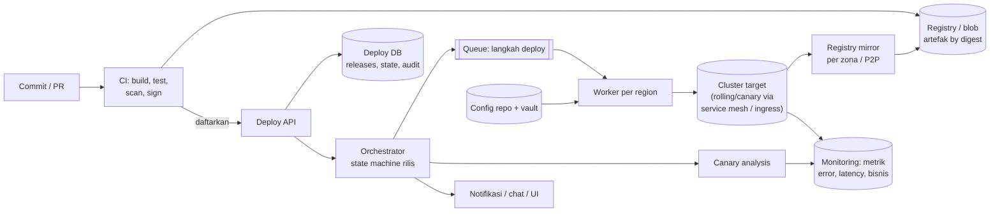
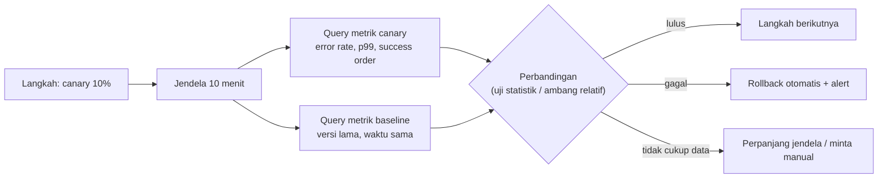

## 1. Requirements

Pertanyaan klarifikasi yang layak diajukan: target deploy berupa VM, container di Kubernetes, atau serverless? Berapa service dan berapa deploy per hari? Apakah ada regulasi yang mewajibkan approval dan audit? Berapa region?

Asumsi: ratusan service di Kubernetes multi-region, ribuan deploy per hari, dan tiap tim men-deploy sendiri.

### Functional

- Pipeline dari commit sampai produksi: build, test, artefak yang tidak bisa diubah, lalu deploy ke dev, staging, dan produksi dengan promosi antar lingkungan.
- Strategi rollout: rolling, canary dengan analisis otomatis, dan blue-green. Rollout berjalan bertahap per region.
- Rollback ke versi sebelumnya dengan satu perintah atau otomatis.
- Konfigurasi dan secret ikut ter-versi dan ter-deploy secara terkendali. Feature flag tersedia.
- Visibilitas: status deploy, siapa men-deploy apa, dan jejak audit. Approval opsional.
- Di luar cakupan: detail sistem build, pengelolaan cluster, dan infrastruktur sebagai kode.

### Non-functional

| Target                     | Nilai                                                                                                         | Alasan                                         |
| -------------------------- | ------------------------------------------------------------------------------------------------------------- | ---------------------------------------------- |
| Keamanan rilis             | Deploy normal tanpa downtime. Insiden akibat deploy terdeteksi di bawah 5 menit dan rollback di bawah 2 menit | Deploy adalah penyebab insiden terbesar        |
| Throughput                 | 5.000 deploy per hari, paralel antar service                                                                  | Tim bekerja mandiri                            |
| Latency                    | Dari commit sampai produksi di bawah 1 jam untuk perubahan biasa                                              | Umpan balik cepat                              |
| Reproducibility            | Artefak tidak bisa diubah, deploy deterministik, audit lengkap                                                | Kepatuhan dan debugging                        |
| Availability sistem deploy | 99.9%, dan produksi tidak bergantung padanya saat runtime                                                     | Sistem deploy mati bukan berarti produksi mati |
| Skala                      | Lebih dari 10.000 instance di beberapa region                                                                 | Platform besar                                 |

## 2. Estimasi kapasitas

- Deploy: 5.000 per hari berarti sekitar 0.06 per detik rata-rata. Puncaknya sekitar 1 per detik pada jam kerja. Tiap deploy terdiri dari ratusan langkah per instance, jadi orkestrator menangani ribuan langkah paralel.
- Artefak: 5.000 build dikali 500 MB adalah 2.5 TB per hari masuk ke registry. Berbagi layer memotongnya sekitar 10 kali. Retensi 90 hari membutuhkan puluhan TB di blob store.
- Distribusi: 10.000 instance dikali beberapa deploy per hari dikali delta 50 MB adalah beberapa TB per hari. Mirror per zona dan peer-to-peer menekan beban origin.
- Analisis canary: tiap rollout aktif mengirim query ke sistem monitoring setiap 30 sampai 60 detik. Ratusan rollout bersamaan berarti ribuan query per menit. Beban ini ringan.
- Audit dan event: puluhan ribu per hari. Kecil.

Keputusan desain: control plane yang mengorkestrasi dipisahkan dari data plane yang menjalankan beban. Registry memakai blob store dengan mirror. State deploy disimpan di database transaksional. Langkah dieksekusi worker lewat queue.

## 3. API design

```text
POST /v1/artifacts                      (dari CI) { service, version, digest, sbom, provenance }
POST /v1/releases                       { service, artifactDigest, config: { ref }, strategy: canary|rolling|bluegreen,
                                          targets: [{ env, regions[] }], steps: [{ weight: 1 }, { pause: 10m }, { weight: 10 }, ...] }
     → 201 { releaseId, status: pending }
POST /v1/releases/{id}/promote          lanjut ke langkah berikutnya (manual) · /pause · /abort · /rollback
GET  /v1/releases/{id}                  → status per target/langkah, analisis canary, siapa, kapan
GET  /v1/services/{name}/deployments     → versi aktif per env/region, riwayat
POST /v1/flags/{name}                   { env, rollout: 25%, rules } (feature flag)
Webhook/event: release.started, step.completed, analysis.failed, release.rolled_back
```

Semua operasi aman diulang karena memakai `releaseId` sebagai kunci. Setiap perubahan mencatat siapa pelakunya, baik manusia maupun CI, untuk audit.

## 4. Skema data

```sql
artifacts(digest PK, service, version, size, sbom_ref, provenance_ref, created_at)
releases(id, service, artifact_digest, config_ref, strategy, steps JSONB, status, created_by, created_at, version)
release_targets(release_id, env, region, status, current_step, canary_weight, baseline_version, started_at)
release_events(id, release_id, type, payload, actor, ts)                 -- append-only audit
service_state(service, env, region, active_digest, previous_digest, config_ref, updated_at)  -- sumber kebenaran "apa yang berjalan"
analysis_runs(release_id, target, step, metric, canary_value, baseline_value, verdict, ts)
feature_flags(name, env, rules JSONB, version)
```

Artefak tersimpan di registry berdasarkan digest, yaitu hash dari isinya. Konfigurasi tersimpan di repo yang ter-versi dan dirender saat deploy. Secret tersimpan di vault, dan database hanya menyimpan referensinya.

## 5. High-level design



Alur satu rilis:

1. CI membangun artefak, menandatanganinya, dan mendaftarkan digest-nya ke Deploy API.
2. Pengembang, atau pipeline otomatis, membuat release dengan strategi dan daftar langkah.
3. Orchestrator menjalankan state machine untuk tiap target, yaitu pasangan lingkungan dan region.
4. Worker di region tujuan menerapkan langkah pertama, misalnya canary 1% trafik, ke cluster.
5. Canary analysis membandingkan metrik canary dengan baseline selama jendela waktu tertentu.
6. Bila lulus, orchestrator lanjut ke langkah berikutnya. Bila gagal, orchestrator menjalankan rollback otomatis dan mengirim alert.
7. Setelah semua langkah selesai, `service_state` diperbarui dan versi lama tetap tersedia untuk rollback.

Rollback berarti men-deploy versi sebelumnya dengan langkah yang dipercepat. Digest lama biasanya masih ada di cache node. Konfigurasi ikut kembali ke ref sebelumnya.

## 6. Detailed design

### 6.1 Artefak, rantai pasok, dan distribusi

Build harus reproducible, artinya commit yang sama menghasilkan artefak yang sama. Hasil build diidentifikasi oleh digest, sedangkan tag hanya alias.

Artefak ditandatangani dan membawa provenance, yaitu catatan siapa membangunnya dari commit apa. Admission controller di cluster memverifikasi keduanya sebelum menjalankan. SBOM, daftar komponen di dalam artefak, disimpan untuk audit kerentanan.

Distribusi memakai registry mirror pull-through per zona. Untuk ribuan node, node saling berbagi layer secara peer-to-peer sehingga origin hanya melayani beberapa unduhan per layer. Artefak ditarik ke node sebelum rollout dimulai, supaya langkah deploy tidak menunggu unduhan.

### 6.2 Strategi rollout

| Strategi            | Cara kerja                                                             | Kelebihan                                | Kekurangan                                                    | Kapan dipakai                        |
| ------------------- | ---------------------------------------------------------------------- | ---------------------------------------- | ------------------------------------------------------------- | ------------------------------------ |
| Rolling             | Ganti instance sedikit demi sedikit dengan batas surge dan unavailable | Hemat kapasitas dan sederhana            | Dua versi berjalan bersama, dan rollback berarti rolling lagi | Default untuk service stateless      |
| Canary              | Sebagian kecil trafik ke versi baru dengan analisis                    | Dampak kecil dan keputusan berbasis data | Butuh routing trafik dan metrik yang terpisah per versi       | Perubahan berisiko dan service besar |
| Blue-green          | Lingkungan baru lengkap, lalu trafik dipindah                          | Rollback seketika dengan memindah balik  | Kapasitas dua kali lipat sementara                            | Perubahan besar dan migrasi runtime  |
| Per region bertahap | Region kecil dulu, tunggu, lalu lanjut                                 | Membatasi dampak global                  | Lebih lama                                                    | Selalu untuk produksi global         |

Semua strategi berjalan bersama. Canary dipakai di dalam region, dan region dijalankan bertahap secara global.

### 6.3 Canary analysis otomatis



Metrik harus berlabel versi, misalnya dari service mesh atau label pod, supaya canary dan baseline bisa dipisah. Baseline adalah versi lama pada waktu yang sama, bukan data historis. Cara ini menghilangkan efek musiman.

Verdict memakai toleransi relatif. Contohnya error rate canary paling banyak 1.2 kali baseline dan p99 paling banyak baseline ditambah 20 ms. Metrik bisnis seperti konversi menjadi gate tambahan.

Setiap langkah punya jeda minimum supaya masalah yang muncul lambat tetap terlihat, misalnya crash setelah 5 menit atau kebocoran memori. Langkah terakhir diberi waktu tunggu lebih lama.

### 6.4 Orchestrator dan eksekusi

State machine tiap target rilis disimpan di database. Orchestrator sendiri stateless dan mengambil pekerjaan lewat lease, yaitu izin berbatas waktu yang harus diperpanjang. Satu rilis hanya punya satu pemilik, dan kegagalan orchestrator tidak menggantung rilis.

Worker per region mengeksekusi langkah lewat queue, dekat dengan cluster dan memakai kredensial lokal. Langkah bersifat idempotent, artinya aman diulang, karena worker menerapkan keadaan yang diinginkan alih-alih menjalankan perintah.

Kontrol konkurensi mencakup satu rilis aktif per service per lingkungan, antrian, dan batas jumlah rilis bersamaan per cluster. Freeze window, misalnya akhir pekan atau masa promo besar, memblokir rilis kecuali lewat jalur darurat.

Produksi tidak bergantung pada sistem deploy saat runtime. Bila sistem deploy mati, yang sedang berjalan tetap berjalan. Rollback darurat tersedia lewat jalur manual yang terdokumentasi.

### 6.5 Konfigurasi, secret, migrasi, dan flag

Konfigurasi hidup di repo yang ter-versi dan dirender per lingkungan dan region. Perubahan konfigurasi adalah rilis yang juga melewati canary. Secret diambil dari vault saat runtime, sehingga rotasi tidak membutuhkan build ulang.

Migrasi database memakai pola expand-contract. Pertama, tambah kolom baru yang kompatibel mundur. Kedua, deploy kode yang menulis ke kolom lama dan baru. Ketiga, isi data lama ke kolom baru. Keempat, deploy kode yang membaca kolom baru. Terakhir, hapus kolom lama di rilis berikutnya. Migrasi dijalankan sebagai langkah terpisah sebelum kode, dan alat migrasinya aman diulang.

Feature flag memisahkan deploy dari peluncuran fitur. Perilaku baru dinyalakan bertahap berdasarkan persentase atau segmen tanpa deploy ulang. Setiap flag punya pemilik dan tanggal kedaluwarsa.

### 6.6 Observability dan audit

Setiap rilis punya timeline langkah, verdict analisis, dan tautan dashboard per versi. Event dikirim ke chat tim. Audit bersifat append-only dan mencatat siapa, apa, kapan, dari commit apa, dan approval bila ada. Metrik sistem deploy sendiri meliputi lead time dari commit ke produksi, frekuensi deploy, rasio rollback, dan waktu pemulihan.

## 7. Evaluasi terhadap non-functional requirements

| Target                                                              | Dipenuhi oleh                                                                                                | Risiko tersisa                                                                                       |
| ------------------------------------------------------------------- | ------------------------------------------------------------------------------------------------------------ | ---------------------------------------------------------------------------------------------------- |
| Tanpa downtime, deteksi di bawah 5 menit, rollback di bawah 2 menit | Rolling dan canary dengan gate kesehatan. Artefak lama ada di cache node. Rollback adalah langkah dipercepat | Masalah yang hanya muncul pada 100% beban. Mitigasi: langkah terakhir dengan waktu tunggu lebih lama |
| 5.000 deploy per hari                                               | Orchestrator stateless dan worker per region, paralel antar service                                          | Kontensi di cluster. Mitigasi: batas konkurensi per cluster                                          |
| Commit sampai produksi di bawah 1 jam                               | Pipeline otomatis dan promosi otomatis saat gate lulus                                                       | Waktu tunggu canary memakan sebagian. Perubahan kecil memakai langkah lebih sedikit                  |
| Reproducibility                                                     | Digest, tanda tangan, konfigurasi ter-versi, audit                                                           | Dependensi runtime seperti secret dan data berada di luar artefak. Catat versinya                    |
| Sistem deploy mati                                                  | Produksi independen, rollback manual terdokumentasi                                                          | Insiden saat sistem deploy mati memperlama pemulihan. Prioritaskan availability-nya                  |
| Multi-region                                                        | Region bertahap, worker lokal, mirror lokal                                                                  | Rilis yang berjalan lama membutuhkan toleransi terhadap dua versi yang hidup bersama                 |

Bottleneck pertama saat beban 10 kali lipat adalah distribusi artefak dan query analisis. Keduanya diatasi dengan mirror, peer-to-peer, dan cache agregasi. Titik kegagalan tunggal ada di database deploy dan registry. Keduanya direplikasi dan registry punya mirror.

## 8. Pertanyaan lanjutan interviewer

- "Bagaimana dengan service stateful seperti database dan broker?" Rolling per node dengan drain, satu node per waktu, dan cek replikasi sebelum lanjut. Biasanya memakai operator khusus.
- "Bagaimana deploy aplikasi mobile?" Rollout bertahap di app store ditambah feature flag di sisi server. Binary tidak bisa di-rollback, jadi kill switch lewat flag.
- "Dua tim men-deploy service yang saling bergantung?" Kontrak API harus kompatibel mundur sehingga deploy bisa independen. Dependency hanya pada versi minimum, bukan rilis bersama.
- "Bagaimana memastikan artefak yang di-deploy memang dari CI?" Tanda tangan dan provenance diverifikasi oleh admission controller. Registry menolak artefak yang tidak ditandatangani.
- "Hotfix saat freeze window?" Jalur darurat dengan approval dua orang dan audit. Hotfix tetap melewati canary yang dipercepat.
- "Rollback tidak mungkin karena migrasi data merusak?" Expand-contract mencegahnya. Bila terlanjur terjadi, roll forward dengan perbaikan dan pulihkan data dari backup.
