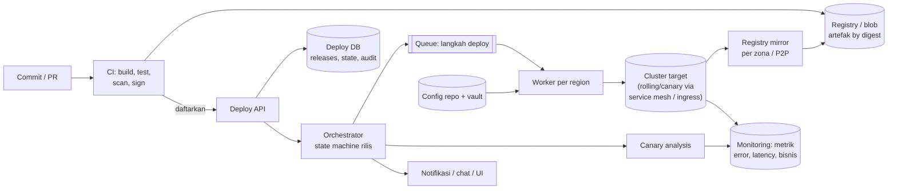
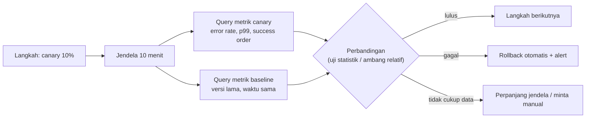

## 1. Requirements

Klarifikasi: target deploy (VM, container/Kubernetes, serverless, mobile/web statis)? Berapa service dan deploy per hari? Apakah ada regulasi (approval, audit)? Multi-region?

Asumsi: ratusan service di Kubernetes multi-region, ribuan deploy/hari, tim mandiri men-deploy sendiri.

### Functional

- Pipeline: commit → build → test → artefak immutable → deploy ke environment (dev, staging, prod) dengan promosi.
- Strategi rollout: rolling, canary dengan analisis otomatis, blue-green; per region bertahap.
- Rollback cepat (satu klik/otomatis) ke versi sebelumnya.
- Konfigurasi dan secret ter-versi dan ter-deploy bersama (atau terpisah tapi terkendali); feature flag.
- Visibilitas: status deploy, siapa men-deploy apa, audit; approval opsional.
- Out of scope: CI build system detail, manajemen cluster, infrastruktur sebagai kode (disebut).

### Non-functional

| NFR                        | Target                                                                                                         | Alasan                                  |
| -------------------------- | -------------------------------------------------------------------------------------------------------------- | --------------------------------------- |
| Keamanan rilis             | Tidak ada downtime saat deploy normal; insiden akibat deploy terdeteksi &lt; 5 menit dan rollback &lt; 2 menit | Deploy adalah penyebab insiden terbesar |
| Throughput                 | 5.000 deploy/hari, paralel antar service                                                                       | Tim mandiri                             |
| Latency                    | Commit → prod &lt; 1 jam untuk perubahan biasa                                                                 | Umpan balik cepat                       |
| Reproducibility            | Artefak immutable, deploy deterministik, audit lengkap                                                         | Kepatuhan, debugging                    |
| Availability sistem deploy | 99.9%, tetapi produksi tidak bergantung padanya saat runtime                                                   | Deploy sistem mati ≠ produksi mati      |
| Skala                      | 10.000+ instance, multi-region                                                                                 | —                                       |

## 2. Estimasi kapasitas

- Deploy: 5.000/hari ≈ 0.06/s rata-rata, puncak ~1/s pada jam kerja; tiap deploy ratusan langkah (per instance/pod); orkestrator menangani ribuan langkah paralel.
- Artefak: 5.000 build × 500 MB = 2.5 TB/hari ke registry; dengan layer sharing ~10x lebih kecil; retensi 90 hari → puluhan TB di blob store.
- Distribusi: 10.000 instance × beberapa deploy/hari × delta 50 MB ≈ TB/hari; mirror per zona dan P2P menekan egress origin.
- Metrik untuk canary analysis: query ke sistem monitoring tiap 30–60 s per rollout aktif (ratusan rollout bersamaan) → ribuan query/menit; ringan.
- Audit/event: puluhan ribu event/hari; kecil.

Keputusan: control plane (orkestrator) terpisah dari data plane (cluster yang menjalankan beban); registry di blob store dengan mirror; state deploy di DB transaksional; eksekusi langkah lewat worker + queue.

## 3. API design

```text
POST /v1/artifacts                      (dari CI) { service, version, digest, sbom, provenance }
POST /v1/releases                       { service, artifactDigest, config: { ref }, strategy: canary|rolling|bluegreen,
                                          targets: [{ env, regions[] }], steps: [{ weight: 1 }, { pause: 10m }, { weight: 10 }, ...] }
     → 201 { releaseId, status: pending }
POST /v1/releases/{id}/promote          lanjut ke langkah berikutnya (manual) · /pause · /abort · /rollback
GET  /v1/releases/{id}                  → status per target/langkah, analisis canary, siapa, kapan
GET  /v1/services/{name}/deployments     → versi aktif per env/region, riwayat
POST /v1/flags/{name}                   { env, rollout: 25%, rules } (feature flag)
Webhook/event: release.started, step.completed, analysis.failed, release.rolled_back
```

Semua operasi idempotent by `releaseId`; setiap perubahan tercatat dengan actor (user/CI) untuk audit.

## 4. Skema data

```sql
artifacts(digest PK, service, version, size, sbom_ref, provenance_ref, created_at)
releases(id, service, artifact_digest, config_ref, strategy, steps JSONB, status, created_by, created_at, version)
release_targets(release_id, env, region, status, current_step, canary_weight, baseline_version, started_at)
release_events(id, release_id, type, payload, actor, ts)                 -- append-only audit
service_state(service, env, region, active_digest, previous_digest, config_ref, updated_at)  -- sumber kebenaran "apa yang berjalan"
analysis_runs(release_id, target, step, metric, canary_value, baseline_value, verdict, ts)
feature_flags(name, env, rules JSONB, version)
```

Artefak di registry (blob store) by digest; konfigurasi di repo ter-versi (git ref) dan dirender saat deploy; secret di vault, hanya referensi yang disimpan.

## 5. High-level design



**Alur rilis**: CI membangun artefak, menandatangani, mendaftarkan digest → pengembang (atau otomatis) membuat release dengan strategi dan langkah → orchestrator menjalankan state machine per target (env, region): langkah 1 canary 1% → worker memperbarui bobot trafik/replika di cluster → analisis membandingkan canary vs baseline selama jendela → lulus: langkah berikutnya; gagal: rollback otomatis (bobot kembali 0, pod canary dihapus) + alert → selesai: `service_state` diperbarui, versi lama tetap tersedia untuk rollback.

**Rollback**: deploy versi sebelumnya (digest yang sudah ada di cluster/cache) dengan langkah dipercepat; konfigurasi ikut kembali ke ref sebelumnya.

## 6. Detailed design

### 6.1 Artefak, supply chain, dan distribusi

- Build reproducible; hasil = image/binary dengan **digest** sebagai identitas; tag hanya alias.
- Tanda tangan dan provenance (siapa membangun dari commit apa) diverifikasi saat deploy (admission); SBOM untuk audit kerentanan.
- Distribusi: registry mirror pull-through per zona/region; untuk ribuan node, P2P (node berbagi layer) agar origin hanya melayani beberapa unduhan per layer; pre-pull ke node sebelum rollout dimulai agar langkah deploy tidak menunggu unduhan.

### 6.2 Strategi rollout

| Strategi            | Cara                                                          | Kelebihan                             | Kekurangan                                                  | Kapan                             |
| ------------------- | ------------------------------------------------------------- | ------------------------------------- | ----------------------------------------------------------- | --------------------------------- |
| Rolling             | Ganti instance sedikit demi sedikit (maxSurge/maxUnavailable) | Hemat kapasitas, sederhana            | Dua versi berjalan bersama; rollback = rolling lagi         | Default untuk service stateless   |
| Canary              | Sebagian kecil trafik ke versi baru dengan analisis           | Dampak kecil, keputusan berbasis data | Butuh routing trafik dan metrik yang bisa dipisah per versi | Perubahan berisiko, service besar |
| Blue-green          | Lingkungan baru penuh, lalu switch trafik                     | Rollback instan (switch balik)        | Kapasitas 2x sementara                                      | Perubahan besar, migrasi runtime  |
| Per region bertahap | Region kecil dulu, tunggu, lanjut                             | Membatasi blast radius global         | Lebih lama                                                  | Selalu untuk produksi global      |

Semua strategi berjalan bersama: canary di dalam region, region bertahap global.

### 6.3 Canary analysis otomatis



- Metrik harus ber-label versi (dari service mesh/ingress atau label pod) agar canary dan baseline terpisah.
- Baseline = versi lama pada waktu yang sama (bukan histori), untuk menghilangkan efek musiman.
- Verdict dengan toleransi (mis. error rate canary ≤ 1.2× baseline dan p99 ≤ baseline + 20 ms) atau uji statistik; metrik bisnis (konversi) sebagai gate tambahan.
- Jeda minimum per langkah agar metrik lambat (crash setelah 5 menit, kebocoran memori) terlihat; bake time lebih lama untuk langkah terakhir.

### 6.4 Orchestrator dan eksekusi

- State machine per release target disimpan di DB; orchestrator stateless mengambil pekerjaan via lease (beberapa instance, satu pemilik per release) sehingga kegagalan orchestrator tidak menggantung rilis.
- Langkah dieksekusi oleh worker per region (dekat cluster, kredensial lokal) lewat queue; idempotent (menerapkan "keadaan yang diinginkan", bukan perintah), sehingga retry aman.
- Kontrol konkurensi: satu rilis aktif per service per env; antrian; batas jumlah rilis bersamaan per cluster; freeze window (mis. akhir pekan, peak sale) dengan pengecualian darurat.
- Produksi **tidak bergantung** pada sistem deploy saat runtime: bila sistem deploy mati, yang berjalan tetap berjalan; rollback darurat tersedia lewat jalur manual terdokumentasi.

### 6.5 Konfigurasi, secret, migrasi, flag

- Konfigurasi di repo (ter-versi), dirender per env/region, di-deploy sebagai bagian rilis (perubahan config = rilis dengan canary juga).
- Secret dari vault saat runtime; rotasi tanpa rebuild.
- Migrasi DB: expand-contract; migrasi dijalankan sebagai langkah terpisah sebelum kode, selalu kompatibel mundur; alat migrasi idempotent dan ter-lock.
- Feature flag: memisahkan deploy dari release; perubahan perilaku dinyalakan bertahap by persen/segmen tanpa deploy; flag punya pemilik dan tanggal kedaluwarsa.

### 6.6 Observability dan audit

Setiap rilis: timeline langkah, verdict analisis, link dashboard versi; event ke chat. Audit append-only: siapa, apa, kapan, dari commit apa, dengan approval bila diperlukan. Metrik sistem: lead time commit → prod, frekuensi deploy, rasio rollback, MTTR.

## 7. Evaluasi terhadap non-functional requirements

| NFR                                                         | Dipenuhi oleh                                                                                         | Risiko tersisa                                                                                |
| ----------------------------------------------------------- | ----------------------------------------------------------------------------------------------------- | --------------------------------------------------------------------------------------------- |
| Tanpa downtime, deteksi &lt; 5 menit, rollback &lt; 2 menit | Rolling/canary dengan health gate, artefak lama tersedia di cache node, rollback = langkah dipercepat | Masalah yang hanya muncul di 100% (kapasitas): tahap terakhir dengan bake time dan load-aware |
| 5.000 deploy/hari                                           | Orchestrator stateless + worker per region, paralel antar service                                     | Kontensi cluster: batas konkurensi per cluster                                                |
| Commit → prod &lt; 1 jam                                    | Pipeline otomatis, promosi otomatis saat gate lulus                                                   | Bake time canary memakan sebagian; untuk perubahan kecil langkah lebih sedikit                |
| Reproducibility                                             | Digest, tanda tangan, config ter-versi, audit                                                         | Dependensi runtime (secret, data) di luar artefak: catat versinya                             |
| Sistem deploy mati                                          | Produksi independen, rollback manual terdokumentasi                                                   | Insiden saat sistem deploy mati memperlama MTTR; prioritaskan availability-nya                |
| Multi-region                                                | Region bertahap, worker lokal, mirror lokal                                                           | Rilis yang berjalan lama memerlukan toleransi dua versi lama                                  |

Bottleneck 10x: distribusi artefak (mirror/P2P) dan query analisis (cache, agregasi); SPOF: deploy DB (replikasi) dan registry (mirror + replika).

## 8. Pertanyaan lanjutan interviewer

- "Service stateful (database, queue broker)?" → Rolling per node dengan drain, satu node per waktu, cek replikasi sebelum lanjut; operator/controller khusus.
- "Bagaimana deploy mobile app?" → Rollout bertahap di store + feature flag server-side; tidak bisa rollback binary, maka kill switch lewat flag.
- "Dua tim men-deploy service yang saling bergantung?" → Kontrak API kompatibel mundur, deploy independen; dependency hanya pada versi minimum, bukan rilis bersama.
- "Bagaimana memastikan artefak yang di-deploy memang dari CI?" → Tanda tangan + provenance diverifikasi oleh admission controller; registry menolak unsigned.
- "Hotfix saat freeze?" → Jalur darurat dengan approval dua orang, audit, dan tetap melalui canary dipercepat.
- "Rollback yang tidak bisa (migrasi data merusak)?" → Expand-contract mencegahnya; bila terjadi, roll forward dengan fix + restore data dari backup/PITR.
