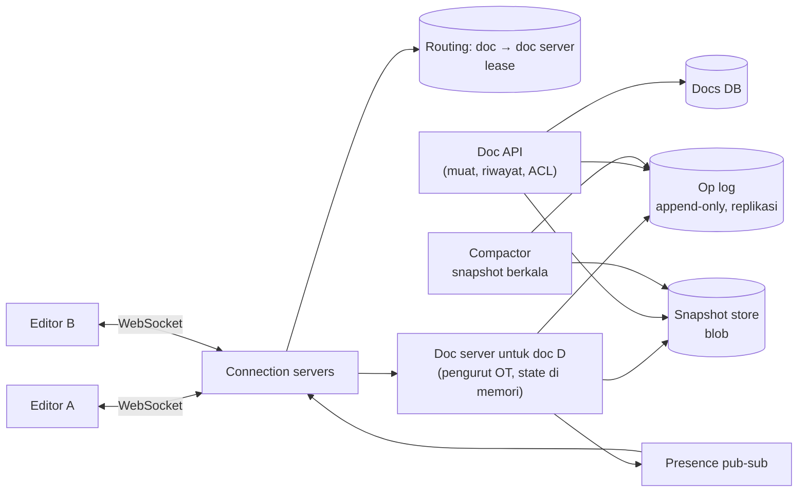
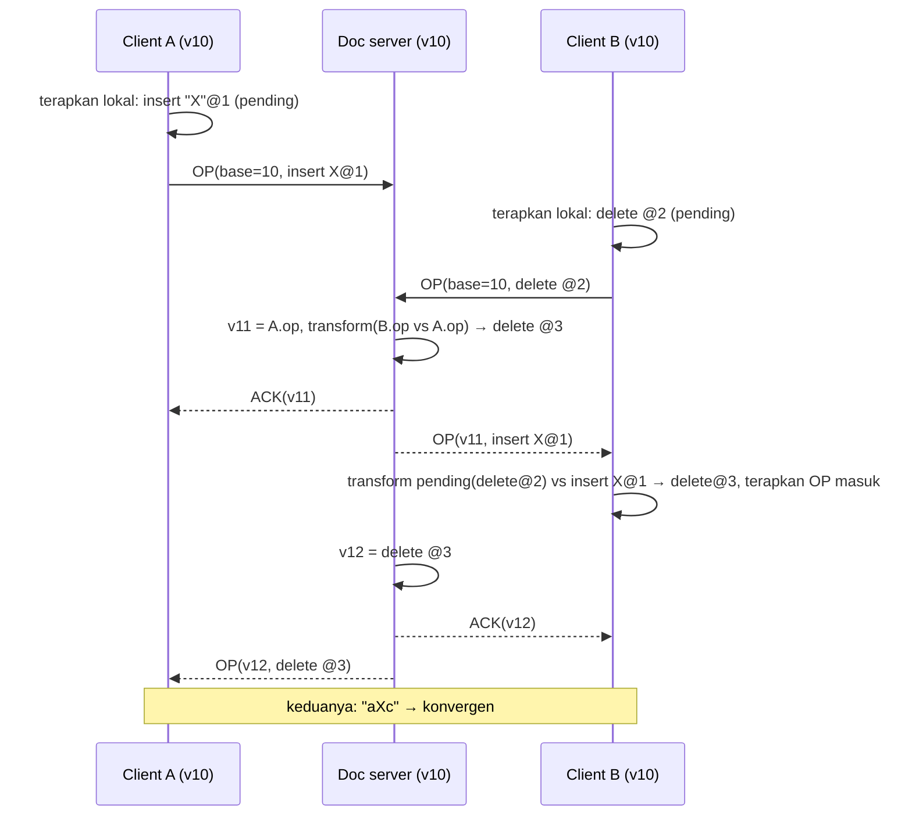

## 1. Requirements

Klarifikasi: teks kaya (format) atau teks polos dulu? Berapa editor bersamaan per dokumen (puluhan vs ribuan)? Offline editing? Riwayat versi dan komentar? Ukuran dokumen maksimum?

### Functional

- Beberapa user mengedit dokumen yang sama secara real-time; setiap orang melihat perubahan orang lain dalam sub-detik; tidak ada editan yang hilang; semua akhirnya melihat dokumen yang sama.
- Presence: kursor dan seleksi orang lain.
- Riwayat versi; kembalikan ke versi lama.
- Izin: pemilik, editor, komentator, pembaca; tautan berbagi.
- Out of scope: komentar (ringkas), teks kaya penuh (disebut), offline berhari-hari (disebut), spreadsheet.

### Non-functional

| NFR               | Target                                                                               | Alasan           |
| ----------------- | ------------------------------------------------------------------------------------ | ---------------- |
| Latency propagasi | &lt; 200 ms antar editor di region sama                                              | Terasa "bersama" |
| Konsistensi       | Konvergen (eventual) untuk isi; urutan total per dokumen; tidak ada editan hilang    | Inti produk      |
| Durability        | Setiap operasi yang di-ack tersimpan                                                 | Dokumen kerja    |
| Availability      | 99.99% baca; 99.9% tulis kolaboratif dengan degradasi ke mode baca                   | —                |
| Skala             | 100 juta dokumen aktif/bulan, 10 juta editor bersamaan; dokumen biasanya 1–20 editor | Kolaborasi tim   |

## 2. Estimasi kapasitas

Asumsi: 10 juta editor bersamaan; tiap editor aktif menghasilkan ~2 operasi/detik saat mengetik (dibatch per 50–100 ms); 1 juta dokumen aktif bersamaan dengan rata-rata 3 editor; dokumen rata-rata 50 KB; operasi ~50 B.

- Operasi masuk: 10M × 2 / (sebagian besar waktu idle, faktor 0.2) ≈ **4 juta op/detik** puncak; tiap op di-ack, disimpan ke log, dan disebarkan ke rata-rata 2 editor lain → 8 juta push/detik.
- Log operasi: 4M × 50 B ≈ 200 MB/s append; per hari ~15 TB mentah; dipadatkan lewat snapshot dan hanya menyimpan log sejak snapshot terakhir + riwayat versi terkompresi.
- Koneksi persisten: 10 juta → ~10–30 server koneksi (seperti kasus WhatsApp).
- Server dokumen: 1 juta dokumen aktif; satu proses ringan per dokumen (state di memori ~ ratusan KB) → ratusan GB memori total, tersebar di ratusan node.
- Storage dokumen: 100M × 50 KB ≈ 5 TB + riwayat.

Keputusan: lapisan koneksi terpisah; server dokumen stateful sebagai pengurut, dipartisi by doc_id dengan lease; log operasi append-only + snapshot berkala; pub-sub untuk presence.

## 3. API design

```text
HTTP
POST /v1/docs                        → { docId }
GET  /v1/docs/{id}                   → { snapshot, version, acl }   (muat awal)
GET  /v1/docs/{id}/history?from=&to= → daftar versi/revisi
POST /v1/docs/{id}/restore { version }
PUT  /v1/docs/{id}/acl { ... }

WebSocket (per dokumen, setelah auth)
→ OP      { clientId, seq, baseVersion, ops: [{ retain: 5 }, { insert: "X" }, { delete: 2 }] }
← ACK     { seq, version }                     operasi diterima, diberi versi
← OP      { version, authorId, ops }           operasi orang lain (sudah ditransformasi ke urutan server)
→/← PRESENCE { userId, cursor, selection }     best-effort
← SNAPSHOT { version, content }                saat client terlalu tertinggal
```

`baseVersion` memberi tahu server operasi ini dibuat pada versi berapa; server mentransformasi terhadap operasi yang masuk setelah versi itu.

## 4. Skema data

```text
docs(id, owner_id, title, current_version, latest_snapshot_version, created_at, updated_at)
doc_ops: (doc_id, version) → {author_id, client_id, seq, ops, ts}      -- append-only, KV/log terpartisi by doc_id
doc_snapshots: (doc_id, version) → content (blob terkompresi)         -- setiap N op atau T menit
doc_versions: (doc_id, version, label, created_by, ts)                  -- titik riwayat bernama
acl(doc_id, principal, role)
presence (memori saja): doc_id → {user_id → cursor, last_seen}
```

Dokumen pada versi v = snapshot terakhir ≤ v + replay `doc_ops` dari snapshot sampai v. Operasi dalam representasi OT (retain/insert/delete dengan atribut format untuk teks kaya) atau CRDT update.

## 5. High-level design



**Muat dokumen**: client HTTP GET → snapshot terbaru + op sejak snapshot (atau server dokumen mengirim keadaan terkini) → client membangun dokumen pada versi v → buka WebSocket ke doc server D (connection server mencari pemilik D di routing; bila belum ada, dipilih dan diberi lease).

**Edit**: client menerapkan operasi lokal segera (optimistic), mengirim OP dengan baseVersion → doc server mentransformasi terhadap op versi &gt; baseVersion, menetapkan versi baru, menulis ke log (durable, replikasi) → ACK ke pengirim, OP ke editor lain → client lain mentransformasi op masuk terhadap op lokal yang belum di-ack lalu menerapkan.

**Presence**: kursor dipublikasikan ke topic dokumen, diteruskan ke editor lain; tidak disimpan.

## 6. Detailed design

### 6.1 Operational Transformation dengan server pengurut



- Client menyimpan **satu** operasi pending gabungan (compose) dan buffer berikutnya; mengirim op berikutnya hanya setelah ACK (pola Wave) menyederhanakan transformasi menjadi terhadap satu arah saja.
- Server mentransformasi op client terhadap semua op sejak `baseVersion` (biasanya 0–beberapa op; ambil dari memori).
- Fungsi transform untuk teks: retain/insert/delete; aturan tie-break deterministik (mis. sisipan di posisi sama diurutkan by versi server/author id) agar semua konvergen.
- Teks kaya: operasi membawa atribut (bold, heading) sebagai bagian dari retain/insert; transform menjaga atribut.

### 6.2 Alternatif: CRDT

Tiap karakter punya ID unik (client id + counter) dan posisi relatif terhadap tetangga (RGA/YATA). Sisip = "karakter baru setelah ID X"; hapus = tombstone. Komutatif: urutan penerapan tidak penting, jadi server hanya penyimpan/penyebar, bukan pengurut; sinkronisasi peer-to-peer dan offline-first alami. Harga: metadata per karakter dan tombstone (dokumen 50 KB bisa menjadi beberapa MB tanpa GC); GC aman hanya saat semua replika telah melihat penghapusan. Pilih OT untuk arsitektur dengan server pusat dan dokumen ramping; CRDT (Yjs-like) untuk offline-first/peer-to-peer.

### 6.3 Server dokumen: kepemilikan dan kegagalan

- Satu dokumen = satu pemilik (doc server) pada satu waktu, dicatat di routing store dengan **lease** (TTL + heartbeat). Partisi doc_id → node via consistent hashing; migrasi saat rebalancing: pemilik lama berhenti menerima, flush, lepas lease; pemilik baru memuat.
- State di memori: versi saat ini, ~100 op terakhir (untuk transform), daftar client. Semua op **ditulis ke log (quorum) sebelum ACK**.
- Kegagalan: lease kedaluwarsa → node lain mengambil, memuat snapshot + replay log; client reconnect membawa `lastVersion` dan op pending (`clientId, seq`) → server mengirim op yang terlewat, menerima ulang pending dengan dedup.
- Dokumen panas (ribuan editor, mis. dokumen publik): batasi editor aktif (lainnya read-only dengan update push), batch op per 100 ms, dan kompresi; satu pengurut tetap cukup karena op per dokumen dibatasi manusia mengetik.

### 6.4 Snapshot, log, dan riwayat

- Compactor membuat snapshot tiap N op (mis. 1.000) atau T menit; log sebelum snapshot dipindahkan ke penyimpanan dingin (riwayat), bukan dihapus.
- Riwayat versi: titik bernama (versi) + kemampuan merekonstruksi versi apa pun dari snapshot terdekat + replay; "restore" = operasi baru yang mengubah isi ke versi lama (riwayat tetap linear).
- Muat awal untuk pembaca: snapshot via CDN/cache untuk dokumen publik populer.

### 6.5 Presence dan kursor

Kursor adalah posisi dalam dokumen; saat op lain masuk, posisi kursor orang lain ditransformasi di client (sama seperti op). Dikirim best-effort dengan throttle (≤ 10/s), via pub-sub per dokumen, tanpa persist; hilang saat disconnect (TTL).

### 6.6 Izin dan keamanan

ACL dicek saat membuka koneksi dan di-cache di doc server; perubahan ACL mempublikasikan event yang memutus sesi yang kehilangan hak. Tautan berbagi = token dengan peran. Semua op mencatat author untuk audit.

### 6.7 Lapisan koneksi

Seperti kasus WhatsApp: connection server stateful ringan; routing dokumen → doc server; reconnect dengan jitter; batching op per 50–100 ms di client untuk mengurangi jumlah pesan.

## 7. Evaluasi terhadap non-functional requirements

| NFR                     | Dipenuhi oleh                                                                             | Risiko tersisa                                                                              |
| ----------------------- | ----------------------------------------------------------------------------------------- | ------------------------------------------------------------------------------------------- |
| Latency &lt; 200 ms     | Optimistic local apply, satu hop ke doc server, push langsung                             | Editor di region jauh dari pemilik dokumen: tempatkan doc server di region mayoritas editor |
| Konvergen, tidak hilang | OT dengan server pengurut, log durable sebelum ACK, dedup clientId+seq, resync by version | Bug fungsi transform = divergensi; uji dengan fuzzing dan properti konvergensi              |
| Durability              | Log quorum + snapshot + riwayat dingin                                                    | Compactor mati: log tumbuh; alert                                                           |
| Availability            | Doc server pengganti via lease (detik), degradasi ke read-only bila log store tulis gagal | Routing store adalah titik kritis: replikasi, cache di connection server                    |
| Skala                   | Partisi by doc_id, connection layer horizontal, op per dokumen dibatasi kecepatan manusia | Dokumen raksasa (MB): paginasi/seksi sebagai dokumen terpisah                               |

Bottleneck 10x: throughput log store (partisi by doc_id, batch) dan jumlah doc server (horizontal). SPOF: tidak ada per dokumen setelah lease; routing store direplikasi.

## 8. Pertanyaan lanjutan interviewer

- "Offline selama satu jam lalu tersambung?" → Client menyimpan op pending; server mentransformasi terhadap ratusan op sejak baseVersion (ambil dari log); konflik besar tetap konvergen meski hasilnya mungkin "aneh"; CRDT lebih alami untuk ini.
- "Komentar yang menempel pada teks?" → Anchor sebagai range yang ikut ditransformasi oleh op (seperti kursor), disimpan sebagai entitas terpisah dengan referensi versi.
- "Spreadsheet?" → Model operasi per sel + dependensi formula; pengurutan sama, tetapi evaluasi ulang formula di server/klien.
- "Bagaimana menguji kebenaran OT?" → Property-based: urutan op acak di n client harus konvergen; pasangan transform memenuhi TP1.
- "Dokumen dengan 10.000 pembaca live?" → Pembaca tidak membuka sesi edit; menerima snapshot + op lewat fan-out pub-sub/CDN push; pengurut tetap satu.
- "Multi-region aktif-aktif?" → OT butuh satu pengurut: pilih region pemilik per dokumen; CRDT memungkinkan penulis di banyak region tanpa pengurut, dengan biaya metadata.
