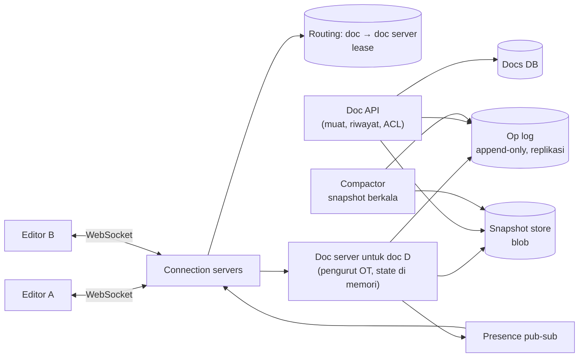
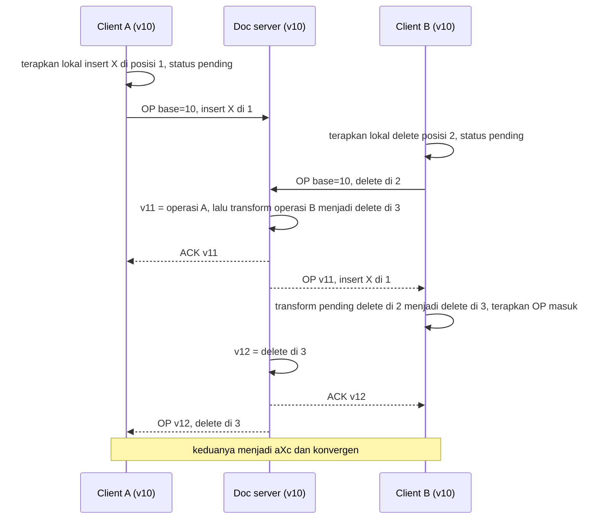

## 1. Requirements

Tanyakan dulu. Teks polos atau teks berformat? Berapa editor bersamaan per dokumen, puluhan atau ribuan? Apakah pengeditan offline didukung? Apakah riwayat versi dan komentar termasuk? Berapa ukuran dokumen maksimum?

### Functional

- Beberapa pengguna mengedit dokumen yang sama secara real-time. Setiap orang melihat perubahan orang lain dalam waktu kurang dari satu detik. Tidak ada editan yang hilang, dan semua akhirnya melihat dokumen yang sama.
- Pengguna melihat kursor dan seleksi orang lain.
- Dokumen punya riwayat versi dan bisa dikembalikan ke versi lama.
- Izin terdiri dari pemilik, editor, pemberi komentar, dan pembaca, ditambah tautan berbagi.
- Di luar cakupan: komentar, teks berformat penuh, offline berhari-hari, dan spreadsheet.

### Non-functional

| Target            | Nilai                                                                                      | Alasan                                     |
| ----------------- | ------------------------------------------------------------------------------------------ | ------------------------------------------ |
| Latency propagasi | Di bawah 200 ms antar editor di region yang sama                                           | Terasa seperti mengetik bersama            |
| Konsistensi       | Semua client konvergen ke isi yang sama, urutan total per dokumen, tidak ada editan hilang | Inti produk                                |
| Durability        | Setiap operasi yang dikonfirmasi tersimpan permanen                                        | Dokumen kerja orang                        |
| Availability      | 99.99% untuk membaca, 99.9% untuk mengedit bersama dengan degradasi ke mode baca           | Pembacaan lebih sering daripada pengeditan |
| Skala             | 100 juta dokumen aktif per bulan, 10 juta editor bersamaan, 1 sampai 20 editor per dokumen | Kolaborasi tim                             |

## 2. Estimasi kapasitas

Asumsi: 10 juta editor bersamaan, dan tiap editor aktif menghasilkan 2 operasi per detik saat mengetik. Operasi dikumpulkan tiap 50 sampai 100 ms. Ada 1 juta dokumen aktif dengan rata-rata 3 editor. Dokumen berukuran 50 KB dan operasi 50 byte.

- Operasi masuk: 10 juta kali 2 operasi, dikalikan faktor aktif 0.2, menghasilkan sekitar 4 juta operasi per detik pada puncak. Tiap operasi dikonfirmasi, disimpan ke log, dan diteruskan ke rata-rata 2 editor lain. Artinya sekitar 8 juta push per detik.
- Log operasi: 4 juta kali 50 byte adalah 200 MB per detik. Sehari sekitar 15 TB mentah. Snapshot berkala memadatkannya, dan hanya log sejak snapshot terakhir yang disimpan panas.
- Koneksi persisten: 10 juta koneksi membutuhkan 10 sampai 30 server koneksi, seperti pada kasus WhatsApp.
- Server dokumen: 1 juta dokumen aktif, masing-masing proses ringan dengan state ratusan KB. Totalnya ratusan GB memori yang tersebar di ratusan node.
- Penyimpanan dokumen: 100 juta kali 50 KB adalah 5 TB, ditambah riwayat.

Keputusannya: lapisan koneksi terpisah, server dokumen yang memegang state sebagai pengurut, dipartisi menurut id dokumen dengan lease, log operasi yang hanya ditambah plus snapshot berkala, dan pub-sub untuk kursor.

## 3. API design

```text
HTTP
POST /v1/docs                        → { docId }
GET  /v1/docs/{id}                   → { snapshot, version, acl }   (muat awal)
GET  /v1/docs/{id}/history?from=&to= → daftar versi/revisi
POST /v1/docs/{id}/restore { version }
PUT  /v1/docs/{id}/acl { ... }

WebSocket (per dokumen, setelah auth)
→ OP      { clientId, seq, baseVersion, ops: [{ retain: 5 }, { insert: "X" }, { delete: 2 }] }
← ACK     { seq, version }                     operasi diterima, diberi versi
← OP      { version, authorId, ops }           operasi orang lain (sudah ditransformasi ke urutan server)
→/← PRESENCE { userId, cursor, selection }     best-effort
← SNAPSHOT { version, content }                saat client terlalu tertinggal
```

Field `baseVersion` memberi tahu server operasi ini dibuat pada versi berapa. Server mentransformasinya terhadap operasi yang masuk setelah versi itu.

## 4. Skema data

```text
docs(id, owner_id, title, current_version, latest_snapshot_version, created_at, updated_at)
doc_ops: (doc_id, version) → {author_id, client_id, seq, ops, ts}      -- append-only, KV/log terpartisi by doc_id
doc_snapshots: (doc_id, version) → content (blob terkompresi)         -- setiap N op atau T menit
doc_versions: (doc_id, version, label, created_by, ts)                  -- titik riwayat bernama
acl(doc_id, principal, role)
presence (memori saja): doc_id → {user_id → cursor, last_seen}
```

Dokumen pada versi tertentu dibangun dari snapshot terakhir sebelum versi itu, ditambah pemutaran ulang operasi sampai versi itu. Operasi memakai bentuk OT, yaitu retain, insert, dan delete, dengan atribut format bila teks berformat.

## 5. High-level design



Alur memuat dokumen:

1. Client meminta dokumen lewat HTTP.
2. API mengembalikan snapshot terbaru beserta operasi sejak snapshot itu.
3. Client membangun dokumen pada versi terakhir.
4. Client membuka WebSocket ke server dokumen. Connection server mencari pemilik dokumen di routing. Bila belum ada, satu server dipilih dan diberi lease, yaitu hak kepemilikan berbatas waktu yang harus diperpanjang.

Alur mengedit:

1. Client menerapkan operasi secara lokal seketika, tanpa menunggu server.
2. Client mengirim operasi beserta versi dasarnya.
3. Server dokumen mentransformasi operasi itu terhadap operasi yang masuk setelah versi dasar.
4. Server dokumen menetapkan versi baru dan menulis operasi ke log secara permanen.
5. Server dokumen mengirim konfirmasi ke pengirim dan operasi ke editor lain.
6. Client lain mentransformasi operasi masuk terhadap operasi lokalnya yang belum dikonfirmasi, lalu menerapkannya.

Alur kursor: posisi kursor dipublikasikan ke topic dokumen dan diteruskan ke editor lain. Kursor tidak disimpan.

## 6. Detailed design

### 6.1 Operational Transformation dengan server pengurut



Client menyimpan satu operasi tertunda hasil gabungan dan menyangga operasi berikutnya. Client mengirim operasi berikutnya hanya setelah konfirmasi diterima. Pola ini, yang dipakai Google Wave, membuat transformasi hanya terhadap satu arah.

Server mentransformasi operasi client terhadap semua operasi sejak versi dasarnya. Biasanya hanya nol sampai beberapa operasi, dan semuanya ada di memori.

Fungsi transform untuk teks menangani retain, insert, dan delete. Aturan pemecah seri harus deterministik, misalnya sisipan di posisi sama diurutkan menurut versi server, agar semua client konvergen. Untuk teks berformat, operasi membawa atribut seperti tebal dan judul, dan transform menjaganya.

### 6.2 Alternatif: CRDT

CRDT adalah struktur data yang hasilnya sama berapa pun urutan operasinya. Setiap karakter diberi id unik dari client dan counter, serta posisi relatif terhadap tetangganya. Sisipan berarti "karakter baru setelah id X". Penghapusan hanya menandai karakter sebagai tombstone, yaitu penanda terhapus yang tetap disimpan.

Karena komutatif, server hanya menyimpan dan menyebarkan, bukan mengurutkan. Sinkronisasi peer-to-peer dan offline-first menjadi alami. Harganya adalah metadata per karakter dan tombstone. Dokumen 50 KB bisa menjadi beberapa MB tanpa pembersihan, dan pembersihan hanya aman setelah semua replika melihat penghapusan.

Pilih OT untuk arsitektur dengan server pusat dan dokumen ramping. Pilih CRDT untuk offline-first atau peer-to-peer.

### 6.3 Server dokumen: kepemilikan dan kegagalan

Satu dokumen dimiliki satu server dokumen pada satu waktu. Kepemilikan dicatat di routing store dengan lease yang diperpanjang lewat heartbeat. Dokumen dipetakan ke node lewat consistent hashing. Saat rebalancing, pemilik lama berhenti menerima, menulis sisa operasi, dan melepas lease. Pemilik baru memuat dokumen.

State di memori berisi versi saat ini, sekitar 100 operasi terakhir untuk transformasi, dan daftar client. Semua operasi ditulis ke log dengan quorum sebelum konfirmasi dikirim.

Pemulihan saat server mati:

1. Lease kedaluwarsa dan node lain mengambil alih.
2. Node baru memuat snapshot dan memutar ulang log.
3. Client tersambung ulang sambil membawa versi terakhir dan operasi tertundanya.
4. Server mengirim operasi yang terlewat, lalu menerima ulang operasi tertunda dengan dedup berdasarkan id client dan nomor urut.

Dokumen panas dengan ribuan editor ditangani dengan membatasi editor aktif. Sisanya hanya membaca dengan pembaruan push. Operasi dikumpulkan tiap 100 ms dan dikompresi. Satu pengurut tetap cukup, karena laju operasi per dokumen dibatasi kecepatan manusia mengetik.

### 6.4 Snapshot, log, dan riwayat

Compactor membuat snapshot tiap 1.000 operasi atau tiap beberapa menit. Log sebelum snapshot dipindahkan ke penyimpanan dingin sebagai riwayat, bukan dihapus.

Riwayat versi berupa titik bernama, dan versi apa pun bisa dibangun dari snapshot terdekat ditambah pemutaran ulang. Mengembalikan versi lama berarti membuat operasi baru yang mengubah isi ke versi itu, sehingga riwayat tetap lurus.

Pembaca dokumen publik yang populer mendapat snapshot dari CDN atau cache.

### 6.5 Kursor

Kursor adalah posisi dalam dokumen. Saat operasi lain masuk, posisi kursor orang lain ditransformasi di client dengan cara yang sama seperti operasi. Kursor dikirim tanpa jaminan, paling banyak 10 kali per detik, lewat pub-sub per dokumen, dan hilang saat koneksi putus.

### 6.6 Izin dan keamanan

Daftar izin diperiksa saat koneksi dibuka dan disimpan di cache server dokumen. Perubahan izin menerbitkan event yang memutus sesi yang kehilangan hak. Tautan berbagi adalah token dengan peran. Setiap operasi mencatat penulisnya untuk audit.

### 6.7 Lapisan koneksi

Seperti kasus WhatsApp: connection server memegang socket tanpa logika bisnis, routing memetakan dokumen ke server dokumen, dan client tersambung ulang dengan jeda acak. Client mengumpulkan operasi tiap 50 sampai 100 ms untuk mengurangi jumlah pesan.

## 7. Evaluasi terhadap non-functional requirements

| Target                     | Cara memenuhi                                                                                    | Risiko yang tersisa                                                                             |
| -------------------------- | ------------------------------------------------------------------------------------------------ | ----------------------------------------------------------------------------------------------- |
| Latency di bawah 200 ms    | Penerapan lokal seketika, satu hop ke server dokumen, push langsung                              | Editor di region jauh dari pemilik dokumen. Tempatkan server dokumen di region mayoritas editor |
| Konvergen dan tidak hilang | OT dengan pengurut, log permanen sebelum konfirmasi, dedup, sinkronisasi ulang berdasarkan versi | Bug fungsi transform menyebabkan divergensi. Uji dengan masukan acak dan sifat konvergensi      |
| Durability                 | Log dengan quorum, snapshot, riwayat dingin                                                      | Compactor mati membuat log membengkak. Pasang alert                                             |
| Availability               | Server pengganti lewat lease dalam detik, degradasi ke mode baca bila log tidak bisa ditulis     | Routing store adalah titik kritis. Replikasi dan cache di connection server                     |
| Skala                      | Partisi menurut id dokumen, lapisan koneksi horizontal, laju operasi dibatasi manusia            | Dokumen berukuran MB dipecah per bagian sebagai dokumen terpisah                                |

Bottleneck pertama saat beban naik 10 kali adalah throughput log store dan jumlah server dokumen. Keduanya horizontal. Tidak ada titik lemah tunggal per dokumen berkat lease, dan routing store direplikasi.

## 8. Pertanyaan lanjutan interviewer

- "Pengguna offline satu jam lalu tersambung?" Client menyimpan operasi tertunda. Server mentransformasinya terhadap ratusan operasi sejak versi dasar. Hasilnya tetap konvergen walau mungkin terasa aneh. CRDT lebih alami untuk kasus ini.
- "Komentar yang menempel pada teks?" Jangkarnya adalah rentang yang ikut ditransformasi seperti kursor, disimpan terpisah dengan referensi versi.
- "Spreadsheet?" Operasi per sel ditambah ketergantungan rumus. Pengurutannya sama, tetapi rumus dihitung ulang di server atau client.
- "Bagaimana menguji kebenaran OT?" Uji berbasis sifat: urutan operasi acak di banyak client harus konvergen, dan pasangan transform memenuhi properti TP1.
- "Dokumen dengan 10.000 pembaca live?" Pembaca tidak membuka sesi edit. Mereka menerima snapshot dan operasi lewat pub-sub atau CDN, dan pengurutnya tetap satu.
- "Beberapa region aktif bersamaan?" OT butuh satu pengurut, jadi pilih region pemilik per dokumen. CRDT memungkinkan penulis di banyak region tanpa pengurut, dengan biaya metadata.
